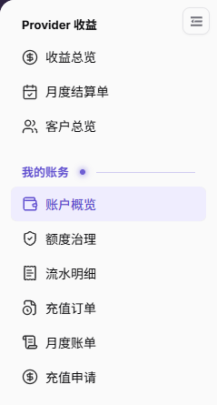
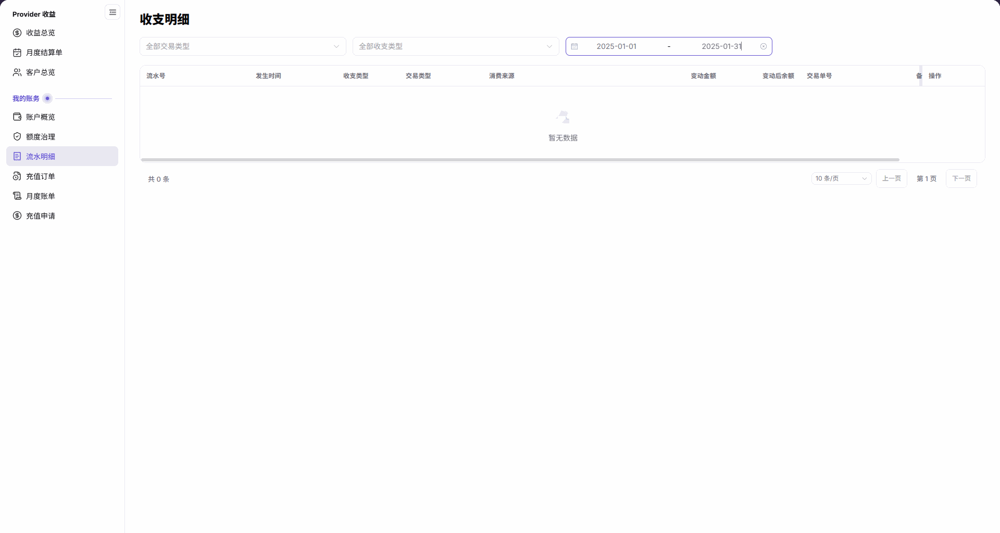
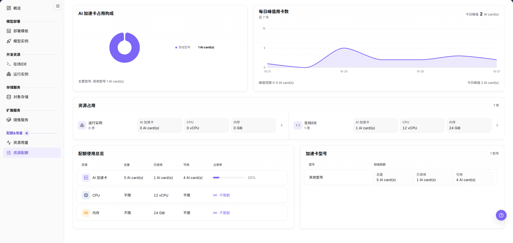
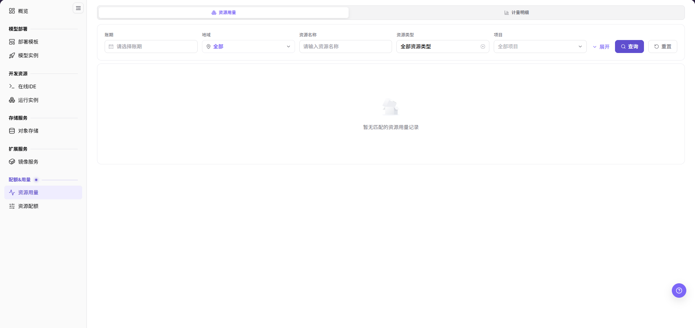

# 充值 & 计费

本场景帮助用户区分账户充值、资源配额、资源用量和模型计费，并按正确入口核对“是否到账、是否可用、消耗多少、为什么扣减”。credits 是平台账户的记账额度单位，资源配额是资源使用上限；文中的 Token 是模型处理文本的计量单位，不是登录令牌。

## 适用角色

- 查看充值、配额、用量和扣费的平台用户
- 查看模型用量和收益的模型提供方
- 核对额度、计量和账期的平台运营方

## 先区分相关概念

| 概念 | 回答的问题 | 参考入口 |
| --- | --- | --- |
| 充值订单 | 账户是否获得了新的可消费额度 | [充值订单](../../../usermanual/billing/user/billing/top-up-orders/) |
| 交易流水 | 余额为什么增加或扣减 | [流水明细](../../../usermanual/billing/user/billing/transactions/) |
| 资源配额 | 当前租户最多可申请多少算力或存储 | [资源配额](../../../usermanual/ai-infra-on-prem/user/quotas-usage/quotas/) |
| 资源用量 | 实例或作业实际用了多少资源 | [资源用量](../../../usermanual/ai-infra-on-prem/user/quotas-usage/usage/) |
| 模型用量与收益 | 模型调用产生多少 Token、次数、时长、消费或收益 | [用量明细](../../../usermanual/model-services/user/usage-earnings/model-usage/)、[模型收益](../../../usermanual/model-services/user/usage-earnings/model-earnings/) |
| 月度账单 | 同一账期的汇总消费是否可以复核 | [月度账单](../../../usermanual/billing/user/billing/monthly-bill/) |

## 场景目标

- 用户能确认充值记录和账户可用额度是否更新。
- 用户能区分“配额不足”和“余额或额度不足”。
- 资源或模型消耗能回溯到实例、作业或调用记录。
- 运营方能用明细和账期汇总解释扣减结果。

## 开始前准备

1. 明确当前核对的是模型调用还是异构卡纳管资源使用。
2. 确认租户、账号、时间范围、账期和计费单位。
3. 准备脱敏后的充值记录、实例、作业或调用标识。

## 操作流程

1. 进入[账户概览](../../../usermanual/billing/user/billing/overview/)，核对最近更新时间，按需点击“刷新本账期”，分别查看余额、本月已支出、本月已充值和预警信息。再查看**充值订单**，按订单号、状态、入账来源及时间范围查询；原币充值金额、到账 credits 和订单状态需要分开阅读，不能仅凭到账列判断已入账。

图示仅展示导航入口；实际账户余额和预警需进入账户概览核对。

需要办理账户额度申请时，使用[充值申请](../../../usermanual/billing/user/billing/top-up-requests/)；这是账户 credits 申请，不是支付订单，也不是设置中的成员额度申请。仅当当前部署开放该菜单时使用，提交不等于审批通过。运营人员可在[充值审批](../../../usermanual/billing/operator/customer-billing/top-up-approvals/)核对客户与申请人、额度、状态及审批信息。

2. 进入[流水明细](../../../usermanual/billing/user/billing/transactions/)，按相同账号和时间范围解释余额增加、扣减或调整。

3. 查看**资源配额**或[额度治理](../../../usermanual/billing/user/billing/quota-governance/)，确认上限和剩余值能够覆盖目标任务。

4. 对异构卡纳管资源，对照实例状态、**资源用量**和运营侧计量明细。

图示为资源用量页签的筛选区和“暂无匹配的资源用量记录”空态，只说明当前查询范围；不能据此证明某个实例或作业的实际消耗已经核对完成。

5. 对模型调用，对照调用日志、模型用量和模型收益。
6. 进入[月度账单](../../../usermanual/billing/user/billing/monthly-bill/)，在同一账期核对币种、计费单位、价格、交易和汇总扣减。

图示为所选历史账期的无统计结果区域，不是零值汇总，也不展示完整消费趋势。

7. 需要运营方协助时，由用户或模型提供方整理租户、账期、对象编号、预期与实际差异及脱敏证据；交给具备相应查看权限的运营人员，按[账期对账与结算](../billing-cycle-reconciliation-settlement/)继续核对。运营人员返回核查结论后，用户再从自己的账户页面复核，不需要进入运营账务页面。

运营方可继续查看：[月度计量](../../../usermanual/ai-infra-on-prem/operator/quotas-metering/monthly-usage/)及其 `计量明细` 页签。

## 完成检查

核对下表；任一项未满足时，先按“常见失败分支”排查。

| 检查项 | 通过标准 |
| --- | --- |
| 1 | 充值订单、交易流水、账户额度和发生时间相互对应。 |
| 2 | 资源配额足以覆盖目标规格，账户额度足以覆盖预计消耗。 |
| 3 | 扣减记录能对应到具体实例、作业或模型调用。 |
| 4 | 计费单位、价格、币种、交易流水和月度账单一致。 |
| 5 | 异常说明包含可复核的时间范围和对象编号。 |

## 常见失败分支

| 现象 | 优先检查 |
| --- | --- |
| 有充值记录但仍不可创建 | 资源配额、规格容量、模板范围和账户额度 |
| 余额充足但模型不能调用 | 模型授权、Personal Key、限流和模型状态 |
| 实例已停止仍有消耗 | 计量结束时间、残留作业和状态同步 |
| 金额与预期不一致 | 计费模式、单位、价格生效时间、币种和账期 |
| 用户与运营方看到的数据不同 | 租户、时间范围、汇总层级和数据同步延迟 |
| Credit 换算结果与预期不一致 | 当前币种设置、运营管理员配置的 Credit 默认兑换倍率、模型计费规则、Token 或资源用量及生效时间 |
