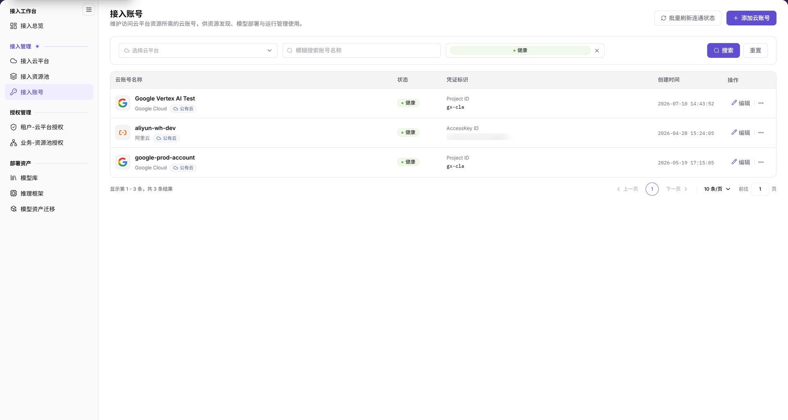

# 接入账号

::: info 文档信息
版本：v2.1
更新日期：2026-11-12
:::

## 功能概述

| 项目 | 内容 |
| --- | --- |
| 适用角色 | 运营管理员 |
| 导航路径 | AI基础设施 > On-Cloud > 接入管理 > 接入账号 |
| 页面路由 | `/infrahub/op/access/account` |
| 管理对象 | 访问云平台资源所需的云账号、凭证标识和连通状态 |

#### 新手理解

接入账号像访问云资源的钥匙登记册：通过表格核对账号、平台、凭证标识和状态，再进入对应维护表单。

#### 术语速查

| 术语 | 说明 |
| --- | --- |
| 云账号 | 用于访问云平台资源的账号。 |
| 凭证标识 | 列表中用于展示凭据类型和标识信息的列，也是新增表单的通用字段名。 |
| 凭证密钥 | 新增表单中的敏感凭据字段。 |
| 状态 | 表格展示的账号连通状态；页面提供批量刷新入口。 |

## 前提条件

1. 当前账号具有运营端接入账号页面的访问权限。
2. 添加账号前确认所属云平台、账号用途、最小权限及授权范围。
3. 通过安全渠道取得凭据；新增、编辑或连通状态刷新前确认变更影响与费用边界。

## 页面说明

当前左侧菜单名称和页内标题均为“接入账号”。

| 区域 | 说明 |
| --- | --- |
| 筛选区 | 云平台、账号名称和状态三个查询条件，配有“搜索”“重置”。 |
| 账号表格 | 列为“云账号名称”“状态”“凭证标识”“创建时间”“操作”；账号名称下显示云平台及类型信息。 |
| 页面操作区 | 提供“批量刷新连通状态”和“添加云账号”。 |
| 行操作区 | 提供“编辑”和更多操作（`...`）。 |
| 新增表单 | “新增云账号”弹窗包含账号名称、选择云平台、凭证标识和凭证密钥。 |

图示为“接入账号”表格：状态筛选当前已选“健康”，列表展示该筛选范围的账号；平台和名称筛选位于上方，右上角提供“批量刷新连通状态”和“添加云账号”，每行有“编辑”入口。

## 主要操作

### 查看云账号

1. 从“接入管理”进入“接入账号”页面。
2. 按需选择云平台、输入账号名称或选择状态，再点击“搜索”；需要重新设置查询条件时使用“重置”。
3. 在目标行核对账号名称、所属平台和类型、状态、凭证标识及创建时间。
4. 需要维护已有账号时，先定位目标行，再使用“编辑”；更多操作入口位于“编辑”右侧，以展开后的实际菜单为准。

### 添加云账号

1. 点击“添加云账号”，打开“新增云账号”弹窗。
2. 填写“账号名称”，在“选择云平台”中指定所属平台。
3. 按所选平台的实际表单要求填写凭据。空白表单使用“凭证标识”“凭证密钥”通用名称，不将所有云平台统一理解为 AK/SK。
4. 核对账号名称、平台和凭据用途；需要提交时点击“确定”。仅查看、不提交时，使用“取消”返回列表。

图示为“新增云账号”空白表单，账号名称、选择云平台、凭证标识、凭证密钥四项均带必填标记；底部按钮为“取消”“确定”。

### 定位连通状态刷新入口

1. 在表格“状态”列查看目标账号当前显示的信息。
2. 页面右上角“批量刷新连通状态”是刷新入口；执行前确认业务授权和影响范围。
3. 不把当前“健康”标签等同于刚执行过连通测试，也不把页面已有状态当作本次刷新结果。

## 参数速查表

| 字段名称 | 是否必填 | 字段类型 | 示例 | 说明 |
| --- | --- | --- | --- | --- |
| 云平台 | 否 | 下拉筛选 | `选择云平台` | 筛选账号所属平台。 |
| 名称 | 否 | 输入框 | `demo-cloud-account` | 按账号名称模糊查询。 |
| 状态 | 否 | 下拉筛选 | `健康` | 与列表“状态”列对应，配图选中了健康状态。 |
| 云账号名称 | — | 表格字段 | `demo-cloud-account` | 名称下展示所属平台及类型。 |
| 状态 | — | 状态标签 | `健康` / `需处理` | 已观察记录中的示例；配图只显示健康筛选，不是全部状态枚举或本次测试结论。 |
| 凭证标识 | — | 表格字段 | `AccessKey ID` / `Project ID` | 显示具体记录的凭据类型和标识，不同类型不能一概视为 AK/SK。 |
| 创建时间 | — | 时间字段 | `YYYY-MM-DD HH:mm:ss` | 账号记录的创建时间，不是更新时间。 |
| 账号名称 | 是 | 输入框 | `demo-cloud-account` | 新增表单中的展示名称。 |
| 选择云平台 | 是 | 下拉选择 | 按实际选项选择 | 选择账号所属云平台。 |
| 凭证标识 | 是 | 输入框 | 示例凭证标识 | 空白表单通用字段，以所选平台的实际要求为准。 |
| 凭证密钥 | 是 | 输入框 | 示例凭证密钥 | 敏感凭据字段，不在文档中填写真实值。 |
| 批量刷新连通状态 | 否 | 操作入口 | `批量刷新连通状态` | 页面顶部入口，操作前核对影响范围。 |
| 编辑 | 否 | 行操作 | `编辑` | 已有账号的维护入口。 |
| 搜索 / 重置 | 否 | 按钮 | `搜索` / `重置` | 查询和重新设置筛选条件的入口。 |
| 取消 / 确定 | 否 | 表单按钮 | `取消` / `确定` | 新增表单退出和提交入口。 |

## 踩坑提示

- “接入账号”是当前菜单与页面名称，新增按钮“添加云账号”打开的是“新增云账号”弹窗。
- 列表“凭证标识”可展示不同凭据类型；空白表单使用通用字段，不应将所有平台都写成 Access Key ID 与 Access Key Secret。
- “创建时间”不是更新时间；“健康”“需处理”仅是已观察账号的状态示例，配图选中了“健康”筛选。

## 结果校验

| 检查项 | 成功表现 | 异常时处理 |
| --- | --- | --- |
| 页面定位 | 左侧“接入账号”高亮，页内标题为“接入账号” | 对照菜单名称和页面路由重新定位。 |
| 表格信息 | 可核对云账号名称、状态、凭证标识、创建时间、操作五列 | 核对当前筛选条件及目标名称，不按旧卡片位置寻找字段。 |
| 新增表单 | 显示“新增云账号”、四项必填字段及“取消”“确定” | 确认打开的是云账号新增表单，不在其他对象上填写凭据。 |
| 退出空白表单 | 点击“取消”后返回表格 | 核对弹窗是否关闭，不将退出当作已保存账号。 |

## 常见问题

#### 应填写 Access Key ID 还是凭证标识？

**问题现象：**

列表凭据类型可见 `AccessKey ID`、`Project ID` 等，而空白新增表单显示“凭证标识”“凭证密钥”。

**可能原因：**

列表展示具体账号的凭据类型，空白表单使用通用字段名称。

**处理方式：**

先选择所属平台，再按实际显示的字段要求填写；不将示例凭据类型当作所有云平台的固定格式。

#### 健康是否表示刚执行过连通刷新？

**问题现象：**

列表已有“健康”标签，页面同时提供“批量刷新连通状态”。

**可能原因：**

状态标签与刷新入口是不同页面元素，标签本身没有说明本次是否执行过刷新。

**处理方式：**

区分当前显示状态与实际执行记录；仅查看列表时不将其描述为完成了连通测试。

## 注意事项

- 凭据只在获授权的操作中通过安全渠道使用；不在文档、工单、截图或聊天中记录真实凭据。
- 新增、编辑及批量刷新前确认最小权限、授权范围、费用边界和变更影响，保留必要的审计记录。
- 不假定凭证字段必然采用某种遮罩方式，不通过截图或反复打开表单查看真实密钥。

## 后续操作

1. 前往[接入资源池](../resource-pools/)核对云平台下的资源池类型及状态。
2. 前往[租户-云平台授权](../../auth-management/tenant-cloud-auth/)或[业务-资源池授权](../../auth-management/business-region-auth/)核对可见范围。
3. 前往[接入总览](../../access-workbench/access-overview/)复核账号、资源池与授权链路；添加账号不等同于已经完成部署。
