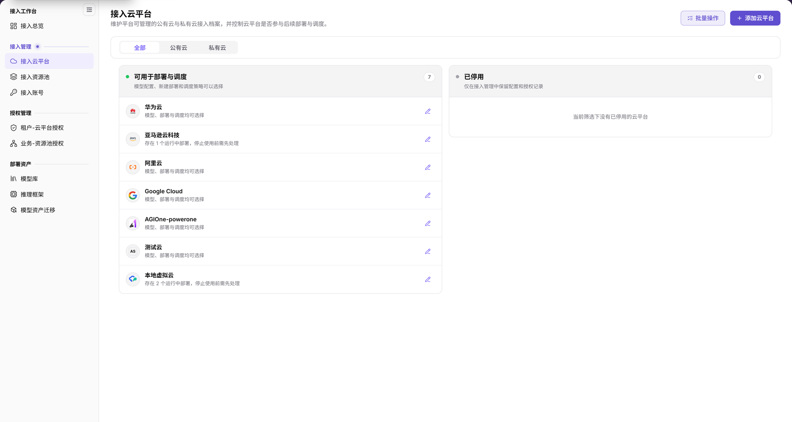

# 接入云平台

::: info 文档信息
版本：v2.2
更新日期：2026-11-12
:::

## 功能概述

| 项目 | 内容 |
| --- | --- |
| 适用角色 | 运营管理员 |
| 导航路径 | AI基础设施 > On-Cloud > 接入管理 > 接入云平台 |
| 页面路由 | `/infrahub/op/access/platform` |
| 管理对象 | 公有云、私有云接入档案及其使用状态和展示配置 |

#### 新手理解

接入云平台像云厂商名册：登记平台，并区分哪些平台可用于部署与调度、哪些平台已停用。

#### 术语速查

| 术语 | 说明 |
| --- | --- |
| 公有云 | 由外部云厂商提供的云平台类型。 |
| 私有云 | 由组织自行维护的云平台类型。 |
| 厂商标识 | 私有云展示配置中的识别字段。 |
| 云平台使用范围 | 添加云平台弹窗中的页签，与“基本信息”分开显示。 |

## 前提条件

1. 当前账号具有接入云平台页面的访问权限。
2. 添加前确认平台类型、归属和用途，先核对现有记录，避免重复登记。
3. 修改平台或使用状态前，核对账号、资源池、授权及现有部署的影响范围。

## 页面说明

| 区域 | 说明 |
| --- | --- |
| 类型筛选 | 提供“全部”“公有云”“私有云”。 |
| 可用于部署与调度 | 显示可选平台及各平台的使用提示。 |
| 已停用 | 停用平台区域；页面说明仅在接入管理中保留配置和授权记录。 |
| 页面操作区 | 提供“批量操作”和“添加云平台”。 |
| 新增弹窗 | 包含“基本信息”“云平台使用范围”页签；基本信息中有“云平台类型”和“选择平台”。 |

图示为“接入云平台”页面：“可用于部署与调度”和“已停用”分别展示平台使用状态，右上角为“批量操作”和“添加云平台”；平台行内提示可用于核对部署影响。

## 主要操作

### 查看云平台

1. 从“接入管理”进入“接入云平台”。
2. 按需切换“全部”“公有云”或“私有云”。
3. 在两个状态分区中定位目标平台，阅读该行使用提示；不要只比较区域数量。
4. 需要维护平台时，先核对目标记录，再使用该行编辑入口；批量处理入口位于页面右上角。

### 添加云平台

1. 点击“添加云平台”，打开同名弹窗。
2. 在“基本信息”中核对“云平台类型”；界面提供“公有云”和“私有云”。
3. 按实际类型分支填写，使用“选择平台”指定目标平台。界面提示内置平台选项仅供业务参考，应选择已有相关账号和资源的平台。
4. 弹窗另有“云平台使用范围”页签，提交前核对实际显示的配置；不要将其当作“基本信息”中的字段。
5. 需要提交时使用底部“添加”；仅查看表单时点击“取消”，不提交配置。

图示为“添加云平台”的“基本信息”页签，包含带必填标记的“云平台类型”“选择平台”，另有“云平台使用范围”页签；底部按钮是“取消”和“添加”，不是“确定”。

### 维护私有云展示信息

1. 定位目标私有云，进入其编辑配置。
2. 核对厂商标识，按变更范围检查多语言显示名称、链接地址和 Logo。
3. 提交前确认目标平台及影响范围；完成维护后回到平台列表核对展示名称，不将关闭弹窗视为保存完成。

图示为私有云编辑配置中的厂商标识、显示名称、语言切换、链接地址与 Logo；这些是平台展示配置，不是云账号凭据字段。

## 参数速查表

| 字段名称 | 是否必填 | 字段类型 | 示例 | 说明 |
| --- | --- | --- | --- | --- |
| 平台类型筛选 | 否 | 分段选择 | `全部` | 按全部、公有云、私有云查看平台。 |
| 可用于部署与调度 | — | 状态分区 | `可用于部署与调度` | 页面列出的可用平台区域。 |
| 已停用 | — | 状态分区 | `已停用` | 页面列出的停用平台区域。 |
| 云平台类型 | 是 | 分段选择 | `公有云` | 新增基本信息中的平台类型。 |
| 选择平台 | 是 | 下拉选择 | 按实际选项选择 | 选择具体云平台。 |
| 云平台使用范围 | 否 | 页签 | `云平台使用范围` | 独立配置页签；内容以实际显示为准。 |
| 厂商标识 | 是 | 展示配置字段 | 示例平台标识 | 私有云编辑配置中的识别信息。 |
| 显示名称 | 是 | 多语言文本 | 示例平台名称 | 私有云平台的语言显示名称。 |
| 链接地址 / Logo | 否 | 展示配置 | 按页面要求填写 | 平台链接与图标。 |
| 批量操作 | 否 | 操作入口 | `批量操作` | 页面顶部入口，先确认目标和影响范围。 |
| 添加 / 取消 | 否 | 按钮 | `添加` / `取消` | 新增弹窗的提交与退出入口。 |

## 踩坑提示

- “公有云”“私有云”是类型筛选，“可用于部署与调度”“已停用”是使用状态分区，两者不是同一分类。
- 新增弹窗底部按钮为“添加”；私有云编辑配置与新增弹窗不是同一表单，不应混用字段和按钮名称。
- 平台行可显示运行中部署的提示，变更使用状态前应逐行阅读，不以平台总数代替影响检查。

## 结果校验

| 检查项 | 成功表现 | 异常时处理 |
| --- | --- | --- |
| 页面定位 | 左侧“接入云平台”高亮，页内标题为“接入云平台” | 对照菜单名称与页面路由重新定位。 |
| 平台范围 | 能核对类型筛选、两个状态分区和目标平台行提示 | 先核对当前类型筛选与目标平台名称。 |
| 新增表单 | 显示“基本信息”“云平台使用范围”，底部为“取消”“添加” | 核对打开的是新增云平台弹窗，不与编辑配置混淆。 |
| 退出空白表单 | 点击“取消”后回到平台页面 | 核对弹窗是否关闭，不把退出视为已添加平台。 |

## 常见问题

#### 公有云与已停用是同一类筛选吗？

**问题现象：**

页面同时出现“公有云”和“已停用”。

**可能原因：**

类型筛选与使用状态分区分别使用上述名称。

**处理方式：**

先选择平台类型，再在两个状态分区中核对目标平台及行内提示。

#### 添加云平台应点击确定还是添加？

**问题现象：**

新增弹窗底部显示“添加”，而编辑配置是另一种表单。

**可能原因：**

当前新增云平台弹窗使用“取消”“添加”作为底部按钮。

**处理方式：**

按实际弹窗按钮操作；只查看时使用“取消”，需要提交时先核对平台与使用范围，再使用“添加”。

## 注意事项

- 批量操作和平台使用状态变更应先核对部署影响，保留必要的审计记录。
- 私有云展示配置不替代账号接入或授权配置，各对象应在对应页面维护。
- 不在文档、工单或聊天中记录真实凭据、内部地址或客户数据。

## 后续操作

1. 前往[接入账号](../cloud-accounts/)查看云账号和凭证配置入口。
2. 前往[接入资源池](../resource-pools/)核对平台下的资源池类型与状态。
3. 前往[租户-云平台授权](../../auth-management/tenant-cloud-auth/)或[业务-资源池授权](../../auth-management/business-region-auth/)核对使用范围。
