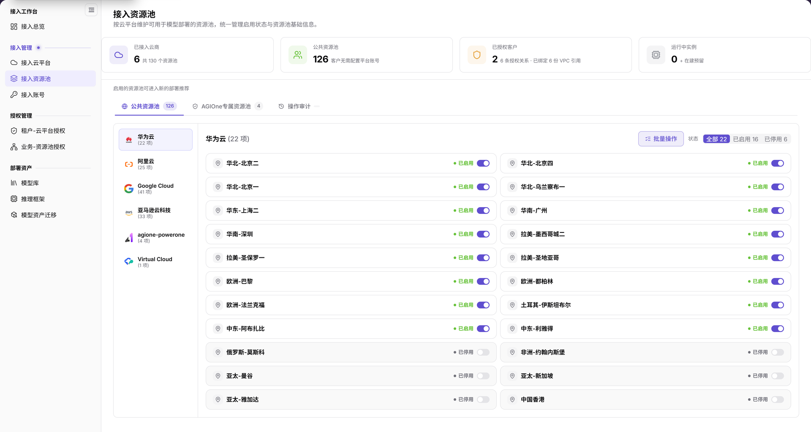
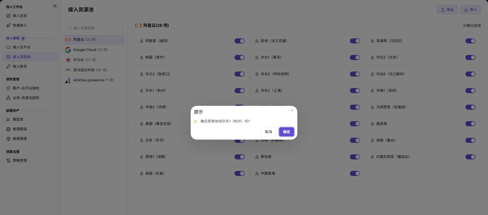

# 接入资源池

::: info 文档信息
版本：v2.1
更新日期：2026-11-12
:::

## 功能概述

| 项目 | 内容 |
| --- | --- |
| 适用角色 | 运营管理员 |
| 导航路径 | AI基础设施 > On-Cloud > 接入管理 > 接入资源池 |
| 页面路由 | `/infrahub/op/access/region` |
| 管理对象 | 云平台下的公共资源池、AGIOne专属资源池及启用状态 |

#### 新手理解

接入资源池像按云平台分类的资源目录：先选择资源池类型和云平台，再核对地域与启用状态。

#### 术语速查

| 术语 | 说明 |
| --- | --- |
| 公共资源池 | 页面中的一种资源池分类，与AGIOne专属资源池分开显示。 |
| AGIOne专属资源池 | 页面中的另一种资源池分类。 |
| 启用状态 | 资源池行显示的“已启用”或“已停用”，旁边有状态开关。 |
| 操作审计 | 资源池类型切换附近的页面入口。 |

## 前提条件

1. 当前账号具有接入资源池页面的访问权限。
2. 已确认目标云平台、资源池类型和目标地域。
3. 状态变更前检查租户授权、业务授权及现有部署的影响范围；仅查询时不要触碰状态开关。

## 页面说明

| 区域 | 说明 |
| --- | --- |
| 概览卡片 | 展示已接入云商、公共资源池、已授权客户和运行中实例等当前统计。 |
| 资源池类型 | 可切换“公共资源池”和“AGIOne专属资源池”。 |
| 操作审计入口 | 位于资源池类型切换附近。 |
| 云平台分组 | 左侧显示云平台及当前条目数，选择后查看该平台的资源池。 |
| 资源池列表 | 显示资源池名称、启用状态和开关。 |
| 状态与批量操作 | 提供“全部”“已启用”“已停用”状态筛选及“批量操作”。 |

图示为“接入资源池”页面：上方可切换“公共资源池”“AGIOne专属资源池”并定位“操作审计”；当前云平台的资源池在右侧按地域展示，带状态筛选、批量操作和逐项开关。

## 主要操作

### 查看资源池

1. 从“接入管理”进入“接入资源池”。
2. 先选择“公共资源池”或“AGIOne专属资源池”。
3. 选择左侧目标云平台，再按需切换“全部”“已启用”或“已停用”。
4. 核对目标资源池名称和状态；数量以当前页面为准，不将示例数量当作固定配置。
5. 需要审查操作记录时，定位“操作审计”入口；需要批量处理时，先核对类型、平台和目标范围，再使用“批量操作”。

### 核对启用或禁用操作

1. 在正确的资源池类型和云平台下定位目标地域，核对当前状态及变更影响。
2. 只有获准变更时才操作目标开关；若出现确认弹窗，逐字核对地域名称和启用或禁用动作。
3. 不执行变更时使用“取消”；需要确认时，以当前弹窗显示的按钮为准。
4. 操作后分别核对本页状态及相关授权、部署页面的目标对象，不以确认弹窗关闭代替结果检查。

图示为禁用地域资源池的确认提示，包含目标地域及“取消”“确定”按钮；确认前应核对提示中的地域与拟执行的禁用动作。

## 参数速查表

| 字段名称 | 是否必填 | 字段类型 | 示例 | 说明 |
| --- | --- | --- | --- | --- |
| 资源池类型 | 否 | 分类切换 | `公共资源池` | 另有“AGIOne专属资源池”，先明确查询范围。 |
| 云平台 | 否 | 分组列表 | 按目标平台选择 | 选择要查看的云平台。 |
| 资源池数量 | — | 统计值 | 当前页面数值 | 随所选平台及范围展示，不是固定数量。 |
| 资源池名称 | — | 列表字段 | 按目标地域核对 | 目标地域资源池的名称。 |
| 状态筛选 | 否 | 分段选择 | `全部` | 提供全部、已启用、已停用。 |
| 启用状态 | — | 状态与开关 | `已启用` / `已停用` | 与目标资源池对应；变更前核对影响。 |
| 操作审计 | 否 | 页面入口 | `操作审计` | 操作审查入口。 |
| 批量操作 | 否 | 操作入口 | `批量操作` | 面向选定范围的批量处理入口。 |
| 确认提示 | — | 弹窗 | 目标地域名称 | 核对地域与动作，不据示例推定所有操作均显示相同弹窗。 |
| 取消 / 确定 | 否 | 确认弹窗按钮 | `取消` / `确定` | 图中禁用提示的退出与确认入口，以实际弹窗为准。 |

## 踩坑提示

- 资源池类型、云平台和启用状态是不同层次的筛选，核对记录时应一起查看。
- 地域条目旁的开关是状态变更入口，不是查看详情入口；只查询时不要切换。
- 平台条目数与状态筛选计数都对应当前页面范围，不应用截图中的数字设定固定验收值。

## 结果校验

| 检查项 | 成功表现 | 异常时处理 |
| --- | --- | --- |
| 页面定位 | 左侧“接入资源池”高亮，页内标题为“接入资源池” | 对照菜单名称和页面路由重新定位。 |
| 类型范围 | 能确认当前选中的是公共资源池还是AGIOne专属资源池 | 先核对类型切换项。 |
| 平台与地域 | 选中的云平台与目标地域一致，资源池行可核对名称和状态 | 检查云平台分组及当前状态筛选。 |
| 操作入口 | 可定位“操作审计”“批量操作”和逐项状态开关 | 区分审查入口与配置变更入口，不用开关代替查询。 |

## 常见问题

#### 为什么当前只显示部分资源池？

**问题现象：**

当前列表展示某一云平台、某一类型或某一状态下的资源池。

**可能原因：**

页面分别提供资源池类型、云平台分组和状态筛选，列表对应当前选择范围。

**处理方式：**

依次核对资源池类型、目标云平台和状态筛选，再按资源池名称定位；不要仅对比截图中的数量。

#### 资源池开关可以用来查看详情吗？

**问题现象：**

资源池名称旁同时显示状态文字和开关。

**可能原因：**

该开关对应启用状态，图中的禁用确认提示标明目标地域和动作。

**处理方式：**

查看时读取名称和状态即可；只有获准变更且完成影响检查后才操作开关，出现确认提示时核对目标地域。

## 注意事项

- 启停和批量变更可能影响真实配置；变更前确认授权、部署影响并保留必要的审计记录。
- 页面展示启用状态不替代租户或业务授权配置，后续使用范围应在对应页面核对。
- 不在文档、工单或聊天记录中写入真实凭据、内部地址或客户数据。

## 后续操作

1. 前往[业务-资源池授权](../../auth-management/business-region-auth/)核对资源池使用范围。
2. 前往[租户-云平台授权](../../auth-management/tenant-cloud-auth/)核对租户的云平台范围。
3. 前往[接入总览](../../access-workbench/access-overview/)复核接入链路中的资源池状态。
