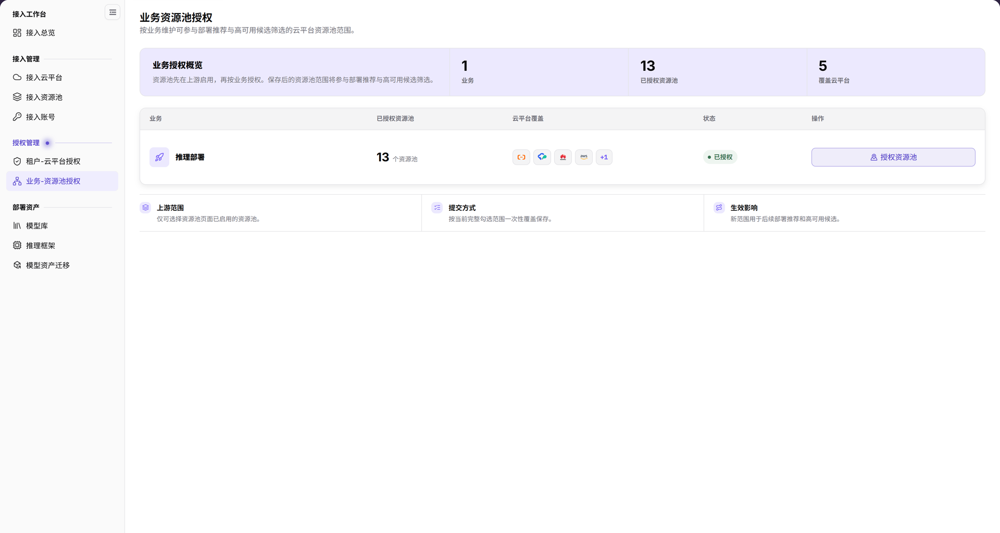
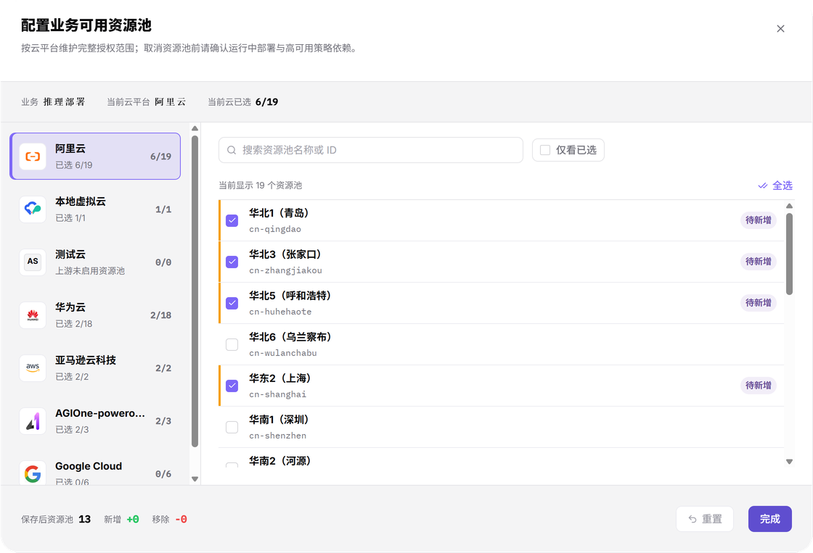

# 业务-资源池授权

::: info 文档信息
版本：v2.1
更新日期：2026-11-12
:::

## 功能概述

| 项目 | 内容 |
| --- | --- |
| 适用角色 | 运营管理员 |
| 导航路径 | AI基础设施 > On-Cloud > 授权管理 > 业务-资源池授权 |
| 页面路由 | `/infrahub/op/auth/region-auth` |
| 管理对象 | 按业务维护的云平台资源池授权范围 |

#### 新手理解

业务-资源池授权像给业务划定资源池候选清单；页面说明该范围用于后续部署推荐与高可用候选筛选，不是给租户分配云平台的同一项配置。

#### 术语速查

| 术语 | 说明 |
| --- | --- |
| 业务 | 需要配置资源池范围的业务，例如推理部署。 |
| 上游范围 | 页面说明仅可选择资源池页面中已启用的资源池。 |
| 当前云已选 | 弹窗中当前云平台的已选资源池数量与可选数量。 |
| 完整授权范围 | 按云平台维护的勾选集合；页面说明按当前完整勾选范围一次性覆盖保存。 |

## 前提条件

1. 当前账号能够访问业务-资源池授权页面。
2. 目标业务已存在，相关云平台和资源池已接入；按页面说明，资源池须先在上游启用，再按业务授权。
3. 取消资源池前，按弹窗提示核对运行中部署与高可用策略依赖，并确认变更范围。

## 页面说明

菜单名称为“业务-资源池授权”，页内标题为“业务资源池授权”。页面说明资源池先在上游启用，再按业务授权；保存后的范围用于后续部署推荐与高可用候选筛选。这里描述的是界面说明，不代表一次授权已经保存或推荐已经更新。

| 区域 | 说明 |
| --- | --- |
| 业务授权概览 | 展示业务、已授权资源池、覆盖云平台的汇总。 |
| 业务列表 | 按业务显示已授权资源池、云平台覆盖、状态及操作。 |
| 授权入口 | “授权资源池”打开“配置业务可用资源池”。 |
| 页面规则 | “上游范围”“提交方式”“生效影响”分别说明可选来源、完整范围覆盖保存及后续用途。 |
| 配置弹窗 | 显示业务、当前云平台、当前云已选，按云切换资源池并核对底部摘要。 |

图示为“业务资源池授权”的概览与业务列表，包含已授权资源池、云平台覆盖、状态和“授权资源池”；下方说明上游启用范围、完整勾选范围覆盖保存及后续推荐用途。

## 主要操作

### 查看业务资源池范围

1. 从“授权管理”进入“业务-资源池授权”。
2. 在业务列表核对目标业务、已授权资源池、云平台覆盖和状态。
3. 阅读页面下方的“上游范围”“提交方式”“生效影响”，将资源池授权与租户云平台授权区分开，不只依据汇总数量判断范围。

### 核对资源池授权配置

1. 点击目标业务的“授权资源池”，打开“配置业务可用资源池”。
2. 核对顶部“业务”“当前云平台”“当前云已选”；在左侧按云平台切换资源池列表。
3. 使用“搜索资源池名称或 ID”定位资源池，按需使用“仅看已选”查看勾选范围；“全选”入口位于资源池列表上方。
4. 需要变更时按批准范围核对勾选项，并检查其他云平台的范围。页面说明提交的是完整勾选集合，不是仅本次新增项。
5. 查看底部“保存后资源池”“新增”“移除”摘要。这些是提交前的范围核对信息，不是保存或下游生效证明。
6. 需要提交时使用“完成”；“重置”是单独的操作入口，不应当作关闭按钮。仅查看时使用右上角关闭按钮退出，不保存配置。

图示为“配置业务可用资源池”弹窗：顶部显示业务、当前云平台和当前云已选，左侧切换云平台，右侧提供资源池搜索、仅看已选、全选及勾选列表；底部为保存后资源池、新增与移除摘要以及“重置”“完成”。

## 参数速查表

| 字段名称 | 是否必填 | 字段类型 | 示例 | 说明 |
| --- | --- | --- | --- | --- |
| 业务 | — | 只读信息 | `推理部署` | 当前配置的业务，不是租户选择器。 |
| 当前云平台 | — | 只读信息 | 以当前选择为准 | 指明右侧资源池列表所属云平台。 |
| 当前云已选 | — | 数量摘要 | 已选数 / 可选数 | 当前云平台的勾选范围，不是全部云平台总数。 |
| 云平台列表 | 否 | 切换入口 | 按实际云平台选择 | 按云维护完整范围，显示各云已选情况。 |
| 搜索资源池名称或 ID | 否 | 搜索框 | 示例资源池名称或 ID | 定位资源池。 |
| 仅看已选 / 全选 | 否 | 筛选 / 选择入口 | `仅看已选` | 复核已选项或进行列表选择，操作前核对当前云平台。 |
| 资源池勾选项 | 按批准范围配置 | 多选 | 以实际资源池为准 | 当前业务的资源池范围，页面说明来源为上游已启用资源池。 |
| 保存后资源池 / 新增 / 移除 | — | 变更摘要 | 以弹窗为准 | 提交前复核完整范围及变化，不代表已保存。 |
| 重置 | 否 | 按钮 | `重置` | 独立操作入口，不是退出配置。 |
| 完成 / 右上角关闭 | 否 | 提交 / 退出入口 | `完成` | 完成用于提交；仅查看时使用右上角关闭。 |

## 踩坑提示

- 当前配置对象是资源池，入口为“授权资源池”，提交按钮为“完成”，不要沿用“授权地域”或“确定”的旧称。
- 页面“提交方式”明确为“按当前完整勾选范围一次性覆盖保存”，不能把未勾选的原有范围默认当作继续保留。
- “当前云已选”只对应当前云平台；底部“保存后资源池”是另一层范围摘要，不应将两者当作同一计数。
- 弹窗提示取消资源池前确认运行中部署与高可用策略依赖；“待新增”标记与摘要不是保存成功提示。

## 结果校验

| 检查项 | 成功表现 | 异常时处理 |
| --- | --- | --- |
| 页面定位 | 左侧为“业务-资源池授权”，页内标题为“业务资源池授权” | 对照菜单和页面路由定位，不因名称中无连字符而误认页面。 |
| 配置对象 | 弹窗标题为“配置业务可用资源池”，顶部业务与目标一致 | 先核对目标业务，不继续提交不明范围。 |
| 范围核对 | 能分别查看当前云已选及底部保存后资源池、新增、移除摘要 | 按云平台逐项复核，不以单个汇总数代替完整集合。 |
| 退出查看 | 使用右上角关闭后回到业务授权页面 | 核对弹窗是否关闭，不把退出或摘要当作保存完成。 |

## 常见问题

#### 云平台显示上游未启用资源池是什么意思？

**问题现象：**

弹窗云平台项显示“上游未启用资源池”。

**可能原因：**

页面“上游范围”说明仅可选择资源池页面已启用的资源池。

**处理方式：**

前往[接入资源池](../../access-management/resource-pools/)核对目标云平台的启用范围，不将该提示解释为租户授权不足或保存失败。

#### 提交时用确定还是完成？

**问题现象：**

“配置业务可用资源池”弹窗底部显示“重置”和“完成”。

**可能原因：**

当前资源池配置使用“完成”作为提交入口，页面说明提交完整勾选范围。

**处理方式：**

按实际按钮操作；提交前复核业务、各云勾选集合与摘要，仅查看时使用右上角关闭。

## 注意事项

- 撤出资源池前核对运行中部署和高可用策略依赖，保留必要审计记录与恢复安排。
- 完整范围覆盖保存与租户授权表单中的追加授权是不同操作，不混用两页的策略或按钮。
- 不在文档、工单或聊天中记录真实凭据、内部地址或客户数据；不以范围说明替代实际部署可用性验证。

## 后续操作

1. 前往[接入资源池](../../access-management/resource-pools/)核对上游启用范围。
2. 前往[租户-云平台授权](../tenant-cloud-auth/)分别核对租户的平台范围。
3. 参阅[接入总览](../../access-workbench/access-overview/)及[快速部署](../../../user/model-services/quick-deployment/)了解后续入口；不把当前配置摘要视为推荐或部署已成功。
