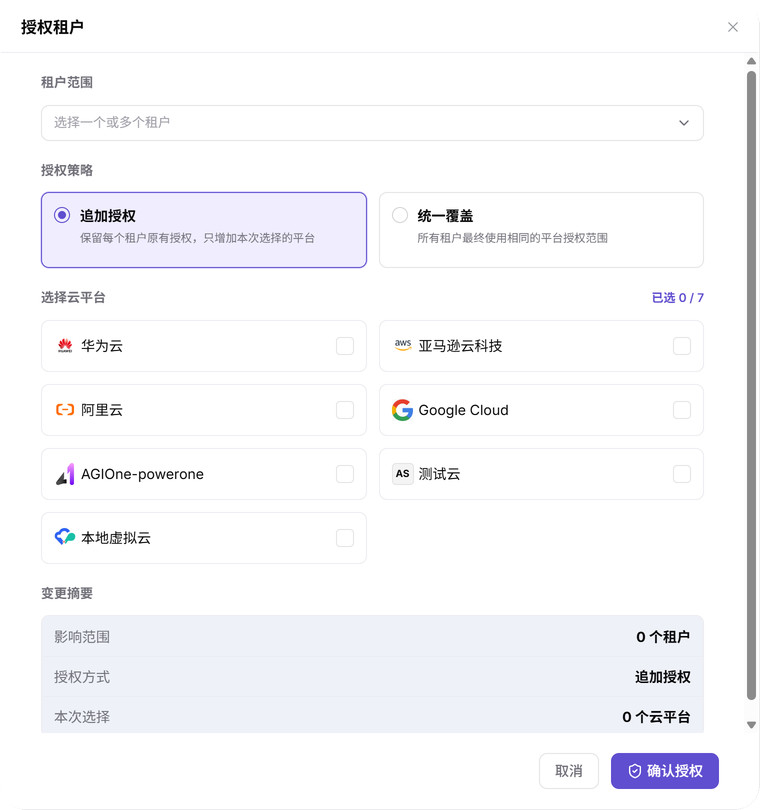
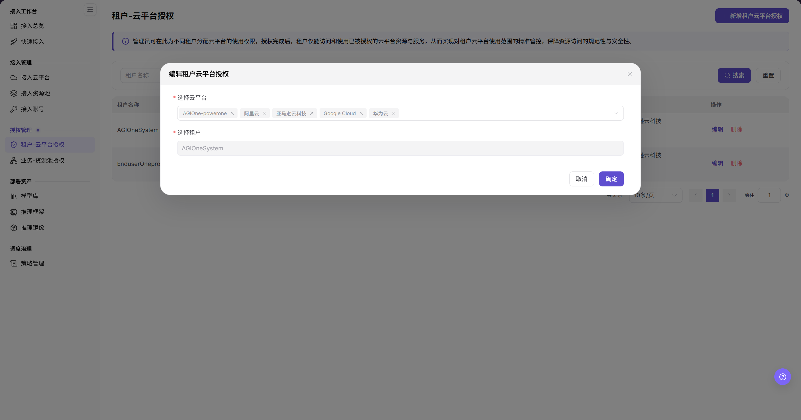
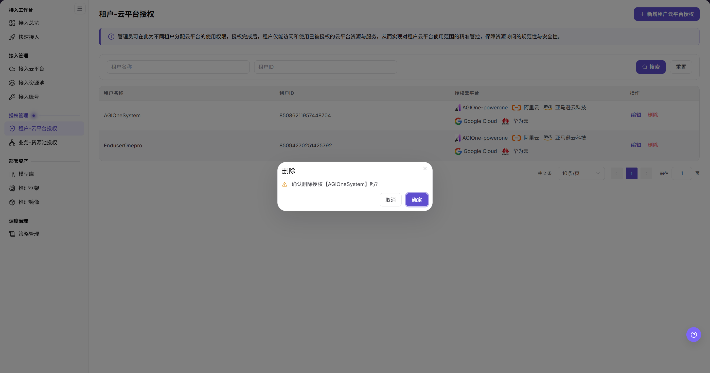

# 租户-云平台授权

::: info 文档信息
版本：v2.1
更新日期：2026-11-12
:::

## 功能概述

| 项目 | 内容 |
| --- | --- |
| 适用角色 | 运营管理员 |
| 导航路径 | AI基础设施 > On-Cloud > 授权管理 > 租户-云平台授权 |
| 页面路由 | `/infrahub/op/auth/platform-auth` |
| 管理对象 | 租户可访问的云平台授权范围 |

#### 新手理解

租户-云平台授权像给租户划定云平台通行范围；批量授权时，先确定哪些租户受影响，再区分追加平台与统一覆盖范围。

#### 术语速查

| 术语 | 说明 |
| --- | --- |
| 租户范围 | 本次授权选择的一个或多个租户。 |
| 追加授权 | 界面说明为“保留每个租户原有授权，只增加本次选择的平台”。 |
| 统一覆盖 | 界面说明为“所有租户最终使用相同的平台授权范围”。 |
| 变更摘要 | 提交前显示影响范围、授权方式和本次选择的区域。 |

## 前提条件

1. 当前账号能够访问租户-云平台授权页面。
2. 目标租户和云平台已存在，本次授权范围已获确认。
3. 变更前核对现有授权、租户部署与业务依赖；收回范围时先确认影响与回收安排。

## 页面说明

| 区域 | 说明 |
| --- | --- |
| 页面标题 | 页内显示“租户-云平台授权”，说明支持向多个租户追加授权或统一覆盖范围。 |
| 租户筛选 | 使用“搜索或选择租户”定位租户。 |
| 授权列表 | 包含选择框及“租户信息”“账号与邮箱”“云平台授权”“操作”列。 |
| 授权入口 | 页面提供“授权租户”；记录行可见“配置授权”“撤销授权”入口。 |
| 授权表单 | 分为租户范围、授权策略、选择云平台和变更摘要。 |

图示为“租户-云平台授权”的标题、租户筛选和表头区域；右上角为“授权租户”，表头区分租户信息、账号与邮箱、云平台授权及操作。

## 主要操作

### 查看现有授权

1. 从“授权管理”进入“租户-云平台授权”。
2. 使用“搜索或选择租户”定位目标租户。
3. 在目标记录核对租户信息和云平台授权范围，再决定是否需要变更；不要只按平台数量判断授权内容。

### 准备租户授权

1. 点击“授权租户”，打开同名表单。
2. 在“租户范围”使用“选择一个或多个租户”指定本次对象。
3. 阅读“授权策略”的说明，按批准范围选择“追加授权”或“统一覆盖”。这两项区分如何处理原有授权，不是单租户与全部租户的二选一。
4. 在“选择云平台”核对本次平台范围。
5. 在“变更摘要”逐项复核“影响范围”“授权方式”“本次选择”。上述策略作用以界面说明为准，不以表单中的选择或摘要代替保存结果。
6. 需要提交时使用“确认授权”；只查看表单时点击“取消”，不提交本次配置。

图示为“授权租户”空白表单：“租户范围”支持选择一个或多个租户，“授权策略”提供追加授权与统一覆盖，底部有变更摘要、“取消”和“确认授权”。

### 核对现有授权的配置入口

1. 在目标租户记录定位“配置授权”，先核对目标租户及现有平台范围。
2. 维护时以实际打开的表单字段和按钮为准；不要把较早版本的编辑字段当作当前批量授权策略。

图示为较早版本的租户授权编辑视图，包含“选择云平台”“选择租户”以及“取消”“确定”；该视图说明租户与平台的关联，不用于解释当前的追加授权或统一覆盖策略。

### 核对撤销授权入口

1. 在目标记录定位“撤销授权”，先确认租户、现有范围和业务依赖。
2. 提交前以当前界面显示的对象和提示为准；不要将旧版“删除”确认视图直接作为当前撤销流程。

图示为较早版本的“删除”确认视图，提示中指明目标租户并提供“取消”“确定”；该图不表示当前“撤销授权”入口具有相同的确认流程或执行结果。

## 参数速查表

| 字段名称 | 是否必填 | 字段类型 | 示例 | 说明 |
| --- | --- | --- | --- | --- |
| 搜索或选择租户 | 否 | 搜索选择器 | 示例租户 | 列表定位入口，不是授权策略。 |
| 租户信息 / 账号与邮箱 | — | 列表信息 | 以目标记录为准 | 区分租户与账号信息，核对目标时结合查看。 |
| 云平台授权 | — | 列表信息 | 以目标记录为准 | 展示记录的云平台范围。 |
| 租户范围 | 提交前选择 | 多选 | 一个或多个租户 | 本次受影响对象，不设“授权所有租户”模式。 |
| 授权策略 | 提交前核对 | 策略选择 | `追加授权` | 提供追加授权与统一覆盖，含各自作用说明。 |
| 选择云平台 | 提交前选择 | 多选 | 按批准范围选择 | 本次选择的平台。 |
| 变更摘要 | — | 只读摘要 | 影响范围 / 授权方式 / 本次选择 | 提交前复核对象、策略及平台范围。 |
| 配置授权 / 撤销授权 | 否 | 行操作入口 | `配置授权` | 维护已有授权的入口，先核对对象。 |
| 取消 / 确认授权 | 否 | 按钮 | `取消` | 授权表单的退出与提交入口。 |

## 踩坑提示

- “租户范围”决定对象，“授权策略”决定处理原有授权的方式；追加授权和统一覆盖不能解释为单个租户与全部租户。
- 界面分别说明追加授权保留原范围、统一覆盖使所选租户使用相同最终范围，选择前应逐项阅读说明。
- “变更摘要”是提交前的核对信息，不是授权已保存或下游已生效的证明。

## 结果校验

| 检查项 | 成功表现 | 异常时处理 |
| --- | --- | --- |
| 页面定位 | 页内标题为“租户-云平台授权”，可见“搜索或选择租户”和“授权租户” | 对照菜单和页面路由重新定位。 |
| 表单定位 | 显示租户范围、授权策略、选择云平台及变更摘要 | 核对是否从“授权租户”打开，不与旧版编辑视图混淆。 |
| 提交前范围 | 可逐项核对影响范围、授权方式和本次选择 | 返回对应选择区复核，未确认范围前不提交。 |
| 退出查看 | 点击“取消”后表单关闭，回到授权页面 | 核对表单是否关闭，不把退出当作保存完成。 |

## 常见问题

#### 追加授权与统一覆盖是在选择租户数量吗？

**问题现象：**

表单同时显示“租户范围”和两种“授权策略”。

**可能原因：**

界面将租户选择与原有授权的处理方式分开：租户范围支持一个或多个租户，策略分别说明追加平台与统一覆盖。

**处理方式：**

先选择目标租户，再阅读策略说明；提交前在变更摘要中分别核对影响范围、授权方式和本次选择。

## 注意事项

- 统一覆盖涉及所选租户的完整平台范围，应在批准范围内操作，避免将当前选择误认为仅追加项。
- 配置或撤销前核对部署和业务依赖，保留必要审计记录与恢复安排。
- 不在文档、工单或聊天中记录真实凭据、内部地址或客户数据。

## 后续操作

1. 前往[业务-资源池授权](../business-region-auth/)核对业务可使用的资源池范围，不把租户云平台授权等同于业务资源池授权。
2. 前往[接入云平台](../../access-management/cloud-platforms/)与[接入资源池](../../access-management/resource-pools/)核对上游对象。
3. 需要检查部署选择入口时，参阅[快速部署](../../../user/model-services/quick-deployment/)；不以本页摘要推定部署或授权结果。
