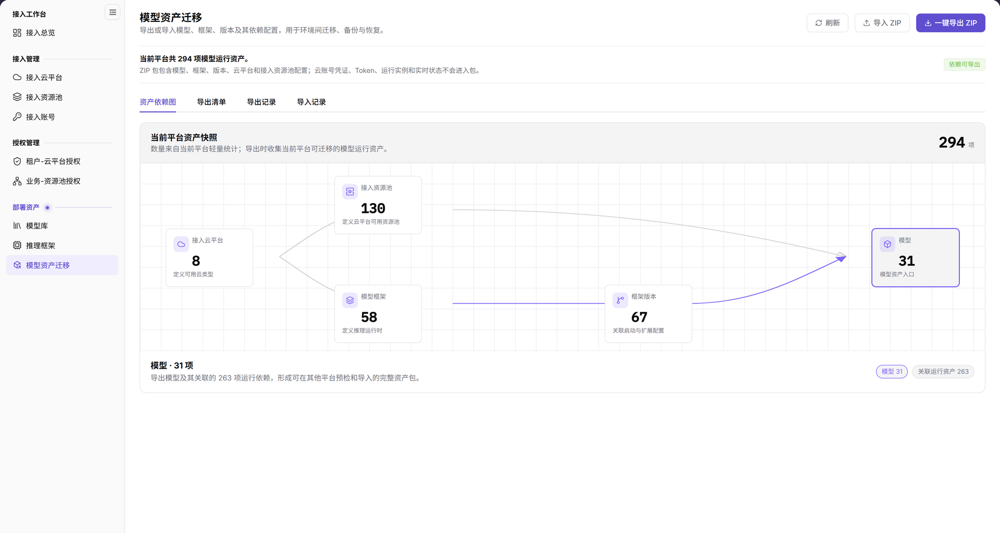
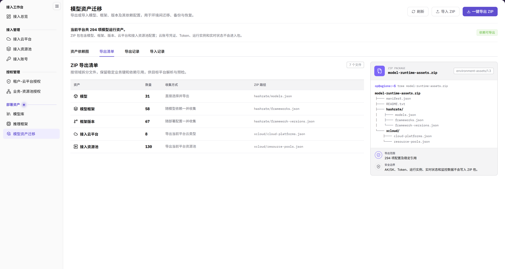
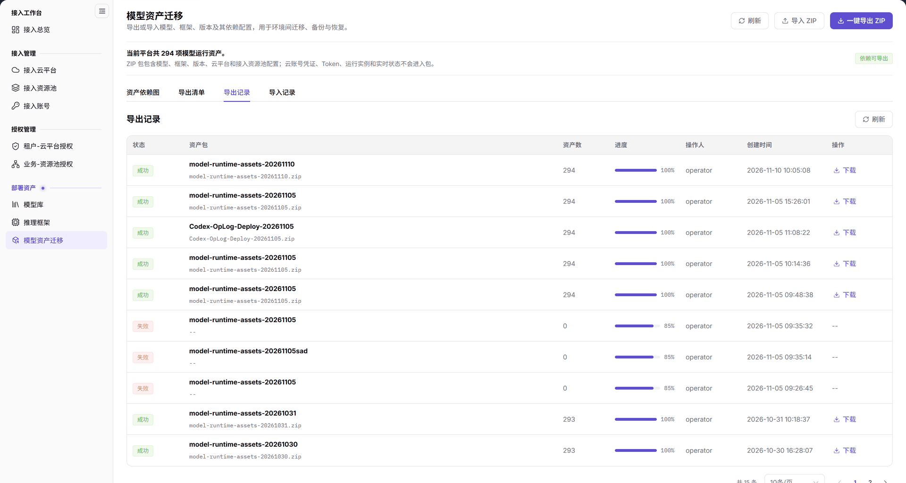
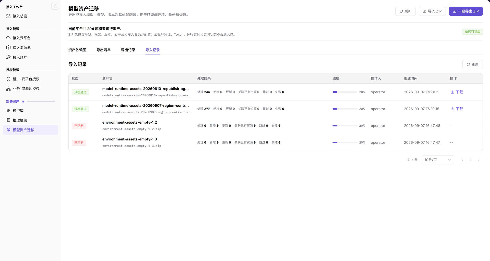

# 模型资产迁移

::: info 文档信息
版本：v2.0
更新日期：2026-11-12
:::

## 功能概述

| 项目 | 内容 |
| --- | --- |
| 适用角色 | 运营管理员 |
| 导航路径 | On-Cloud > 部署资产 > 模型资产迁移 |
| 页面路由 | `/infrahub/op/model/asset-migration` |
| 管理对象 | 模型、框架、版本及其依赖配置 |

页面介绍为：导出或导入模型、框架、版本及其依赖配置，用于环境间迁移、备份与恢复。

本页仅说明只读浏览、页签切换与入口识别，不提供 ZIP 执行流程。

#### 新手理解

模型资产迁移像资产配置的搬运目录，先看快照和依赖，再区分清单与记录。

#### 术语速查

| 术语 | 说明 |
| --- | --- |
| 当前平台资产快照 | 展示平台资产类型的区域。 |
| 资产依赖图 | 资产依赖信息的查看入口。 |
| 导出清单 | 对应“ZIP 导出清单”的页签，不是导出记录。 |
| 导出记录 / 导入记录 | 分别查看两类记录的页签。 |

## 前提条件

1. 使用运营管理员身份，从 On-Cloud 的“部署资产”菜单定位“模型资产迁移”，不以其他角色的可见性代替核对。
2. 明确只读核对对象为模型、框架、版本及其依赖配置，区分浏览与执行 ZIP 操作。
3. 仅浏览时不选择或上传文件，不触发“一键导出 ZIP”。

## 页面说明

| 区域 | 说明 |
| --- | --- |
| 当前平台资产快照 | 展示接入云平台、接入资源池、模型框架、框架版本、模型；数量以当前页面为准。 |
| 资产依赖图 | 资产依赖信息的查看入口。 |
| 导出清单 | 页签为“导出清单”，区域标题为“ZIP 导出清单”；清单展示资产、数量、收集方式和 ZIP 路径，右侧为页面给出的包结构示意。 |
| 导出记录 | 列为“状态”“资产包”“资产数”“进度”“操作人”“创建时间”“操作”。 |
| 导入记录 | 列为“状态”“资产包”“处理结果”“进度”“操作人”“创建时间”“操作”；不要将“处理结果”当作导出记录中的“资产数”。 |
| 页面按钮 | “刷新”“导入 ZIP”“一键导出 ZIP”；入口存在不等于操作完成。 |

界面说明 ZIP 不包含云账号凭证、Token、运行实例和实时状态。这是界面范围说明，不代表实际 ZIP 已经过内容核查，也不是导出包不含敏感信息的安全保证。

## 主要操作

### 浏览平台快照与资产依赖

1. 按“On-Cloud > 部署资产 > 模型资产迁移”进入页面，核对页面名称和路由。
2. 找到“当前平台资产快照”，核对接入云平台、接入资源池、模型框架、框架版本、模型五类资产，不套用固定数量。
3. 切换到“资产依赖图”，阅读当前可见信息，将需核对的资产类型与快照对应，不把依赖展示当作迁移完成。

图示为“资产依赖图”中的“当前平台资产快照”，接入云平台、接入资源池、模型框架、框架版本和模型以节点及连线展示；顶部提供“刷新”“导入 ZIP”和“一键导出 ZIP”入口。

### 查看 ZIP 导出清单

1. 切换到“导出清单”页签。
2. 核对标题“ZIP 导出清单”，按同一行阅读资产、数量、收集方式和 ZIP 路径；将右侧包结构作为页面示意阅读，不据此确认实际包内容。
3. 与需核对的模型、框架、版本及其依赖配置对照；不点击“一键导出 ZIP”，不将清单视为已生成的 ZIP 或成功证明。

图示为“ZIP 导出清单”，左侧按资产列出数量、收集方式和 ZIP 路径，右侧展示页面给出的包结构示意；这些展示不替代实际包内容核查。

### 查看导出记录

1. 切换到“导出记录”，确认页签名称。
2. 在目标记录中依次核对状态、资产包、资产数、进度、操作人、创建时间和操作列，将资产包与创建时间对应后再读取其状态和进度。
3. 识别记录区的“刷新”和部分已有记录的“下载”入口；仅浏览时不点击“下载”。页面中的已有任务状态不代表本次已经执行导出，也不证明实际包内容已核查。

图示为“导出记录”，资产包、资产数、状态、进度、操作人和创建时间分别展示；部分已有记录的操作列提供“下载”，不能据这些历史记录认定本次已完成导出。

### 查看导入记录

1. 切换到“导入记录”，确认页签名称。
2. 在目标记录中依次核对状态、资产包、处理结果、进度、操作人、创建时间和操作列；此页的第三列为“处理结果”，不是导出记录的“资产数”。
3. 将同一行的状态、处理结果和进度一起阅读。仅查看记录，不点击“下载”或“导入 ZIP”，不根据已有记录推断本次导入结果或未观察到的失败原因。

图示为“导入记录”，第三列为“处理结果”，与状态、进度分开显示；查看记录时按同一行核对，不将其混同为导出记录中的“资产数”。

### 识别刷新与 ZIP 操作入口

1. 找到“刷新”“导入 ZIP”“一键导出 ZIP”，按完整名称区分按钮。
2. 仅查看记录时使用“导出记录”或“导入记录”页签，不以 ZIP 按钮代替页签。
3. 停留在入口识别，不点击 ZIP 按钮、不选择文件。“刷新”仅列为已见入口，不据名称推断包校验或迁移结果。

## 参数速查表

“—”表示不是此处要填写的表单字段，不表示导入表单必填规则。

| 字段名称 | 是否必填 | 字段类型 | 示例 | 说明 |
| --- | --- | --- | --- | --- |
| 当前平台资产快照 | — | 区域标题 | `当前平台资产快照` | 核对五类资产，不记录固定数量。 |
| 资产依赖图 | — | 页签 | `资产依赖图` | 查看资产依赖信息。 |
| 导出清单 | — | 页签 | `导出清单` | 对应“ZIP 导出清单”。 |
| ZIP 导出清单 | — | 区域标题 | `ZIP 导出清单` | 不是导出成功提示。 |
| 导出记录 | — | 页签 | `导出记录` | 与导入记录分开查看。 |
| 导入记录 | — | 页签 | `导入记录` | 与导出记录分开查看。 |
| 刷新 | — | 按钮 | `刷新` | 不作为包校验或迁移结果依据。 |
| 导入 ZIP | — | 按钮 | `导入 ZIP` | 只读浏览不点击、不上传。 |
| 一键导出 ZIP | — | 按钮 | `一键导出 ZIP` | 只读浏览不点击、不下载。 |
| 状态、资产包、进度、操作人、创建时间、操作 | — | 记录列 | `创建时间` | 导出和导入记录共有的列，按同一行核对。 |
| 资产数 | — | 导出记录列 | `资产数` | 仅按导出记录中的该列读取，不与导入处理结果混用。 |
| 处理结果 | — | 导入记录列 | `处理结果` | 与同一导入记录的状态和进度一起查看。 |
| 下载 | — | 行操作入口 | `下载` | 部分已有记录可见；只读浏览不点击，不据此保证包可用或内容安全。 |

## 踩坑提示

- “导出清单”对应“ZIP 导出清单”，“导出记录”是另一个页签；查看清单不等于已经导出。
- “导入 ZIP”是按钮，“导入记录”是页签；查看记录不要用导入按钮代替切换页签。
- “当前平台资产快照”展示资产类型，不要把它理解为运行实例或实时状态的迁移结果。

## 结果校验

以下仅校验页面定位与只读浏览，不校验 ZIP 生成、上传、导入、恢复或部署成功。

| 检查项 | 成功表现 | 异常时处理 |
| --- | --- | --- |
| 页面定位 | 名称为“模型资产迁移”，路由为 `/infrahub/op/model/asset-migration` | 对照菜单和路由，记录实际页面名称，不通过 ZIP 按钮尝试定位。 |
| 快照定位 | 可核对“当前平台资产快照”和五类资产名称 | 记录实际差异，不以旧数量补填。 |
| 清单定位 | 页签为“导出清单”，标题为“ZIP 导出清单” | 核对所选页签，不把“导出记录”当作清单。 |
| 导出记录区分 | “导出记录”包含“资产数”列，能按资产包、创建时间核对同一行状态和进度 | 记录实际可见列名，不以导入“处理结果”代替导出“资产数”。 |
| 导入记录区分 | “导入记录”包含“处理结果”列，能与同一行状态和进度对照 | 核对当前页签和列名；不推断未观察到的失败原因或恢复结果。 |
| 入口识别 | 区分“刷新”“导入 ZIP”“一键导出 ZIP” | 记录实际按钮文本，不点击不明确入口验证后续行为。 |

## 常见问题

#### 导出清单和导出记录应看哪一个？

**问题现象：**

页面同时有“导出清单”和“导出记录”两个页签。

**可能原因：**

界面将“ZIP 导出清单”和导出记录分别设置为两个查看入口。

**处理方式：**

核对清单时切换到“导出清单”并核对“ZIP 导出清单”标题；查看记录时切换到“导出记录”。仅看到清单不能确认导出完成。

#### 查看导入记录需要点击“导入 ZIP”吗？

**问题现象：**

页面既有“导入 ZIP”按钮，也有“导入记录”页签。

**可能原因：**

界面分别使用“导入 ZIP”和“导入记录”命名操作入口和记录查看入口。

**处理方式：**

只查看记录时切换到“导入记录”，不要为查看记录点击“导入 ZIP”或上传文件。

## 注意事项

- 页面用途为环境间迁移、备份与恢复；用途说明不等于迁移、备份或恢复已经完成。
- 界面关于 ZIP 排除项的说明不替代实际包内容审查，也不构成导出安全保证。
- 导入导出应作为独立业务操作另行确认；本页不规定文件内部格式、预检、覆盖、重试或回滚规则，不据入口存在保证权限或作用范围。
- 文档、截图及沟通材料中不要写入真实凭据或敏感配置，只读核对无需读取云账号密钥。

## 后续操作

1. 需要对照模型时，从“部署资产 > 模型库”查看对应模型，仍限只读核对。
2. 需要对照框架与版本时，从“部署资产 > 推理框架”查看对应对象，不据快照推断其已在其他环境恢复。
3. 实际导入导出前独立确认操作授权及当前界面具体要求，不将本页浏览步骤直接用作 ZIP 执行流程。
