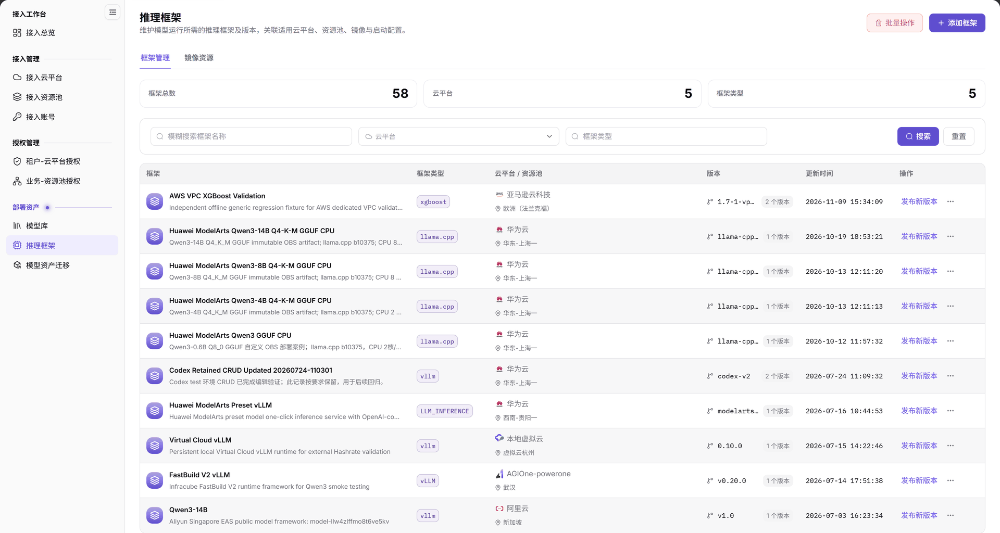
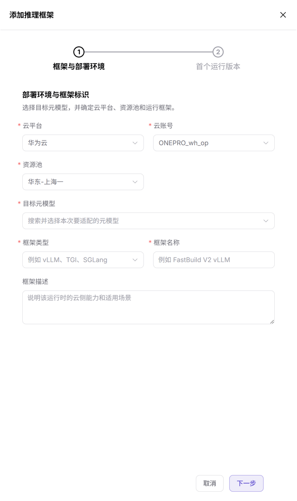
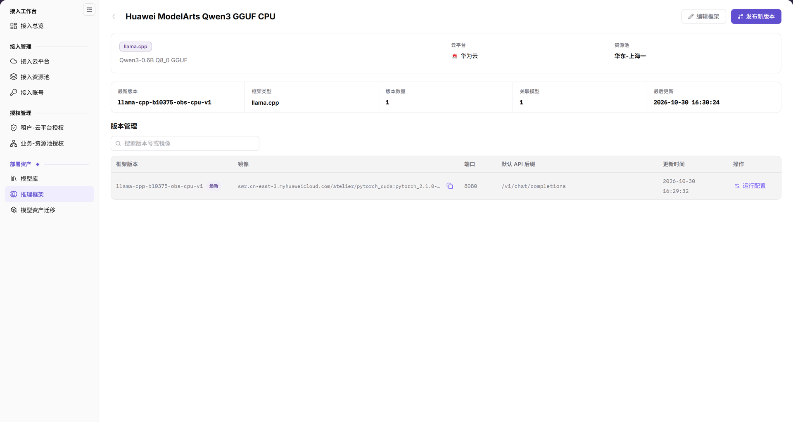
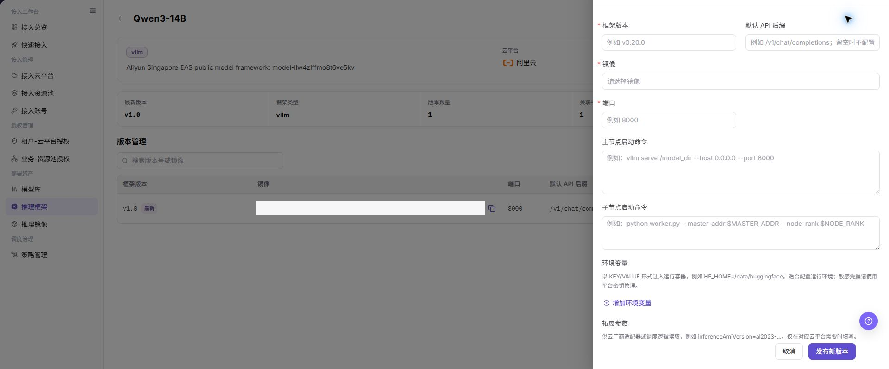

# 推理框架

::: info 文档信息
版本：v2.1
更新日期：2026-11-12
:::

## 功能概述

| 项目 | 内容 |
| --- | --- |
| 适用角色 | 运营管理员 |
| 导航路径 | AI基础设施 > On-Cloud > 部署资产 > 推理框架 |
| 页面路由 | `/infrahub/op/model/framework` |
| 管理对象 | 推理框架、部署环境及框架运行版本配置 |

#### 新手理解

推理框架像模型运行说明书：框架标识和部署环境说明在哪里运行，运行版本说明使用什么镜像及启动配置。

#### 术语速查

| 术语 | 说明 |
| --- | --- |
| 目标元模型 | 新增框架第1步中选择的适配对象。 |
| 框架类型 | 运行框架分类，输入提示包含 vLLM、TGI、SGLang。 |
| 首个运行版本 | 新增抽屉的第2步标题，与第1步“框架与部署环境”分开。 |

## 前提条件

1. 使用具有推理框架页面访问权限的运营管理员账号。
2. 添加前准备目标云平台、云账号、资源池、元模型及框架名称和类型。
3. 维护运行版本前确认镜像、端口和启动要求；发布前核对引用范围和变更影响。

## 页面说明

| 区域 | 说明 |
| --- | --- |
| 页面页签 | 提供“框架管理”“镜像资源”；本页说明框架管理，不将两个页签混为同一列表。 |
| 统计区 | 显示框架总数、云平台和框架类型数量。 |
| 查询区 | 提供框架名称、云平台、框架类型条件及“搜索”“重置”。 |
| 框架列表 | 列为框架、框架类型、云平台 / 资源池、版本、更新时间、操作。 |
| 操作入口 | 顶部有“批量操作”“添加框架”，行内有“发布新版本”和更多操作入口。 |
| 新增抽屉 | 两步标题为“框架与部署环境”“首个运行版本”；初始显示第1步。 |

图示为“框架管理”列表：统计区下方可按名称、云平台和框架类型查询，结果分别展示云平台/资源池与版本；行内“发布新版本”是入口，不是已发布状态。

## 主要操作

### 查询框架

1. 从“部署资产”进入“推理框架”，核对当前为“框架管理”。
2. 按需输入框架名称、选择云平台或输入框架类型，使用“搜索”；需要重新设置条件时使用“重置”。
3. 在目标行核对框架名称、类型、云平台/资源池、版本及更新时间，不以统计总数代替逐条核对。
4. 变更前区分“批量操作”与目标行操作，先确认对象和影响范围。

### 打开添加框架初始配置

1. 点击“添加框架”，打开标题为“添加推理框架”的抽屉。
2. 在第1步“框架与部署环境”核对云平台、云账号、资源池的当前显示值；有显示值不代表已提交配置。
3. 按适配目标检查“目标元模型”“框架类型”“框架名称”，按需填写“框架描述”。框架类型提示包含 vLLM、TGI、SGLang。
4. 底部提供“取消”“下一步”；仅查看初始表单时使用“取消”。第2步标题为“首个运行版本”，不是第1步内已经展开的运行参数区。

图示为“框架与部署环境”初始配置，实际显示云平台、云账号、资源池、目标元模型、框架类型、框架名称、框架描述七项，底部为“取消”“下一步”；第2步只有标题，没有展示运行版本表单。

### 对照既有框架详情

1. 在列表定位目标框架，使用名称入口查看详情。以下保留既有详情界面作为静态字段参考，不保证每条记录当前都能正常打开该视图。
2. 若正常打开的详情提供这些分区，核对云平台、资源池、最新版本、版本数量、关联模型与最后更新，再逐项查看版本管理列表。
3. 若页面提供“运行配置”，以实际打开内容为准核对运行参数；不要把旧详情图当作当前运行成功或健康检查结果。

图示为既有框架详情：上方列出云平台、资源池及版本概要，下方版本管理列出框架版本、镜像、端口、默认 API 后缀、更新时间与“运行配置”入口；这是静态参考，不是新增后的结果。

### 对照既有运行版本配置

1. 当前列表行提供“发布新版本”入口；需要维护版本时先核对目标框架和变更范围。
2. 以下既有版本配置参考展示框架版本、默认 API 后缀、镜像、端口和启动命令等字段，不能将其当作新增抽屉第1步，也不能据此推断已进入当前第2步。
3. 若当前打开的版本表单包含这些字段，按实际标记核对版本、镜像、端口、主/子节点启动命令、环境变量及拓展参数。提交入口以当前表单为准，不将关闭表单或按钮存在视为发布成功。

图示为既有运行版本配置抽屉，包含版本、API 后缀、镜像、端口、启动命令与环境变量等项目，底部有“取消”“发布新版本”；这不是只需确认的提示弹窗，也不展示发布后的结果。

## 参数速查表

第1步字段按当前可见表单列出；运行版本字段仅对照既有版本图，不代表初始页已显示或当前第2步已核对。

| 字段名称 | 是否必填 | 字段类型 | 示例 | 说明 |
| --- | --- | --- | --- | --- |
| 框架名称 / 云平台 / 框架类型查询 | 否 | 文本 / 选择 | 示例框架 / 示例云平台 | 框架管理列表查询项。 |
| 云平台 | 是 | 选择 | 按当前选项 | 第1步部署环境字段。 |
| 云账号 | 是 | 选择 | 示例云账号 | 第1步显示当前云账号，不是密钥输入项。 |
| 资源池 | 是 | 选择 | 示例资源池 | 第1步选择框架部署环境中的资源池，不沿用旧“地域”字段名。 |
| 目标元模型 | 是 | 搜索选择 | 示例元模型 | 第1步指定适配对象。 |
| 框架类型 | 是 | 选择 | `vLLM` | 第1步运行框架类型，提示另含 TGI、SGLang。 |
| 框架名称 | 是 | 文本 | `示例推理框架` | 第1步框架标识。 |
| 框架描述 | 否 | 多行文本 | `示例用途说明` | 第1步用途与场景说明，不替代运行验收。 |
| 取消 / 下一步 | — | 按钮 | `取消` / `下一步` | 第1步底部入口，不是最终“确定”按钮。 |
| 框架版本 | 按当前表单 | 文本 | `v1.0` | 既有运行版本图中的版本字段。 |
| 默认 API 后缀 | 按当前表单 | 文本 | `/v1/chat/completions` | 既有版本配置中的 API 路径后缀。 |
| 镜像 / 端口 | 按当前表单 | 选择 / 输入 | 示例镜像 / `8000` | 既有版本配置的运行镜像与监听端口。 |
| 主节点启动命令 / 子节点启动命令 | 按当前表单 | 多行文本 | 以框架要求为准 | 既有版本配置中的两类启动命令。 |
| 环境变量 / 拓展参数 | 按框架要求 | 键值配置 | `ENV_NAME=value` | 既有版本图中的配置项，不写入真实密钥。 |
| 发布新版本 | — | 操作入口 | `发布新版本` | 当前列表提供入口；既有版本图中也有同名提交按钮，不能混同入口与结果。 |

## 踩坑提示

- 列表的“云平台 / 资源池”与“版本”分列展示，框架名称不替代部署环境或版本信息。
- 新增抽屉第1步只有七个业务字段；“首个运行版本”是第2步标题，不应把镜像、端口和启动命令写成第1步已见字段。
- 第1步底部是“取消”“下一步”，不是旧单页表单描述中的“确定”。
- “发布新版本”入口和旧版本表单只说明可定位的控件，不能作为已发布或模型配置已可选的证明。

## 结果校验

| 检查项 | 成功表现 | 异常时处理 |
| --- | --- | --- |
| 页面定位 | “推理框架”菜单高亮，当前为“框架管理” | 核对菜单及页签，不与“镜像资源”混淆。 |
| 框架定位 | 目标行可核对类型、云平台/资源池、版本和更新时间 | 按当前查询条件和目标名称重新定位。 |
| 新增初始页 | 抽屉显示两步标题，第1步为七字段及“取消”“下一步” | 核对当前激活步骤，不将旧运行版本图当作第1步。 |
| 查看后退出 | 使用“取消”后回到框架列表 | 核对抽屉是否关闭；退出不表示已新增或发布。 |

## 常见问题

#### 为什么添加框架时没有同时显示镜像和端口？

**问题现象：**

初始抽屉显示部署环境和框架标识，没有展示运行版本字段。

**可能原因：**

当前激活的是第1步“框架与部署环境”，“首个运行版本”是另一步的标题。

**处理方式：**

先核对当前七个字段和步骤标题；不要将既有运行版本配置图中的字段当作初始页缺失字段。

#### 添加框架初始页应使用确定还是下一步？

**问题现象：**

抽屉底部显示“取消”“下一步”。

**可能原因：**

当前新增入口采用两步抽屉，初始页不是旧单页提交表单。

**处理方式：**

按当前表单按钮操作；仅查看时使用“取消”，不将“下一步”或关闭抽屉视为保存、发布完成。

## 注意事项

- 发布或修改运行版本前核对模型引用、镜像、启动参数和影响范围，保留必要审计记录。
- 既有详情和版本图仅作静态配置参考，不保证当前详情可达、发布成功、模型可选或服务启动成功。
- 框架描述属于记录内容；示例自填的验证说明不等于平台已完成部署验收。
- 不在文档、工单或聊天中填写真实密钥、内部地址或客户数据。

## 后续操作

1. 前往[模型库](../models/)查看模型档案与框架配置参考，不将框架列表中的版本展示当作模型已部署。
2. 前往[接入资源池](../../access-management/resource-pools/)和[接入账号](../../access-management/cloud-accounts/)核对部署环境对象。
3. 需要用户侧部署时，参阅[快速部署](../../../user/model-services/quick-deployment/)；服务启动与运行结果应在实际部署中另行确认。
