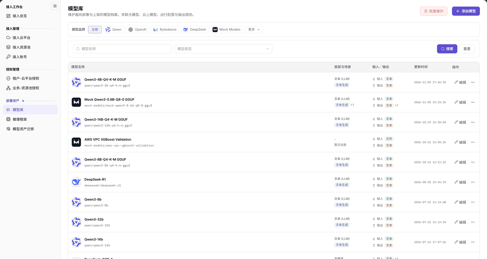
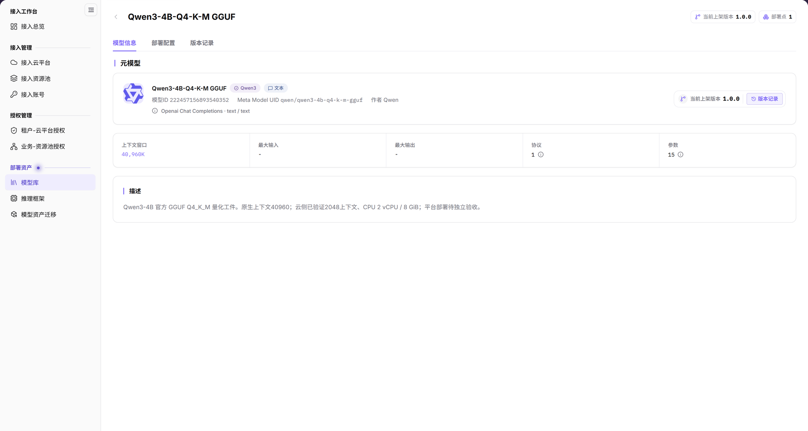
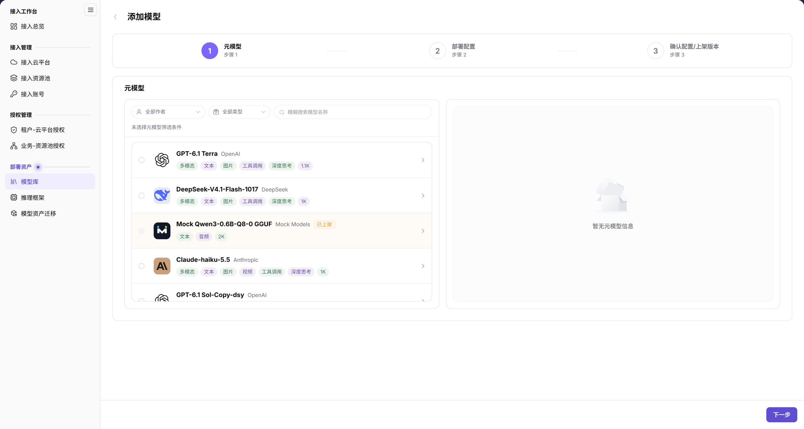
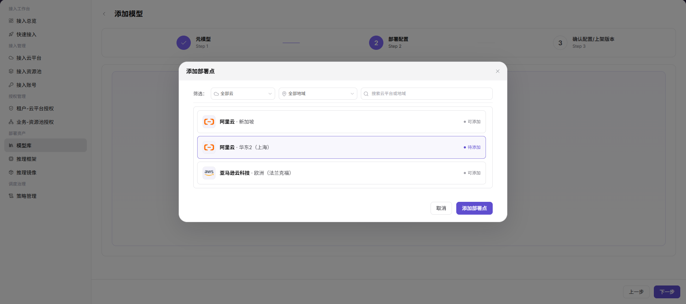
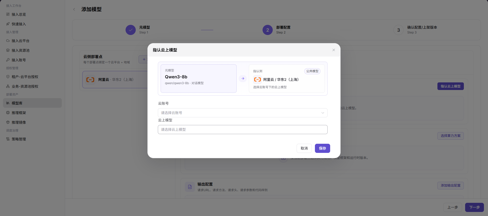
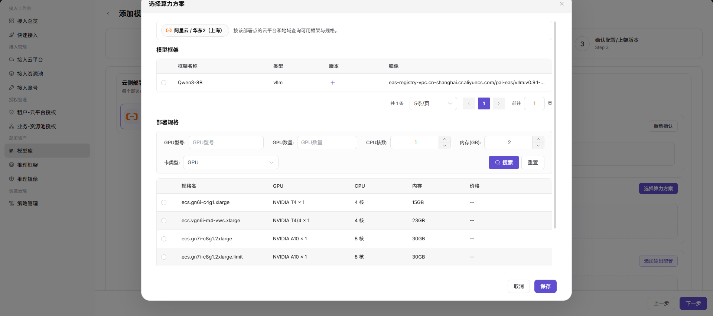
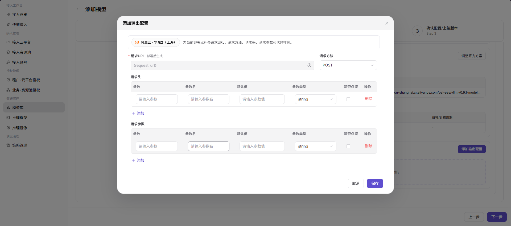
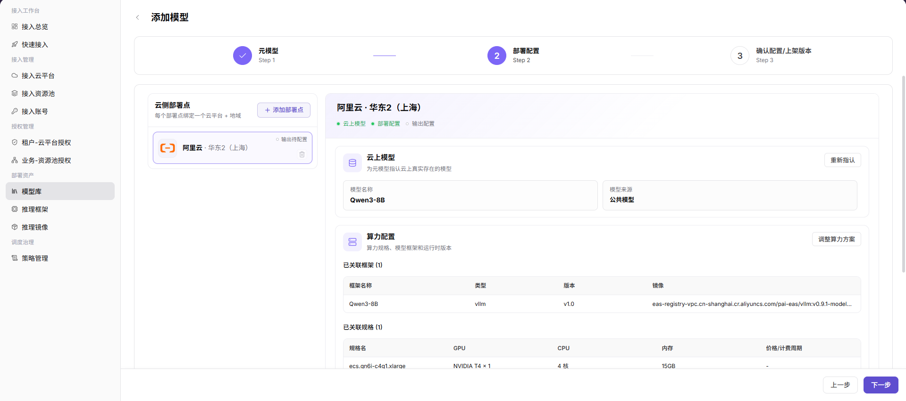

# 模型库

::: info 文档信息
版本：v2.1
更新日期：2026-11-12
:::

## 功能概述

| 项目 | 内容 |
| --- | --- |
| 适用角色 | 运营管理员 |
| 导航路径 | AI基础设施 > On-Cloud > 部署资产 > 模型库 |
| 页面路由 | `/infrahub/op/model/model` |
| 管理对象 | 模型档案、关联元模型、云侧部署点及部署配置 |

#### 新手理解

模型库像部署资产目录：先找到模型档案，再区分模型本身的信息与云侧部署配置。

#### 术语速查

| 术语 | 说明 |
| --- | --- |
| 元模型 | 模型的基础定义，详情中展示作者、能力、协议等信息。 |
| 云侧部署点 | 既有部署配置中关联的云平台与地域组合。 |
| 算力方案 | 既有配置界面中组合模型框架、运行版本与部署规格的配置。 |

## 前提条件

1. 使用具有模型库访问权限的运营管理员账号。
2. 添加前先核对已有模型；准备目标元模型及所需云平台、资源池和推理框架信息。
3. 涉及部署配置变更时，先确认目标地域、资源成本和引用范围。

## 页面说明

| 区域 | 说明 |
| --- | --- |
| 品牌与查询区 | 提供模型品牌、模型名称和模型类型条件，以及“搜索”“重置”。 |
| 列表 | 列为模型名称、类型与场景、输入/输出、更新时间、操作；名称下方可显示模型标识。 |
| 操作入口 | 顶部提供“批量操作”“添加模型”，行内可见“编辑”和更多操作入口。 |
| 模型详情 | 点击模型名称进入独立页面，默认显示“模型信息”，另有“部署配置”“版本记录”。 |
| 添加向导 | 创建路由为 `/infrahub/op/model/model/create`；三个阶段为“元模型”“部署配置”“确认配置/上架版本”。 |

图示为模型库列表：品牌条件位于上方，名称与类型查询位于其下；结果按模型名称、类型与场景、输入/输出和更新时间分列，不是部署点卡片列表。

## 主要操作

### 查询模型

1. 从“部署资产”进入“模型库”。
2. 按需选择模型品牌，输入模型名称或选择模型类型，再使用“搜索”。
3. 逐行核对模型名称、标识、类型与场景及输入/输出；需要重新设置条件时使用“重置”。
4. 修改前确认目标行；不要将顶部“批量操作”与单行“编辑”混用。

### 查看模型信息

1. 在列表定位目标模型，点击模型名称。
2. 在独立详情页的默认“模型信息”页签核对元模型名称、模型 ID、Meta Model UID 和作者。
3. 阅读上下文窗口、最大输入、最大输出、协议、参数与描述；顶部另列当前上架版本和部署点数量。
4. “部署配置”和“版本记录”是另外的页签入口，不要将默认信息视图当作部署配置或服务健康检查结果。

图示为独立模型详情页的“模型信息”页签：元模型卡片、能力概要与描述分区可见，顶部还有“部署配置”“版本记录”；这不是详情抽屉。

### 打开添加模型向导

1. 点击列表右上角“添加模型”，进入创建页。
2. 在“元模型”阶段按作者、类型或模型名称查找目录条目。
3. 核对条目名称和能力标签；初始未选状态右侧显示“暂无元模型信息”。底部提供“下一步”，不应把打开向导视为已经添加模型。
4. 后续阶段由顶部“部署配置”“确认配置/上架版本”标识。以下保留既有配置界面作为字段对照，实际控件与要求以当前页面为准，不据这些示例判断保存或上架结果。

图示为未选择元模型的初始目录：左侧有作者、类型与名称查询，右侧为“暂无元模型信息”，底部为“下一步”；此图没有展示选择后的版本配置。

### 对照既有部署点与云上模型配置

1. 若当前配置提供部署点选择界面，先核对云平台与地域，再确认目标部署点；既有界面提供云平台、地域和关键词筛选。

图示为既有“添加部署点”界面，按云平台、地域筛选并列出可添加或待添加的部署点；此静态参考不表示已在当前向导添加部署点。

2. 若当前页面提供“指认云上模型”，核对元模型与目标部署点，再检查云账号、云上模型两个选择项。不要把按钮存在当作保存结果。

图示为既有“指认云上模型”配置：上方对照元模型与目标云平台/地域，下方为云账号、云上模型，底部有“取消”“保存”；图中不包含保存后的结果。

### 对照既有算力与输出配置

1. 若当前页面提供算力方案选择，核对框架名称、类型、版本和镜像，再对照规格的 GPU、CPU、内存与价格；示例价格不是当前报价。

图示为既有“选择算力方案”界面：模型框架在上，部署规格及 GPU、CPU、内存筛选在下；框架版本与资源规格是不同配置项。

2. 若当前页面提供输出配置，按接口要求核对请求 URL、请求方法、请求头和请求参数；请求头示例不得填写真实密钥。

图示为既有“添加输出配置”界面，包含请求 URL、请求方法及请求头/请求参数表；表内区分参数、参数名、默认值、参数类型与是否必须，不是端口或超时表单。

3. 对照部署配置汇总中的云上模型、已关联框架与规格，并逐项阅读配置状态。只有当前页面实际进入最终确认阶段时，才按实际显示内容复核；下图不能作为最终提交界面依据。

图示为既有第2阶段“部署配置”汇总，展示云上模型、模型来源、已关联框架和规格；第3阶段“确认配置/上架版本”尚未激活，底部仍为“下一步”，不是上架成功结果。

## 参数速查表

以下先列当前列表、详情和初始目录；后续配置字段仅对应上文既有静态参考，必填要求以当前表单标记为准。

| 字段名称 | 是否必填 | 字段类型 | 示例 | 说明 |
| --- | --- | --- | --- | --- |
| 模型品牌 / 模型名称 / 模型类型 | 否 | 查询条件 | `Qwen` | 列表的品牌、名称与类型条件。 |
| 类型与场景 / 输入/输出 | — | 结果列 | `文本生成` / `文本` | 用于区分模型用途和输入输出模态。 |
| 模型 ID / Meta Model UID / 作者 | — | 详情信息 | 示例模型标识 | “模型信息”中的识别信息。 |
| 上下文窗口 / 最大输入 / 最大输出 | — | 详情信息 | 以目标模型为准 | 模型能力概要，不代表部署验收结果。 |
| 作者 / 类型 / 模型名称 | 否 | 目录查询 | `全部作者` | 添加模型初始目录的查询项。 |
| 下一步 | — | 按钮 | `下一步` | 创建页的阶段入口，不是已保存标记。 |
| 云侧部署点 | 按当前表单 | 选择 | 示例云平台与地域 | 既有部署点选择参考中的目标范围。 |
| 云账号 / 云上模型 | 按当前表单 | 选择 | 示例云账号 / 示例模型 | 既有指认云上模型参考中的选择项。 |
| 模型框架 / 类型 / 版本 / 镜像 | 按当前表单 | 表格选择 | `vllm` / `v1.0` | 既有算力方案中的框架信息，不是初始元模型目录字段。 |
| GPU型号 / GPU数量 / CPU核数 / 内存(GB) / 卡类型 | 否 | 规格筛选 | `1` / `4` / `16` / `GPU` | 既有部署规格查询项。 |
| 规格名 / 价格/计费周期 | 按当前表单 | 结果列 | `example.spec` / `--` | 既有规格与费用展示；使用时核对当前报价。 |
| 请求URL / 请求方法 | 按当前表单 | 文本 / 选择 | `{request_url}` / `POST` | 既有输出配置字段；图中请求 URL 提示“部署后生成”。 |
| 请求头 / 请求参数 | 按接口要求 | 参数表 | `Authorization` / `temperature` | 既有输出配置中的两组参数，禁止填写真实凭据作为示例。 |
| 参数类型 / 是否必须 | 按接口要求 | 选择 / 复选框 | `string` | 既有参数表内对每个参数的定义。 |

## 踩坑提示

- 列表中的“类型与场景”和“输入/输出”是不同列，不要将用途标签当作输入输出模态。
- 点击模型名称进入独立详情页，默认“模型信息”；该页签不是部署配置，也没有提供本页可据以确认的健康探针结果。
- 初始元模型目录的未选空态与已经打开的模型详情不同；“暂无元模型信息”不能当作添加成功提示。
- 既有部署配置汇总图仍处于第2阶段，不能据其文件名或顶部第3阶段标题推断已经最终确认。

## 结果校验

| 检查项 | 成功表现 | 异常时处理 |
| --- | --- | --- |
| 列表定位 | “模型库”菜单高亮，列表包含模型名称、类型与场景、输入/输出、更新时间、操作 | 对照当前菜单和查询条件定位目标记录。 |
| 详情定位 | 独立页面显示目标模型名称，“模型信息”默认选中 | 核对目标名称与模型标识，不与创建目录混淆。 |
| 创建入口 | 标题为“添加模型”，显示三阶段和元模型目录 | 核对创建页与当前阶段，不将打开页面视为已录入。 |
| 配置参考范围 | 能区分初始目录、既有第2阶段配置与第3阶段标题 | 以当前激活阶段和实际显示字段为准，不据旧图判断保存或上架成功。 |

## 常见问题

#### 为什么详情打开后不是部署配置？

**问题现象：**

点击模型名称后，页面显示元模型卡片和能力概要。

**可能原因：**

独立详情页默认选中“模型信息”，“部署配置”是另一个页签。

**处理方式：**

先核对目标模型和当前页签；需要查看部署配置时，使用其对应入口，以实际打开内容为准。

#### 添加模型初始页为什么显示暂无元模型信息？

**问题现象：**

左侧有元模型目录，右侧显示“暂无元模型信息”。

**可能原因：**

此初始视图的元模型单选项尚未选中。

**处理方式：**

先在目录核对作者、类型、名称和当前选择状态，不把该空态当作已创建模型的详情或提交结果。

## 注意事项

- 添加、上架或修改配置前，核对目标模型、地域、资源成本与引用范围，保留必要审计记录。
- 本页既有配置示例用于字段对照，不构成当前创建、保存、上架、部署或下游同步成功的保证。
- 模型描述是记录内容，不替代平台部署验收；不得将示例中的自填验证描述作为服务可用结论。
- 文档、工单和聊天中不得记录真实密钥、内部地址或客户数据。

## 后续操作

1. 前往[推理框架](../frameworks/)核对框架类型、部署环境与运行版本信息。
2. 前往[租户-云平台授权](../../auth-management/tenant-cloud-auth/)和[业务-资源池授权](../../auth-management/business-region-auth/)核对使用范围。
3. 需要用户侧部署时，参阅[快速部署](../../../user/model-services/quick-deployment/)；模型出现在本列表不等于已经完成部署。
