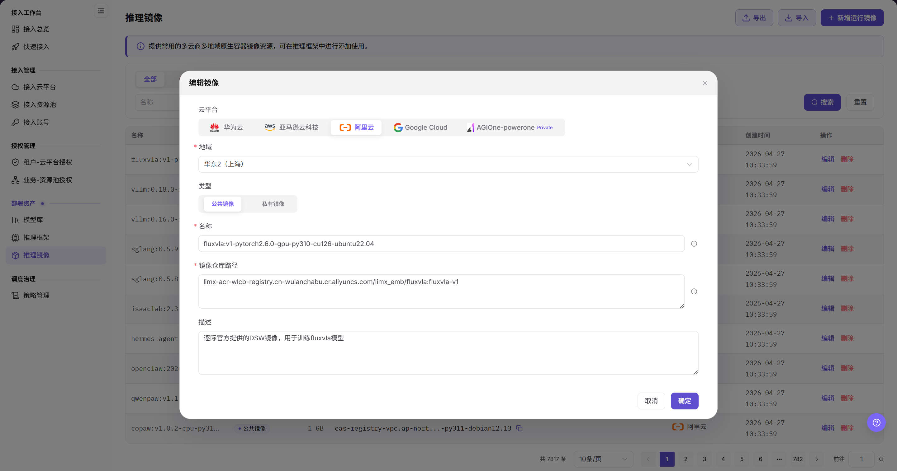

# 推理镜像

::: info 文档信息
版本：v2.1
更新日期：2026-11-12
:::

## 功能概述

| 项目 | 内容 |
| --- | --- |
| 适用角色 | 运营管理员 |
| 导航路径 | AI基础设施 > On-Cloud > 部署资产 > 推理框架 > 页内“镜像资源” |
| 页面路由 | `/infrahub/op/model/image` |
| 管理对象 | 框架相关运行镜像、镜像仓库路径、云平台与资源池范围 |

#### 新手理解

运行镜像像框架使用的运行包；本页从推理框架内的“镜像资源”入口查看和维护这些镜像记录。

#### 术语速查

| 术语 | 说明 |
| --- | --- |
| 镜像资源 | 推理框架页面内的导航入口，对应运行镜像列表，不是独立侧栏项。 |
| 镜像仓库路径 | 镜像仓库中的完整镜像引用，输入提示采用“仓库地址/命名空间/镜像名:标签”格式。 |
| 类型 | 新增表单中的“公共镜像”“私有镜像”选项，与云平台旁的 Private 徽章分开。 |
| 资源池 | 新增表单中位于云平台下方的部署环境选择项。 |

## 前提条件

1. 使用能够访问“部署资产 > 推理框架”的运营管理员账号。
2. 准备新增或维护时，先确认目标镜像名称、仓库路径、云平台、资源池及用途。
3. 涉及既有镜像变更前，核对关联框架版本和使用范围；表单可见不代表镜像已可拉取。

## 页面说明

本手册保留“推理镜像”名称和原有路径。当前系统从侧栏“推理框架”进入，再使用页内“镜像资源”；“框架管理”和“镜像资源”共享页面大标题“推理框架”，镜像资源的浏览器标题为“推理镜像”。不要在当前系统侧栏寻找独立的“推理镜像”菜单。

| 区域 | 说明 |
| --- | --- |
| 页内导航 | “框架管理”“镜像资源”分别对应框架列表与镜像列表。 |
| 查询区 | 提供镜像名称、云平台、可见性条件，以及“搜索”“重置”。 |
| 镜像列表 | 列为镜像资源、云平台 / 资源池、可见性、大小、更新时间、操作。 |
| 操作入口 | 顶部为“新增运行镜像”；当前记录行可见“编辑”“删除”。 |
| 新增表单 | 字段为云平台、资源池、类型、名称、镜像仓库路径、描述；底部为“取消”“确定”。 |

图示为“镜像资源”的页内导航、名称/云平台/可见性筛选及六列表头，上方仍显示“推理框架”；此图只展示该区域，不包含数据行，也不表示空列表。

## 主要操作

### 进入并查询镜像资源

1. 从侧栏“部署资产 > 推理框架”进入框架页面。
2. 点击主内容区的“镜像资源”，等待镜像列表显示“镜像资源、云平台 / 资源池、可见性、大小、更新时间、操作”表头，再读取内容；不要将切换期间仍显示的框架表当作镜像列表。
3. 按需设置镜像名称、云平台或可见性条件，使用“搜索”；需要重新设置条件时使用“重置”。
4. 在目标记录中核对镜像、云平台/资源池、可见性、大小和更新时间，再定位该行操作。

### 打开新增运行镜像初始表单

1. 点击“新增运行镜像”，核对同名表单标题。
2. 查看“云平台”和“资源池”的当前显示值；初始显示值不代表已经完成新增。
3. 在“类型”区域区分“公共镜像”“私有镜像”，不要将云平台名称旁的 Private 徽章当作镜像类型的选择结果。
4. 核对名称、镜像仓库路径和描述的输入提示。名称提示使用“框架:版本-环境”格式，仓库路径提示使用完整镜像引用；不要把架构写成此初始表单中已显示的必填字段。
5. 底部提供“取消”“确定”。仅查看初始表单时使用“取消”；需要提交配置时，先复核当前表单要求和目标对象，不将按钮存在或表单关闭视为保存成功。

图示为“新增运行镜像”初始表单，资源池、名称和镜像仓库路径带必填标记，类型提供公共镜像/私有镜像，描述在下方，底部为“取消”“确定”；图中没有架构输入项。

### 对照既有镜像维护表单

1. 当前镜像记录行提供“编辑”入口；需要维护时先核对目标镜像及关联框架的影响范围。
2. 以下既有“编辑镜像”表单作为静态字段参考，展示云平台、地域、类型、名称、镜像仓库路径和描述；其中“地域”不是当前新增表单的字段名“资源池”。
3. 若当前打开的编辑表单包含这些项目，按实际字段核对仓库路径和用途说明，提交要求以当前表单为准；不要把参考图当作当前编辑界面、已保存或已完成镜像拉取的结果。

图示为既有“编辑镜像”表单，包含云平台、地域、公共/私有类型、名称、镜像仓库路径与描述；背景中的独立“推理镜像”菜单属于该参考界面，不是当前入口说明。

### 定位删除入口

1. 在镜像资源列表确认目标行，区分“编辑”和“删除”。
2. 删除属于变更操作，执行前核对关联框架和使用范围；此处只说明行内入口，不预设确认弹窗、删除条件或完成结果。

## 参数速查表

新增字段以当前初始表单为准；地域仅作既有维护表单参考，不替代当前的资源池字段。

| 字段名称 | 是否必填 | 字段类型 | 示例 | 说明 |
| --- | --- | --- | --- | --- |
| 镜像名称 / 云平台 / 可见性查询 | 否 | 文本 / 选择 | 示例镜像 / 示例云平台 | 镜像资源列表的查询条件。 |
| 云平台 | 按当前表单 | 选择 | 按当前选项 | 新增表单上方的云平台选择区，平台类型徽章不等于镜像类型。 |
| 资源池 | 是 | 选择 | 示例资源池 | 当前新增表单带必填标记，使用“资源池”而非旧“地域”名称。 |
| 类型 | 按当前表单 | 分段选择 | `公共镜像` | 可见选项为公共镜像、私有镜像。 |
| 名称 | 是 | 文本 | `framework:v1.0-runtime` | 当前新增表单带必填标记；输入提示建议体现框架、版本和环境。 |
| 镜像仓库路径 | 是 | 多行文本 | `<BASE_URL>/namespace/image:tag` | 当前新增表单带必填标记，要求完整镜像仓库路径；文档使用占位地址。 |
| 描述 | 否 | 多行文本 | `示例运行镜像说明` | 输入提示为简述镜像核心库及适用模型类型。 |
| 镜像资源 / 云平台 / 资源池 | — | 列表信息 | 以目标记录为准 | 用于核对镜像及其环境范围，不以名称代替环境信息。 |
| 可见性 / 大小 / 更新时间 | — | 列表信息 | 以目标记录为准 | 当前列表分列展示的信息，不沿用旧“创建时间”列名。 |
| 地域 | 按当前编辑表单 | 选择 | 以实际显示为准 | 仅见于既有维护表单参考，不列为当前新增字段。 |
| 搜索 / 重置 | — | 按钮 | `搜索` / `重置` | 列表查询入口。 |
| 编辑 / 删除 | — | 行内入口 | `编辑` / `删除` | 当前可见操作入口，不代表已执行或已完成。 |
| 取消 / 确定 | — | 按钮 | `取消` / `确定` | 当前新增表单底部入口；提交结果需另行核对。 |

## 踩坑提示

- “镜像资源”是“推理框架”内的入口，不是独立侧栏菜单；页面大标题“推理框架”不代表当前仍在框架管理列表。
- 当前列表表头为“更新时间”，不是旧列表的“创建时间”；新增表单为“资源池”，不是旧维护图的“地域”。
- 云平台旁的 Private 徽章与表单“类型”中的“私有镜像”位于不同区域，不能相互替代。
- 本页的入口与查询区图片不含数据行，不能据此判断当前列表没有镜像记录。

## 结果校验

| 检查项 | 成功表现 | 异常时处理 |
| --- | --- | --- |
| 入口定位 | 从“推理框架”主内容区进入“镜像资源” | 核对页内入口，不寻找独立侧栏项。 |
| 列表定位 | 表头为镜像资源、云平台 / 资源池、可见性、大小、更新时间、操作 | 等待切换完成后核对表头，不读取仍显示的框架表。 |
| 新增初始表单 | 标题“新增运行镜像”，显示六项字段及“取消”“确定” | 核对实际表单，区分资源池与旧参考中的地域。 |
| 类型定位 | 公共镜像/私有镜像位于“类型”区域 | 不用云平台旁的 Private 徽章代替此选项。 |

## 常见问题

#### 为什么侧栏没有独立的推理镜像入口？

**问题现象：**

当前侧栏提供“推理框架”，镜像列表的浏览器标题为“推理镜像”。

**可能原因：**

当前“镜像资源”位于推理框架主内容区，与“框架管理”并列。

**处理方式：**

从“部署资产 > 推理框架”进入，再点击页内“镜像资源”，以镜像列表表头确认当前位置。

#### 云平台旁的 Private 是否就是私有镜像类型？

**问题现象：**

新增表单的云平台区域有 Private 徽章，“类型”区域另有公共镜像/私有镜像。

**可能原因：**

云平台类型标识与镜像类型选项分属不同区域。

**处理方式：**

在“类型”区域核对镜像选项，不以平台徽章判断镜像类型。

## 注意事项

- 既有维护图仅作静态字段参考，不保证当前编辑表单完全相同，也不证明保存、同步或框架可用。
- 新增、编辑和删除前核对目标对象与使用范围；列表记录和配置按钮不代表镜像仓库连通、镜像可拉取或服务可启动。
- 不在文档、工单或聊天中写入真实凭据、内部地址或客户数据。

## 后续操作

1. 返回[推理框架](../frameworks/)查看框架管理与运行版本配置参考。
2. 前往[接入资源池](../../access-management/resource-pools/)核对环境对象，前往[模型库](../models/)查看模型与框架配置参考。
3. 需要用户侧部署时参阅[快速部署](../../../user/model-services/quick-deployment/)；镜像拉取、服务启动和健康检查结果应在实际部署中另行确认。
