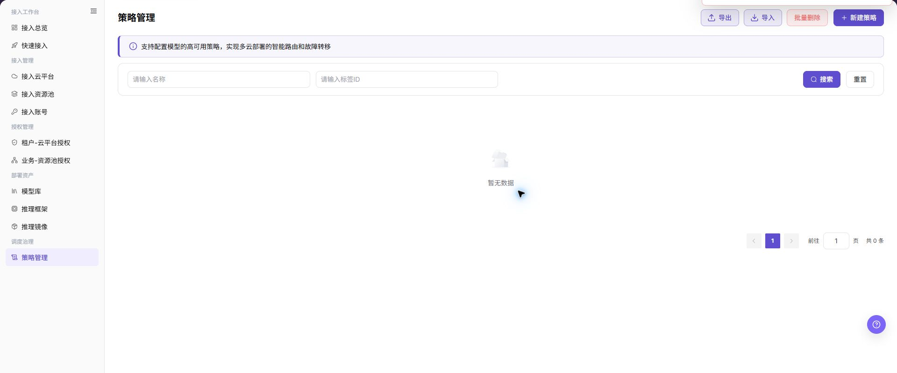
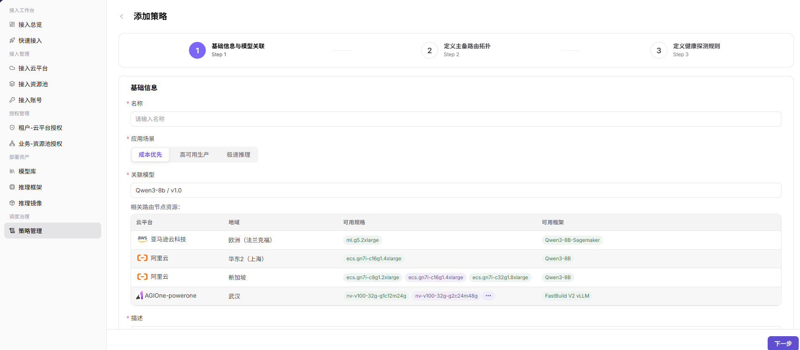
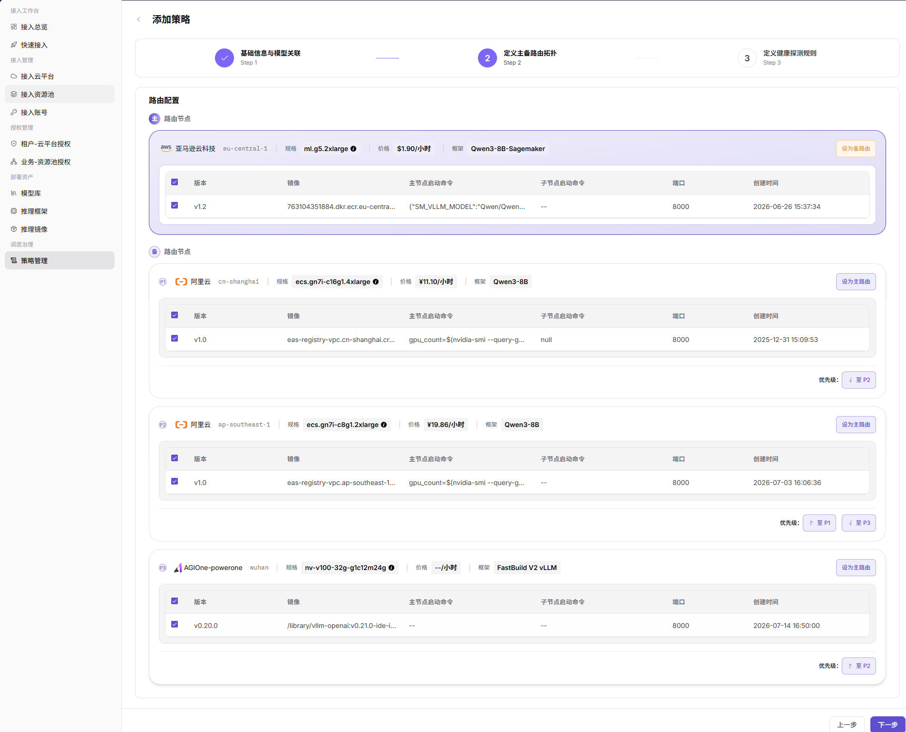
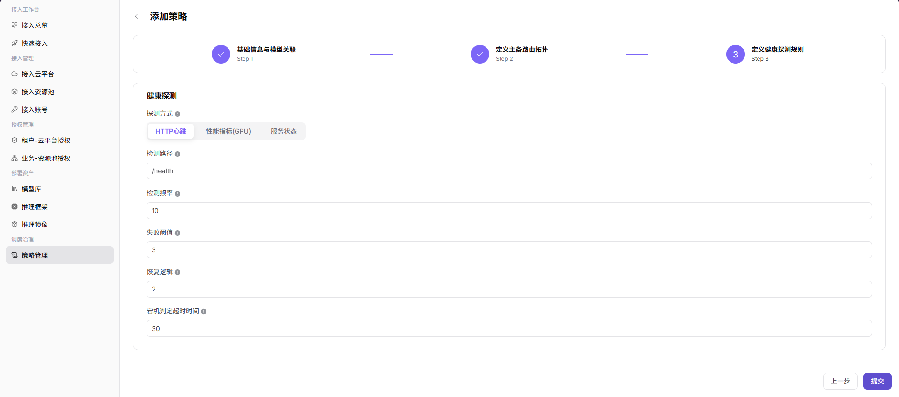

# 策略管理

::: info 文档信息
版本：v2.1
更新日期：2026-11-12
:::

## 功能概述

本文限定于 2026-11-12 Demo 环境（`https://demo.agione.pro/`）的运营管理员视图：`/infrahub/op/schedule/policy` 显示 `开发中，敬请期待!`，侧栏未显示策略入口。下文的策略流程和图片仅作历史参考，不是当前可执行的配置指引；该状态不代表其他版本或部署不支持策略管理，也不能证明后台调度能力。

| 项目 | 内容 |
| --- | --- |
| 适用角色 | 运营管理员 |
| 导航路径 | 历史路径：AI基础设施 > On-Cloud > 调度治理 > 策略管理；当前侧栏未显示该入口。 |
| 页面路由 | `/infrahub/op/schedule/policy` |
| 管理对象 | 当前入口的占位提示；历史说明涉及应用场景、关联模型、主备路由和健康探测规则。 |

#### 新手理解

历史策略说明将策略比作模型部署的交通规则，涉及模型、主备部署点与健康探测。这些概念不表示占位页已经提供相应配置能力。

#### 术语速查

下列术语用于阅读历史策略说明，不是当前可填写的字段。

| 术语 | 说明 |
| --- | --- |
| 应用场景 | 成本优先、高可用生产或极速推理等调度目标。 |
| 主备路由 | 模型请求在主要和备用部署点之间的拓扑。 |
| 健康探测 | 用于判断部署点是否可继续接收请求的检测规则。 |

#### 推荐操作顺序

先阅读页面提示，确认这里只显示开发中占位内容；需要离开时，可选择 `返回主页`。不要按历史图片创建、提交或修改策略。

#### 小白先看

| 场景 | 先做 | 不要直接做 |
| --- | --- | --- |
| 第一次进入页面 | 阅读开发中提示 | 将占位页当成策略列表 |
| 需要配置策略 | 区分历史说明与当前界面 | 按旧向导填写或提交配置 |
| 看到返回入口 | 核对 `返回主页` 的链接目标 | 将导航视为策略保存成功 |
| 页面状态与预期不同 | 记录路由、语言和页面提示 | 据占位提示推断后端故障或反复提交 |

## 前提条件

1. 使用已获授权的运营管理员会话查看该路由。
2. 阅读历史流程前，先确认当前入口只显示占位提示，不把旧图中的模型、部署点或框架当成当前表单。
3. 不执行策略新建、保存、导入、删除、探测或切流；其他环境如提供这些功能，应先评估路由、容量、费用和故障切换影响。

## 页面说明

入口显示 `开发中，敬请期待!`，说明文字为 `页面开发中，请刷新页面，或者点击下面的按钮返回主页.`，并提供指向 `/` 的 `返回主页` 链接。主区未显示策略列表、添加入口、配置向导、保存或健康探测控件。

历史页面截图：

图示为历史策略页面参考，包含名称与标签 ID 筛选、新建策略入口、“暂无数据”和“共 0 条”；未展示策略卡片或拓扑，不代表本页现有功能。

## 主要操作

### 历史创建流程参考

以下三幅配置图保留用于理解历史流程，不是可执行步骤；当前页面没有对应向导或提交入口。

### 历史画面一：基础信息与模型关联

历史说明将策略名称、应用场景、目标模型与版本、描述放在基础信息阶段，并描述了关联模型后的节点列表。不能据此在当前页面寻找这些输入项或自动联动结果。

图示为历史“基础信息与模型关联”参考，涉及策略名称、应用场景、目标模型与云平台节点；不是当前新增表单。

### 历史画面二：主备路由拓扑

历史说明涉及主备节点、优先级、云厂商、规格、费用参考和框架版本。此处不提供节点选择或自动降级的操作指引，也不以旧图证明路由行为。

图示为历史“主备路由拓扑”参考，涉及节点优先级与降级链路；不是当前路由配置入口。

### 历史画面三：健康探测规则

历史说明涉及探测周期、超时、健康与不健康阈值、接口路径及响应状态码。占位页不提供这些配置，不据此判断异常节点剔除、恢复或切流已经执行。

图示为历史“健康探测规则”参考，涉及探测周期、超时和故障切换阈值；不是当前探测表单。

### 查看当前入口

1. 打开上方页面路由。
2. 核对开发中提示及说明文字，不按历史图查找策略列表或向导。
3. 如需离开，选择目标为 `/` 的 `返回主页`；不要把返回导航当成策略保存或路由验证结果。

## 参数速查表

页面没有可填写的策略参数，以下只列实际占位内容与导航入口。历史字段的必填性、校验和保存规则不适用于此占位页。

| 字段名称 | 是否必填 | 字段类型 | 示例 | 说明 |
| --- | --- | --- | --- | --- |
| 页面提示 | 不适用 | 只读文本 | `开发中，敬请期待!` | 页面显示的开发中状态，不是策略执行结果。 |
| 说明文字 | 不适用 | 只读文本 | `页面开发中，请刷新页面，或者点击下面的按钮返回主页.` | 页面提供的说明；不能据此保证刷新后出现策略表单。 |
| 返回主页 | 不适用 | 导航链接 | `返回主页` | 链接目标为 `/`，不能据此判断策略保存结果。 |

## 踩坑提示

- 不要按历史图片输入策略参数或寻找添加、保存、导入、删除入口。
- 没有策略侧栏入口或列表，不足以诊断账号权限、上游模型或后台调度故障。
- 返回主页是导航入口，不是策略创建、保存或切流成功的信号。
- 示例凭据只使用 `<API_KEY>`、`<PERSONAL_KEY>`、`<ACCESS_KEY_ID>`、`<ACCESS_KEY_SECRET>`、`<BASE_URL>` 和 `<ENDPOINT_PATH>`。

## 结果校验

| 检查项 | 成功表现 | 异常时处理 |
| --- | --- | --- |
| 页面提示 | 显示 `开发中，敬请期待!` 及开发中说明 | 若实际界面不同，先核对环境、角色和版本 |
| 侧栏状态 | 未见策略管理入口 | 以实际可见菜单为准，不把历史路径当作当前入口 |
| 配置区域 | 未显示策略列表、三步向导、保存或探测控件 | 不用旧图替代实际表单，先确认功能是否提供 |
| 返回链接 | `返回主页` 指向 `/` | 核对目标链接，不以返回导航判断策略保存结果 |

## 常见问题

#### 为什么看不到策略列表

**问题现象：**

页面显示 `开发中，敬请期待!`，没有策略列表。

**可能原因：**

页面呈现的是开发中占位内容；仅凭该提示无法判断后台实现或故障原因。

**处理方式：**

阅读提示并确认当前入口状态，不清除不存在的列表筛选，也不据此修改模型或授权。

#### 为什么没有添加或提交按钮

**问题现象：**

找不到历史说明中的添加策略、下一步或提交入口。

**可能原因：**

当前主区没有策略表单或三步向导，旧图不能证明这些按钮目前可用。

**处理方式：**

不要依据旧图尝试创建或保存；先确认所用环境实际提供的功能。

#### 能否直接按旧三步图片配置

**问题现象：**

文档保留配置图片，但页面没有对应控件。

**可能原因：**

图片属于历史参考，与本页占位状态不同。

**处理方式：**

仅用图片理解旧流程，不据此选择节点、设置探测或提交策略。

#### 占位提示是否代表所有环境都不支持策略

**问题现象：**

希望据此判断其他版本、部署或后台的策略能力。

**可能原因：**

占位提示只说明所述入口的可见状态，不能证明其他环境或后台功能。

**处理方式：**

分别核对目标环境的实际菜单、字段与可信功能说明，不将本页状态推广到所有部署。

#### 返回主页是否代表已保存策略

**问题现象：**

页面有 `返回主页`，但没有策略保存控件。

**可能原因：**

该入口是指向 `/` 的导航链接，不是保存结果提示。

**处理方式：**

如需离开可使用该链接，不将其作为保存、同步或故障切换已完成的依据。

## 注意事项

- 占位页不能证明策略持久化、路由、自动降级或健康探测已执行。
- 文档、截图、工单和聊天记录中不得写入真实账号、凭据、内部地址或客户数据。
- 在其他已提供的功能中执行授权、部署、删除、发布、启停或计费变更前，仍应评估影响、保留可审计记录并准备恢复方案。

## 后续操作

1. 如需检查云资源接入准备情况，可查看[接入总览](../../access-workbench/access-overview/)，该页不是策略配置的替代入口。
2. 其他版本或部署如提供策略功能，按其实际菜单、字段与权限确认后再使用，不沿用旧三步图直接操作。
3. 策略入口未确认前，不执行策略创建、导入、删除、健康探测或切流验证。
