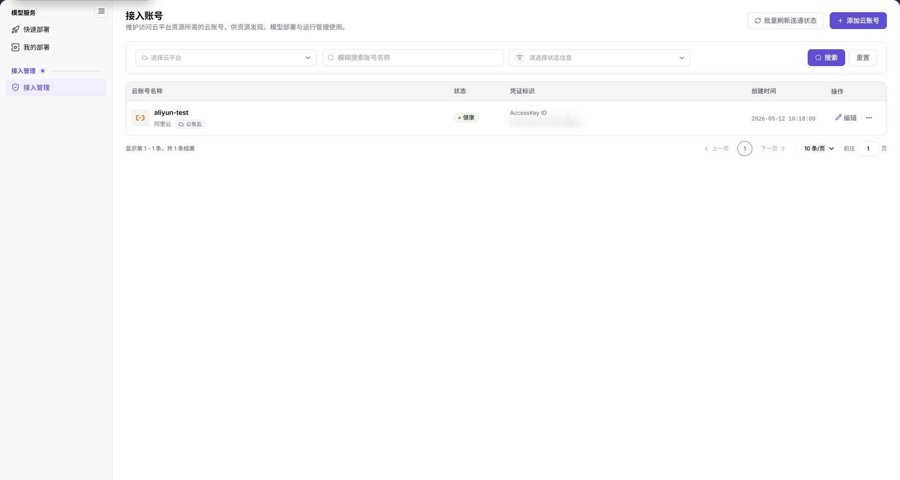

# 接入管理

::: info 文档信息
版本：v2.1
更新日期：2026-11-11
:::

## 功能概述

| 项目 | 内容 |
| --- | --- |
| 适用角色 | 用户 |
| 导航路径 | AI基础设施 > On-Cloud > 接入管理 > 接入管理 |
| 页面路由 | `/infrahub/user/access/account` |
| 管理对象 | 访问云平台资源所需的云账号及凭据 |

#### 新手理解

接入管理像云账号名册，集中展示账号、凭据标识和连通状态，供资源发现、模型部署与运行管理使用。

#### 术语速查

| 术语 | 说明 |
| --- | --- |
| 接入账号 | 用于访问云平台资源的云账号。 |
| 凭证标识 | 用于标识云账号访问凭据的字段；列表同时展示该凭据的类型。 |
| 凭证密钥 | 新增云账号表单中的敏感凭据字段。 |
| 连通状态 | 列表“状态”列展示的账号状态，页面提供批量刷新入口。 |

## 前提条件

1. 当前账号具有接入管理页面的访问权限。
2. 添加账号前，确认所属云平台、账号用途和授权范围；后续使用云资源前，与运营管理员核对云平台、资源池和授权配置。
3. 通过安全渠道取得最小权限凭据，并确认费用边界。

## 页面说明

左侧菜单名称为“接入管理”，进入后页内标题为“接入账号”。菜单入口与页内标题分别命名，不是两个页面。

| 区域 | 说明 |
| --- | --- |
| 筛选区 | 云平台下拉框、账号名称模糊搜索框和状态下拉框，配有“搜索”“重置”。 |
| 账号列表 | 列为“云账号名称”“状态”“凭证标识”“创建时间”“操作”；账号名称下显示云平台和公有云/私有云类型信息。 |
| 页面操作区 | 提供“批量刷新连通状态”和“添加云账号”入口。 |
| 行操作区 | 提供“编辑”和更多操作（`...`）入口。 |
| 新增表单 | “新增云账号”弹窗包含账号名称、选择云平台、凭证标识、凭证密钥。 |

图示为“接入账号”列表：云平台、名称、状态三个查询条件位于表格上方；状态列中的示例为“健康”，右上角提供“批量刷新连通状态”和“添加云账号”。

## 主要操作

### 查看接入账号

1. 从左侧“接入管理”进入“接入账号”页面。
2. 按需选择云平台、输入账号名称、选择状态，再点击“搜索”。需要重新设置查询条件时使用“重置”。
3. 在目标行核对云账号名称、所属云平台及类型、状态、凭证标识和创建时间。
4. 需要维护已有账号时，先定位目标行，再使用该行的“编辑”入口。更多操作入口位于“编辑”右侧。

### 添加接入账号

1. 点击“添加云账号”，打开“新增云账号”弹窗。
2. 填写“账号名称”，在“选择云平台”中选择所属平台。
3. 按所选平台的实际表单要求填写凭据；空白表单的通用字段为“凭证标识”和“凭证密钥”，不要将所有云平台凭据统一理解为 AK/SK。
4. 核对账号名称、所属平台和凭据用途；需要提交时点击“确定”。仅查看表单、不提交时，点击“取消”返回列表。

图示为“新增云账号”空白表单，四项字段均带必填标记：账号名称、选择云平台、凭证标识、凭证密钥；底部按钮为“取消”和“确定”。

## 参数速查表

| 字段名称 | 是否必填 | 字段类型 | 示例 | 说明 |
| --- | --- | --- | --- | --- |
| 云平台 | 否 | 下拉筛选 | `选择云平台` | 筛选所属云平台，不是云平台页签。 |
| 名称 | 否 | 输入框 | `demo-cloud-account` | 按账号名称模糊搜索。 |
| 状态 | 否 | 下拉筛选 | `请选择状态信息` | 按账号状态筛选；与列表的状态列对应。 |
| 搜索 | 否 | 按钮 | `搜索` | 查询入口。 |
| 重置 | 否 | 按钮 | `重置` | 重新设置查询条件的入口。 |
| 云账号名称 | — | 列表字段 | `demo-cloud-account` | 账号名称下展示所属云平台及类型信息。 |
| 状态 | — | 状态标签 | `健康` | 示例记录显示的连通状态，不是全部状态的枚举。 |
| 凭证标识 | — | 列表字段 | `AccessKey ID` | 显示凭据类型和标识信息；该示例类型不代表全部云平台。 |
| 创建时间 | — | 时间字段 | `YYYY-MM-DD HH:mm:ss` | 账号记录的创建时间。 |
| 批量刷新连通状态 | 否 | 操作入口 | `批量刷新连通状态` | 页面顶部的连通状态刷新入口。 |
| 添加云账号 | 否 | 按钮 | `添加云账号` | 打开“新增云账号”表单。 |
| 账号名称 | 是 | 输入框 | `demo-cloud-account` | 云账号在平台中的展示名称。 |
| 选择云平台 | 是 | 下拉选择 | `选择云平台` | 选择账号所属云平台。 |
| 凭证标识 | 是 | 输入框 | `示例凭证标识` | 空白表单中的通用凭据标识字段；以所选平台的实际要求为准。 |
| 凭证密钥 | 是 | 输入框 | `示例凭证密钥` | 敏感凭据字段；文档中不得填写真实值。 |
| 编辑 | 否 | 行操作入口 | `编辑` | 已有云账号的维护入口，操作前确认目标和影响范围。 |
| 更多操作 | 否 | 行操作入口 | `...` | 位于“编辑”右侧；以展开后的实际菜单为准。 |
| 取消 | 否 | 按钮 | `取消` | 退出当前新增表单。 |
| 确定 | 否 | 按钮 | `确定` | 表单提交入口，点击前核对各项输入。 |

## 踩坑提示

- 菜单“接入管理”与页内标题“接入账号”对应同一入口，查找页面时不要只按页内标题寻找菜单。
- 列表中的凭据类型示例为 `AccessKey ID`，新增空白表单使用“凭证标识”“凭证密钥”；不要把示例类型当作全部云平台的固定字段。
- 状态筛选与名称搜索是两个独立条件；核对记录时同时查看筛选区和列表“状态”列。

## 结果校验

| 检查项 | 成功表现 | 异常时处理 |
| --- | --- | --- |
| 页面定位 | 左侧“接入管理”高亮，页内标题为“接入账号” | 对照菜单名称和页面路由重新定位。 |
| 列表信息 | 可核对云账号名称、状态、凭证标识、创建时间和操作列 | 先核对当前筛选条件与目标记录名称。 |
| 新增表单定位 | 点击“添加云账号”后显示“新增云账号”，包含四项必填字段及“取消”“确定” | 核对打开的是新增云账号表单，不在其他对象上填写凭据。 |
| 退出空白表单 | 点击“取消”后返回账号列表 | 核对当前仍处于列表还是弹窗，不把关闭表单当作提交。 |

## 常见问题

#### 为什么菜单叫接入管理，页面却叫接入账号？

**问题现象：**

左侧高亮“接入管理”，页内标题显示“接入账号”。

**可能原因：**

当前界面的菜单名称与页内标题分别使用上述名称。

**处理方式：**

按“接入管理”进入，并以“接入账号”的列表字段核对目标账号。

#### 新增账号时应填写 Access Key ID 还是凭证标识？

**问题现象：**

列表的凭据类型示例为 `AccessKey ID`，空白新增表单却显示“凭证标识”“凭证密钥”。

**可能原因：**

列表展示具体记录的凭据类型，空白表单显示通用凭据字段名称。

**处理方式：**

先选择云平台，再按实际显示的字段要求填写，不将所有云类型统一写成 AK/SK。

## 注意事项

- 凭据只在获授权的业务操作中通过安全渠道使用；不要将真实凭据写入文档、工单或聊天记录。
- 新增或编辑前核对最小权限、授权范围、费用边界和变更影响；保留必要的审计记录。
- 列表“状态”是本页展示的信息，后续资源可见范围仍需在相应页面单独核对。

## 后续操作

1. 前往[快速部署](../../model-services/quick-deployment/)查看云平台、资源池和模型选择入口，核对实际可用资源。
2. 已有部署任务可前往[我的部署](../../model-services/my-deployments/)查看；不要将添加云账号等同于已经创建部署。
3. 定期核对云账号权限、凭据有效期和资源可见范围。

