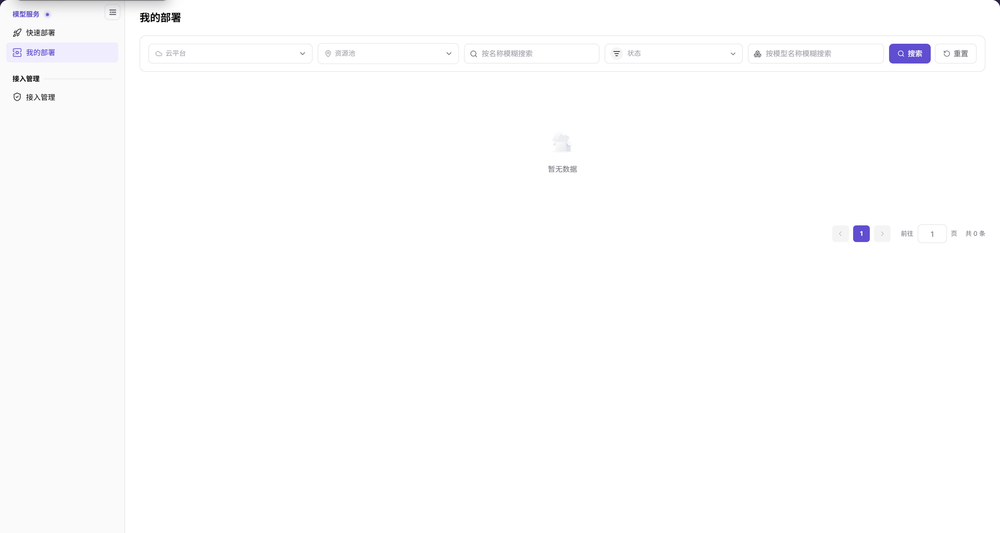
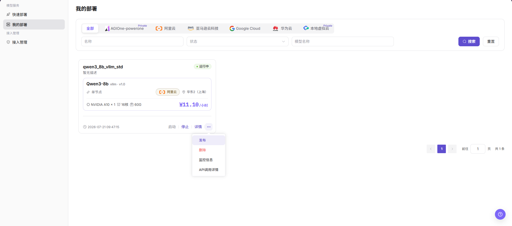
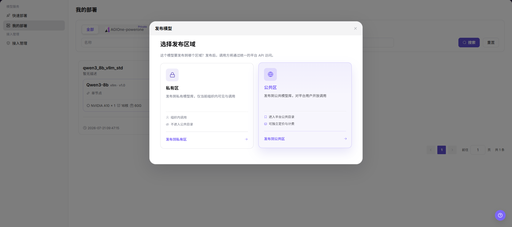

# 我的部署

::: info 文档信息
版本：v2.1
更新日期：2026-11-11
:::

## 功能概述

| 项目 | 内容 |
| --- | --- |
| 适用角色 | 用户 |
| 导航路径 | AI基础设施 > On-Cloud > 模型服务 > 我的部署 |
| 页面路由 | `/infrahub/user/model/deployment` |
| 管理对象 | 部署查询、部署卡片和模型发布入口 |

#### 新手理解

我的部署像模型部署的任务目录：先用筛选条件找到记录，再核对卡片信息和可用操作。

#### 术语速查

| 术语 | 说明 |
| --- | --- |
| 资源池 | 查询部署时使用的资源范围条件。 |
| 部署状态 | 部署记录显示的当前状态，以卡片实际标签为准。 |
| 发布区域 | 发布模型时选择的私有区或公共区，决定发布目标范围。 |

## 前提条件

1. 已登录，并可从 On-Cloud 的模型服务菜单进入我的部署。
2. 查询页面不要求列表中已有记录；查看卡片及发布流程需要有可查看的目标部署。
3. 发布、启停或删除前，先确认目标记录、服务影响、可见范围和费用边界。

## 页面说明

| 区域 | 说明 |
| --- | --- |
| 筛选区 | 云平台、资源池、名称、状态和模型名称条件，以及“搜索”“重置”。名称和模型名称支持模糊搜索。 |
| 结果区 | 展示查询到的部署；没有记录时显示“暂无数据”，底部提供分页。 |
| 部署卡片及发布 | 有记录时可核对名称、模型、状态、资源及费用，按卡片可用入口查看详情或进入发布。 |

图示为云平台、资源池、按名称模糊搜索、状态、按模型名称模糊搜索，以及“搜索”“重置”；当前结果区显示“暂无数据”，分页总数为 0。

## 主要操作

### 查询部署

1. 进入我的部署，按需选择 **云平台** 和 **资源池**。
2. 输入部署名称或模型名称的关键字，按需选择 **状态**。
3. 点击 **搜索**，查看结果区与分页；需要重新设置条件时使用 **重置**。
4. 若显示 **暂无数据**，先核对当前条件；空列表不提供目标部署的详情、运行或发布结果。

### 核对部署卡片

1. 有记录时，定位目标部署，核对名称、模型、部署模式、云平台、地域和状态。
2. 查看卡片中的 GPU、CPU、内存和每小时费用参考；不要把示例金额作为固定价格。
3. 按卡片实际可用入口进入 **详情**；更多操作中可见发布、删除、监控信息和 API 调用详情入口。不要仅凭入口存在判断操作已执行。

### 打开模型发布入口

以下发布流程适用于列表中存在目标部署且发布入口可用的情况。

1. 在列表中定位目标运行中部署，先核对卡片名称和模型。
2. 点击卡片右下角更多操作图标（`···`），选择 **发布**。

图示为部署卡片的运行中标签、资源规格、费用参考和“详情”入口；更多操作菜单中可见“发布”“删除”“监控信息”和“API调用详情”。

### 选择发布区域

1. 在“发布模型”的“选择发布区域”弹窗中阅读两种目标说明：**私有区**发布到私有模型库，仅当前组织内可见与调用，不进入公共目录；**公共区**发布到公共模型库，对平台用户开放调用，可独立定价与计费。
2. 按目标受众点击 **发布到私有区** 或 **发布到公共区**，进入发布模型配置页。

图示为私有区和公共区两张发布目标卡片，分别说明组织内调用、不进入公共目录，以及进入平台公共目录、可独立定价与计费。

### 核对模型发布信息

1. 在发布模型页核对 **元模型**、**模型源**、**请求URL** 和地域，确认与目标部署相符；示例地址使用 `<BASE_URL><ENDPOINT_PATH>`。
2. 在安全输入区核对 **API密钥** 和 **模型源ID**，不将真实密钥复制到文档、工单或聊天记录。
3. 按页面顺序使用 **下一步** 进入 **计费配置** 和 **限流配置**，完成各阶段要求后再提交。
4. 提交后前往 **创作空间 > 我的模型** 核对目标模型的实际状态与可见范围，不将进入配置页视为已上架或可调用。

图示为发布模型的基本信息阶段，包含元模型、模型源、请求URL、API密钥和模型源ID；顶部列出计费配置与限流配置，底部提供“取消”“下一步”。

## 参数速查表

| 字段名称 | 是否必填 | 字段类型 | 示例 | 说明 |
| --- | --- | --- | --- | --- |
| 云平台 | 否 | 下拉筛选 | `云平台` | 按部署所在云平台查询。 |
| 资源池 | 否 | 下拉筛选 | `资源池` | 按部署所在资源池查询。 |
| 名称 | 否 | 文本筛选 | `demo` | 按部署名称模糊搜索。 |
| 状态 | 否 | 下拉筛选 | `状态` | 按部署状态查询，不预设所有可选状态。 |
| 模型名称 | 否 | 文本筛选 | `Qwen` | 按模型名称模糊搜索。 |
| 搜索 / 重置 | 否 | 按钮 | `搜索` | 查询或重新设置条件。 |
| 部署名称 / 状态 | — | 卡片字段 | `demo_deployment` | 核对目标记录及当前状态。 |
| 模型 / 部署模式 | — | 卡片字段 | `单节点` | 部署绑定的模型、引擎版本和模式。 |
| 云平台 / 地域 | — | 卡片字段 | `示例云 / 示例地域` | 卡片显示的资源位置。 |
| 资源规格 / 费用 | — | 卡片字段 | `示例 GPU / CPU / 内存` | 资源配置与每小时费用参考。 |
| 发布 | 否 | 操作入口 | `发布` | 从卡片更多操作进入发布区域选择。 |
| 发布区域 | 是 | 目标卡片 | `私有区` | 私有区与公共区的范围见弹窗说明。 |
| 元模型 / 模型源 | 是 | 选择框 | `示例模型 / 来源A` | 发布模型基本信息中的模型与来源。 |
| 请求URL | 是 | URL | `<BASE_URL><ENDPOINT_PATH>` | 核对上游请求地址。 |
| API密钥 | 是 | 密钥输入 | `<API_KEY>` | 仅在安全输入区使用真实值。 |
| 模型源ID | 是 | 文本 | `demo-model-id` | 发给上游供应商的精确模型名称。 |
| 地域 | 否 | 下拉选择 | `示例地域` | 发布模型基本信息中的区域字段。 |

## 踩坑提示

- 当前列表图显示空状态；不能由此判断详情、发布或生命周期功能不存在，也不能将其当作部署成功的证据。
- 发布区域弹窗区分“私有区”和“公共区”；进入公共目录与组织内调用不是同一范围。
- 卡片中的“发布”是打开发布流程的入口，不是模型已经上架的标志。

## 结果校验

| 检查项 | 成功表现 | 异常时处理 |
| --- | --- | --- |
| 查询范围 | 云平台、资源池、名称、状态和模型名称符合查询目标 | 核对筛选区，按需重置后重新查询 |
| 查询结果 | 结果区显示部署记录，或明确显示“暂无数据” | 以实际记录和分页为准，不推断空列表原因 |
| 目标部署 | 有记录时，卡片名称、模型和状态可逐项核对 | 未定位目标记录时不执行发布、启停或删除 |
| 发布目标 | 弹窗显示私有区与公共区及其说明 | 先核对受众范围，再选择对应入口 |
| 发布信息 | 基本信息页的模型、来源、URL和模型源ID与目标相符 | 返回核对目标部署，不把配置页当成发布成功结果 |

## 常见问题

#### 空列表是否表示无法使用发布功能？

**问题现象：**

结果区显示“暂无数据”，没有部署卡片可供操作。

**可能原因：**

页面当前展示的是空结果，截图中没有目标卡片；这条空状态提示本身不说明具体原因或功能权限。

**处理方式：**

核对云平台、资源池、名称、状态和模型名称条件；只有定位到目标部署后，才按该卡片实际可用入口继续操作。

#### 私有区和公共区有什么区别？

**问题现象：**

发布区域弹窗提供两个发布目标。

**可能原因：**

弹窗分别标明组织内调用、不进入公共目录，以及平台公共目录、独立定价与计费。

**处理方式：**

根据目标受众阅读对应卡片说明，确认范围后选择发布到私有区或公共区。

## 注意事项

- 发布、启停和删除会涉及服务或资源；操作前确认目标与影响，不凭空列表推断操作结果。
- 真实凭据只在安全输入区处理；文档示例使用 `<API_KEY>`、`<BASE_URL>` 和 `<ENDPOINT_PATH>`。
- 查询结果、卡片状态和发布配置属于不同阶段，不承诺下游同步或调用成功。

## 后续操作

1. 尚无目标部署时，查看[快速部署](../quick-deployment/)的模型与方案选择。
2. 已进入发布模型页时，按页面阶段继续核对基本信息、计费配置和限流配置。
3. 发布提交后到[我的模型](../../../../model-services/user/studio/my-models/)查看目标记录，以实际状态为准。
