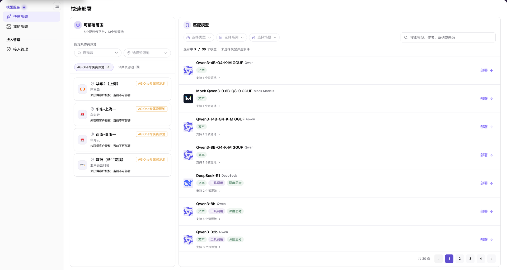
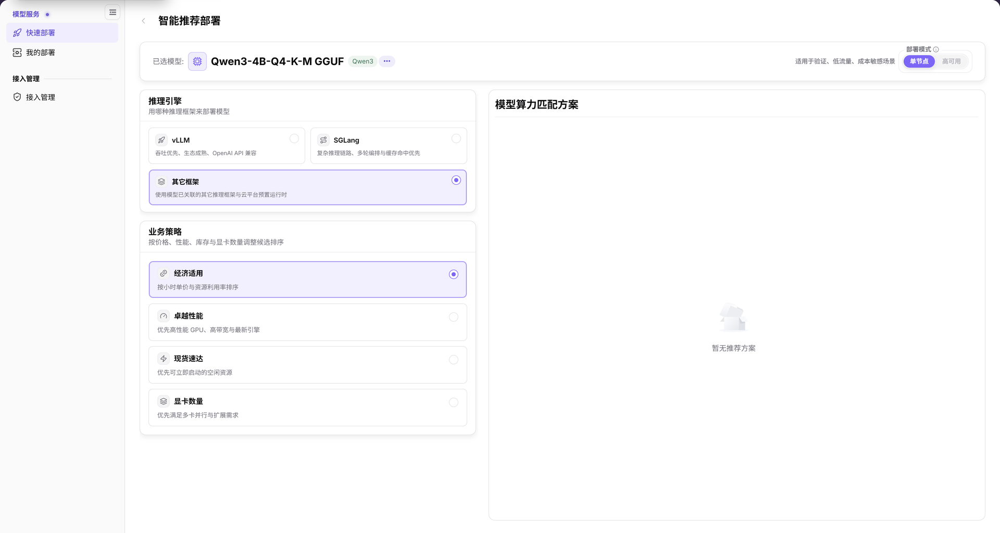
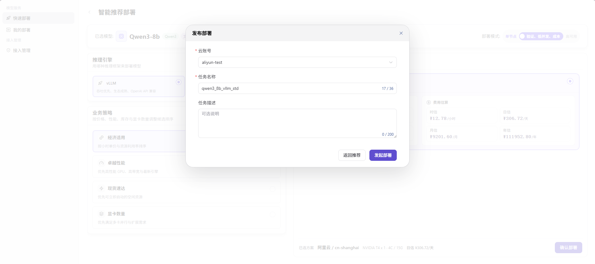

# 快速部署

::: info 文档信息
版本：v2.1
更新日期：2026-11-11
:::

## 功能概述

| 项目 | 内容 |
| --- | --- |
| 适用角色 | 用户 |
| 导航路径 | AI基础设施 > On-Cloud > 模型服务 > 快速部署 |
| 页面路由 | `/infrahub/user/model/store` |
| 管理对象 | 可部署范围、匹配模型、推理引擎、业务策略和部署方案 |

#### 新手理解

快速部署像模型与算力的匹配向导：先选云和资源池中的模型，再查看适合该模型的部署方案。

#### 术语速查

| 术语 | 说明 |
| --- | --- |
| 可部署范围 | 按云和资源池展示的资源范围，卡片同时显示授权或可部署提示。 |
| 推理引擎 | 部署模型使用的推理框架，包括 vLLM、SGLang 和其它框架。 |
| 业务策略 | 按价格、性能、库存与显卡数量调整候选方案排序的偏好。 |

## 前提条件

1. 已登录，并可从 On-Cloud 的模型服务菜单进入快速部署。
2. 先核对目标云、资源池及页面上的授权提示，再选择模型。
3. 发起部署前，确认所选资源规格、费用估算、云账号和任务名称。

## 页面说明

| 区域 | 说明 |
| --- | --- |
| 可部署范围 | 使用“选择云”“选择资源池”定位资源；分为“AGIOne专属资源池”和“公共资源池”。 |
| 匹配模型 | 按类型、系列、场景筛选，或搜索模型、作者、系列或来源；卡片显示能力标签、支持资源池和“部署”入口。 |
| 智能推荐部署 | 顶部展示已选模型和部署模式；左侧选择推理引擎与业务策略，右侧展示模型算力匹配方案。 |

图示为云与资源池选择、专属/公共资源池分区，以及模型筛选、搜索和“部署”按钮；图中部分资源池显示“未获得客户授权 · 当前不可部署”。

## 主要操作

### 查看可部署模型

1. 进入快速部署，在可部署范围中按云、资源池定位目标资源。
2. 查看“AGIOne专属资源池”或“公共资源池”，核对资源池卡片上的授权与可部署提示。
3. 选择类型、系列或场景，或输入模型、作者、系列或来源进行搜索。
4. 核对模型名称、能力标签和支持资源池，点击模型卡片上的 **部署**，进入智能推荐部署。

### 查看智能推荐

1. 在顶部核对已选模型。部署模式包括 **单节点** 与 **高可用**，按当前页面可选状态操作。
2. 在推理引擎中选择 **vLLM**、**SGLang** 或 **其它框架**。
3. 在业务策略中选择 **经济适用**、**卓越性能**、**现货速达** 或 **显卡数量**，查看右侧模型算力匹配方案。
4. 若显示 **暂无推荐方案**，当前结果区没有可选方案；不能据此确认资源规格、费用或部署结果。

图示为单节点/高可用模式、三类推理引擎和四类业务策略；当前示例选择“其它框架”“经济适用”，高可用呈禁用状态，右侧显示“暂无推荐方案”。

### 创建模型部署

以下流程适用于已显示推荐方案并能进入发布部署弹窗的情况；空推荐状态不具备这些确认信息。

1. 核对所选方案的模型、云平台、地域、资源规格及费用估算，点击 **确认部署**。
2. 在“发布部署”弹窗中选择 **云账号**，填写必填的 **任务名称**；按需填写 **任务描述**。
3. 需要调整方案时点击 **返回推荐**；确认任务信息后点击 **发起部署**。
4. 提交后进入[我的部署](../my-deployments/)查询目标任务，以该页实际显示的记录与状态为准。

图示为发布部署弹窗中的云账号、任务名称和可选任务描述，底部提供“返回推荐”与“发起部署”；背景中的费用估算属于图中方案，不是通用价格。

## 参数速查表

| 字段名称 | 是否必填 | 字段类型 | 示例 | 说明 |
| --- | --- | --- | --- | --- |
| 选择云 | 否 | 下拉筛选 | `选择云` | 按云平台定位可部署范围。 |
| 选择资源池 | 否 | 下拉筛选 | `选择资源池` | 按资源池定位可部署范围。 |
| 资源池分区 | 否 | 分区切换 | `公共资源池` | 可切换 AGIOne专属资源池和公共资源池。 |
| 选择类型 / 选择系列 / 选择场景 | 否 | 下拉筛选 | `选择系列` | 筛选匹配模型。 |
| 搜索 | 否 | 文本 | `Qwen` | 搜索模型、作者、系列或来源。 |
| 部署 | 否 | 操作入口 | `部署` | 模型卡片按钮，进入智能推荐部署，不是最终提交。 |
| 已选模型 | — | 展示字段 | `示例模型` | 当前准备匹配部署方案的模型。 |
| 部署模式 | 是 | 分段选择 | `单节点` | 单节点、高可用；是否可选以当前模型页面为准。 |
| 推理引擎 | 是 | 单选卡片 | `其它框架` | vLLM、SGLang、其它框架。 |
| 业务策略 | 是 | 单选卡片 | `经济适用` | 经济适用、卓越性能、现货速达、显卡数量。 |
| 模型算力匹配方案 | — | 结果区域 | `暂无推荐方案` | 显示候选方案或空状态，不代表部署已创建。 |
| 费用估算 | — | 展示字段 | `以所选方案为准` | 有方案时核对费用估算，不将示例金额作为固定价格。 |
| 确认部署 | 否 | 按钮 | `确认部署` | 有可选方案时进入发布部署确认弹窗。 |
| 云账号 | 是 | 下拉选择 | `example-cloud-account` | 发布部署弹窗中的执行账号。 |
| 任务名称 | 是 | 文本 | `demo_deploy_task` | 发布部署弹窗中的任务名称。 |
| 任务描述 | 否 | 多行文本 | `示例任务描述` | 可选说明，不填写密钥或内部参数。 |
| 返回推荐 / 发起部署 | 否 / 是 | 按钮 | `返回推荐` | 分别返回方案页与最终提交任务。 |

## 踩坑提示

- **经济适用**是业务策略，不是独立部署模式；模式区显示单节点和高可用。
- 图中高可用禁用只对应当前示例，不能据此判断所有模型均不支持高可用。
- **暂无推荐方案**是方案区空状态，不是创建成功提示；模型卡片上的“部署”也只是进入推荐页。

## 结果校验

| 检查项 | 成功表现 | 异常时处理 |
| --- | --- | --- |
| 模型选择 | 推荐页顶部显示目标模型名称 | 返回快速部署，重新核对模型卡片 |
| 选项核对 | 模式、引擎和策略与当前选择一致 | 核对各区域的选中状态和可选状态 |
| 方案读取 | 右侧显示方案，或明确显示“暂无推荐方案” | 以实际提示为准，不填写推测的费用和规格 |
| 最终确认信息 | 已进入弹窗时，可核对云账号、任务名称和任务描述 | 未进入弹窗时不将推荐页视为已提交 |

## 常见问题

#### “经济适用”是否属于部署模式？

**问题现象：**

在推荐页需要区分部署模式与经济适用选项。

**可能原因：**

界面将“单节点/高可用”放在部署模式区，将“经济适用”放在业务策略区。

**处理方式：**

分别在模式区和策略区核对选择；不要将策略名称作为第三种部署模式。

#### “暂无推荐方案”是否表示部署已完成？

**问题现象：**

模型算力匹配方案区显示“暂无推荐方案”。

**可能原因：**

这是方案区显示的空状态，提示本身没有给出具体原因或部署成功信息。

**处理方式：**

核对已选模型、模式、推理引擎和业务策略；没有可选方案时，不继续套用最终部署确认步骤。

## 注意事项

- 发起部署属于资源操作；提交前核对云账号、所选资源和费用边界。
- 文档、截图、工单和聊天记录中不得写入真实凭据、内部地址或客户数据。
- 不把费用估算当成最终账单，也不把进入推荐页或确认弹窗当成任务已成功运行。

## 后续操作

1. 到[我的部署](../my-deployments/)按云平台、资源池、名称、状态或模型名称查询任务。
2. 需要核对可用云账号时，查看[接入管理](../../access-management/access-accounts/)。
3. 只有在页面显示具体方案后，才继续核对资源规格与部署确认信息。
