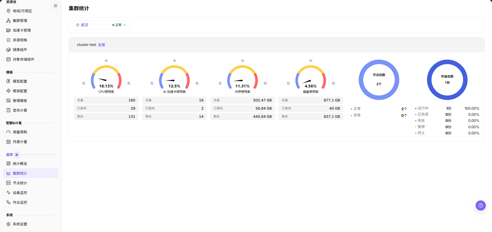
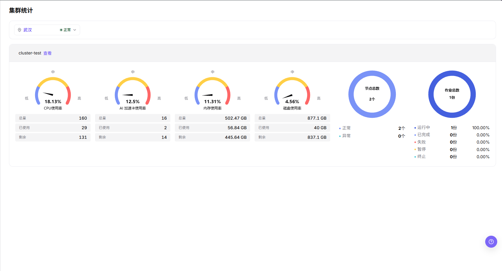

# 集群统计

## 功能概述

| 项目 | 内容 |
| --- | --- |
| 适用角色 | 运营管理员 |
| 导航路径 | On-Prem > 监控 > 集群统计 |
| 管理对象 | 集群状态、资源容量、作业数量和地域/可用区归属 |

#### 新手理解

集群统计像每个机房的体检表，用来比较不同集群的容量、健康状态和资源水位，判断问题是局部集群还是全局资源不足。

#### 术语表

| 术语 | 说明 |
| --- | --- |
| 集群容量 | 集群能够提供的 CPU、内存、GPU/NPU 等资源总量。 |
| 资源水位 | 已用资源占可用资源总量的比例。 |
| 健康状态 | 集群组件、节点及调度能力是否正常。 |

#### 推荐操作顺序

先确认集群状态、资源容量、作业数量和地域/可用区归属的前置依赖，再按主要操作顺序处理，最后执行结果校验并进入后续页面。

#### 小白先看

先确认当前任务是否涉及集群状态、资源容量、作业数量和地域/可用区归属，再按照推荐顺序操作。页面字段或状态与预期不符时，先回到前置对象页核对依赖，不要跳过结果校验直接进入下游流程。

## 前提条件

1. 当前账号具备集群监控查看权限。
2. 目标集群已注册并处于可监控范围。
3. 集群容量、节点和加速卡指标已采集。
4. 已确认需要比较的地域或集群范围。

## 页面说明

页面用于查看和处理集群状态、资源容量、作业数量和地域归属。

集群统计用于比较不同地域中的集群容量、健康状态和资源水位。运营管理员可以通过集群维度判断是否存在整体容量不足、采集异常或单集群热点。

## 主要操作

### 筛选集群统计

#### 适用场景

需要按地域或状态缩小监控范围、快速定位目标集群时使用。

#### 操作步骤

1. 进入 `On-Prem > 监控 > 集群统计`。
2. 在内容区顶部卡片内的地域选择器中，选择目标集群所属地域，例如 `武汉`。
3. 同一选择器会显示所选地域的状态，例如 `武汉` 右侧的绿色 `正常`。
4. 在集群卡片中定位目标集群，查看卡片标题与 `查看` 入口。

#### 结果校验

- 页面仅显示所选地域下的集群卡片。
- 集群卡片标题与所选地域一致。

#### 注意事项

- 地域选择器同时展示所选地域及其状态（`武汉` ＋ 绿色 `正常`）。

### 查看集群资源与健康概览

#### 适用场景

评估单个集群的容量水位、节点与作业健康状态时使用。

#### 操作步骤

1. 打开目标集群卡片，依次查看 CPU 使用率、AI 加速卡使用率、内存使用率、磁盘使用率四个仪表盘，以及各仪表盘的总量、已使用、剩余。

2. 查看节点环形图，核对节点总数及正常、异常节点数量。
3. 查看作业环形图，核对作业总数及运行中、已完成、失败、暂停、终止各状态的分布。
4. 点击卡片头中紧跟集群名（例如 `cluster-test`）的 `查看` 链接进入集群详情。

#### 结果校验

- 四个仪表盘正常显示使用率，且总量等于已使用与剩余之和。
- 每个仪表盘下方依次列出 `总量`、`已使用`、`剩余`，已使用除以总量的结果与仪表盘使用率一致（例如 29 / 160 = 18.13%）。
- 节点环形图的正常、异常计数与节点列表一致。
- 作业环形图的图例给出每个状态的数量与占比（例如 `运行中` 为 `1份 100.00%`，其余状态为 `0.00%`）。

#### 注意事项

- 仪表盘档位（低/中/高）用于快速判断资源水位，不代表集群整体健康。
- 集群水位正常不代表单个节点或设备一定可用。

### 排查集群异常指标

#### 适用场景

集群资源利用率出现高水位或状态异常，需要定位根因时使用。

#### 操作步骤

1. 记录异常集群名称与具体时间点。
2. 切换到左侧栏的 `节点统计` 或 `设备监控`，核对具体节点与硬件状态。
3. 结合 `作业监控` 判断异常是单点硬件故障、节点负载不均还是突发高负载训练/推理作业引起。
4. 如需调整调度策略或隔离故障节点，联系平台运维处理，不直接修改底层资源。

#### 结果校验

- 集群状态是否可用。
- GPU、CPU、内存、磁盘使用率是否异常。
- 作业数量是否集中在少数集群。
- 左侧栏 `监控` 组依次为 `统计概览`、`集群统计`、`节点统计`、`设备监控`、`作业监控`。

#### 注意事项

- 集群统计可能存在采集延迟，不能只凭单个瞬时指标判断故障。
- 跨地域对比集群时，统一时间范围与指标单位。

## 参数速查表

| 字段名称 | 是否必填 | 字段类型 | 示例 | 说明 |
| --- | --- | --- | --- | --- |
| 地域 | 条件必填 | 下拉选择 | `武汉` | 限定集群所属的地域。 |
| 状态 | 条件必填 | 下拉选择 | `正常` | 在地域选择器内随所选地域展示状态。 |
| 集群名称 | 系统生成 | 文本 | `cluster-test` | 标识被监控的集群对象。 |
| CPU 使用率 | 系统生成 | 百分比 | `18.13%` | 展示集群 CPU 资源使用水位。 |
| AI 加速卡使用率 | 系统生成 | 百分比 | `12.5%` | 展示 GPU、NPU 等加速卡资源使用水位。 |
| 内存使用率 | 系统生成 | 百分比 | `11.31%` | 展示集群内存资源使用水位。 |
| 磁盘使用率 | 系统生成 | 百分比 | `4.56%` | 展示集群磁盘资源使用水位。 |
| 总量 / 已使用 / 剩余 | 系统生成 | 数值表 | `502.47 GB` / `56.84 GB` / `445.64 GB` | 每个仪表盘下方的三行数值；内存与磁盘带 `GB` 单位，CPU 与 AI 加速卡不带单位。 |
| 节点总数 | 系统生成 | 数字 | `2 个` | 展示集群中纳入监控统计的节点数量。 |
| 节点状态 | 系统生成 | 状态 | `正常 / 异常` | 展示正常、异常节点的数量分布。 |
| 作业总数 | 系统生成 | 数字 | `1 份` | 展示集群内的作业数量。 |
| 作业状态 | 系统生成 | 状态 | `运行中 / 已完成 / 失败 / 暂停 / 终止` | 展示作业在各状态的数量分布。 |

## 踩坑提示

- 集群异常应继续前往节点统计和设备监控页面排查。
- 集群水位异常需要结合节点、设备、作业和调度事件一起排查。
- 不在文档中写真实集群 ID、节点名、设备 ID、资源池 ID、租户信息、内部指标 key 或测试数据。

#### 配置规则与影响

- **集群状态用于容量判断**：健康但水位高通常优先看扩容或调度，异常则优先排查集群接入和采集。
- **资源水位要分类型看**：CPU、内存、GPU/NPU、存储的瓶颈含义不同，不能只看单一总分。
- **跨集群比较要固定时间范围**：不同时间窗口会影响峰值、均值和异常统计。
- **不可用集群会影响实例创建**：用户创建失败时，应同步核对集群健康、规格关联和配额。

## 结果校验

| 检查项 | 成功表现 | 异常时处理 |
| --- | --- | --- |
| 页面加载 | 集群统计图表或列表正常显示 | 检查当前角色的监控权限和所选地域是否开放采集能力 |
| 统计范围 | 时间范围、地域和对象数量与排查目标一致 | 清除筛选后逐项恢复条件，确认没有混用不同统计口径 |
| 数据新鲜度 | 更新时间落在预期采集周期内 | 到系统设置或监控采集组件核对采集周期、连接和告警 |
| 异常关联 | 异常指标能关联到集群、节点、设备或作业 | 保持相同时间范围，到相邻监控页和对象详情交叉核对 |

## 常见问题

#### 集群统计没有数据

**问题现象：**

页面可进入，但图表或列表为空。

**可能原因：**

- 所选时间没有任务。
- 地域未开放采集。
- 当前角色无指标权限。

**处理方式：**

1. 扩大时间范围并重置筛选
2. 核对地域监控能力
3. 到相邻监控页确认是否同样无数据。

#### 集群统计更新不及时

**问题现象：**

页面数据长时间没有变化。

**可能原因：**

- 采集周期尚未到。
- 采集组件异常。
- 页面缓存未刷新。

**处理方式：**

1. 核对更新时间
2. 检查采集组件和告警
3. 刷新后用同一时间范围复查。

#### 集群统计与相邻页面数值不一致

**问题现象：**

同一对象在两个监控页面显示不同数值。

**可能原因：**

- 聚合粒度不同。
- 时间范围或时区不同。
- 筛选对象不同。

**处理方式：**

1. 统一时间范围和时区
2. 核对聚合口径
3. 清除筛选后逐项恢复。

#### 无法在关联监控中定位目标对象

**问题现象：**

点击指标或详情入口后找不到对应对象。

**可能原因：**

- 对象已结束或被移除。
- 角色不可见。
- 关联标识不一致。

**处理方式：**

1. 记录对象名称和时间
2. 到对应列表核对状态
3. 联系运营管理员检查可见范围。

#### 异常峰值无法复现

**问题现象：**

监控中出现峰值，但当前详情已恢复正常。

**可能原因：**

- 峰值持续时间短。
- 采样粒度较粗。
- 任务已经结束。

**处理方式：**

1. 锁定峰值时间段
2. 对照作业和节点事件
3. 保留脱敏截图和对象标识。

## 注意事项

- 集群健康不等于所有业务正常，需要结合实例和作业状态。
- 跨集群比较时固定时间范围。
- 不要暴露集群内部名称、API Server 或网络信息。
- 扩容、迁移或故障判断前，需要结合节点统计、设备监控、作业监控和调度事件交叉确认。
- 文档示例不得包含真实集群 ID、节点名、设备 ID、资源池 ID、租户信息、内部指标 key 或测试数据。

## 后续操作

1. 水位高时进入节点统计定位热点节点。
2. 加速卡紧张时进入设备监控确认型号和显存。
3. 集群不可用时回到资源池集群管理检查接入状态。
