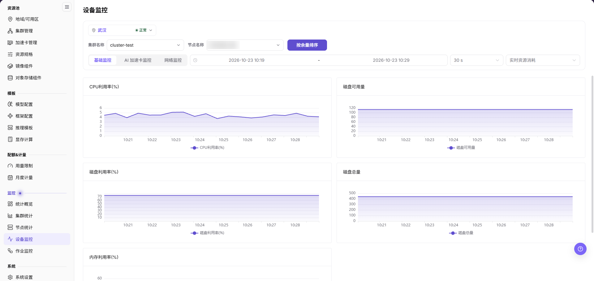
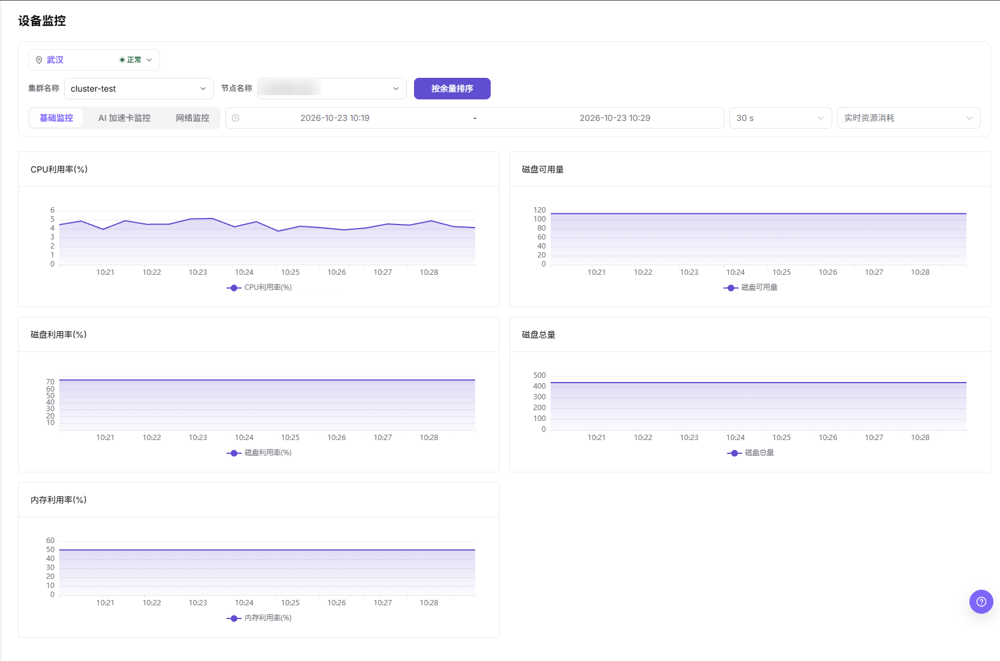

# 设备监控

## 功能概述

| 项目 | 内容 |
| --- | --- |
| 适用角色 | 运营管理员 |
| 导航路径 | On-Prem > 监控 > 设备监控 |
| 管理对象 | GPU/NPU 等加速卡设备、显存、利用率、温度和健康状态 |

#### 新手理解

设备监控像加速卡仪表盘，用来观察 GPU/NPU 利用率、显存、温度和健康状态，判断算力卡是否可继续承载任务。

#### 术语表

| 术语 | 说明 |
| --- | --- |
| 设备利用率 | GPU/NPU 当前的计算利用率。 |
| 显存使用率 | 加速卡显存的占用比例。 |
| 温度 | 设备当前的运行温度。 |

#### 推荐操作顺序

先确认 GPU/NPU 等加速卡设备、显存、利用率、温度和健康状态的前置依赖，再按主要操作顺序处理，最后执行结果校验并进入后续页面。

#### 小白先看

先确认当前任务是否涉及 GPU/NPU 等加速卡设备、显存、利用率、温度和健康状态，再按照推荐顺序操作。页面字段或状态与预期不符时，先回到前置对象页核对依赖，不要跳过结果校验直接进入下游流程。

## 前提条件

1. 当前账号具备设备监控查看权限。
2. 目标集群已部署设备插件并能上报 GPU/NPU 指标。
3. 设备型号、显存、温度和健康状态可采集。
4. 已确认需要关注的加速卡型号或作业范围。

## 页面说明

页面用于按地域、集群和节点查看监控趋势，并通过图表上方的页签切换监控维度。

设备监控用于查看 GPU/NPU 利用率、显存、温度和健康状态。运营管理员可用它判断加速卡是否离线、过热、显存不足或被单个任务长期占用。

## 主要操作

### 筛选并查看基础监控

#### 适用场景

- 在判断加速卡问题之前，需要先确认某个集群、某个节点的资源趋势。
- 需要区分主机侧 CPU、内存、磁盘瓶颈与加速卡本身的问题。

#### 操作步骤

1. 进入 `On-Prem > 监控 > 设备监控`。
2. 在页面顶部的卡片中确认地域选择器为目标地域及其状态（本屏为 `武汉` 与带绿色圆点的 `正常`）。
3. 将 `集群名称` 设置为目标集群（本屏为 `cluster-test`）。
4. 将 `节点名称` 设置为目标节点。
5. 保持 `基础监控` 页签选中，设置时间范围（本屏为 `2026-10-23 10:19` 至 `2026-10-23 10:29`）、采集粒度（`30 s`）以及右侧的指标范围下拉。
6. 需要按剩余可用容量对节点排序时，点击 `按余量排序`。

下图为所选集群、节点与时间范围对应的趋势图区域。

#### 结果校验

- `基础监控` 页签渲染 5 张图：`CPU利用率(%)`、`磁盘可用量`、`磁盘利用率(%)`、`磁盘总量` 和 `内存利用率(%)`。
- 每张图下方的图例与图标题一致，横轴落在所选时间范围内。
- 切换 `集群名称` 或 `节点名称` 后，曲线随选择变化而不是保持不变。

#### 注意事项

- `基础监控` 页签画面只提供集群与节点两级筛选，设备维度的问题需要切换到加速卡页签查看。
- 本屏 `磁盘可用量` 与 `磁盘总量` 的纵轴为未标注单位的数值，与其他监控页对比前先确认单位。
- 指标范围下拉的文案在画面中被截断。

### 切换监控维度页签

#### 适用场景

- 需要的指标不在当前页签的 5 张图中。
- 需要把主机资源问题与加速卡或网络问题区分开。

#### 操作步骤

1. 使用图表上方的页签行。本屏从左到右共 3 个页签：`基础监控`（选中）、`AI 加速卡监控`、`网络监控`。
2. 点击 `AI 加速卡监控`，从主机资源切换到加速卡维度。
3. 点击 `网络监控`，切换到网络维度。
4. 非默认页签内以页面实际渲染为准再引用字段名。

#### 结果校验

- 选中的页签高亮，下方图表区域随之变化。
- 切换页签后，时间范围、采集粒度与指标范围下拉仍然可见。

#### 注意事项

- 未在屏幕上看到的加速卡字段名（如设备型号、显存）不要照抄到结论中；本页配图仅覆盖 `基础监控` 页签。
- 页签名称按界面原文书写，不做跨语言拉齐。

### 排查设备异常指标

#### 适用场景

- 加速卡被报告离线、温度过高、显存不足或出现驱动错误。
- 集群整体水位正常，但某张卡被单个作业长期占用。

#### 操作步骤

1. 在 `基础监控` 页签记录异常对应的 `节点名称` 与出现异常的图表，并保持相同时间范围。
2. 在本页切换到 `AI 加速卡监控`，确认同一节点的加速卡维度。
3. 在左侧 `监控` 分组中打开 `作业监控`，确认是否有大模型训练或高并发推理作业持续占用该卡。
4. 打开同组的 `节点统计`，检查宿主节点的负载、网络与驱动服务健康状态。
5. 确认硬件故障或掉卡时，通知运维工程师进行硬件隔离检修，避免影响后续作业调度。

#### 结果校验

- 本页定位到的节点，在 `作业监控` 与 `节点统计` 中以相同时间范围可见。
- 左侧 `监控` 分组中 `设备监控` 保持选中，该组条目为 `统计概览`、`集群统计`、`节点统计`、`设备监控`、`作业监控`。

#### 注意事项

- 设备是否被识别并持续上报，决定图表的可信程度。
- 显存与利用率要一起读，单个瞬时指标不足以判定硬件故障。
- 温度、错误计数与健康状态属于加速卡维度。

## 参数速查表

| 字段名称 | 是否必填 | 字段类型 | 示例 | 说明 |
| --- | --- | --- | --- | --- |
| 设备 ID | 系统生成 | 文本 | `GPU-0` | 区分同一节点上的多张设备。 |
| 设备类型 | 必填 | 文本 | `NVIDIA A800` | 展示 GPU/NPU 或其他加速设备类型和型号。 |
| 节点名称 | 条件必填 | 下拉选择 | `<节点名称>` | 选择绘制指标的目标节点。 |
| 集群名称 | 条件必填 | 下拉选择 | `cluster-test` | 选择节点所属集群。 |
| 地域 | 条件必填 | 下拉选择 | `武汉` | 限定整页统计口径所属地域，并与地域状态一起展示。 |
| 设备状态 | 系统生成 | 状态 | `正常` | 展示设备是否可用、告警或离线。 |
| 加速卡使用率 | 系统生成 | 百分比 | `92%` | 判断计算单元是否高负载。 |
| 显存使用率 | 系统生成 | 百分比 / 容量 | `62 GB / 80 GB` | 判断模型或作业是否占满显存。 |
| 温度 | 系统生成 | 数值 | `71°C` | 辅助判断散热和硬件健康。 |
| 健康状态 | 系统生成 | 状态 | `正常` | 展示设备是否可用、告警或离线。 |
| 绑定作业 | 系统生成 | 文本 / 数字 | `运行中作业` | 展示当前设备关联或占用的作业信息。 |
| 时间范围 | 条件必填 | 日期范围 | `2026-10-23 10:19` - `2026-10-23 10:29` | 控制趋势图的查询窗口。 |

## 踩坑提示

- 显存占满不一定代表算力满载，显存水位高也不等于设备故障，需要结合利用率和绑定作业一起判断。
- 温度异常应尽快联系运维检查硬件和散热。
- 设备不可见时先检查驱动、插件和节点状态。
- 设备监控可能存在采集延迟，不能只凭单个瞬时指标判断硬件故障。
- 设备异常需要结合节点状态、作业状态、调度事件、设备插件和节点日志一起排查。

#### 配置规则与影响

- **显存水位直接影响模型启动**：显存不足时，即使集群总资源看起来充足，实例也可能创建失败。
- **温度和健康状态要一起看**：高温、掉卡或驱动异常都可能导致作业失败。
- **设备维度适合定位热点**：当集群水位正常但作业慢时，可用设备维度确认是否存在单卡热点。
- **型号差异影响可调度性**：同一规格可能要求特定 GPU/NPU 型号、驱动或算力能力。

## 结果校验

| 检查项 | 成功表现 | 异常时处理 |
| --- | --- | --- |
| 页面加载 | 设备监控图表或列表正常显示 | 检查当前角色的监控权限和所选地域是否开放采集能力 |
| 统计范围 | 时间范围、地域和对象数量与排查目标一致 | 清除筛选后逐项恢复条件，确认没有混用不同统计口径 |
| 数据新鲜度 | 更新时间落在预期采集周期内 | 到系统设置或监控采集组件核对采集周期、连接和告警 |
| 异常关联 | 异常指标能关联到集群、节点、设备或作业 | 保持相同时间范围，到相邻监控页和对象详情交叉核对 |

## 常见问题

#### 设备监控没有数据

**问题现象：**

页面可进入，但图表或列表为空。

**可能原因：**

- 所选时间没有任务。
- 地域未开放采集。
- 当前角色无指标权限。

**处理方式：**

1. 扩大时间范围并重置筛选
2. 核对地域监控能力
3. 到相邻监控页确认是否同样无数据。

#### 设备监控更新不及时

**问题现象：**

页面数据长时间没有变化。

**可能原因：**

- 采集周期尚未到。
- 采集组件异常。
- 页面缓存未刷新。

**处理方式：**

1. 核对更新时间
2. 检查采集组件和告警
3. 刷新后用同一时间范围复查。

#### 设备监控与相邻页面数值不一致

**问题现象：**

同一对象在两个监控页面显示不同数值。

**可能原因：**

- 聚合粒度不同。
- 时间范围或时区不同。
- 筛选对象不同。

**处理方式：**

1. 统一时间范围和时区
2. 核对聚合口径
3. 清除筛选后逐项恢复。

#### 无法在关联监控中定位目标对象

**问题现象：**

点击指标或详情入口后找不到对应对象。

**可能原因：**

- 对象已结束或被移除。
- 角色不可见。
- 关联标识不一致。

**处理方式：**

1. 记录对象名称和时间
2. 到对应列表核对状态
3. 联系运营管理员检查可见范围。

#### 异常峰值无法复现

**问题现象：**

监控中出现峰值，但当前详情已恢复正常。

**可能原因：**

- 峰值持续时间短。
- 采样粒度较粗。
- 任务已经结束。

**处理方式：**

1. 锁定峰值时间段
2. 对照作业和节点事件
3. 保留脱敏截图和对象标识。

## 注意事项

- 设备序列号、节点位置和内部硬件编号应脱敏。
- 利用率为空不一定表示异常，需要结合任务时间范围。
- 设备健康异常优先按硬件流程处理。
- 设备故障判断前，需要结合节点状态、作业状态、调度事件、设备插件和节点日志交叉确认。
- 文档示例不得包含真实设备 ID、节点名、节点 IP、集群 ID、资源池 ID、租户信息、内部指标 key 或测试数据。

## 后续操作

1. 显存高位时进入作业监控定位占用任务。
2. 温度或健康异常时联系运维处理硬件或驱动。
3. 型号资源不足时复核加速卡配置和规格关联。
