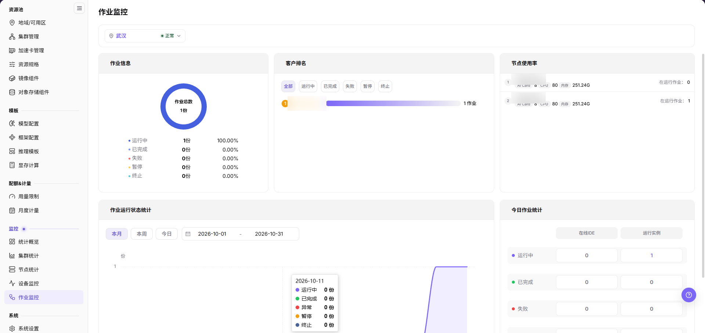
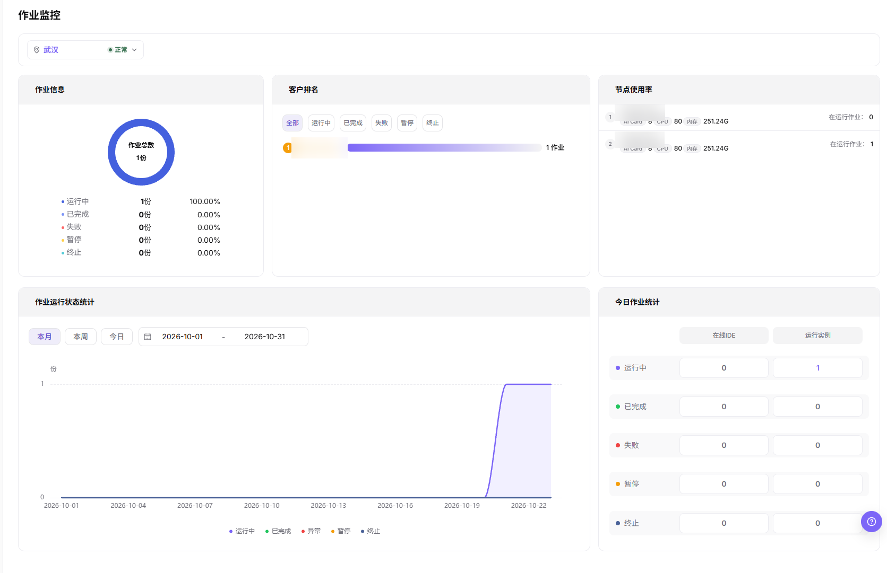

# 作业监控

## 功能概述

| 项目 | 内容 |
| --- | --- |
| 适用角色 | 运营管理员 |
| 导航路径 | On-Prem > 监控 > 作业监控 |
| 管理对象 | 模型实例、在线 IDE、运行实例、训练任务和历史作业 |

#### 新手理解

作业监控像任务排队和执行清单，用来查看训练、推理或开发任务的状态、排队原因、运行时长和资源占用。

#### 术语表

| 术语 | 说明 |
| --- | --- |
| 作业状态 | 作业当前处于排队中、运行中、成功、失败或已取消等状态。 |
| 排队原因 | 资源不足、配额限制或调度约束等导致作业无法启动的原因。 |
| 运行时长 | 作业从启动到当前时间的持续时长。 |

#### 推荐操作顺序

先确认模型实例、在线 IDE、运行实例、训练任务和历史作业的前置依赖，再按主要操作顺序处理，最后执行结果校验并进入后续页面。

#### 小白先看

先确认当前任务是否涉及模型实例、在线 IDE、运行实例、训练任务和历史作业，再按照推荐顺序操作。页面字段或状态与预期不符时，先回到前置对象页核对依赖，不要跳过结果校验直接进入下游流程。

## 前提条件

1. 当前账号具备作业监控查看权限。
2. 平台已采集作业状态、事件、排队和运行时长。
3. 目标租户、用户或集群范围已明确。
4. 需要排障时已准备作业 ID 或提交时间。

## 页面说明

页面用于查看和处理模型实例、在线 IDE、运行实例、训练任务和历史作业。

作业监控用于查看作业排队、运行中、失败原因和资源占用。运营管理员可用它分析资源不足、镜像拉取失败、启动异常或长时间运行任务。

## 主要操作

### 查看作业监控总览

#### 适用场景

- 一眼确认平台当前作业总数，以及五类作业状态的分布。
- 在打开其他监控页之前，先定位当前承载运行中作业的节点。

#### 操作步骤

1. 进入 `On-Prem > 监控 > 作业监控`。
2. 在页面标题下方的地域选择器中确认地域与其状态徽标，例如 `武汉` 与 `正常`。
3. 在 `作业信息` 中读取环图中心的 `作业总数`，以及其下图例中 `运行中`、`已完成`、`失败`、`暂停`、`终止` 的份数与百分比。
4. 在 `节点使用率` 中逐行读取节点的加速卡、`CPU` 与 `内存` 用量，以及行末的 `在运行作业：N`。
5. 在 `客户排名` 中读取排名行与每条进度条右端的作业数量。

页面并列五张卡片：`作业信息`、`客户排名`、`节点使用率`、`作业运行状态统计` 与 `今日作业统计`。

#### 结果校验

- 五行状态份数之和等于环图中心的 `作业总数`。
- `作业总数` 大于 0 时，五行百分比之和为 `100.00%`。
- 各节点行的 `在运行作业：N` 之和等于 `作业信息` 中 `运行中` 的份数。

#### 注意事项

- 节点行为内网地址。入库截图已就地遮蔽，文档一律不转录真实值。

### 按状态筛选客户排名

#### 适用场景

- 定位某一状态下的作业归属于哪些客户。
- 在把某个状态当作空结果处理前，先确认该状态确实没有排名行。

#### 操作步骤

1. 在 `客户排名` 卡片中选择六个状态控件之一：`全部`、`运行中`、`已完成`、`失败`、`暂停` 或 `终止`。默认选中 `全部`。
2. 读取每个排名行：左侧排名徽标、客户名称、进度条与右端的作业数量，例如 `1 作业`。
3. 将该数量与 `作业信息` 图例中同一状态的份数进行比对。

`客户排名` 的六个状态控件位于排名行上方。

#### 结果校验

- 被选中的状态控件与其他五个在样式上可区分。
- 排名行右端的作业数量等于 `作业信息` 图例中同一状态的份数。
- 选中 `全部` 时，各排名行的作业数量之和等于 `作业总数`。

#### 注意事项

- 客户名称在卡片内以省略号截断展示，入库截图已就地遮蔽，文档一律不转录该值。

### 读取作业运行状态趋势

#### 适用场景

- 判断作业量在一段周期内的升降，而不是只看单个瞬时状态。
- 定位某一状态首次出现在曲线上的日期。

#### 操作步骤

1. 在 `作业运行状态统计` 卡片中选择三个快捷范围之一：`本月`、`本周` 或 `今日`。默认选中 `本月`。
2. 或在右侧两个日期选择器中设定明确区间，例如 `2026-10-01` 至 `2026-10-31`。
3. 按 x 轴日期与 y 轴单位 `份` 读取曲线，并识别图下五项图例：`运行中`、`已完成`、`异常`、`暂停`、`终止`。
4. 将某一日期上的数值与同期 `作业信息` 中同一状态的份数进行比对。

#### 结果校验

- x 轴范围与两个日期选择器所示区间一致。
- 被选中的快捷范围与另外两个在样式上可区分。
- 无作业的日期曲线贴住基线，有作业的日期曲线抬升。

#### 注意事项

- 趋势图图例第三项为 `异常`，而 `作业信息` 环图第三项为 `失败`。两名均为本页画面原文，按显示逐字转录。
- 将指针悬停在曲线某一天上会展开该日各系列的数值明细，例如 `2026-10-11` 的五项均为 `0 份`。

### 按实例类型核对今日作业统计

#### 适用场景

- 按实例类型拆分当日作业量，而不是只看一个合计。
- 确认某个作业数量属于在线开发环境还是运行实例。

#### 操作步骤

1. 在 `今日作业统计` 卡片中读取顶部两列标题：`在线IDE` 与 `运行实例`。
2. 自上而下读取五行状态：`运行中`、`已完成`、`失败`、`暂停`、`终止`。
3. 取某一状态行与某一实例类型列交叉处的数值单元格，作为当日该实例类型下该状态的作业数量。

#### 结果校验

- `在线IDE` 与 `运行实例` 两列的 `运行中` 数值之和等于 `作业信息` 中 `运行中` 的份数。
- 五行状态在两个列下各有一个数值单元格。
- 卡片标题 `今日作业统计` 将口径限定为当日，而非 `作业运行状态统计` 所选区间。

#### 注意事项

- 本次画面中该卡片无合计行与百分比列。

### 排查作业异常指标

#### 适用场景

- 作业批量排队、运行中卡死或突发失败增多。
- 需要把异常作业归因到资源、镜像、存储或其落到的节点。

#### 操作步骤

1. 在 `作业运行状态统计` 中记录异常发生的日期，以及图下图例中受影响的状态。
2. 检查 `节点使用率` 中各节点的加速卡、`CPU`、`内存` 用量与 `在运行作业：N`，判断负载是否集中在单个节点。
3. 保持相同时间范围，结合 `集群统计` 与 `节点统计` 排查是否由于整体计算资源耗尽导致排队。
4. 进入作业详情与实例日志，排查镜像拉取超时、启动命令错误、存储挂载失败或 OOM 崩溃等问题。

#### 结果校验

- 失败与排队作业数量无异常增多。
- 长时间运行作业未在超出业务预期的情况下占用关键资源。
- 每个受影响作业符合预期的所属租户、规格、镜像与集群。

#### 注意事项

- 作业排队不一定是平台故障，先看资源、配额与调度条件。
- 如确认需取消死锁作业或重新调度，依据平台运维规程处理，不擅自批量强杀正常业务作业。

## 参数速查表

| 字段名称 | 是否必填 | 字段类型 | 示例 | 说明 |
| --- | --- | --- | --- | --- |
| 作业 ID | 必填 | 文本 | `job-20260706-001` | 定位单个作业或任务实例。 |
| 作业名称 | 条件必填 | 文本 | `inference-job` | 辅助按业务名称定位作业。 |
| 作业类型 | 条件必填 | 枚举 | `运行实例` | 区分模型实例、在线 IDE、运行实例、训练任务或历史作业。 |
| 作业状态 | 系统生成 | 状态 | `Running` | 展示作业处于排队、运行、成功或失败状态。 |
| 所属租户 / 用户 | 条件必填 | 文本 | `tenant-a` | 用于按租户或用户定位作业归属。 |
| 所属集群 | 条件必填 | 文本 | `cluster-prod-a` | 定位作业运行或排队的集群。 |
| 节点 | 系统生成 | 文本 | `node-gpu-01` | 展示作业实际调度到的节点。 |
| 资源规格 | 系统生成 | 文本 | `2 * A800` | 展示作业申请或占用的资源规格。 |
| GPU / 加速卡占用 | 系统生成 | 数字 / 文本 | `2 * A800` | 展示作业占用的加速卡规格和数量。 |
| 排队时长 | 系统生成 | 时长 | `18 分钟` | 判断调度是否存在等待或资源不足。 |
| 运行时长 | 系统生成 | 时长 | `2 小时 15 分钟` | 判断作业运行是否超出预期。 |
| 失败信息 | 系统生成 | 文本 | `ImagePullBackOff` | 辅助定位作业失败原因。 |
| 时间范围 | 条件必填 | 日期范围 | `近 1 小时` | 控制统计卡片、趋势图和列表数据的查询窗口。 |

## 踩坑提示

- 作业排队不一定是故障，可能是资源或配额不足。
- 失败原因要结合事件、日志和镜像拉取状态判断。
- 长时间运行作业应关注资源占用和费用。
- 作业监控可能存在采集延迟，不能只凭单个瞬时状态判断故障。
- 作业异常需要结合事件、日志、镜像拉取、启动命令、存储挂载、节点状态和设备状态一起排查。
- 长时间运行或高资源占用不一定是异常，需要结合业务预期、租户配额和模型规格判断。

#### 配置规则与影响

- **排队先看资源和调度条件**：排队不一定是平台故障，可能是规格、标签、配额或集群容量限制。
- **失败信息要结合事件**：错误码和事件能区分镜像、存储、启动命令、权限和资源不足问题。
- **运行时长用于发现卡死任务**：长时间运行应结合日志、资源利用率和业务预期判断。
- **资源占用会影响其他用户**：大作业集中提交时，应同步关注租户配额和集群水位。

## 结果校验

| 检查项 | 成功表现 | 异常时处理 |
| --- | --- | --- |
| 页面加载 | 作业监控图表或列表正常显示 | 检查当前角色的监控权限和所选地域是否开放采集能力 |
| 统计范围 | 时间范围、地域和对象数量与排查目标一致 | 清除筛选后逐项恢复条件，确认没有混用不同统计口径 |
| 数据新鲜度 | 更新时间落在预期采集周期内 | 到系统设置或监控采集组件核对采集周期、连接和告警 |
| 异常关联 | 异常指标能关联到集群、节点、设备或作业 | 保持相同时间范围，到相邻监控页和对象详情交叉核对 |

## 常见问题

#### 作业监控没有数据

**问题现象：**

页面可进入，但图表或列表为空。

**可能原因：**

- 所选时间没有任务。
- 地域未开放采集。
- 当前角色无指标权限。

**处理方式：**

1. 扩大时间范围并重置筛选
2. 核对地域监控能力
3. 到相邻监控页确认是否同样无数据。

#### 作业监控更新不及时

**问题现象：**

页面数据长时间没有变化。

**可能原因：**

- 采集周期尚未到。
- 采集组件异常。
- 页面缓存未刷新。

**处理方式：**

1. 核对更新时间
2. 检查采集组件和告警
3. 刷新后用同一时间范围复查。

#### 作业监控与相邻页面数值不一致

**问题现象：**

同一对象在两个监控页面显示不同数值。

**可能原因：**

- 聚合粒度不同。
- 时间范围或时区不同。
- 筛选对象不同。

**处理方式：**

1. 统一时间范围和时区
2. 核对聚合口径
3. 清除筛选后逐项恢复。

#### 无法在关联监控中定位目标对象

**问题现象：**

点击指标或详情入口后找不到对应对象。

**可能原因：**

- 对象已结束或被移除。
- 角色不可见。
- 关联标识不一致。

**处理方式：**

1. 记录对象名称和时间
2. 到对应列表核对状态
3. 联系运营管理员检查可见范围。

#### 异常峰值无法复现

**问题现象：**

监控中出现峰值，但当前详情已恢复正常。

**可能原因：**

- 峰值持续时间短。
- 采样粒度较粗。
- 任务已经结束。

**处理方式：**

1. 锁定峰值时间段
2. 对照作业和节点事件
3. 保留脱敏截图和对象标识。

## 注意事项

- 作业名称、镜像地址、数据路径和日志内容可能含敏感信息。
- 终止作业前确认业务影响和输出文件保留策略。
- 高频失败作业应进入模板或镜像复盘。
- `终止`、`重启` 与 `删除` 会影响真实作业，执行最终动作前确认范围与影响。
- 文档示例不得包含真实作业 ID、实例名称、镜像地址、数据路径、日志内容、租户信息、节点名、集群 ID、资源池 ID、内部指标 key 或测试数据。

## 后续操作

1. 排队问题核对配额、规格和集群容量。
2. 失败问题核对镜像、启动命令、存储和事件。
3. 长时间运行任务进入用量和监控页面评估消耗。
