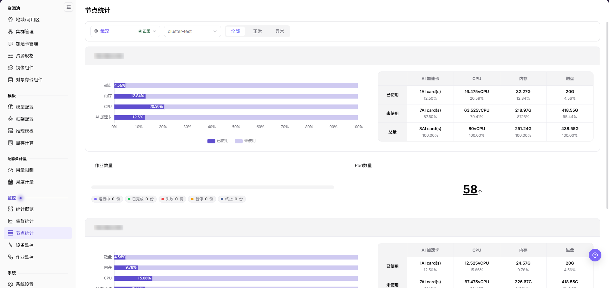
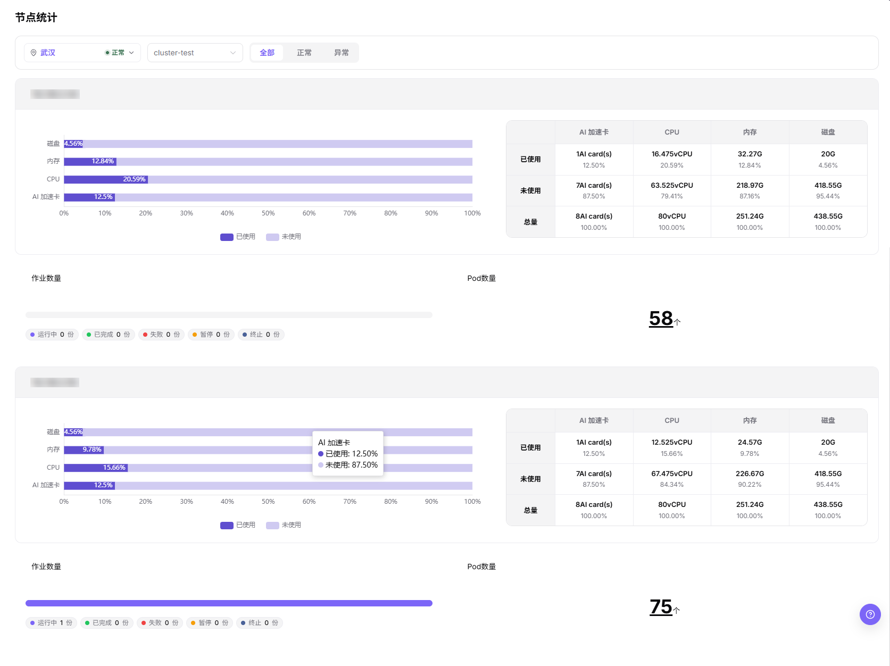

# 节点统计

## 功能概述
| 项目 | 内容 |
| --- | --- |
| 适用角色 | 运营管理员 |
| 导航路径 | On-Prem > 监控 > 节点统计 |
| 管理对象 | 节点标识、资源水位（磁盘／内存／CPU／AI 加速卡）、作业数量与 Pod 数量。 |

#### 新手理解

节点统计像服务器点检表，按节点逐张卡片展示磁盘、内存、CPU 与 AI 加速卡的水位以及作业与 Pod 数量，帮助判断问题落在哪台机器上。

#### 术语表

| 术语 | 说明 |
| --- | --- |
| 节点状态 | 节点是否处于 `正常` 或 `异常` 状态。 |
| CPU 使用率 | 节点当前的 CPU 负载比例，画面同时给出绝对量（`vCPU`）。 |
| 内存使用率 | 节点内存的占用比例，画面同时给出绝对量（`G`）。 |
| AI 加速卡使用率 | 节点 AI 加速卡的占用比例，绝对量以 `AI card(s)` 表示。 |
| Pod 数量 | 该节点当前承载的 Pod 总数，单位为「个」。 |

#### 推荐操作顺序

先按地域与集群筛选节点，再逐节点核对资源水位与作业、Pod 数量，最后执行结果校验并进入相邻监控页。

#### 小白先看

先确认筛选条的地域与集群是否指向目标范围，再看节点卡片的水位条形图与资源表。页面字段或状态与预期不符时，先回到 `集群管理` 与 `加速卡管理` 核对前置对象，不要跳过结果校验直接进入下游流程。

## 前提条件

1. 当前账号具备节点监控查看权限。
2. 目标节点属于已接入集群。
3. 节点 CPU、内存、磁盘和状态指标正常上报。
4. 已明确排障时间范围或受影响任务。

## 页面说明
页面用于按节点查看磁盘、内存、CPU 与 AI 加速卡的资源水位，以及该节点的作业数量与 Pod 数量。

节点统计用于查看每台节点的磁盘、内存、CPU 与 AI 加速卡水位及其作业与 Pod 数量。运营管理员可用它定位异常节点与高水位节点。

## 主要操作
### 按地域与集群筛选节点

#### 适用场景

- 需要把节点统计限定到某个地域下的某个集群时。
- 需要只看异常节点，或从异常切回全部节点时。

#### 操作步骤

1. 进入 `On-Prem > 监控 > 节点统计`。
2. 在页面标题下方的筛选条内打开地域选择器，选择目标地域；选择器右侧的徽标显示该地域当前状态，如 `正常`。
3. 在地域右侧的下拉框中选择目标集群，如 `cluster-test`。
4. 在筛选条最右侧的三态分段中点击 `全部`、`正常` 或 `异常`，默认选中 `全部`。

筛选条自左向右依次为地域、集群、状态分段三项控件。

#### 结果校验

- 页面标题保持 `节点统计`，节点卡片数量随所选集群变化。
- 选择 `异常` 后不再出现正常节点卡片；当前无异常节点时卡片区域为空。
- 地域徽标与所选地域一致。

#### 注意事项

- 本次画面未出现时间范围控件。
- 使用地域选择器与集群下拉缩小节点范围。

### 查看单节点资源水位

#### 适用场景

- 需要判断某台节点的磁盘、内存、CPU 或 AI 加速卡是否接近满载时。
- 需要核对节点已使用与未使用资源的绝对量和占比时。

#### 操作步骤

1. 筛选完成后，页面按节点纵向并列展示节点卡片，每张卡片对应一台节点。
2. 卡片顶部的灰底标题行为该节点的标识，画面以 IP 形态展示，文档与工单中不得转录真实值。
3. 读卡片左侧的横向水位条形图，自上而下四行依次为 `磁盘`、`内存`、`CPU`、`AI 加速卡`，横轴为 `0%` 到 `100%`，图例区分 `已使用` 与 `未使用`。
4. 读卡片右侧的资源表，列头依次为 `AI 加速卡`、`CPU`、`内存`、`磁盘`，行头依次为 `已使用`、`未使用`、`总量`；每格上方粗体为绝对量，下方为百分比。

同一张卡片的水位条形图与资源表呈现该节点的同一组指标。

#### 结果校验

- 条形图百分比与资源表同列百分比一致，例如 `CPU` 行 `20.59%` 对应表中 `16.475vCPU` 与 `20.59%`。
- `已使用` 与 `未使用` 两行的百分比相加为 `100.00%`，与 `总量` 行一致。
- `总量` 行的绝对量在同一集群的各节点卡片之间保持一致，例如 `8AI card(s)` 与 `80vCPU`。

#### 注意事项

- 条形图与资源表覆盖磁盘、内存、CPU、AI 加速卡四类指标。
- 加速卡绝对量以 `N AI card(s)` 形态展示，卡数与占比同时给出。
- 节点标识为内网地址形态，入库截图已就地遮蔽，正文一律使用脱敏占位。

### 查看节点作业与 Pod 数量

#### 适用场景

- 需要判断节点上是否有作业正在运行，或是否存在失败、暂停作业时。
- 需要核对节点当前承载的 Pod 总数时。

#### 操作步骤

1. 在每张节点卡片下方读 `作业数量` 区块的进度条：无作业时进度条为空，有运行时作业按运行占比填充。
2. 读进度条下方的五个状态标签，依次为 `运行中`、`已完成`、`失败`、`暂停`、`终止`，单位为「份」。
3. 读右侧 `Pod数量` 区块的大数字与单位「个」，得到该节点当前的 Pod 总数。

`作业数量` 与 `Pod数量` 在同一行并列，逐节点各一组。

#### 结果校验

- 五个状态标签的取值与进度条填充一致，例如仅 `运行中 1 份` 时进度条满格。
- `Pod数量` 大数字与状态标签相互独立，不等于五个标签之和。

#### 注意事项

- 状态标签单位中文画面为「份」，英文画面为 `Jobs`；`Pod数量` 单位中文画面为「个」，英文画面为 `unit`。
- 需要排查具体作业时，从 `作业监控` 页面进入该作业。

### 排查异常节点

#### 适用场景

- 节点卡片显示异常，或某项资源水位接近满载时。
- 需要跨页确认异常是否集中在同一集群时。

#### 操作步骤

1. 在筛选条把状态分段切到 `异常`，确认异常节点卡片。
2. 记录该节点的脱敏标识与所属集群。
3. 读该节点卡片中占比最高的一项资源，判断压力来自计算、内存还是磁盘。
4. 保持同一地域与集群，到左侧 `监控` 分组下的 `设备监控`、`作业监控` 继续核对设备侧与作业侧证据。
5. 结合节点事件和作业日志判断，不只看单个瞬时指标。

左侧菜单 `监控` 分组含 `统计概览`、`集群统计`、`节点统计`、`设备监控`、`作业监控` 五项。

#### 结果校验

- 状态分段切到 `异常` 后，页面只剩异常节点卡片。
- 相邻监控页与本页在同一地域、同一集群下的对象可互相对上。

#### 注意事项

- 本节仅覆盖本页展示的水位指标。
- 节点排空、维护等操作在节点管理工作流中处理。
- 单点节点异常不代表集群整体不可用。

## 参数速查表
| 字段名称 | 是否必填 | 字段类型 | 示例 | 说明 |
| --- | --- | --- | --- | --- |
| 地域 | 必填 | 下拉选择 | `武汉` | 筛选条最左侧控件，右侧徽标显示该地域状态，如 `正常`。 |
| 集群 | 条件必填 | 下拉选择 | `cluster-test` | 限定节点所属集群。 |
| 节点状态分段 | 必填 | 分段选择 | `全部` | 三态分段 `全部`／`正常`／`异常`，默认 `全部`。 |
| 节点标识 | 系统生成 | 文本 | 已脱敏 | 节点卡片顶部标题行，画面以 IP 形态展示，文档不得转录真实值。 |
| 磁盘使用率 | 系统生成 | 百分比 | `4.56%` | 条形图首行与资源表末列，绝对量如 `20G`。 |
| 内存使用率 | 系统生成 | 百分比 | `12.84%` | 条形图第二行与资源表 `内存` 列，绝对量如 `32.27G`。 |
| CPU 使用率 | 系统生成 | 百分比 | `20.59%` | 条形图第三行与资源表 `CPU` 列，绝对量如 `16.475vCPU`。 |
| AI 加速卡使用率 | 系统生成 | 百分比 | `12.5%` | 条形图末行与资源表 `AI 加速卡` 列，绝对量如 `1AI card(s)`。 |
| 资源绝对量 | 系统生成 | 数值 | `8AI card(s)`／`80vCPU`／`251.24G`／`438.55G` | 资源表 `总量` 行的四项绝对量。 |
| 作业数量 | 系统生成 | 数字 | `运行中 1 份` | 五个状态标签：`运行中`／`已完成`／`失败`／`暂停`／`终止`，单位「份」。 |
| Pod 数量 | 系统生成 | 数字 | `58 个` | 节点卡片右侧大数字，单位「个」。 |

## 踩坑提示
- 节点 `正常` 不代表设备插件一定正常，两者需分别确认。
- 节点统计可能有采集延迟，不能只凭单个瞬时指标判断故障。
- 状态分段选 `异常` 后卡片区域可能为空，空区域表示当前无异常节点，不等于采集异常。
- 水位条形图与资源表口径一致，两处数值对不上时先确认是否同一张节点卡片。
- `Pod数量` 与 `作业数量` 单位不同（「个」与「份」），不要把两者互相换算。

#### 配置规则与影响

- **节点状态优先于资源水位**：节点异常或采集异常时，先处理状态问题。
- **磁盘压力会影响作业稳定性**：磁盘水位高可能导致镜像拉取、日志写入或临时文件创建失败。
- **单节点异常会造成局部排队**：调度失败不一定是集群整体容量不足，可能是目标节点标签或污点限制。
- **指标延迟要结合事件判断**：节点指标延迟时，应同时查看集群事件和作业失败原因。

## 结果校验
| 检查项 | 成功表现 | 异常时处理 |
| --- | --- | --- |
| 页面加载 | 节点卡片、水位条形图与资源表正常显示 | 检查当前角色的监控权限和所选地域是否开放采集能力 |
| 统计范围 | 地域、集群和节点卡片数量与排查目标一致 | 清除筛选后逐项恢复条件，确认没有混用不同统计口径 |
| 数据新鲜度 | 节点指标与最近一次采集一致 | 到系统设置或监控采集组件核对采集周期、连接和告警 |
| 异常关联 | 异常指标能关联到集群、节点或作业 | 保持同一地域与集群，到 `设备监控`、`作业监控` 和对象详情交叉核对 |

## 常见问题

#### 节点统计没有数据

**问题现象：**

页面可进入，但图表或列表为空。

**可能原因：**

- 所选时间没有任务。
- 地域未开放采集。
- 当前角色无指标权限。

**处理方式：**

1. 扩大时间范围并重置筛选
2. 核对地域监控能力
3. 到相邻监控页确认是否同样无数据。

#### 节点统计更新不及时

**问题现象：**

页面数据长时间没有变化。

**可能原因：**

- 采集周期尚未到。
- 采集组件异常。
- 页面缓存未刷新。

**处理方式：**

1. 核对更新时间
2. 检查采集组件和告警
3. 刷新后用同一时间范围复查。

#### 节点统计与相邻页面数值不一致

**问题现象：**

同一对象在两个监控页面显示不同数值。

**可能原因：**

- 聚合粒度不同。
- 时间范围或时区不同。
- 筛选对象不同。

**处理方式：**

1. 统一时间范围和时区
2. 核对聚合口径
3. 清除筛选后逐项恢复。

#### 无法在关联监控中定位目标对象

**问题现象：**

点击指标或详情入口后找不到对应对象。

**可能原因：**

- 对象已结束或被移除。
- 角色不可见。
- 关联标识不一致。

**处理方式：**

1. 记录对象名称和时间
2. 到对应列表核对状态
3. 联系运营管理员检查可见范围。

#### 异常峰值无法复现

**问题现象：**

监控中出现峰值，但当前详情已恢复正常。

**可能原因：**

- 峰值持续时间短。
- 采样粒度较粗。
- 任务已经结束。

**处理方式：**

1. 锁定峰值时间段
2. 对照作业和节点事件
3. 保留脱敏截图和对象标识。

## 注意事项

- 节点名、IP、标签和机房信息应脱敏。
- 单点节点异常不一定代表集群整体不可用。
- 节点维护前应确认运行中任务和挂载存储影响。
- 故障判断前，需要结合集群统计、设备监控、作业监控、调度事件和节点日志交叉确认。
- 文档示例不得包含真实节点名、节点 IP、设备 ID、集群 ID、资源池 ID、租户信息、内部指标 key 或测试数据。

## 后续操作
1. 节点显示异常时，到 `集群管理` 与 `设备监控` 检查集群事件与设备状态。
2. 某项资源水位接近满载时，到 `作业监控` 定位占用资源的作业。
3. 涉及 AI 加速卡时继续查看 `设备监控`。
