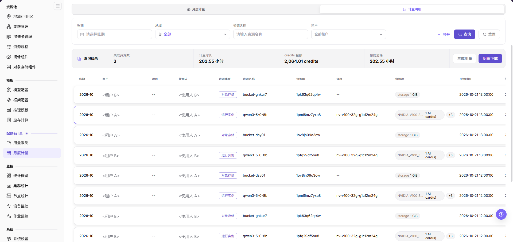
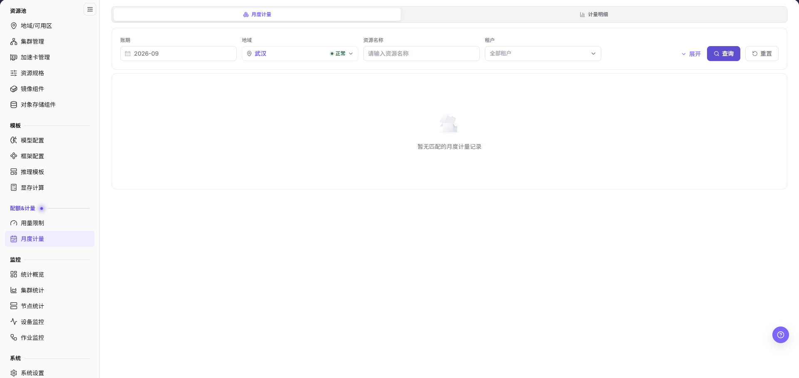
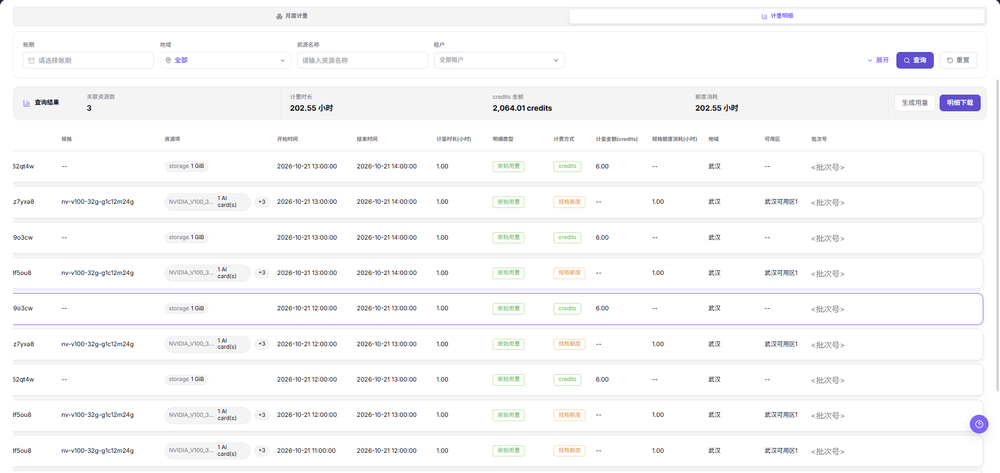

# 月度计量

## 功能概述

| 项目 | 内容 |
| --- | --- |
| 适用角色 | 运营管理员 |
| 导航路径 | On-Prem > 配额&计量 > 月度计量 |
| 管理对象 | 账期、地域、资源名称和租户筛选条件，以及月度计量记录、用量汇总与导出 |

#### 新手理解

月度用量像每月资源账单汇总，把分散的算力、存储和实例消费汇总到账期、租户和资源类型维度，再按小时粒度的计量记录逐条列出。

#### 术语表

| 术语 | 说明 |
| --- | --- |
| 账期 | 计量数据所属的月份，同时是页面的筛选条件。 |
| 明细类型 | 计量记录的类型标签，本批画面仅出现 `原始用量`。 |
| 计费方式 | 单条记录的折算口径，取值为 `credits` 或 `规格额度`。 |
| 批次号 | 一次生成或汇总任务的标识，用于把记录回溯到同一次处理。 |

#### 推荐操作顺序

先确认账期、地域、资源名称和租户四项筛选条件的前置依赖，再按查询、核对汇总、逐条核对、生成用量、明细下载的顺序处理，最后执行结果校验并进入后续页面。

#### 小白先看

先确认当前任务是否涉及账期、地域、资源名称、租户和月度计量记录，再按照推荐顺序操作。页面字段或状态与预期不符时，先回到前置对象页核对依赖，不要跳过结果校验直接进入下游流程。

## 前提条件

1. 当前账号具备运营管理员权限。
2. 目标地域已在页面 `地域` 筛选中选中且状态显示 `正常`。
3. 相关资源、作业或计量任务已有数据上报。
4. 需要补齐或重算记录时，本次处理范围与账期已经过内部确认。

## 页面说明

页面用于按账期查询租户的资源消费记录，核对用量汇总，并触发生成用量或导出明细。

页面标题区提供 `月度计量` 和 `计量明细` 两个页签，当前页为 `月度计量`，另一页签跳转到兄弟页 `计量明细`。左侧菜单 `配额&计量` 分组下可见 `用量限制` 和 `月度计量` 两项。

筛选区自左至右为 `账期`、`地域`、`资源名称`、`租户` 四项，右侧依次为 `展开`、`查询` 和 `重置`。`账期` 未选择时显示占位 `请选择账期`；`地域` 未选择时显示 `全部`，选中后右侧带状态点与 `正常` 标识；`资源名称` 占位为 `请输入资源名称`；`租户` 默认 `全部租户`。

筛选区下方是汇总条，左侧为 `查询结果` 区块，依次展示 `关联资源数`、`计量时长`（单位 `小时`）、`credits 金额`（单位 `credits`）和 `额度消耗`（单位 `小时`）四项统计；右侧为 `生成用量` 和 `明细下载` 两枚按钮，后者为实心强调样式。

主表列自左至右为 `账期`、`租户`、`项目`、`使用人`、`资源类型`、`资源名称`、`资源ID`、`规格`、`资源项`、`开始时间`、`结束时间`、`计量时长(小时)`、`明细类型`、`计费方式`、`计量金额(credits)`、`规格额度消耗(小时)`、`地域`、`可用区`、`批次号`。`项目` 与 `规格` 无值时显示 `--`，`资源项` 以灰色胶囊展示卡型号与 `1 AI card(s)` 或 `storage 1 GiB`，GPU 类记录的胶囊后带 `+3` 折叠标记。

同一资源在同一账期内会出现多行按小时切分的记录，因此列表行数不等于资源个数；判断总量时使用汇总条，定位单条消费时使用列表行。

## 主要操作

### 查询月度计量记录

#### 适用场景

需要按账期、地域、资源名称或租户定位某一段范围内的月度计量记录时使用。四项筛选条件均为选填，不设置条件直接查询会返回当前可见范围内的全部记录。

#### 操作步骤

1. 进入 `On-Prem > 配额&计量 > 月度计量`，确认页面停留在 `月度计量` 页签。
2. 在 `账期` 选择器中选择月份；未选择时输入框显示占位 `请选择账期`。
3. 在 `地域` 下拉中选择目标地域，选中项右侧显示状态点与 `正常`；不限定地域时保留 `全部`。
4. 在 `资源名称` 输入框中填写关键字，在 `租户` 下拉中选择单个租户；未选择时 `租户` 显示 `全部租户`。

5. 需要更多条件时点击 `展开`。
6. 点击 `查询` 刷新汇总条与列表，点击 `重置` 清空全部筛选条件后重新查询。

#### 结果校验

1. 有数据时列表首列 `账期` 与所选月份一致，`地域` 列与所选地域一致。
2. 无数据时列表区显示占位插画与文案 `暂无匹配的月度计量记录`，此时汇总条各统计项不作为结论依据。
3. 点击 `重置` 后 `账期` 与 `资源名称` 回到占位状态、`地域` 回到 `全部`、`租户` 回到 `全部租户`。

#### 注意事项

- 列表按小时粒度展示记录，同一资源在同一账期内会出现多行，不要按行数判断资源个数。
- 旧版页面的 `状态`、`创建时间` 列和 `确认` 操作属于更早的界面布局，当前页面不再出现。
- 截图入库前已按 G3 口径脱敏，核对时以 `资源名称` 和 `资源ID` 定位记录。

### 核对查询结果汇总

#### 适用场景

需要在逐条核对之前先确认一次查询命中的资源规模、时长与消耗总量，或者需要比较不同筛选范围之间统计值变化时使用。

#### 操作步骤

1. 完成一次查询后，读取列表上方汇总条的 `查询结果` 区块。
2. 核对 `关联资源数`、`计量时长`、`credits 金额` 和 `额度消耗` 四项统计，注意 `计量时长` 与 `额度消耗` 的单位是 `小时`，`credits 金额` 的单位是 `credits`。
3. 变更 `账期` 或 `地域` 后重新点击 `查询`，观察四项统计随筛选范围扩大或缩小的变化方向。
4. 需要按口径拆分时，把汇总条的 `credits 金额` 与列表 `计量金额(credits)` 列、`额度消耗` 与 `规格额度消耗(小时)` 列分别对照。

#### 结果校验

1. `关联资源数` 与当前结果中去重后的 `资源ID` 个数一致。
2. `credits 金额` 与 `计量金额(credits)` 列的合计在同一筛选范围内可对应，`额度消耗` 与 `规格额度消耗(小时)` 列的合计可对应。
3. `计量时长` 与 `额度消耗` 在画面中同为小时口径。

#### 注意事项

- 汇总条只反映当前筛选结果，不等价于整月账单，也不能替代结算口径。
- 统计项为空或为 0 时，先确认 `账期` 与 `地域` 是否命中，再判断是否真的没有计量数据。
- 只读核对时不要点击汇总条右侧的 `生成用量` 和 `明细下载`，前者会改写计量数据。

### 逐条核对计量记录

#### 适用场景

需要按资源、时间段和计费口径核对单条计量记录，或者需要定位某一时段的缺失记录时使用。

#### 操作步骤

1. 在列表中定位目标行，读取 `账期`、`租户`、`项目`、`使用人` 四列确认记录归属；`项目` 无值时显示 `--`。
2. 读取 `资源类型`、`资源名称`、`资源ID` 和 `规格` 四列确认计量对象；对象存储类记录的 `规格` 显示 `--`。
3. 核对 `资源项` 胶囊内容：GPU 类记录展示卡型号与 `1 AI card(s)` 并在胶囊后带 `+3` 折叠标记，存储类记录展示 `storage 1 GiB`。

4. 横向滚动列表，读取 `开始时间`、`结束时间`、`计量时长(小时)`、`明细类型`、`计费方式`、`计量金额(credits)`、`规格额度消耗(小时)`、`地域`、`可用区` 和 `批次号`。
5. 按 `计费方式` 分组求和：取值为 `credits` 的记录看 `计量金额(credits)` 列，取值为 `规格额度` 的记录看 `规格额度消耗(小时)` 列，两类记录的另一列显示 `--`。
6. 发现相邻时段缺口时，记录该资源的 `资源ID`、缺口起止时间和同批次其他记录的 `批次号`，再进入 `生成用量` 处理。

#### 结果校验

1. 每行的 `开始时间` 与 `结束时间` 首尾相接，`计量时长(小时)` 与两者之差一致。
2. 同一 `资源ID` 的多行记录，其 `资源名称`、`规格` 与 `地域` 保持一致。
3. `明细类型` 与 `计费方式` 两列的标签组合在同一记录口径下保持一致；`明细类型` 显示 `原始用量`。

#### 注意事项

- 逐条核对只解释单条消费，不能直接得出整月结论，整月判断回到汇总条与月度账单。
- `批次号` 在入库截图中已脱敏，实际核对时使用页面原值定位批次。
- 不在页面上直接修改记录值；需要补齐或重算时统一走 `生成用量`。

### 生成用量

#### 适用场景

月度计量记录缺失、时段未覆盖，或者需要按新的口径重新核算已有明细时使用。该操作会改写计量数据，属于写操作。

#### 操作步骤

1. 在汇总条右侧点击 `生成用量`，打开同名弹窗。
2. 在 `* 处理范围` 中选择 `小时`、`日` 或 `月`，弹窗默认选中 `月`。
3. 需要限定月份时，在 `选择时间` 卡片的 `月份` 输入框中选择；该卡片右上角标注 `可选`，卡片内说明为 `不选月份时处理上个月；选择本月时只处理已结束的小时。`
4. 在 `已有明细的处理方式` 分组中确认 `重算已有明细` 开关状态，卡片内说明为 `开启：补齐缺失明细并重新核算已有明细；原明细保留，费用差额另记调账。关闭：仅补齐缺失明细，不重新核算已有明细。`

5. 点击页脚 `确定` 提交本次生成任务，点击 `取消` 或弹窗右上角 `×` 放弃未提交的设置。

#### 结果校验

1. 回到列表后以相同 `账期` 与 `地域` 重新点击 `查询`，确认缺失时段的记录已补齐。
2. 切换到 `计量明细` 页签，核对新增记录的 `批次号` 与本次生成任务可对应。
3. 以重新查询后的列表结果为准，确认生成完成。

#### 注意事项

- `重算已有明细` 开启后会把费用差额记为调账，执行前确认目标账期的结算状态与内部审批。
- 处理范围越小越安全，未经审批不在已结算账期上执行 `月` 粒度重算。
- 不在真实租户账期上通过反复点击 `确定` 验证行为差异。

### 明细下载

#### 适用场景

需要把当前筛选范围内的明细或汇总导出为文件，用于对账、计量复核或问题排查时使用。

#### 操作步骤

1. 在汇总条右侧点击 `明细下载`，打开同名弹窗。
2. 在 `数据类型` 中选择 `明细数据` 或 `汇总数据`，弹窗默认选中 `明细数据`。
3. 在 `* 起止时间` 区间选择器中填写 `开始时间` 和 `结束时间`，该项为必填。
4. 按需选择 `账期`、`资源类型`、`地域`、`可用区`、`租户` 和 `项目`，或填写 `资源名称`、`资源ID`、`批次号` 缩小导出范围；`资源类型` 未选择时显示 `全部资源类型` 并在右侧提供清除图标，`地域` 为 `全部` 时 `可用区` 置灰显示 `全部可用区`。

5. 点击页脚 `确定` 开始导出，点击 `取消` 放弃本次导出。
6. 下载完成后核对文件内容，再把文件保存在受控目录，仅用于对账、计量复核或问题排查。

#### 结果校验

1. 下载文件的列名、时间范围与弹窗内所选条件一致。
2. 文件的合计值与页面汇总条的 `计量时长`、`credits 金额` 和 `额度消耗` 在同一筛选范围内可对应。

#### 注意事项

- 导出文件包含租户、资源与计量信息，按权限共享，不外发到非授权渠道。
- 点击 `确定` 前再次确认 `起止时间` 与 `数据类型`，避免导出过大范围或非目标租户数据。

## 参数速查表

| 字段名称 | 是否必填 | 字段类型 | 示例 | 说明 |
| --- | --- | --- | --- | --- |
| 账期 | 选填 | 月份选择 | `2026-07` | 筛选条件，对应列表首列 `账期`。 |
| 地域 | 选填 | 下拉选择 | `武汉` | 选中后右侧显示状态点与 `正常`。 |
| 资源名称 | 选填 | 文本 | `<text>` | 按资源名称过滤记录。 |
| 租户 | 选填 | 下拉选择 | `全部租户` | 未选择时覆盖全部可见租户。 |
| 关联资源数 | 系统生成 | 数字 | `<number>` | 当前结果中去重后的资源个数。 |
| 计量时长 | 系统生成 | 时长 | 小时 | 汇总条统计项。 |
| credits 金额 | 系统生成 | 数字 | credits | 汇总条统计项，对应 `计量金额(credits)` 列。 |
| 额度消耗 | 系统生成 | 时长 | 小时 | 汇总条统计项，对应 `规格额度消耗(小时)` 列。 |
| 明细类型 | 系统生成 | 标签 | `原始用量` | 记录类型。 |
| 计费方式 | 系统生成 | 标签 | `credits` / `规格额度` | 决定用量落在哪一列。 |
| 批次号 | 系统生成 | 文本 | `<text>` | 把记录回溯到同一次生成或汇总任务。 |
| 处理范围 | 必填 | 单选胶囊 | `小时` / `日` / `月` | `生成用量` 弹窗字段，默认 `月`。 |
| 起止时间 | 必填 | 时间区间 | 开始 - 结束 | `明细下载` 弹窗字段。 |
| 数据类型 | 选填 | 单选胶囊 | `明细数据` / `汇总数据` | `明细下载` 弹窗字段，默认明细数据。 |

## 踩坑提示

- 月度用量是汇总口径，不能只凭汇总值判断具体资源是否计量正确。
- 列表按小时粒度切分记录，跨时段和跨账期运行的资源会被拆成多行，不要只用单行推断整月费用。
- 计量数据可能延迟入账或需要补齐，对账前统一 `账期`、`地域` 与统计口径。
- `生成用量` 会改写计量数据，`重算已有明细` 开启还会产生调账记录，两者都不用于验证性操作。
- `明细下载` 导出的文件包含租户名称、资源标识与用量信息，下载前必须确认筛选条件。
- 旧版页面的 `状态`、`创建时间`、`导出状态` 与 `确认` 入口属于更早的界面布局，当前页面不再出现。

#### 配置规则与影响

- **先汇总后明细**：月度异常先从汇总条定位范围，再回到逐条记录与计量明细追溯。
- **账期不可混用**：核对与导出前先明确 `账期` 与 `起止时间` 的边界。
- **写操作单独执行**：`生成用量` 与查询、导出分开做，避免在同一次操作里既改数据又比对旧值。

## 结果校验

| 检查项 | 成功表现 | 异常时处理 |
| --- | --- | --- |
| 页面入口 | 可进入月度计量并看到页签、筛选区与汇总条 | 检查菜单权限、当前业务身份和所属租户范围 |
| 数据范围 | 列表与汇总条和所选账期、地域、资源名称、租户一致 | 点击 `重置` 后重新查询，核对时间边界与统计口径 |
| 数据更新 | 最新记录的 `结束时间` 与 `批次号` 符合预期周期 | 到来源页核对任务、计量或配额记录是否已生成 |
| 交叉核对 | 记录的起止时间、计费方式与金额可与计量明细对应 | 切换到 `计量明细` 页签按 `资源ID` 和时间范围逐项比对 |

## 常见问题

#### 月度计量没有记录

**问题现象：**

页面正常打开，但列表区显示 `暂无匹配的月度计量记录`。

**可能原因：**

- 筛选范围过窄。
- 来源记录尚未生成。
- 当前角色不可见。

**处理方式：**

1. 点击 `重置` 后重新查询
2. 核对来源任务或计量周期
3. 检查当前业务身份和租户范围。

#### 月度计量范围不正确

**问题现象：**

显示的数据不属于预期账期、地域或资源。

**可能原因：**

- 时间边界不一致。
- `地域` 筛选未生效。
- 对象归属已变化。

**处理方式：**

1. 重新选择 `账期` 和 `地域` 后点击 `查询`
2. 核对 `资源ID` 与 `资源名称`
3. 到来源详情确认当前归属。

#### 月度计量更新延迟

**问题现象：**

来源操作已完成，但页面尚未出现最新记录。

**可能原因：**

- 统计任务尚未结束。
- 缓存未刷新。
- 来源状态仍在处理中。

**处理方式：**

1. 核对来源状态
2. 等待一个统计周期后重新查询
3. 持续延迟时按 `生成用量` 流程检查缺失时段。

#### 详情或下载入口不可用

**问题现象：**

`明细下载`、`展开` 或页签入口不可点击。

**可能原因：**

- 当前记录不支持该操作。
- 角色权限不足。
- 必填条件尚未填写。

**处理方式：**

1. 先完成一次查询
2. 检查角色权限
3. 在弹窗内补齐 `* 起止时间` 等必填项。

#### 汇总与明细不一致

**问题现象：**

汇总条数值与逐条记录相加结果不同。

**可能原因：**

- 统计周期不同。
- `credits` 与 `规格额度` 两类口径被混算。
- 部分记录仍在处理。

**处理方式：**

1. 统一 `账期` 与查询时间
2. 按 `计费方式` 分组、按 `资源ID` 逐条核对
3. 等待未完成记录结算后复查。

## 注意事项

- 月度用量用于经营和结算参考，发布前应确认统计口径和最终入账状态。
- 导出报表可能包含租户名称、费用和用量明细，应限制分发范围。
- 跨账期运行的资源会按周期拆分成多行记录，不要只用单时段记录推断整月费用。

## 后续操作

1. 月度记录异常时，切换到 `计量明细` 页签核对资源和时间范围。
2. 缺失时段确认后，按 `生成用量` 选择处理范围并补齐记录。
3. 结算前确认统计周期、延迟入账和修正记录是否处理完毕。
4. 导出报表后，按租户或业务线进行内部复核。
