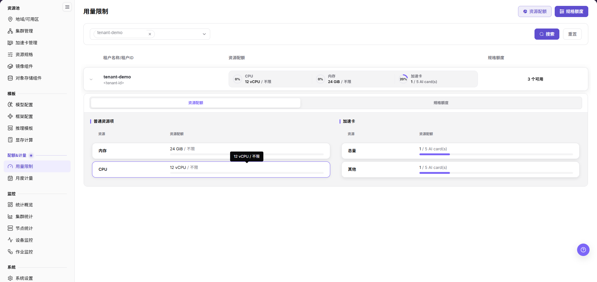
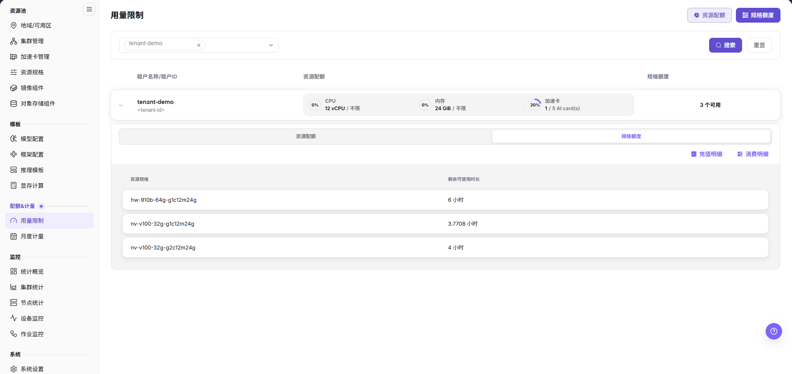
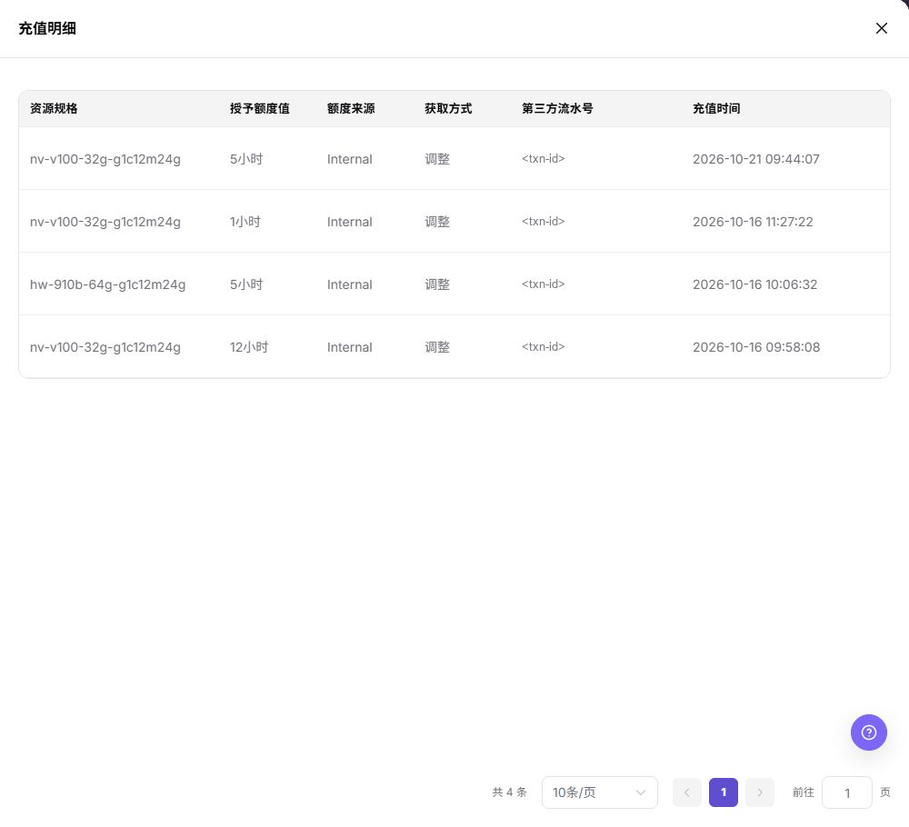
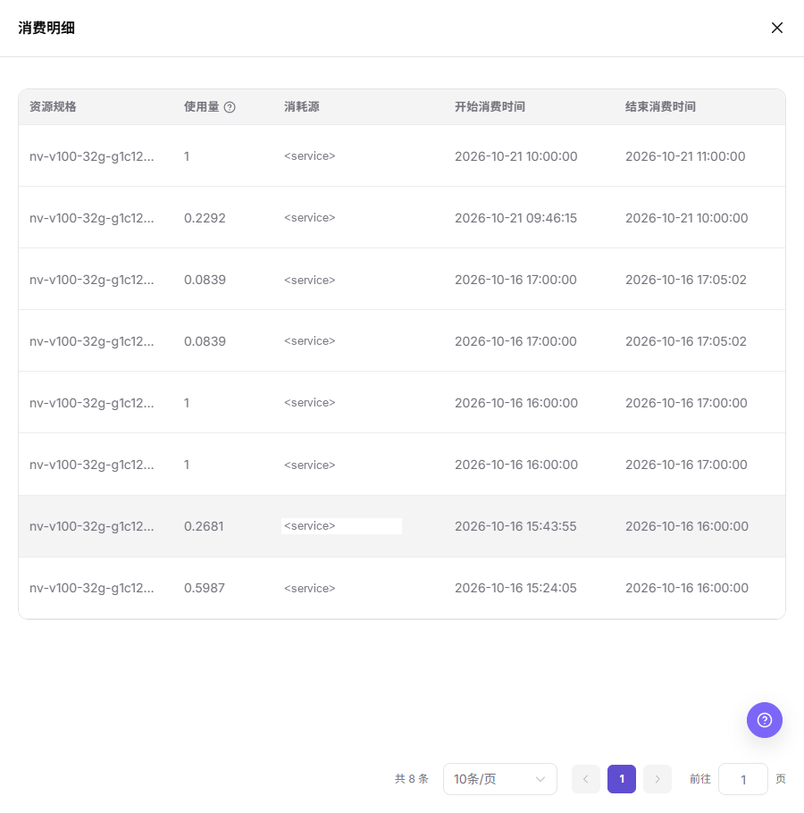
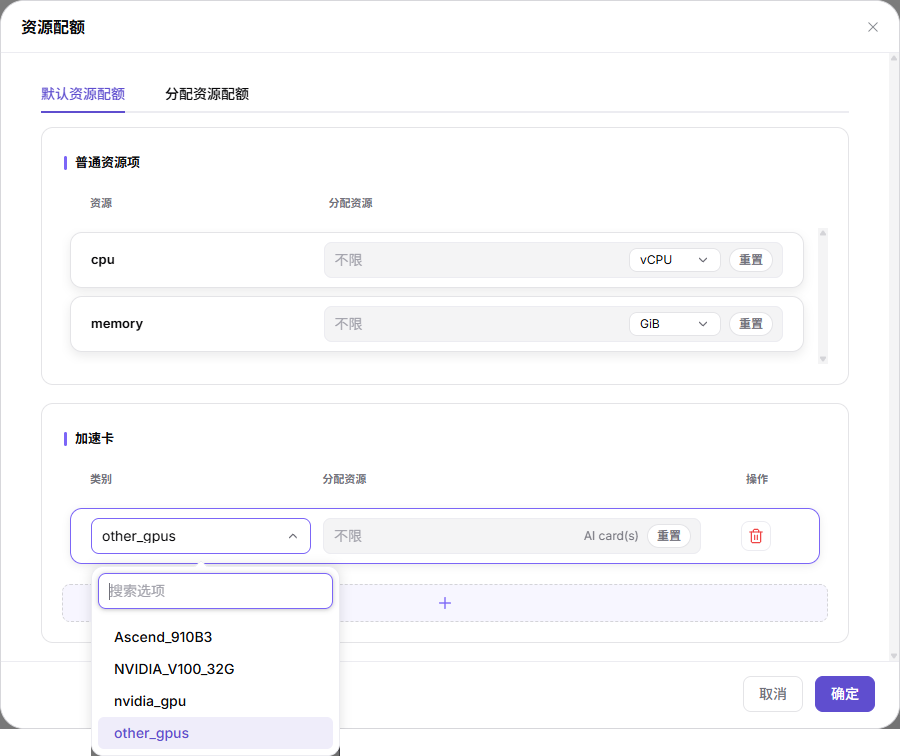
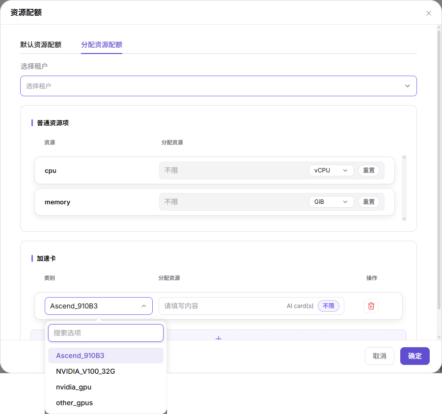

# 用量限制

## 功能概述

| 项目 | 内容 |
| --- | --- |
| 适用角色 | 运营管理员 |
| 导航路径 | On-Prem > 配额&计量 > 用量限制 |
| 管理对象 | 租户、资源配额、规格额度、规格 ID 和额度配置 |

#### 新手理解

用量限制像租户的资源上限表。资源规格决定一次实例或作业使用多少资源，用量限制决定某个租户总体可以使用多少资源，以及某些规格是否有额度限制。配额有两种口径：默认口径作用于未单独设置的租户，指定租户口径只作用于弹窗内所选租户。

#### 术语表

| 术语 | 说明 |
| --- | --- |
| 资源配额 | 按 CPU、内存、加速卡等资源类别限制租户可使用的资源量。 |
| 规格额度 | 按规格 ID 限制租户可使用的额度，额度框单位为小时。 |
| 不限 | 取消某一资源项或某一规格的固定上限，扩大其可用范围。 |
| 默认资源配额 / 默认规格额度 | 弹窗页签，作用于默认口径，页签内没有 `选择租户` 字段。 |
| 分配资源配额 | 弹窗页签，为 `选择租户` 选中的租户单独设置资源配额。 |
| 覆盖式初始化额度 | 弹窗页签，把所选租户的规格额度整体替换为页内配置，未列出的额度将被移除。 |
| 调整规格额度 | 弹窗页签，只把页内列出的规格额度调整为指定值，其他保持不变。 |

#### 推荐操作顺序

先确认目标租户、资源类别或规格、本次使用的口径已经过内部审批，再按「主要操作」逐项维护，然后用展开区和明细抽屉读回结果，最后进入后续页面。

#### 小白先看

先看页面说明，分清两条入口：页头两枚按钮打开配置弹窗，展开租户行查看该租户的配额视图与额度明细。弹窗内 `默认资源配额`、`分配资源配额`、`默认规格额度`、`覆盖式初始化额度`、`调整规格额度` 五个页签作用范围不同，选错页签会改到非目标对象，提交前必须核对页签名和 `选择租户`。

## 前提条件

1. 当前账号具备运营管理员权限。
2. 已选择正确地域。
3. 已确认目标租户、资源类型和规格范围。
4. 额度调整已经过内部审批，并明确本次使用默认口径还是指定租户口径。

## 页面说明

页面用于查看和维护租户的资源配额与规格额度：页头两枚按钮打开配置弹窗，展开租户行查看该租户的配额视图和额度明细。

进入 `On-Prem > 配额&计量 > 用量限制` 后，页面标题为 `用量限制`，页头右上提供 `资源配额` 和 `规格额度` 两枚带图标按钮；展开租户行后出现的同名两页签是查看明细的另一个入口。

筛选区是租户选择器而不是文本输入框：未选择时显示占位 `全部租户`，选中后以可移除标签展示租户名并带 `×`，标签右侧保留下拉箭头。设置条件后点击 `搜索` 查看匹配租户，点击 `重置` 恢复查询条件。

主表列为 `租户名称/租户ID`、`资源配额`、`规格额度`。每行由展开箭头、租户名与租户 ID、三张带百分比环的资源卡和最右侧的 `3 个可用` 组成，三张资源卡分别为 `CPU 12 vCPU / 不限`、`内存 24 GiB / 不限`、`加速卡 1 / 5 AI card(s)`，对应环上显示 0%、0% 和 20%。

展开租户行后出现 `资源配额` 和 `规格额度` 两个页签。`资源配额` 页签分 `普通资源项` 和 `加速卡` 两组，列名均为 `资源` 和 `资源配额`，行分别为 `内存`、`CPU` 和 `总量`、`其他`，数值下方带进度条，鼠标悬停显示形如 `12 vCPU / 不限` 的浮层。

`规格额度` 页签列出该租户可用的 `资源规格` 与 `剩余可使用时长`，右上提供 `充值明细` 和 `消费明细` 两个带图标链接。

`充值明细` 抽屉的列为 `资源规格`、`授予额度值`、`额度来源`、`获取方式`、`第三方流水号`、`充值时间`，底部为 `共 4 条`、`10条/页`、`前往 1 页` 形态的分页器。

`消费明细` 抽屉的列为 `资源规格`、`使用量`、`消耗源`、`开始消费时间`、`结束消费时间`，其中 `使用量` 列名后带 `?` 图标。两个抽屉均为只读视图，用于追溯额度的来源与消耗，页内不提供额度修改入口。

## 主要操作

### 维护默认资源配额

#### 适用场景

需要为未单独设置配额的租户确定 CPU、内存和加速卡的默认上限时使用。`默认资源配额` 页签没有 `选择租户` 字段，改动作用于默认口径。

#### 操作步骤

1. 进入 `On-Prem > 配额&计量 > 用量限制`。
2. 点击页头 **"资源配额"** 打开同名弹窗。
3. 确认弹窗停留在 **"默认资源配额"** 页签。
4. 在 `普通资源项` 组确认 `资源` 列为 `cpu` 和 `memory`，在 `分配资源` 框内填写额度，并用右侧下拉选择单位 `vCPU` 或 `GiB`；点击行末 **"重置"** 把该行恢复为占位 `不限`。
5. 在 `加速卡` 组点击 `类别` 下拉，在 `搜索选项` 框内检索并选择类别。

6. 在 `分配资源` 框内填写数量，单位为 `AI card(s)`；不限量时点击 **"不限"** 胶囊，已设不限时该行显示占位 `不限` 与 **"重置"** 按钮。
7. 需要增加一行时点击表格下方整宽虚线 `+`；需要移除一行时点击该行 `操作` 列的红色垃圾桶图标，图标不带文字。
8. 点击页脚 **"确定"** 提交本次配置，点击 **"取消"** 放弃未提交的修改。

#### 结果校验

1. 重新打开 `资源配额` 弹窗的 `默认资源配额` 页签，逐行核对额度值、单位和 `不限` 状态。
2. 展开目标租户行的 `资源配额` 页签，核对 `普通资源项` 与 `加速卡` 两组的 `资源配额` 数值与进度条。
3. 回到列表核对该行三张资源卡的数值与 `3 个可用`。以重新打开弹窗的读回结果为准。

#### 注意事项

- 默认口径影响所有未单独设置的租户，提交前确认改动范围。
- `不限` 会扩大可用资源范围，未经审批不得用于真实租户。
- 移除行前先记录该行的 `类别` 与额度。
- `确定` 是本次配置的唯一提交动作，点击前逐行复核 `类别`、`分配资源` 与单位。

### 为指定租户分配资源配额

#### 适用场景

需要为一个或若干个指定租户单独设置资源配额、使其偏离默认口径时使用。`分配资源配额` 页签比默认页签多一个 `选择租户` 字段。

#### 操作步骤

1. 进入 `On-Prem > 配额&计量 > 用量限制`，点击页头 **"资源配额"**。
2. 切换到 **"分配资源配额"** 页签。
3. 点击 `选择租户` 下拉，选中目标租户。
4. 参照「维护默认资源配额」的步骤 4，设置 `普通资源项` 中 `cpu` 与 `memory` 的 `分配资源` 值和单位。
5. 在 `加速卡` 组点击 `类别` 下拉，从 `搜索选项` 中选择类别，画面可见 `Ascend_910B3`、`NVIDIA_V100_32G`、`nvidia_gpu`、`other_gpus`。

6. 在 `分配资源` 框内填写数量，单位为 `AI card(s)`；待填状态下输入框显示占位 `请填写内容`，右侧提供 **"不限"** 胶囊。
7. 用整宽虚线 `+` 增加加速卡资源行，用行末红色垃圾桶图标移除该行。
8. 点击页脚 **"确定"** 提交，点击 **"取消"** 放弃修改。

#### 结果校验

1. 展开该租户行的 `资源配额` 页签，核对 `普通资源项` 与 `加速卡` 的 `资源` 与 `资源配额` 是否等于刚提交的值。
2. 回到列表核对该行的三张资源卡与 `3 个可用` 是否反映新的配额。
3. 重新打开 `分配资源配额` 页签，确认 `选择租户` 仍是目标租户且各行额度读回一致。

#### 注意事项

- 提交前必须确认 `选择租户` 命中的是目标租户，选错租户会把配额写到非目标对象上。
- 默认页签与分配页签的作用范围不同，同一批配置不要跨页签重复提交。
- 加速卡行的 `类别` 与 `分配资源` 成对生效，只填类别不填数量时该行仍是占位状态。
- 删除行与 `不限` 的风险与默认口径一致，逐条对照「维护默认资源配额」的注意事项。

### 维护默认规格额度

#### 适用场景

需要为未单独设置的租户确定各规格的默认额度时使用，例如新环境交付时统一规格额度基线。`默认规格额度` 页签没有 `选择租户` 字段。

#### 操作步骤

1. 进入 `On-Prem > 配额&计量 > 用量限制`，点击页头 **"规格额度"** 打开同名弹窗。
2. 确认弹窗停留在 **"默认规格额度"** 页签。
3. 在 `规格 ID` 列点击下拉选择目标规格，未选择时显示占位 `请选择`，面板内提供 `搜索选项` 检索框。
4. 在 `额度` 框内填写数值，单位后缀为 `小时`；不限量时点击 **"不限"** 胶囊，已设不限时该行显示占位 `不限` 与 **"重置"** 按钮。

5. 需要增加一行时点击表格下方整宽虚线 `+`；需要移除一行时点击该行 `操作` 列的红色垃圾桶图标。
6. 点击页脚 **"确定"** 提交，点击 **"取消"** 放弃未提交的修改。

#### 结果校验

1. 重新打开 `规格额度` 弹窗的 `默认规格额度` 页签，逐行核对 `规格 ID` 与 `额度`。
2. 展开目标租户行的 `规格额度` 页签，核对 `资源规格` 与 `剩余可使用时长` 是否反映本次调整。
3. 需要追溯额度来源时，打开 `充值明细` 抽屉核对 `授予额度值`、`额度来源`、`获取方式` 与 `充值时间`。

#### 注意事项

- 该页签作用于默认口径，与分配、覆盖式初始化、调整三种页签不要混用。
- 额度单位是小时，填写前确认业务侧的时长口径。
- 行末垃圾桶图标不带文字，误删会丢失该行未提交的额度值，删除前先记录。
- `确定` 前逐行复核 `规格 ID` 与 `额度` 的对应关系。

### 覆盖式初始化规格额度

#### 适用场景

需要把所选租户的规格额度整体重置为一套目标配置时使用，例如环境重新交付或批量纠正历史配置。该页签会移除未列出的已有额度，属高风险动作。

#### 操作步骤

1. 进入 `On-Prem > 配额&计量 > 用量限制`，点击页头 **"规格额度"**。
2. 切换到 **"覆盖式初始化额度"** 页签。
3. 阅读页签内橙色警示条：`将所选租户的规格额度完整覆盖为下方配置，未列出的已有规格额度将被移除。`
4. 点击 `选择租户` 下拉，选中目标租户。
5. 在 `规格 ID` 列选择规格，面板占位 `搜索选项`，本批画面可见 4 个选项（含 `other`）。
6. 在 `额度` 框内填写数值，单位为 `小时`，或点击 **"不限"** 胶囊设为不限。

7. 用整宽虚线 `+` 补齐所有需要保留的规格行，使列表与目标配置逐行一致。
8. 点击页脚 **"确定"** 提交，点击 **"取消"** 放弃修改。

#### 结果校验

1. 重新打开该页签，核对行集合与目标配置逐行一致，没有遗漏规格。
2. 展开目标租户行的 `规格额度` 页签，核对 `资源规格` 与 `剩余可使用时长` 只反映本次提交的配置。
3. 如需核对覆盖前后的差异，用 `充值明细` 与 `消费明细` 两个抽屉按时间列对照。

#### 注意事项

- 高风险：未列出的已有规格额度会被移除，提交前逐行确认列表完整。
- 该页签含 `选择租户`，一次提交可能作用于多个租户，提交前确认所选范围。
- 建议先在 `默认规格额度` 页签或展开区记录当前行集合，作为回退依据。
- 本批未采到撤销入口画面，如需回退，按同一页签重新提交目标配置。

### 调整规格额度

#### 适用场景

只需要把若干指定规格的额度改为目标值、其余规格保持不变时使用，适合日常小幅纠正。该页签不移除未列出的额度。

#### 操作步骤

1. 进入 `On-Prem > 配额&计量 > 用量限制`，点击页头 **"规格额度"**。
2. 切换到 **"调整规格额度"** 页签。
3. 阅读页签内灰色说明条：`仅将下方所选规格额度调整为指定值，其他已有规格额度保持不变。`
4. 点击 `选择租户` 下拉，选中目标租户。
5. 在 `规格 ID` 列选择规格，未选择时显示占位 `请选择`，本批画面面板内可见 3 个选项。
6. 在 `调整后额度` 框内填写目标值，单位为 `小时`，或点击 **"不限"** 胶囊。

7. 用整宽虚线 `+` 增加需要一并调整的规格行，用行末红色垃圾桶图标移除误加的行。
8. 点击页脚 **"确定"** 提交，点击 **"取消"** 放弃修改。

#### 结果校验

1. 重新打开该页签，核对 `规格 ID` 与 `调整后额度` 逐行一致。
2. 展开目标租户行的 `规格额度` 页签，核对被调整的 `资源规格` 的 `剩余可使用时长` 已变为目标值。
3. 核对未被列出的 `资源规格` 仍保持原值，确认本次调整范围没有扩大。

#### 注意事项

- `调整后额度` 是调整后的目标值，不是增量，说明条逐字表述为「调整为指定值」。
- 与覆盖式初始化的区别：本页签只影响列出的规格，不会移除未列出的额度。
- 提交前确认 `选择租户` 与 `规格 ID` 两项都指向目标对象。

## 参数速查表

| 字段名称 | 是否必填 | 字段类型 | 示例 | 说明 |
| --- | --- | --- | --- | --- |
| 全部租户 | 否 | 选择器占位 | `全部租户` | 租户选择器未选择时的占位文案，选中后变为带 `×` 的租户标签。 所在区域：筛选区。 |
| 租户名称/租户ID | 视操作而定 | 主表列 / 系统生成 | `tenant-demo` | 定位目标租户。文档与截图中不写真实租户名和租户 ID。 所在区域：主表。 |
| 资源配额 | 视操作而定 | 页头按钮 / 主表列 / 展开区页签 | `CPU 12 vCPU / 不限` | 打开资源配额弹窗，并在主表与展开区展示该租户的资源配额。 所在区域：页头、主表、展开区。 |
| 规格额度 | 视操作而定 | 页头按钮 / 主表列 / 展开区页签 | `6 小时` | 打开规格额度弹窗，并在主表与展开区展示该租户的规格额度。 所在区域：页头、主表、展开区。 |
| 搜索 | 否 | 查询动作 | `搜索` | 按当前筛选条件刷新租户列表。 所在区域：筛选区。 |
| 重置（筛选区） | 否 | 查询动作 | `重置` | 恢复筛选条件。 所在区域：筛选区。 |
| 普通资源项 | — | 分组标题 | `普通资源项` | 展开区与弹窗内 CPU、内存所在分组。 所在区域：展开区、资源配额弹窗。 |
| 加速卡 | — | 分组标题 | `加速卡` | 展开区与弹窗内加速卡资源所在分组。 所在区域：展开区、资源配额弹窗。 |
| 资源 | — | 展开区列 | `内存`、`CPU`、`总量`、`其他` | 展开区 `资源配额` 页签的资源项名称。 所在区域：展开区。 |
| 资源配额（展开区列） | 视操作而定 | 数量 / 容量 | `24 GiB / 不限` | 展开区展示的当前配额与用量，数值下方带进度条。 所在区域：展开区。 |
| 剩余可使用时长 | — | 展开区列 | `3.7708 小时` | 展开区 `规格额度` 页签按规格展示的剩余可用时长。 所在区域：展开区。 |
| 选择租户 | 是（指定租户类页签） | 下拉选择 | `选择租户` | `分配资源配额`、`覆盖式初始化额度`、`调整规格额度` 三个页签的目标对象字段。 所在区域：资源配额弹窗、规格额度弹窗。 |
| 类别 | 是（加速卡行） | 下拉选择 | `<加速卡类别>` | 加速卡资源行的类别，下拉面板支持 `搜索选项`。文档中不写真实内部资源 key。 所在区域：资源配额弹窗。 |
| 分配资源 | 视操作而定 | 数量 / 容量 | `100` | 当前类别或资源项允许使用的数量。 所在区域：资源配额弹窗。 |
| 规格 ID | 是（规格额度行） | 下拉选择 | `<规格 ID>` | 规格额度行的目标规格，未选择时显示占位 `请选择`。文档中不写真实规格 ID。 所在区域：规格额度弹窗。 |
| 额度 | 视操作而定 | 数量 / 时长 | `10` | `默认规格额度` 与 `覆盖式初始化额度` 页签的额度输入框。 所在区域：规格额度弹窗。 |
| 调整后额度 | 视操作而定 | 数量 / 时长 | `10` | `调整规格额度` 页签的目标值输入框，填写调整后的值而非增量。 所在区域：规格额度弹窗。 |
| 单位 | 视操作而定 | 下拉 / 后缀 | `vCPU`、`GiB`、`AI card(s)`、`小时` | 额度输入框右侧的单位，随资源项不同而变化。 所在区域：资源配额弹窗、规格额度弹窗。 |
| 不限 | 否 | 快捷动作 | `不限` | 胶囊按钮，把该行设为不限量；已设不限时输入框显示占位 `不限`。 所在区域：资源配额弹窗、规格额度弹窗。 |
| 重置（行内） | 否 | 快捷动作 | `重置` | 把该行额度恢复为占位 `不限`。 所在区域：资源配额弹窗、规格额度弹窗。 |
| `+` | 否 | 配置动作 | `+` | 整宽虚线按钮，新增一行资源或规格额度配置，按钮无文字。 所在区域：资源配额弹窗、规格额度弹窗。 |
| 垃圾桶图标 | 否 | 高风险动作 | — | 行末 `操作`／`Actions` 列的删除图标，无文字。 所在区域：资源配额弹窗、规格额度弹窗。 |
| 取消 | 否 | 安全退出 | `取消` | 放弃弹窗内未提交的修改。 所在区域：资源配额弹窗、规格额度弹窗。 |
| 确定 | 是 | 高风险最终动作 | `确定` | 提交弹窗内的当前配置。 所在区域：资源配额弹窗、规格额度弹窗。 |
| 充值明细 | 否 | 只读入口 | `充值明细` | 打开额度来源抽屉，列为 `授予额度值`、`额度来源`、`获取方式`、`第三方流水号`、`充值时间`。 所在区域：展开区 `规格额度` 页签。 |
| 消费明细 | 否 | 只读入口 | `消费明细` | 打开额度消耗抽屉，列为 `使用量`、`消耗源`、`开始消费时间`、`结束消费时间`。 所在区域：展开区 `规格额度` 页签。 |

## 踩坑提示

- `确定` 是高风险最终动作，点击后可能立即改变租户可用资源范围。
- 行末垃圾桶图标不带文字，误点会移除整行配置，可能导致对应资源或规格限制缺失。
- `不限` 会扩大资源可用范围，不能在未审批情况下用于真实租户。
- `覆盖式初始化额度` 会移除未列出的已有规格额度，只补齐部分规格就提交会丢失其余规格的额度。
- `调整规格额度` 的 `调整后额度` 是目标值不是增量，按增量填写会把额度改错。
- 资源配额充足不代表底层集群一定有空闲资源，还需要结合资源规格、集群容量和调度状态判断。
- 展开区与主表的百分比只表示用量相对配额的比例，不表示底层容量。
- 规格额度或规格 ID 配置错误，可能导致用户侧规格不可用或超出预期范围。
- 页头按钮与展开区页签同名但入口不同，核对配置时注意当前所在的是弹窗还是展开区。
- 两个明细抽屉为只读视图，追溯额度问题时先看抽屉再回到弹窗，不要在抽屉里寻找修改入口。
- 不写真实租户 ID、租户名、规格 ID、内部资源 key、第三方流水号、消耗源服务名、账号、密钥、Token 或内部测试参数。

## 结果校验

| 检查项 | 成功表现 | 异常时处理 |
| --- | --- | --- |
| 页面入口 | 可进入 `用量限制`，页头显示 `资源配额` 与 `规格额度` 两枚按钮 | 检查菜单权限与当前账号的运营管理员权限 |
| 租户定位 | 租户选择器选中标签后，主表出现目标租户行 | 点击 `重置` 恢复条件，再确认租户名称与租户 ID |
| 配置读回 | 重新打开弹窗后，行集合、额度值、单位与 `不限` 状态与提交一致 | 确认提交时所在页签与 `选择租户`，必要时重新提交 |
| 用量视图 | 展开区 `资源配额` 与 `规格额度` 两页签数值与主表资源卡一致 | 以弹窗读回结果为准 |
| 额度追溯 | `充值明细`、`消费明细` 抽屉可按规格与时间列对应到本次变更 | 核对 `充值时间` 与 `开始消费时间`、`结束消费时间` 的时间边界 |

## 常见问题

#### 用量限制没有记录

**问题现象：**

页面正常打开，但列表或统计为空。

**可能原因：**

- 筛选范围过窄。
- 来源记录尚未生成。
- 当前角色不可见。

**处理方式：**

1. 重置筛选
2. 核对来源任务或计量周期
3. 检查当前业务身份和租户范围。

#### 用量限制范围不正确

**问题现象：**

显示的数据不属于预期租户或规格。

**可能原因：**

- 租户选择器仍停留在上一个标签。
- 弹窗内页签选错，改到了默认口径。
- 对象归属已变化。

**处理方式：**

1. 重新选择租户并点击 `搜索`
2. 核对当前页签名与 `选择租户`
3. 到展开区两页签确认当前归属。

#### 用量限制更新延迟

**问题现象：**

来源操作已完成，但页面尚未出现最新记录。

**可能原因：**

- 统计任务尚未结束。
- 缓存未刷新。
- 来源状态仍在处理中。

**处理方式：**

1. 核对来源状态
2. 等待一个统计周期后刷新
3. 持续延迟时检查处理任务。

#### 详情或下载入口不可用

**问题现象：**

详情、展开或下载按钮不可点击。

**可能原因：**

- 当前记录不支持该操作。
- 角色权限不足。
- 文件尚未生成。

**处理方式：**

1. 选择可用记录
2. 检查角色权限

#### 汇总与明细不一致

**问题现象：**

主表资源卡与展开区数值或抽屉明细相加结果不同。

**可能原因：**

- 统计周期不同。
- 存在舍入。
- 部分记录仍在处理。

**处理方式：**

1. 统一周期和时区
2. 按 `资源规格` 逐条核对
3. 等待未完成记录结算后复查。

## 注意事项

- 用量限制直接影响租户可用资源范围，正式变更前必须确认租户、资源类别或规格和本次使用的口径。
- `确定`、行末垃圾桶图标和 `不限` 都需要重点提示风险。
- 五个页签作用范围不同：两个默认页签不带 `选择租户`，三个指定租户页签必须先选租户，选错页签会改到非目标对象。
- 不在文档、截图或工单中写真实租户 ID、租户名、规格 ID、内部资源 key、第三方流水号、消耗源服务名、测试参数、账号、密钥或 Token。
- 导出或复制页面信息前，应对租户、规格和流水标识做脱敏处理。

## 后续操作

1. 调整真实限制后，回到用户侧验证目标规格是否可选。
2. 结合 `计量明细` 查看后续资源使用是否符合预期。
3. 结合资源池、监控和作业页面排查资源不足或排队问题。
4. 将额度变更记录纳入内部变更或审计流程。
