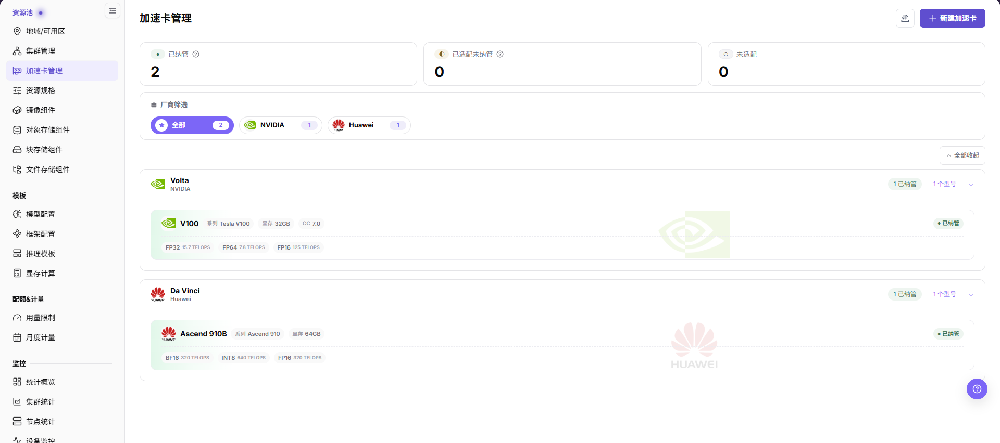
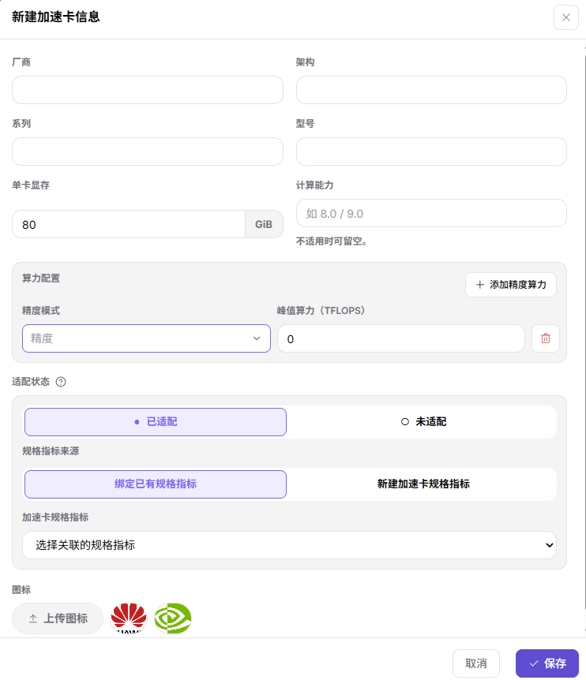
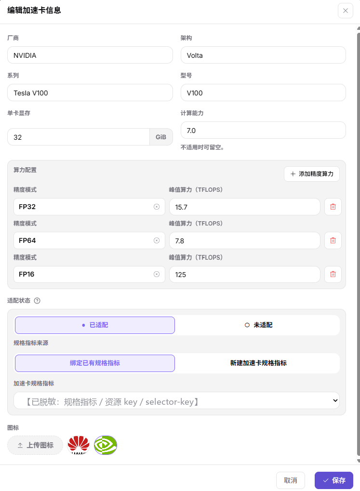
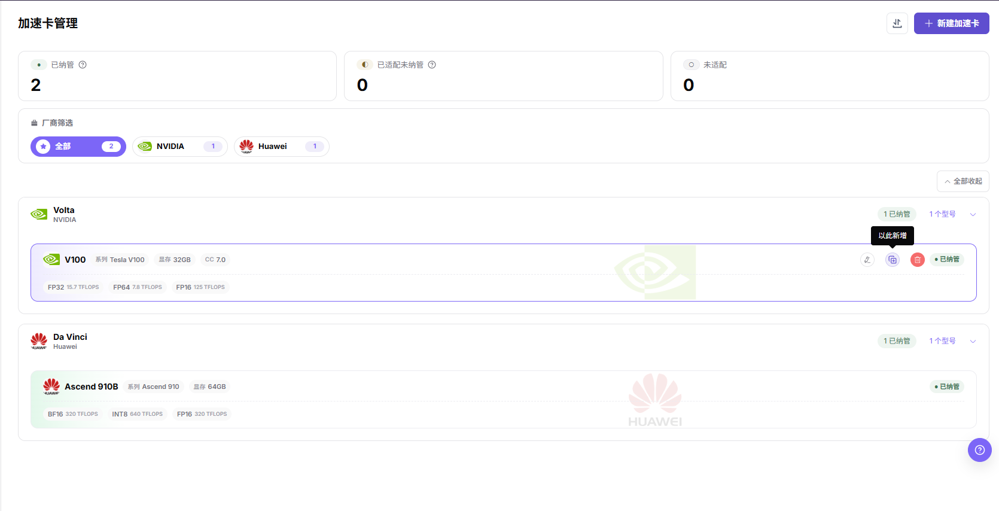
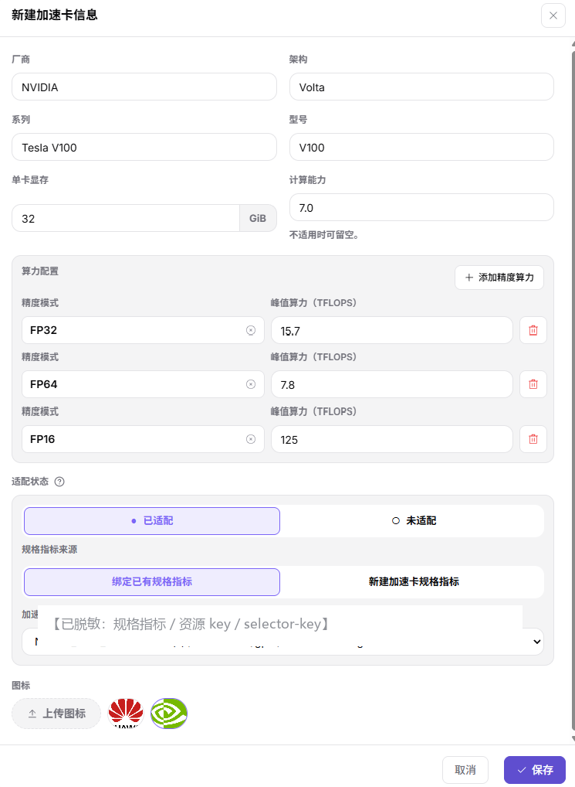

# 加速卡管理

## 功能概述

| 项目 | 内容 |
| --- | --- |
| 适用角色 | 运营管理员 |
| 导航路径 | On-Prem > 资源池 > 加速卡管理 |
| 页面路由 | `/powerone/resourcepool/accelerators` |
| 管理对象 | AI 加速卡厂商、架构、系列、型号、显存、算力信息、规格指标和纳管状态 |

#### 新手理解

- **加速卡型号** 像硬件身份证，告诉平台这是 A100、H100、Ascend 910B 还是其他型号。
- **规格指标** 像调度标签，决定 Kubernetes 中使用哪个资源 key 申请对应加速卡。
- **selector-key** 用于辅助识别设备类型或节点标签，错误配置会影响调度和监控匹配。
- **已纳管** 表示平台已经可以把该型号纳入资源规格和作业调度口径。
- **未适配** 的型号可以先作为硬件信息维护，但不能直接作为稳定调度能力对外开放。

#### 术语表

| 术语 | 说明 |
| --- | --- |
| 加速卡厂商 | 加速卡的生产厂商，例如 NVIDIA、华为、AMD 或 Intel。 |
| 型号 | 具体的加速卡型号，例如 A100、H100 或昇腾 910B。 |
| 架构 | 同一厂商下的硬件架构或代际，例如 Ampere 或 Hopper。 |

#### 推荐操作顺序

1. 确认集群中实际存在的加速卡厂商、型号、显存和 Kubernetes 资源 key。
2. 在 `资源池 > 规格指标` 中准备对应 AI 加速卡指标。
3. 进入 `On-Prem > 资源池 > 加速卡管理` 新建型号、编辑已有型号，或用 **"以此新增"** 复用已有型号。
4. 把加速卡型号关联到正确的规格指标。
5. 在资源规格中引用该指标，并通过测试作业验证调度、监控和模板推荐结果。

#### 小白先看

先确认当前任务是否涉及 AI 加速卡厂商、架构、系列、型号、显存、算力信息、规格指标和纳管状态，再按照推荐顺序操作。页面字段或状态与预期不符时，先回到前置对象页核对依赖，不要跳过结果校验直接进入下游流程。

## 前提条件

1. 当前账号具备运营管理员权限，并能进入 `On-Prem > 资源池 > 加速卡管理`。
2. 已确认目标加速卡厂商、型号、架构、系列、显存容量和算力信息。
3. 已确认 Kubernetes 资源 key、selector-key 或监控识别字段与集群实际上报信息一致。
4. 如需纳管到作业调度，已在 `资源池 > 规格指标` 中准备对应指标。
5. 编辑或删除型号前，确认哪些资源规格、集群规格和调度配置正在引用该型号。

## 页面说明

页面用于查看和处理 AI 加速卡厂商、架构、系列、型号、显存、算力信息、规格指标和纳管状态。

页面按架构在各厂商下分组组织加速卡型号（可折叠，右上角"全部收起"），顶部展示纳管状态统计，厂商筛选栏可按厂商缩小范围，型号卡片展示系列、型号、显存（卡面以 GB 显示）、计算能力和不同精度下的峰值算力。

下图展示加速卡管理列表，可按厂商和纳管状态查看硬件型号。

#### 厂商与状态筛选

| 区域 | 说明 |
| --- | --- |
| 状态统计 | 展示已纳管、已适配未纳管、未适配数量。 |
| 厂商筛选 | 按 NVIDIA、AMD、Intel、Huawei 等厂商缩小范围。 |
| 型号卡片 | 展示系列、型号、显存（卡面以 GB 显示）、计算能力和不同精度下的峰值算力。 |
| 操作入口 | 右上角 **"新建加速卡"** 打开新建弹窗、**"导入/导出"** 打开批量维护入口；悬停型号卡片会出现 **编辑 / 复制 / 删除** 图标，其中编辑图标的提示文案为 **"编辑"**、复制图标的提示文案为 **"以此新增"**。编辑、复制、删除属写操作，执行前须确认范围与影响。 |

## 主要操作

### 新增加速卡

#### 适用场景

新增硬件型号接入平台前，需要先维护加速卡基础信息。已录入型号的信息需要更正或补充时，改用下面的「编辑加速卡」。

#### 操作步骤

1. 进入 `On-Prem > 资源池 > 加速卡管理`。
2. 点击右上角 **"新建加速卡"**，打开"新建加速卡信息"弹窗。
3. 以文本方式填写厂商、架构、系列、型号，再按页面填写单卡显存（框内单位为 GiB）和计算能力（可选）。
4. 在"算力配置"分区通过 **"添加精度算力"** 录入一行或多行精度算力（每行为一个精度模式下拉的精度 + 一个峰值算力 TFLOPS）；可通过"图标"上传图标或从预置厂商 logo 中选择。
5. 根据页面要求选择或关联规格指标，核对 Kubernetes 资源 key、selector-key 或监控识别字段。
6. 点击 **"保存"** 前，再次核对硬件型号、资源指标和集群实际上报信息是否一致。

下图展示新建加速卡信息弹窗，重点填写硬件基础信息和规格指标关联。

### 编辑加速卡

#### 适用场景

已录入的加速卡型号需要更正或补充信息时编辑该型号，例如修改系列或型号的写法、单卡显存、计算能力，增删某一精度的算力，切换适配状态，或改绑"加速卡规格指标"。

#### 操作步骤

1. 进入 `On-Prem > 资源池 > 加速卡管理`，在架构分组内定位目标型号卡片。
2. 悬停该卡片，点击卡片右上角图标行最左侧的 **编辑**（铅笔）图标，提示文案为 **"编辑"**，打开"编辑加速卡信息"弹窗。
3. 弹窗按该型号的当前记录预填 厂商、架构、系列、型号、单卡显存（框内单位 GiB）、计算能力（不适用时可留空）、算力配置、适配状态、规格指标来源、加速卡规格指标和图标。
4. 只修改需要变更的字段：算力配置可用 **"添加精度算力"** 增加一行、用行末的红色图标删除一行；需要更换资源指标时改"加速卡规格指标"下拉，或把"规格指标来源"切换为 **"新建加速卡规格指标"** 后新建。
5. 点击 **"保存"** 前，核对修改后的型号、显存与规格指标仍与集群设备插件实际上报的值一致；点击 **"取消"** 则不产生变更。

下图展示 **"编辑"** 打开的"编辑加速卡信息"弹窗，字段按该型号的现有记录预填。其中"加速卡规格指标"字段包含 Kubernetes 资源 key 与 selector-key，已按平台脱敏规则遮蔽，实际值以页面显示为准。

#### 结果校验

- 型号卡片上的系列、显存（卡面以 GB 显示）、计算能力与精度算力标签按保存后的取值更新。
- 该型号仍留在其架构分组内；若改动了适配状态，以页面顶部的状态统计卡为准，实际显示以页面为准。

#### 注意事项

- **"编辑"** 修改的是当前型号本身，与 **"以此新增"** 的复制新建不同，不会另存一份记录。
- 型号标识、单卡显存和加速卡规格指标决定资源规格与监控能否匹配集群实际上报的设备，保存前确认影响范围。
- 弹窗仅展示上述字段；如页面另有字段或命名，以实际页面为准。

### 以此新增加速卡

#### 适用场景

新型号与已有型号只差个别字段（例如同系列不同显存、同架构不同型号）时，用 **"以此新增"** 从已有型号带出一份基础信息再改差异字段，避免重复录入厂商、架构、显存和多行精度算力。

#### 操作步骤

1. 进入 `On-Prem > 资源池 > 加速卡管理`，在架构分组内找到作为模板的型号卡片。
2. 悬停该卡片，卡片右上角依次出现 **编辑**、**复制**、**删除** 图标；指针停在中间的复制图标上时，提示文案为 **"以此新增"**。
3. 点击 **"以此新增"**，打开"新建加速卡信息"弹窗，厂商、架构、系列、型号、单卡显存、计算能力、算力配置（精度与峰值算力）、适配状态、规格指标来源和图标均按源型号预填。
4. 按"新增加速卡"的字段口径修改差异字段：至少改型号，通常还需同步核对系列、单卡显存、精度算力和加速卡规格指标。
5. 点击 **"保存"** 前，逐项确认预填值对新硬件仍然成立；不需要时点击 **"取消"**，不会产生新记录。

下图展示悬停型号卡片后出现的操作图标，以及复制图标上的 **"以此新增"** 提示。

下图展示点击 **"以此新增"** 后按源型号预填的"新建加速卡信息"弹窗。其中"加速卡规格指标"字段包含 Kubernetes 资源 key 与 selector-key，已按平台脱敏规则遮蔽，实际值以页面显示为准。

#### 结果校验

- 弹窗标题仍为"新建加速卡信息"，字段值与源型号一致，说明预填生效。
- 保存后列表新增一张型号卡片，归入对应架构分组，状态统计与厂商筛选计数同步增加。

#### 注意事项

- **"以此新增"** 是复制新建，不会修改源型号；源型号信息仍然保留。
- 预填的规格指标沿用源型号，若新硬件上报的资源 key 或 selector-key 不同，必须改绑或新建规格指标，否则集群侧无法按该型号识别和调度。

### 删除加速卡

#### 适用场景

平台内录入的加速卡型号已下线、录错或重复，且未被资源规格、集群规格等配置引用时，删除该条基础信息。

#### 操作步骤

1. 进入 `On-Prem > 资源池 > 加速卡管理`，在架构分组内定位目标型号卡片。
2. 悬停卡片，点击最右侧的红色 **删除** 图标（图标位置见上一节截图）。
3. 按页面弹出的确认提示核对厂商、系列与型号后确认；确认提示的具体文案以实际页面为准。
4. 删除后回到列表，确认该型号已从架构分组中消失，状态统计与厂商筛选计数同步减少。

#### 注意事项

- 删除是不可逆的写操作，执行前须确认该型号未被集群、资源规格或调度配置引用。
- 已纳管型号的删除影响范围更大，建议先由平台管理员确认；若只是暂停使用，优先在 **"编辑"** 弹窗内调整适配或纳管状态（以页面显示为准），而不是删除基础信息。
- 误删后可通过 **"新建加速卡"**、**"以此新增"** 或 **"导入/导出"** 入口重新维护该型号。

## 参数速查表

| 字段名称 | 是否必填 | 字段类型 | 示例 | 说明 |
| --- | --- | --- | --- | --- |
| 厂商 | 必填 | 文本 | `NVIDIA` | 加速卡厂商以文本填写，与真实硬件厂商保持一致。 |
| 架构 | 必填 | 文本 | `Ampere` | 加速卡架构以文本填写，与真实硬件架构保持一致。 |
| 系列 | 必填 | 文本 | `A100` | 加速卡所属系列以文本填写，与型号、厂商保持一致。 |
| 型号 | 必填 | 文本 | `A100-SXM4-80GB` | 加速卡型号以文本填写，与集群节点实际上报设备型号保持一致。 |
| 单卡显存 | 必填 | 数值 / 容量 | `80` | 单卡显存容量按输入框单位 GiB 填写（卡面显存以 GB 显示），避免 GiB/GB 混用。 |
| 计算能力 | 可选 | 文本 | `8.0` | CUDA 或硬件能力版本没有明确值时不要臆造。 |
| 精度模式 | 条件必填 | 下拉 / 枚举 | `FP32` | 从可搜索下拉选择的精度模式（FP32、TF32、FP16、BF16、INT8、FP64）与页面支持项和硬件能力一致。 |
| 峰值算力（TFLOPS） | 条件必填 | 数值 / 容量 | `312` | 对应精度模式下的峰值算力只填写已确认的公开或硬件上报数据。 |
| 规格指标来源 | 条件必填 | 分段选项 | `绑定已有规格指标` | 弹窗提供 **绑定已有规格指标** 与 **新建加速卡规格指标** 两个选项，决定"加速卡规格指标"字段是选择已有指标还是新建指标；默认选中项以页面显示为准。 |
| 图标 | 可选 | 图片 | — | 上传图标，或从页面提供的预置厂商 logo 中选择。 |
| 加速卡规格指标 | 条件必填 | 文本 | `gpu-a100-80g` | 按"规格指标来源"选定的加速卡规格指标核对 k8s-key、selector-key 与节点实际上报标签。 |
| 适配状态 | 必填 | 状态 | `已适配` | 是否已适配平台资源识别和调度未适配时不要对用户侧开放。 |
| 操作 | 系统生成 | 操作入口 | `编辑` | 新建、编辑（提示文案"编辑"）、以此新增（复制图标）、删除、导入/导出、保存等入口。`保存`、`编辑`、`以此新增`、`删除` 属写操作，执行最终动作前确认范围与影响。 |

## 踩坑提示

- 新增或编辑加速卡会影响资源规格、调度识别、监控展示和推理模板推荐。
- 型号、显存容量、资源 key 或 selector-key 配置错误，可能导致规格不可选、调度失败或监控无法匹配设备。
- 不要把显示名称相近但 Kubernetes 资源 key 不同的卡混成同一个型号。
- 显存容量会影响推理模板和显存测算结果，提交前应与硬件信息核对。
- 删除加速卡不可逆；型号已被资源规格、集群规格或调度配置引用时，删除会影响下游，执行前先核对引用范围。
- **"以此新增"** 复制型号时，加速卡规格指标沿用源型号；新硬件上报的资源 key 或 selector-key 不同却未改绑，会导致调度与监控匹配失败。
- **保存** 是本页各弹窗的最终高风险动作，执行前确认范围与影响。

#### 配置规则与影响

- **资源 key 一致性**：加速卡指标中的 Kubernetes 资源 key 必须与集群实际上报的资源 key 一致。
- **selector-key 一致性**：selector-key 应与节点标签、规格指标或监控识别字段保持一致。
- **命名稳定性**：厂商、系列和型号应与硬件采购、驱动识别和监控采集口径一致。
- **纳管前验证**：纳管前先用测试作业验证资源申请、调度和监控展示。
- **模板影响**：显存容量、算力信息和适配状态会影响推理模板推荐和资源规格选择。

## 结果校验

| 检查项 | 成功表现 | 异常时处理 |
| --- | --- | --- |
| 页面入口 | 可进入加速卡管理并看到目标操作入口 | 检查运营管理员权限和对应菜单是否已开放 |
| 对象记录 | AI 加速卡厂商、架构、系列、型号、显存、算力信息、规格指标和纳管状态在型号卡片或新建/编辑/以此新增弹窗中可见 | 重置筛选并核对名称、所属范围和操作结果 |
| 状态结果 | 新增、以此新增、编辑或删除后的状态符合页面提示；删除后目标型号卡片从其架构分组消失，状态统计与厂商筛选计数同步减少 | 查看操作提示、依赖对象状态和最近更新时间 |
| 下游使用 | 后续页面能够选择或关联目标对象 | 回到前置配置核对启用状态、归属关系和可见范围 |

## 常见问题

#### 导入后加速卡没有出现在列表

**问题现象：**

导入提示完成，但目标加速卡在列表中不可见或状态没有更新。

**可能原因：**

- 当前筛选条件隐藏了目标记录。
- 文件中的唯一标识、必填列或枚举值不符合页面要求。
- 导入记录与已有型号冲突，或后台校验尚未完成。

**处理方式：**

1. 重置筛选并按型号或厂商重新搜索。
2. 对照页面要求核对文件列名、唯一标识和指标值。
3. 查看页面提示和更新时间，确认校验完成后再处理冲突记录。
4. 本页不维护"导入/导出"弹窗内的字段与流程，实际项、顺序与提示以页面显示为准。

#### 加速卡管理的操作入口不可用

**问题现象：**

**新建加速卡**、**以此新增**、**编辑**、**删除** 或 **导入/导出** 入口不可见或不可点击。

**可能原因：**

- 当前角色权限不足。
- 页面处于只读状态。
- 依赖对象不满足条件。

**处理方式：**

1. 检查运营管理员权限
2. 核对页面提示
3. 先完成依赖对象配置。

#### 加速卡管理的必填项没有可选值

**问题现象：**

表单能打开，但 **"精度模式"** 或 **"加速卡规格指标"** 下拉框为空。

**可能原因：**

- 候选对象未启用。
- 所属范围不一致。
- 当前账号不可见。

**处理方式：**

1. 到候选对象页面核对状态
2. 确认归属关系
3. 检查可见范围后刷新表单。

#### 加速卡管理操作后状态异常

**问题现象：**

提交后记录存在，但状态不是预期值。

**可能原因：**

- 连通性或校验失败。
- 关联对象异常。
- 后台处理尚未完成。

**处理方式：**

1. 查看页面提示和更新时间
2. 检查关联对象
3. 按状态阶段排查处理任务。

#### 下游页面无法使用加速卡管理

**问题现象：**

当前页状态正常，但下游页面无法选择或关联 AI 加速卡厂商、架构、系列、型号、显存、算力信息、规格指标和纳管状态。

**可能原因：**

- 可见范围不匹配。
- 对象未启用。
- 下游缓存未刷新。
- 编辑后型号名与节点实际上报值不一致、单卡显存 GB 与 GiB 混填，或规格指标改绑到其他资源 key。

**处理方式：**

1. 核对启用状态和归属
2. 检查角色可见范围
3. 刷新下游页面并重新选择。
4. 对照设备插件实际上报值核对型号名，确认单卡显存单位，必要时重新绑定规格指标。

## 注意事项

- 加速卡型号、厂商、架构、显存容量和算力信息应与硬件清单、驱动识别和监控采集保持一致。
- 型号纳管前要确认设备插件能上报资源，规格指标能识别资源 key，监控能采集利用率和显存。
- 不同驱动或固件版本可能影响资源识别和稳定性，生产接入前先提交测试作业验证。
- 不写真实内部资源 key 映射、节点标签、集群 ID、资源池 ID、内网地址、账号、密钥、Token、AK/SK 或内部测试参数。

## 后续操作

1. 进入 `资源池 > 规格指标` 维护或确认对应指标。
2. 进入 `资源池 > 资源规格` 创建包含该加速卡的规格。
3. 在推理模板或测试作业中验证该型号能被正确选择。
4. 回到加速卡管理列表，确认状态统计、厂商筛选和型号卡片信息符合预期。
5. 删除后核对资源规格与推理模板不再引用已删除型号。
