# 集群管理

## 功能概述

| 项目 | 内容 |
| --- | --- |
| 适用角色 | 运营管理员 |
| 导航路径 | On-Prem > 资源池 > 集群管理 |
| 页面路由 | `/powerone/resourcepool/cluster` |
| 管理对象 | Kubernetes 集群、地域、可用区、节点、规格、存储、作业和资源监控 |

#### 新手理解

On-Prem 资源池像一套本地算力管理体系：

- **地域/可用区** 表示算力资源所在的站点、机房或资源分组。
- **集群** 是真正提供算力的 Kubernetes 环境，平台通过集群接入后才能调度作业。
- **节点** 是集群中的具体服务器，提供 CPU、GPU、内存、磁盘等资源。
- **规格** 定义用户作业可申请的资源套餐。
- **存储** 为作业提供模型、数据集、代码仓库或输出目录。

集群注册的核心目的，是把真实 Kubernetes 集群纳入平台的调度、监控和资源管理范围。

#### 术语表

| 术语 | 说明 |
| --- | --- |
| Kubernetes | 用于管理计算节点、容器、服务发现和作业调度的容器编排系统。 |
| kubeconfig | Kubernetes 连接配置文件，通常包含集群地址、证书、用户和认证信息。 |
| 服务器地址 | Kubernetes 的控制入口，平台通过该地址读取节点、资源、作业和状态。 |
| 模型仓库 | 集群内置的模型文件存储入口，每集群限 1 个；编辑为替换现有取值。 |
| 集群可调度资源限制 | 限制新作业可调度资源比例的集群级设置，含临界单次超用规则。 |

#### 推荐操作顺序

先确认Kubernetes 集群、地域、可用区、节点、规格、存储、作业和资源监控的前置依赖，再按主要操作顺序处理，最后执行结果校验并进入后续页面。

#### 小白先看

先确认当前任务是否涉及Kubernetes 集群、地域、可用区、节点、规格、存储、作业和资源监控，再按照推荐顺序操作。页面字段或状态与预期不符时，先回到前置对象页核对依赖，不要跳过结果校验直接进入下游流程。

## 前提条件

执行本章各操作前，请确认以下条件已满足：

1. 当前账号具备运营管理员权限，并能进入 `On-Prem > 资源池 > 集群管理`。
2. 目标地域和可用区已在 `资源池 > 地域/可用区` 中创建。
3. Kubernetes 服务器地址 可从平台管理侧访问。
4. 已准备 kubeconfig、身份验证证书、服务器地址、集群名称和认证材料。
5. 已确认 cluster CIDR、service CIDR 与用户服务端口范围不和现有网络冲突。
6. 如需监控或 RDMA 能力，相关服务、端口、硬件和网络规划已提前确认。
7. 关联规格前：目标规格已在 `资源池 > 资源规格` 创建且状态可用。
8. 添加共享存储或编辑模型仓库前：NFS 服务地址或宿主机物理路径已就绪，并能被集群节点访问。
9. 配置集群可调度资源限制前：若需调整 **系统默认** 阈值，账号还需可进入 `系统设置 > 任务调度与资源管控`；该阈值在集群级只读。
10. 禁用或启用集群前：已约定维护窗口，并确认集群上运行中作业的影响。

## 页面说明

页面用于查看和处理Kubernetes 集群、地域、可用区、节点、规格、存储、作业和资源监控。

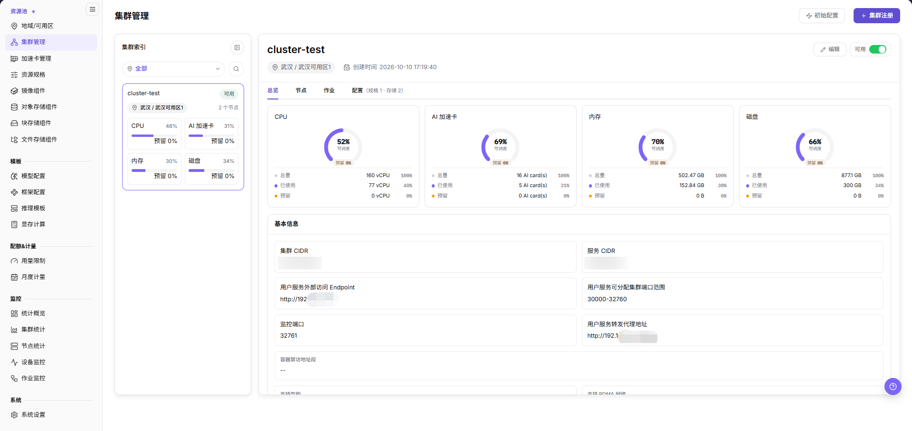

集群管理页采用左右两栏布局：左侧"集群索引"以卡片列出集群，右侧面板通过顶部页签展示所选集群的详情。页面右上角提供"初始配置"和"集群注册"入口。本章不展开"初始配置"入口，其包含项与流程以页面显示为准。

下图展示集群列表、集群卡片、资源用量和详情页签。

#### 集群列表（集群索引）

| 区域 | 说明 |
| --- | --- |
| 地域筛选 | "全部"下拉按**地域**筛选集群（如某地域显示"正常"或"失效"）。它是地域筛选，不是集群状态筛选。 |
| 搜索区 | 按**集群名称**搜索。 |
| 集群索引收放 | 左侧"集群索引"面板可收起/展开，为右侧详情腾出空间。 |
| 集群卡片 | 展示集群名称、状态（如"可用"）、地域/可用区、节点数量，以及 CPU / AI 加速卡 / 内存 / 磁盘 使用率与预留百分比。 |
| 详情头部操作 | 所选集群的详情头部提供"编辑"按钮和"可用"开关；集群级启用/禁用通过该开关完成。 |
| 详情页签 | 详情面板在顶部页签 **总览 / 节点 / 作业 / 配置（规格 · 存储）** 之间切换。 |

> 说明：当前页面未单独提供可用区列表筛选、按节点数搜索、或网格/列表视图切换。若你的环境存在这些控件，以页面实际为准。

#### 集群详情

集群详情在右侧面板通过顶部页签展示。**总览**显示资源环形图（CPU、AI 加速卡、内存、磁盘）和"基本信息"区（集群 CIDR、服务 CIDR、用户服务外部访问 Endpoint、用户服务可分配集群端口范围、监控端口、用户服务转发代理地址、容器禁访地址段、支持架构、支持 RDMA 网络）。**配置**页签含"已关联规格""模型仓库""共享存储""集群可调度资源限制"四个子页签。排查集群状态、资源容量、规格可用性或存储挂载问题时，优先进入该区域确认。

> "基本信息"中的取值可能包含内网地址和网络规划，文档、截图和工单中只保留脱敏内容。

#### 集群节点

**节点**页签列出集群节点并提供节点详情。节点详情包含节点名称、节点存活时长、状态、角色（master/worker）、K8s 节点状态、**节点标签**和**节点状况（Conditions）**。

> 是否展示污点(taints)与监控图表以页面为准。

## 主要操作

### 集群注册

#### 适用场景

当需要把新的 Kubernetes 集群纳入平台统一调度、监控和资源管理时，执行集群注册。常见场景包括首次接入算力资源、新增机房或资源组、扩容 GPU/CPU 节点，以及为后续作业提供可调度节点。

#### 操作前确认

1. 目标地域和可用区已创建并可用于集群接入。
2. kubeconfig 或等价认证材料来自可信集群管理员。
3. 服务器地址、证书和认证方式已完成核对。
4. cluster CIDR、service CIDR 和用户服务端口范围已通过网络规划确认。
5. 监控端口、转发代理、RDMA 等网络项已确认是否需要启用。

#### 操作步骤

集群注册会把真实 Kubernetes 集群接入平台调度，属于高影响写操作。

1. 进入 `On-Prem > 资源池 > 集群管理`。
2. 点击页面右上角的 **集群注册**。注册是一个**四步向导**：
   1. **步骤 1 · 选择集群接入方式** — 选择 **KubeConfig 快速导入**（上传文件或粘贴文本，自动解析 API Server 地址、CA 根证书及访问凭据）或 **手动录入连接信息**（手动配置端点地址、CA 根证书及凭据）。
   2. **步骤 2 · 控制面连接与身份认证** — 填写 **服务器地址**、**集群名称**、**身份验证证书**（certificate-authority-data）和 **用户名称**。**认证类型** 为分段控件：**证书认证 / 用户名密码认证 / 身份令牌认证 / 认证程序认证**；按提示提供对应的 **客户端证书**（client-certificate-data）和 **客户端密钥**（client-key-data）。
   3. **步骤 3 · 网络规划与服务接入** — 配置 **支持 RDMA 网络**（开关）、**用户服务可分配集群端口范围**、**用户服务外部访问 Endpoint**、**监控端口**、**用户服务转发代理地址**、**集群 CIDR**、**服务 CIDR** 和可选的 **容器禁访地址段**。
   4. **步骤 4 · 地域可用区与集群信息** — 选择 **地域** 和 **可用区**（可在此步骤直接创建可用区，创建后到地域/可用区页维护），并确认系统自动生成的 **注册名称**。
3. 点击最终 **提交** 前，再次核对敏感信息、地域/可用区、网络配置和调度影响。

下面依次展示注册向导的前三个步骤（步骤 4「地域可用区与集群信息」请在实际页面完成）。

**步骤 1 · 选择集群接入方式** —— 选择接入卡片，上传或粘贴 kubeconfig 后点击 **解析**。

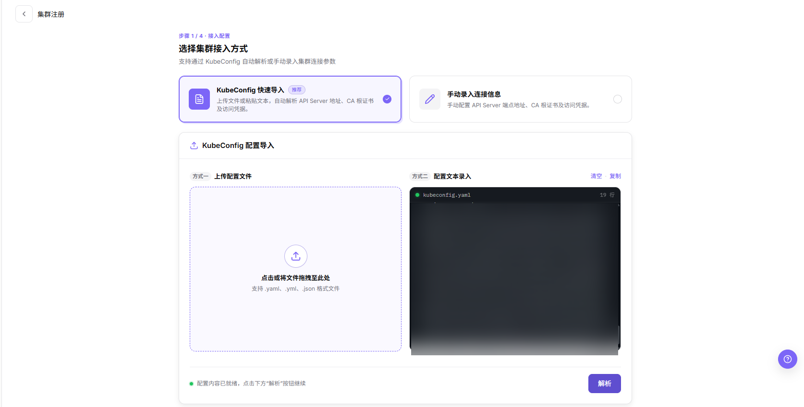

**步骤 2 · 控制面连接与身份认证** —— 核对自动解析出的 **服务器地址**、**集群名称**、**身份验证证书** 和 **用户名称**，再选择 **认证类型** 并填写对应的客户端证书或密钥。

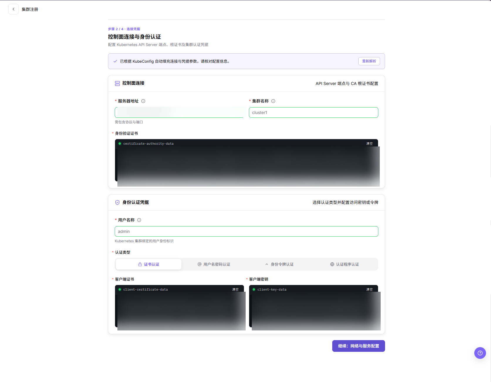

**步骤 3 · 网络规划与服务接入** —— 配置 RDMA 开关、用户服务可分配集群端口范围、外部访问 Endpoint、监控端口、转发代理地址，以及集群/服务 CIDR。

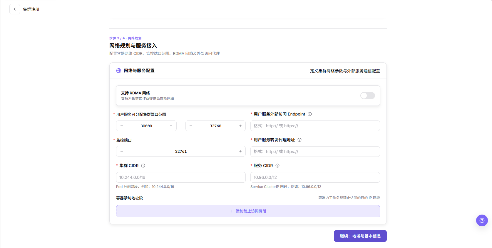

### 编辑集群

#### 适用场景

当集群注册后需要调整用户服务接入或网络参数时，编辑集群。例如修改外部访问 Endpoint、用户服务可分配端口范围、监控端口、集群/服务 CIDR、转发代理地址、RDMA 开关或集群描述。

#### 操作步骤

1. 进入 `On-Prem > 资源池 > 集群管理`，选择目标集群。
2. 在详情头部点击 **编辑**，打开 **编辑集群** 弹窗。
3. 按弹窗提供的字段修改 **集群名称**、**用户服务外部访问 Endpoint**、**用户服务可分配集群端口范围**、**监控端口**、**集群 CIDR**、**服务 CIDR**、**用户服务转发代理地址**、**支持 RDMA 网络** 开关和 **描述**。
4. 点击 **确定** 前，核对修改后的 Endpoint、端口范围、CIDR 和代理地址仍与网络规划一致，且不影响运行中的作业。
5. 保存后刷新集群详情，确认更新后的取值。

下面展示 **编辑集群** 弹窗。

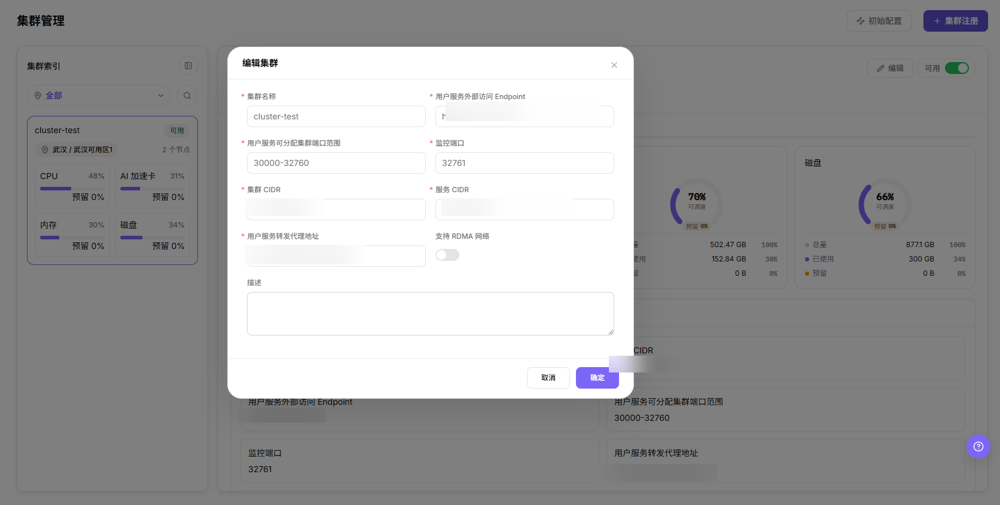

#### 结果校验

- 集群详情显示更新后的 Endpoint、端口范围、监控端口、CIDR、代理地址、RDMA 状态和描述。
- 已有的规格关联和存储关联保持不变。

#### 注意事项

- 修改 Endpoint、端口范围、CIDR 或代理地址可能影响用户服务接入与调度，保存前确认影响范围。
- 弹窗仅展示上述字段；如页面另有字段或命名，以实际页面为准。

### 禁用/启用集群

#### 适用场景

当集群需要暂时停止新作业调度，或维护完成后恢复可调度状态时，按当前状态禁用或启用集群。

#### 操作步骤

1. 进入 `On-Prem > 资源池 > 集群管理`，选择目标集群。
2. 在详情头部使用 **可用** 开关切换集群的禁用或启用状态。
3. 阅读确认提示，核对运行中作业、节点、规格关联和存储配置的影响。
4. 确认维护窗口和影响范围后，确认状态变更。
5. 刷新集群列表和 **节点** 页签，核对集群状态及调度可用范围。

#### 结果校验

- 集群状态变为页面提示的禁用或可用状态。
- 新作业创建或资源选择页面按集群状态限制可选范围。
- 已有关联规格和存储记录仍显示其关联关系，未被误删除。

#### 注意事项

- 禁用集群可能阻止新作业调度，但不代表运行中的作业会自动迁移或停止；操作前必须确认实际影响。
- 启用前确认节点健康、监控数据、规格关联和存储挂载均已恢复。

### 关联规格

#### 适用场景

当目标集群需要承载特定 CPU、内存或加速卡规格的作业时，为集群关联规格。关联后，用户创建作业时才可能在对应地域、可用区或集群范围内选择这些规格。

#### 操作步骤

1. 进入 `On-Prem > 资源池 > 集群管理`，在集群索引中选择目标集群。
2. 在右侧详情面板打开 **配置** 页签，再进入 **已关联规格** 子页签。该子页签展示 **已关联规格** 数量、**按规格 ID 筛选** 搜索框，以及含 **规格 ID**、**资源配置**、**状态** 列的表格。
3. 点击右上角的 **关联规格**，打开规格选择弹窗。
4. 在弹窗中定位要关联的规格：可在左侧 **规格指标** 列表中选择某个加速卡指标（例如 `NVIDIA_V100_32G`），或在搜索框输入规格 ID / 指标名称。右侧按指标分组列出匹配的规格，每条含 **规格 ID**、**资源配置**（加速卡、vCPU 与卡数标签）和 **状态**。
5. 勾选要关联的规格行，或使用 **按 kubemore_xpu_type 标签选中** 按标签批量选择；底部显示当前已选择数量。
6. 点击 **确认关联** 保存，或点击 **取消** 放弃。
7. 返回 **已关联规格** 子页签，核对新关联的规格行。

下面展示 **已关联规格** 子页签。

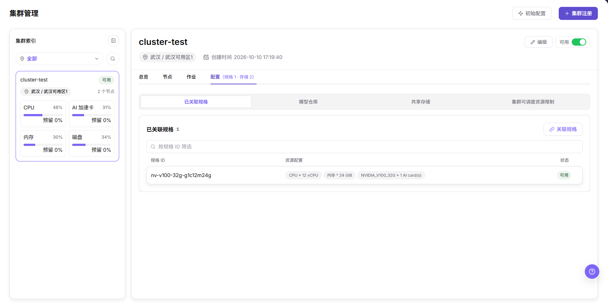

下面展示 **关联规格** 选择弹窗。

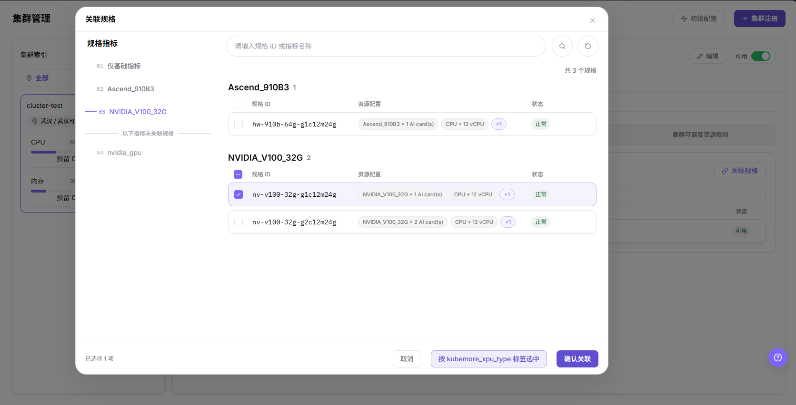

#### 结果校验

- 已关联规格表格出现预期资源配置与状态的规格行。
- **配置** 页签标题中的规格数量随之更新。

#### 注意事项

- 只应关联与集群实际加速卡和容量匹配的规格，确认前核对资源配置。
- 弹窗的指标列表、列名与 **按 kubemore_xpu_type 标签选中** 操作以当前页面为准；如页面另有字段或命名，以实际页面为准。

### 编辑模型仓库

#### 适用场景

当模型需要部署到目标集群时，配置集群内置的模型仓库。每个集群的模型仓库限 1 个，为模型部署提供读取所用的存储。

#### 操作步骤

1. 进入 `On-Prem > 资源池 > 集群管理`，在集群索引中选择目标集群。
2. 在右侧详情面板打开 **配置** 页签，再进入 **模型仓库** 子页签。**模型仓库** 卡片展示 **存储名称**、**存储类型**、**访问模式**、**共享范围**、**服务地址**、**源路径** 与 **挂载路径**，右上角提供 **编辑** 与 **删除** 操作。
3. 点击 **编辑**，打开 **编辑模型仓库** 弹窗。
4. 选择 **存储类型**：**NFS 网络存储**（网络共享存储，支持多机并发读写）或 **HostPath 节点存储**（挂载宿主机物理路径，本地高性能 IO）。
5. 在 **参数配置** 中填写 **存储名称**、所选类型对应的路径字段（HostPath 为 **宿主机物理路径**）、**访问模式**（**读写 ReadWrite** 或 **只读 ReadOnly**）、**容器挂载路径** 与 **共享范围**（**全租户共享** 或 **租户独立目录**）。
6. 点击 **保存更改** 前，核对路径、访问模式与共享范围，确保运行中的模型部署保持有效的读写访问；点击 **取消** 放弃。
7. 返回 **模型仓库** 子页签，核对已保存的值。

下面展示 **模型仓库** 子页签。

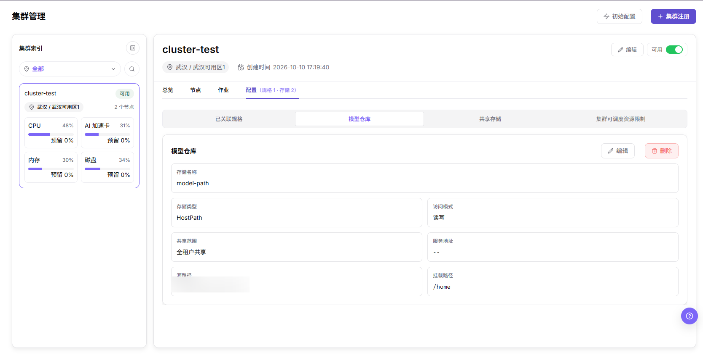

下面展示 **编辑模型仓库** 弹窗。

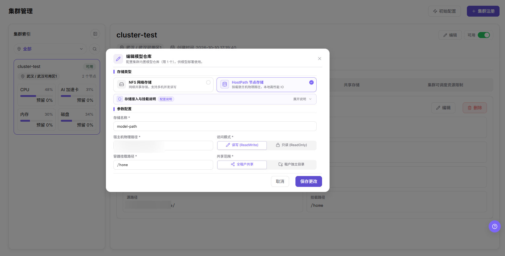

#### 结果校验

- **模型仓库** 卡片展示更新后的存储名称、存储类型、访问模式、共享范围、源路径与挂载路径。
- 集群最多保留 1 个模型仓库条目。

#### 注意事项

- 每个集群的模型仓库限 1 个；编辑为替换现有配置，而非新增第二条。
- **模型仓库** 卡片同时提供 **删除**。本章未展开该流程，其影响以页面提示为准——使用前先确认没有部署仍在读取该仓库。
- 变更源路径、挂载路径、访问模式或共享范围可能影响模型加载与运行中的部署，保存前确认影响范围。
- 弹窗字段以当前页面为准；如页面另有字段或命名，以实际页面为准。

### 添加共享存储

#### 适用场景

当作业需要共享网络目录（NFS）或为作业调度挂载宿主机路径时，为集群添加共享存储。存储配置会影响作业启动、文件读写、模型加载和租户访问范围。

#### 操作步骤

1. 进入 `On-Prem > 资源池 > 集群管理`，在集群索引中选择目标集群。
2. 在右侧详情面板打开 **配置** 页签，再进入 **共享存储** 子页签。该子页签展示 **共享存储** 数量，以及含 **存储名称**、**存储类型**、**访问模式**、**共享范围**、**服务地址**、**源路径**、**挂载路径**、**操作** 列的表格，每行提供编辑与删除操作。
3. 点击右上角的 **添加存储**，打开 **添加共享存储** 弹窗。
4. 选择 **存储类型**：**NFS 网络存储**（网络共享存储，支持多机并发读写）或 **HostPath 节点存储**（挂载宿主机物理路径，本地高性能 IO）。
5. 在 **参数配置** 中按所选类型填写字段——NFS 为 **存储名称**、**NFS 服务地址**、**NFS 导出源路径**——并设置 **访问模式**（**读写 ReadWrite** 或 **只读 ReadOnly**）、**容器挂载路径** 与 **共享范围**（**全租户共享** 或 **租户独立目录**）。
6. 点击 **确定** 前，核对存储路径、挂载策略与权限范围，确保运行中的作业保持有效的数据访问；点击 **取消** 放弃。
7. 返回 **共享存储** 子页签，核对新增的存储行。

下面展示 **共享存储** 子页签。

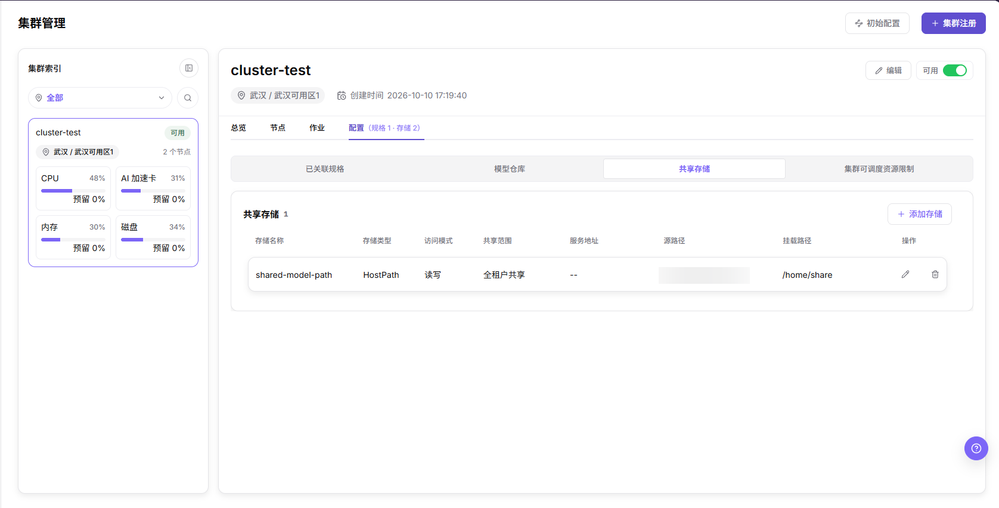

下面展示 **添加共享存储** 弹窗。

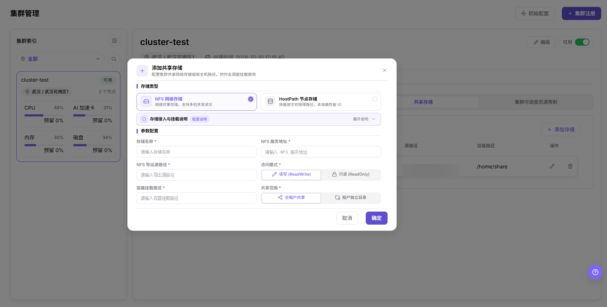

#### 结果校验

- 新存储以一行出现在 **共享存储** 表格中，存储类型、访问模式、共享范围、源路径与挂载路径符合预期。
- **共享存储** 数量与 **配置** 页签标题随之更新。

#### 注意事项

- 变更源路径、容器挂载路径、访问模式或共享范围会影响可读写数据的作业及其范围，保存前确认影响。
- 弹窗字段随存储类型而变；如页面另有字段或命名，以实际页面为准。

### 集群可调度资源限制

#### 适用场景

当需要控制作业可按多大比例调度集群资源，或是否允许单个任务临时越过调度阈值时，配置集群可调度资源限制。这些设置影响作业的准入与调度，在运行中的集群上调整前请先评估影响。

#### 操作步骤

1. 进入 `On-Prem > 资源池 > 集群管理`，在集群索引中选择目标集群。
2. 在右侧详情面板打开 **配置** 页签，再进入 **集群可调度资源限制** 子页签。
3. 设置 **临界单次超用**：开关 **允许单次超用**，开启后填写 **最大超用比例**。该项控制当前用量未越过调度阈值时是否允许单个任务按配置比例跨线；超用比例按目标节点对应资源总量计算，跨线后继续拦截新任务。
4. 在 **选择一种维度配置新作业可调度的资源比例** 中，从五个维度页签里选择一个：**系统默认**、**集群整体**、**集群资源项**、**节点整体** 或 **节点资源项**。其中 **0% 是有效限制**；**留空表示使用对应的上级规则**（**集群整体** 卡片提示"留空时使用系统全局配置"）。点击 **保存配置** 时，会提交当前选中的维度，并同步保存当前集群的临界单次超用策略。
5. **系统默认**：**资源调度阈值**（适用于 CPU、内存和 AI 加速卡）与 **临时存储调度阈值**（仅适用于临时存储）作为 **系统全局设置** 由系统统一配置，无法在当前集群中修改；如需调整，请前往 `系统设置 > 任务调度与资源管控`。
6. **集群整体**：为整个集群设置单一的 **集群可调度资源比例**。
7. **集群资源项**：按资源分别设置可调度比例——**CPU**、**内存**、**AI 加速卡**、**临时存储**。
8. **节点整体**：为每个节点设置整体可调度比例（每节点一行）。
9. **节点资源项**：为每个节点按资源分别设置可调度比例（每个节点的 **CPU**、**内存**、**AI 加速卡**、**临时存储**）。
10. 点击 **保存配置** 生效，或点击 **取消编辑** 放弃。

下面展示 **系统默认** 维度。

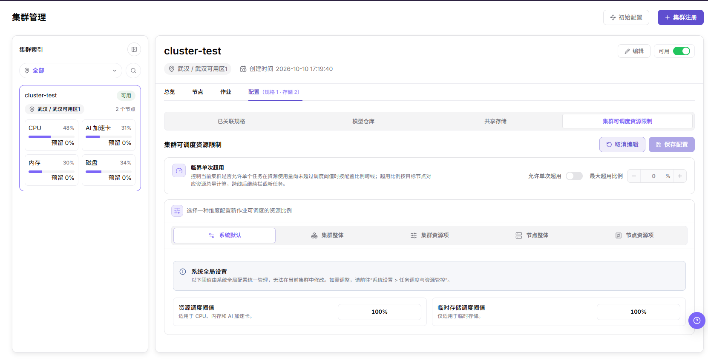

**集群整体** 维度为整个集群设置单一的可调度比例。

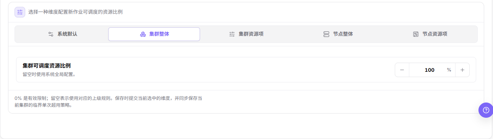

**集群资源项** 维度按资源分别设置集群级可调度比例。

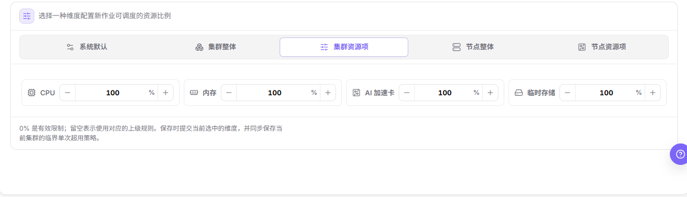

**节点整体** 维度为每个节点设置整体可调度比例；节点地址与标识已脱敏。

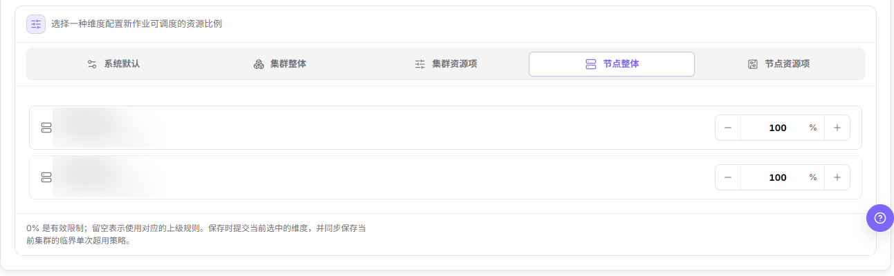

**节点资源项** 维度为每个节点按资源分别设置可调度比例；节点地址与标识已脱敏。

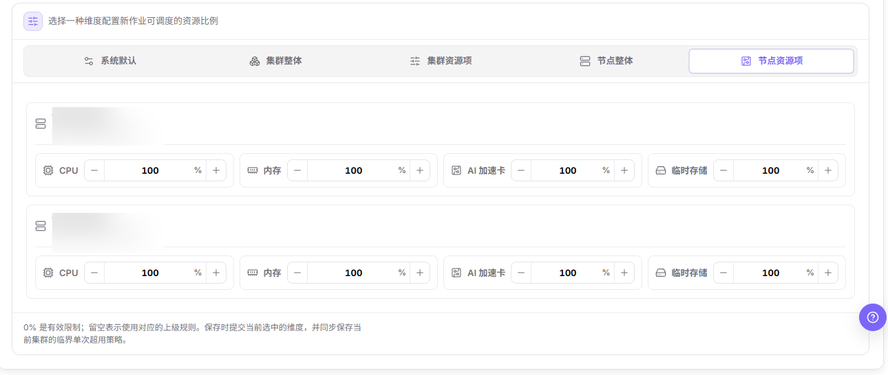

#### 结果校验

- 保存后，所选维度及其阈值数值在子页签上如实反映。
- 在 **系统默认** 维度下，资源调度阈值与临时存储调度阈值保持系统全局值，集群级不可编辑。
- 留空的字段回退到其上级规则；保存的非空值在当前集群上覆盖上级规则。

#### 注意事项

- **系统默认** 阈值由系统全局管控，需前往 `系统设置 > 任务调度与资源管控` 修改，且影响其他集群而非仅当前集群。
- 提高最大超用比例或降低调度阈值会改变作业准入与调度的激进程度，保存前确认对运行中与排队中作业的影响。
- **集群整体**、**集群资源项**、**节点整体**、**节点资源项** 四个维度按由粗到细的粒度覆盖可调度比例；各维度暴露的字段以实际页面为准。
- **节点整体** 与 **节点资源项** 维度会以内部地址和标识列出节点，属敏感信息——分享截图前必须脱敏（本文档仅保留已高斯模糊的版本）。

## 参数速查表

| 字段名称 | 是否必填 | 字段类型 | 示例 | 说明 |
| --- | --- | --- | --- | --- |
| 接入方式 | 必填 | 单选（步骤 1） | `KubeConfig 快速导入` / `手动录入连接信息` | 连接信息的提供方式。快速导入解析粘贴或上传的 kubeconfig；手动录入逐项配置。 |
| 服务器地址 | 必填 | URL（步骤 2） | `https://<api-host>:<port>` | Kubernetes API 访问入口，需从平台侧可达；以 http:// 或 https:// 开头且含端口号。不要在文档中记录真实地址。 |
| 集群名称 | 必填 | 文本（步骤 2） | `cluster-a` | Kubernetes 集群/页面识别名称（1–63 字符，仅字母数字 `-` `_` `.`）。 |
| 身份验证证书 | 必填 | 敏感文本（步骤 2） | `certificate-authority-data` | 校验服务器身份的 CA 根证书。属于敏感材料，不写入文档或截图。 |
| 用户名称 | 必填 | 文本（步骤 2） | `cluster-user` | 认证用户名（1–63 字符，字母数字 `-` `_` `.` `@`）。 |
| 认证类型 | 必填 | 分段控件（步骤 2） | `证书认证` | 四选一：`证书认证` / `用户名密码认证` / `身份令牌认证` / `认证程序认证`。 |
| 客户端证书 / 客户端密钥 | 条件必填 | 敏感文本（步骤 2） | `client-certificate-data` / `client-key-data` | 证书认证方式下的客户端凭据。属于敏感材料。 |
| 支持 RDMA 网络 | 可选 | 开关（步骤 3） | `关闭` | 仅在硬件、驱动、网络和调度策略支持时开启。 |
| 用户服务可分配集群端口范围 | 必填 | 端口范围（步骤 3） | `30000-32760` | 用户服务访问的 NodePort 式端口范围（起始端口 / 结束端口）。 |
| 用户服务外部访问 Endpoint | 必填 | URL（步骤 3） | `http(s)://<host>:<port>` | 用户服务的外部访问端点。不要在文档中记录真实地址。 |
| 监控端口 | 必填 | 端口（步骤 3） | `32761` | 监控采集端口。 |
| 用户服务转发代理地址 | 必填 | URL（步骤 3） | `http(s)://<host>:<port>` | 用户服务的转发代理地址。 |
| 集群 CIDR | 必填 | IPv4 CIDR（步骤 3） | `<POD_CIDR>` | Pod 分配网段。必须与平台、节点或其他集群不冲突。 |
| 服务 CIDR | 必填 | IPv4 CIDR（步骤 3） | `<SERVICE_CIDR>` | Service ClusterIP 网段。 |
| 容器禁访地址段 | 可选 | IPv4 CIDR 列表（步骤 3） | — | 容器内工作负载禁止访问的目的网段。 |
| 地域 | 必填 | 下拉（步骤 4） | `武汉` | 集群所属地域；选择已创建且可用的地域。 |
| 可用区 | 必填 | 下拉（步骤 4） | `武汉可用区1` | 集群所属可用区；可在此步骤直接创建可用区，创建后到地域/可用区页维护。 |
| 注册名称 | 必填 | 自动生成文本（步骤 4） | `cluster-<随机>` | 平台标识名称，系统自动生成（2–48 字符；小写字母、数字、连字符，字母开头、字母或数字结尾）。 |
| 规格 ID | 必填 | 文本（配置） | `nv-v100-32g-…` | 关联到集群的规格；核对资源配置和状态。 |
| 存储名称 | 必填 | 文本（配置） | `shared-data` | 集群存储配置名称。 |
| 存储类型 | 必填 | 枚举（配置） | `NFS 网络存储` / `HostPath 节点存储` | 存储类型，两个取值逐字取自「编辑模型仓库」与「添加共享存储」弹窗。 |
| 访问模式 | 必填 | 枚举（配置） | `读写` | 存储读写访问模式。 |
| 共享范围 | 条件必填 | 枚举（配置） | `全租户共享` | 存储对租户的可见 / 隔离范围。 |
| 服务地址 / 源路径 / 挂载路径 | 必填 | 地址 / 路径（配置） | — | 存储服务地址、宿主机源路径和容器挂载路径。不记录真实内部路径。 |
| 编辑集群可改字段 | 视字段而定 | 文本 / URL / 端口 / CIDR / 开关 / 多行文本（编辑集群弹窗） | — | **编辑集群** 弹窗仅提供：**集群名称**、**用户服务外部访问 Endpoint**、**用户服务可分配集群端口范围**、**监控端口**、**集群 CIDR**、**服务 CIDR**、**用户服务转发代理地址**、**支持 RDMA 网络** 开关和 **描述**。连接凭据与认证类型不在该弹窗内修改。 |
| 描述 | 可选 | 多行文本（编辑集群弹窗） | — | 集群自由文本描述，编辑集群弹窗提供，注册向导未单列。 |
| 临界单次超用 | 可选 | 开关 + 百分比（集群限制） | **允许单次超用** + **最大超用比例** | 控制单个任务能否临时越过调度阈值；比例按目标节点该资源总量计算，越阈后后续任务仍被拦截。 |
| 集群可调度资源比例 | 可选 | 百分比，按维度（集群限制） | `100%` | 五个维度页签：**系统默认** / **集群整体** / **集群资源项** / **节点整体** / **节点资源项**。**0% 是有效限制**；字段留空则继承上级规则。**系统默认** 阈值为系统全局设置，集群级只读。 |
| 模型仓库 | 条件 | 存储卡片（模型仓库子页签） | — | 每集群内置模型仓库限 1 个；**编辑模型仓库** 为替换现有取值，弹窗最终动作是 **保存更改**（**取消** 放弃）。 |
| 最终动作 | 系统生成 | 按钮 | `提交` / `确定` / `确认关联` / `保存更改` / `保存配置` / `取消编辑` / `可用` 开关 | 注册向导最终为 **提交**；编辑集群与添加共享存储为 **确定**；关联规格为 **确认关联**；模型仓库为 **保存更改**；集群限制为 **保存配置**（**取消编辑** 放弃）；禁用/启用使用 **可用** 开关。均为真实写入动作。 |

> 注册向导未单列 JupyterLab 地址或独立的 Context 名称字段，若有其他项以页面实际为准。自由文本 **描述** 存在于 **编辑集群** 弹窗（见上表）。

## 踩坑提示

- 集群注册会把真实 Kubernetes 集群接入平台调度、监控和资源管理，不能当作普通页面演示操作处理。
- kubeconfig、证书、私钥、token、密码都属于敏感材料，不能写入文档、截图、工单、提交记录或聊天消息。
- 服务器地址 不可达时，即使表单字段格式正确，平台也无法完成接入。
- 错误的地域/可用区会导致资源归属、规格关联、存储配置和作业调度异常。
- 错误的认证类型、CIDR 或 NodePort 可能导致接入失败、网络冲突或服务访问异常。
- 关联规格会影响用户创建作业时可选择的资源规格。错误规格关联可能导致作业调度失败、资源申请不匹配或容量误判。
- 添加存储会影响作业挂载路径、读写权限、数据访问范围和运行稳定性。错误共享路径、挂载路径或权限范围可能导致作业启动失败、数据不可访问或越权访问。

#### 配置规则与影响

- **配置顺序**：先创建地域和可用区，再在对应可用区下注册集群。
- **接入依赖**：服务器地址 可达、认证材料有效、CIDR 和端口规划正确，是集群可接入的基础条件。
- **自动解析**：粘贴 kubeconfig 可提升填写效率，但自动解析结果仍需人工核对。
- **网络影响**：cluster CIDR、service CIDR 和 NodePort 会影响 Pod、Service 和平台访问路径。
- **调度影响**：集群注册后会进入平台调度范围，后续规格、存储和授权配置都会引用该集群。
- **规格影响**：关联规格会改变用户创建作业时可选择的资源规格，配置错误可能造成调度失败或资源申请不匹配。
- **存储影响**：添加存储会改变作业可挂载路径、读写权限和租户访问范围，配置错误可能造成数据不可访问或越权访问。
- **监控影响**：监控数据用于容量判断和排障，数据缺失时需同步检查采集组件、端口和时间范围。
- **运维影响**：禁用、启用集群可能影响作业调度和业务可用性，需提前确认维护窗口和回退方案。

## 结果校验

| 检查项 | 成功表现 | 异常时处理 |
| --- | --- | --- |
| 页面入口 | 可进入集群管理并看到目标操作入口 | 检查运营管理员权限和对应菜单是否已开放 |
| 对象记录 | Kubernetes 集群、地域、可用区、节点、规格、存储、作业和资源监控在列表或详情中可见 | 重置筛选并核对名称、所属范围和创建结果 |
| 状态结果 | 新增或变更后的状态符合页面提示 | 查看操作提示、依赖对象状态和最近更新时间 |
| 下游使用 | 后续页面能够选择或关联目标对象 | 回到前置配置核对启用状态、归属关系和可见范围 |

## 常见问题

#### 集群详情面板未加载

**问题现象：**

集群索引中能看到目标集群，但选中后右侧面板没有展示其详情。

**可能原因：**

- 当前账号只有列表查看权限。
- 集群处于异常处理中，详情暂不可用。
- 集群索引面板被收起。

**处理方式：**

1. 检查运营管理员权限和集群状态。
2. 展开集群索引面板并选中目标集群卡片。
3. 仍无法加载时，按页面提示联系权限或集群维护人员。

#### 集群节点页面没有数据

**问题现象：**

打开 **节点** 页签后，节点列表为空或资源指标没有更新。

**可能原因：**

- 集群尚未完成纳管或节点尚未上报。
- 监控采集服务、网络或时间范围异常。
- 当前集群筛选范围与目标集群不一致。

**处理方式：**

1. 返回集群详情确认纳管状态和节点数量。
2. 检查监控采集状态、更新时间和网络配置。
3. 重新选择目标集群并刷新节点页面。

#### 集群禁用后仍出现在可选列表

**问题现象：**

集群状态已显示禁用，但下游资源选择页面仍能看到该集群。

**可能原因：**

- 下游页面使用了旧缓存或筛选条件。
- 页面展示的是已有资源关系，而不是新作业可调度范围。
- 状态变更仍在后台处理中。

**处理方式：**

1. 刷新下游页面并重置筛选。
2. 区分已有资源关联和新作业可选范围。
3. 查看集群更新时间和页面提示，确认状态处理已完成。

#### 编辑存储后作业无法访问数据

**问题现象：**

存储配置保存成功，但新作业或已有作业无法读取原路径或写入挂载目录。

**可能原因：**

- 共享路径或容器挂载路径填写错误。
- 访问模式、租户范围或底层权限发生变化。
- 节点无法访问存储服务。

**处理方式：**

1. 在集群详情核对路径、访问模式和租户范围。
2. 检查目标节点的网络连通性和底层存储权限。
3. 根据变更审批恢复已验证的配置，并重新执行挂载验证。

#### 为什么删除后仍能看到存储

**问题现象：**

存储移除后，列表或作业页面仍显示旧存储配置。

**可能原因：**

- 页面缓存或详情数据尚未刷新。
- 其他集群仍关联同名存储。
- 移除请求尚在处理中。

**处理方式：**

1. 刷新集群详情并核对目标集群和存储 ID。
2. 检查其他集群的关联关系，避免把同名记录误认为目标记录。
3. 查看页面提示和更新时间，确认后台处理状态。

## 注意事项

- 集群注册会把真实 Kubernetes 集群接入平台调度、监控和资源管理。
- kubeconfig、证书、私钥、token、密码属于敏感材料，不得写入文档、截图、工单或提交记录。
- 错误的地域/可用区、服务器地址、认证类型、CIDR、NodePort 可能导致接入失败、网络冲突或调度异常。
- 关联规格和添加存储会影响真实作业可选规格、挂载路径、读写权限和数据访问范围。
- **提交**、**确定**、**确认关联**、**保存更改**、**保存配置** 是本页的高风险最终动作；禁用/启用使用 **可用** 开关。执行最终动作前确认范围与影响。
- 不写真实 kubeconfig、证书、私钥、token、密码、共享路径、内网地址、服务器地址、账号、密钥、AK/SK、集群 ID、资源池 ID 或内部测试参数。

## 后续操作

1. 返回 `集群管理` 列表，确认集群状态、地域/可用区和资源用量。
2. 进入集群详情，确认资源用量、基本信息、已关联规格和存储配置。
3. 按需为集群关联规格，确保用户创建作业时能选择目标规格。
4. 按需配置共享存储，并使用测试作业验证挂载、读写和路径隔离。
5. 查看节点资源监控，确认监控数据、时间范围和监控类型可正常切换。
6. 保存模型仓库后，发起一次模型部署，验证其能读取仓库路径。
7. 调整集群可调度资源限制后，用小作业验证准入行为符合预期。
