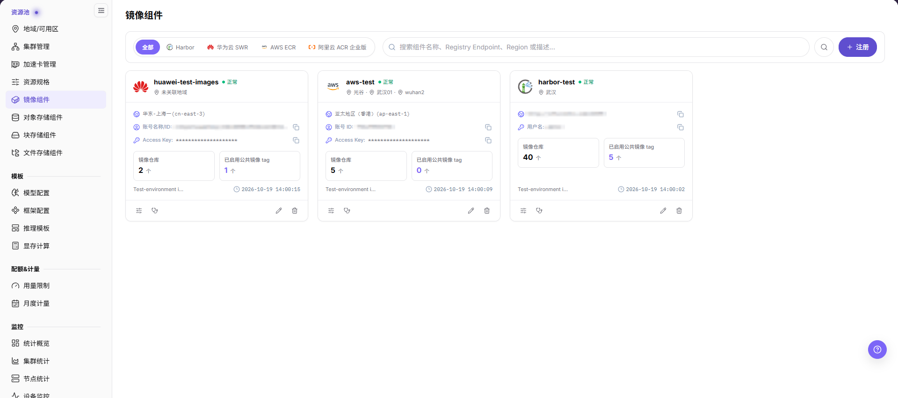
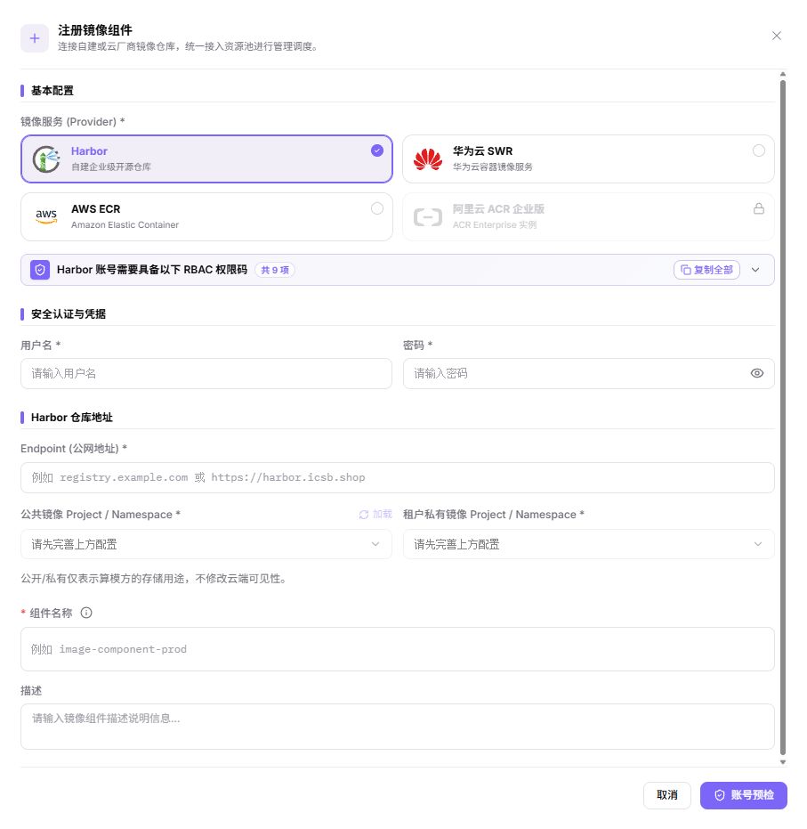
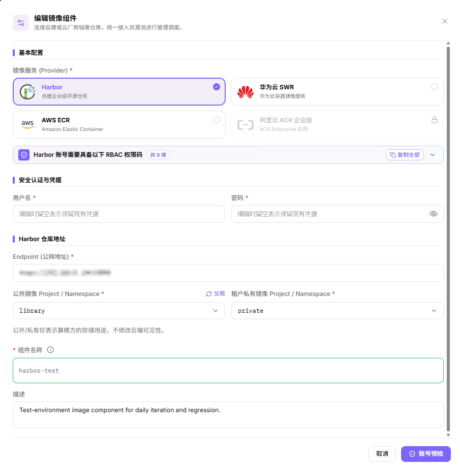
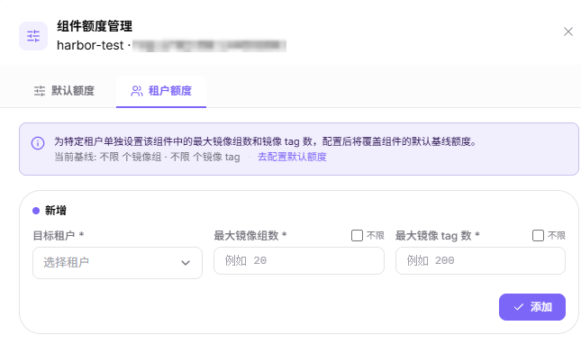
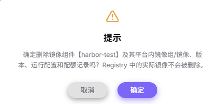

# 镜像组件

## 功能概述

| 项目 | 内容 |
| --- | --- |
| 适用角色 | 运营管理员 |
| 导航路径 | AI基础设施(On-Prem) > 资源池 > 镜像组件 |
| 页面路由 | `/powerone/resourcepool/images` |
| 管理对象 | 服务商类型、访问凭据、仓库地址或地域、公共与租户私有 Namespace、组件名称、描述、健康状态和额度 |

#### 新手理解

镜像组件像平台里的镜像仓库接入卡，负责告诉平台去哪里拉取运行镜像、用什么凭据认证、哪些地域或集群可以使用。镜像组件配置不正确时，用户侧模型实例、在线 IDE、运行实例和作业通常会卡在镜像拉取阶段。

#### 术语表

| 术语 | 说明 |
| --- | --- |
| Harbor | 常见的企业级容器镜像仓库。 |
| Registry | 用于存储和分发容器镜像的镜像仓库服务。 |
| Endpoint | 平台或集群访问镜像仓库时使用的服务地址。 |

#### 推荐操作顺序

先确认服务商类型、访问凭据、仓库地址或地域、公共与租户私有 Namespace、组件名称和描述的前置依赖，再按主要操作顺序处理，最后执行结果校验并进入后续页面。

#### 小白先看

先确认当前任务是否涉及服务商类型、访问凭据、仓库地址或地域、公共与租户私有 Namespace、组件名称和描述，再按照推荐顺序操作。页面字段或状态与预期不符时，先回到前置对象页核对依赖，不要跳过结果校验直接进入下游流程。

## 前提条件

1. 镜像仓库已部署完成，并能从平台侧和目标集群访问。
2. 已准备仓库地址、Endpoint、认证方式、访问凭据和证书策略。
3. 目标集群能解析并访问镜像仓库地址。
4. 已确认关联地域、绑定集群、公共镜像、自定义镜像和租户项目权限边界。

## 页面说明

页面用于维护已接入的镜像组件：服务商类型、访问凭据、仓库地址或地域、公共与租户私有 Namespace、组件名称与描述、健康状态和额度。

组件以卡片形式展示，每张卡片显示健康状态、`镜像仓库 N 个`、`已启用公共镜像 tag N 个` 与关联地域，右下角为不带字段名的时间戳；未绑定任何地域时地域行显示 `未关联地域`，两个计数在空值时显示 `0 个`。Harbor 卡片显示仓库地址并提供 `复制仓库地址`；云服务商卡片显示账号或 Access Key 行并提供 `复制`。页头提供 `全部` / `Harbor` / `华为云 SWR` / `AWS ECR` / `阿里云 ACR 企业版` 页签，可在占位提示为 `搜索组件名称、Registry Endpoint、Region 或描述...` 的搜索框里检索，再点击搜索图标。页头右侧提供 `注册`，卡片底部另有四个纯图标入口，悬停可看到对应名称。

## 主要操作

### 注册镜像组件

#### 适用场景

当需要接入自建 Harbor 仓库或云厂商容器镜像仓库，并让资源池通过它拉取和存放镜像时，注册镜像组件。

#### 操作步骤

1. 进入 `AI基础设施(On-Prem) > 资源池 > 镜像组件`，点击 **"注册"** 打开 `注册镜像组件` 弹窗。
2. 在 `镜像服务 (Provider) *` 选择服务商卡片：`Harbor`、`华为云 SWR`、`AWS ECR`、`阿里云 ACR 企业版`。暂不支持的服务商以禁用卡片显示。每张卡片会列出该账号所需的权限码，可 `复制全部` 或 `展开权限清单`。
3. 在凭据区填写所选服务商对应的凭据对：Harbor 填 `用户名 *` 与 `密码 *`，华为云 SWR 与 AWS ECR 填 `Access Key *` 与 `Secret Key *`，可用 `显示密码或 Secret Key 明文` 切换明暗文。
4. 填写地址或地域：Harbor 填 `Endpoint (公网地址) *`；华为云 SWR 与 AWS ECR 填 `云平台地域 *`，其候选由 `加载地域` 在凭据填写完成后返回。
5. 设置存储用途与名称：`公共镜像 Project / Namespace *`、`租户私有镜像 Project / Namespace *`、`组件名称 *` 与 `描述`。页面说明公开/私有仅表示平台侧的存储用途，不修改云端可见性。
6. 点击最终 **"账号预检"** 提交。提交前再次核对服务商、仓库地址或地域、凭据来源与两个 Namespace 归属。

下图展示 `注册镜像组件` 弹窗。凭据字段与地址或地域字段随所选服务商变化。

#### 结果校验

- 提交成功后，组件以卡片形式出现在 `镜像组件` 页，显示健康状态、`镜像仓库 N 个`、`已启用公共镜像 tag N 个` 与关联地域。
- 卡片内容随所选服务商不同：Harbor 卡片显示仓库地址并提供 `复制仓库地址`，云服务商卡片显示账号或 Access Key 行并提供 `复制`。
- 健康状态由预检结果决定，预检结论的具体文案以页面实际显示为准。

#### 注意事项

- 弹窗底部给出 `取消` 与 `账号预检`，`账号预检` 就是提交注册的动作，该弹窗内没有单独的保存步骤。
- 填入的账号需已具备所选服务商卡片列出的 action code；提交前可在弹窗内用 `复制全部` 或 `展开权限清单` 核对。
- `公共镜像 Project / Namespace` 与 `租户私有镜像 Project / Namespace` 是两项独立分配，编辑弹窗内两个选择器互斥。
- `阿里云 ACR 企业版` 当前以禁用卡片呈现，暂不能注册该类型组件。

### 编辑镜像组件

#### 适用场景

当镜像组件的名称、描述、凭据或命名空间归属需要调整时，编辑镜像组件。

#### 操作步骤

1. 在目标组件卡片点击 **"编辑"**，打开 `编辑镜像组件` 弹窗。
2. `基本配置` 分组内 `镜像服务 (Provider) *` 保持当前服务商为选中态，暂不支持的服务商仍是带锁的禁用卡片。卡片下方的横幅说明该账号需要具备的 RBAC 权限码，带 `共 9 项`、`复制全部` 与折叠控件。
3. `安全认证与凭据` 分组内 `用户名 *` 与 `密码 *` 的占位提示都是 `编辑时留空表示保留现有凭据`：留空即沿用已保存的凭据，两项都填则替换。
4. `Harbor 仓库地址` 分组内核对 `Endpoint (公网地址) *`，再调整 `公共镜像 Project / Namespace *` 或 `租户私有镜像 Project / Namespace *`；`加载` 会从仓库侧重新拉取命名空间列表。两个选择器互斥，命名空间只能改选，不能留空。分组下方的说明指出，公开/私有仅表示平台侧的存储用途，不修改云端可见性。
5. 修改 `组件名称` —— 该字段的必填星号前置，界面写作 `* 组件名称` —— 与 `描述`。
6. 点击最终 **"账号预检"** 提交。

下图展示 `编辑镜像组件` 弹窗的 Harbor 形态；凭据字段与地址或地域字段随所选服务商变化。

#### 结果校验

- 卡片显示新的组件名称与描述，健康状态按预检结果刷新。

#### 注意事项

- 编辑不会改变云端仓库中的镜像数据，只改变平台侧的归属划分。
- 替换凭据前先确认其来源，预检失败会让组件不可用。

### 管理镜像组件额度

额度只有一个入口：卡片上的 **"额度管理"** 打开 `组件额度管理` 弹窗，弹窗内用 `默认额度` 与 `租户额度` 两个页签区分适用范围。

#### 适用场景

当需要为所有未单独配置额度的租户设置基线时用 `默认额度`，需要为单个租户放宽或收紧限制时用 `租户额度`。

#### 操作步骤

1. 进入 `AI基础设施(On-Prem) > 资源池 > 镜像组件`，在目标组件卡片点击 **"额度管理"**。
2. 在 `默认额度` 页签核对或调整 `每个租户默认最大镜像组数量 *` 与 `每个租户默认最大镜像 tag 数量 *`。勾选 `不限制数量` 后对应输入框变为不可用，该维度即为不限；此时禁用输入框内残留的数字只是占位值，不是生效值。
3. 切到 `租户额度` 页签。页签顶部给出 `当前基线: ...`，默认额度为不限时该行显示 `当前基线: 不限 个镜像组 · 不限 个镜像 tag`，右侧另有 `去配置默认额度` 链接，点击可跳回 `默认额度` 页签。
4. 在 `新增` 区块选择 `目标租户 *`，再填写 `最大镜像组数 *` 与 `最大镜像 tag 数 *`；勾选字段旁的 `不限` 会让对应输入框失效，该维度即为不限。点击 **"添加"** 提交这条新记录。
5. 修改已有记录时在 `操作` 列点击 `编辑`：区块标题变为 `编辑租户特殊额度`，右上角给出 `取消编辑 / 切回新增`，底部按钮随之变为 `保存`。要让某租户回到基线，点击 `移除`。
6. `默认额度` 页签与租户额度的编辑区块用 **"保存"** 提交，新增区块用 **"添加"** 提交。除这些按钮外，弹窗只提供右上角关闭控件。

下图展示 `租户额度` 页签的新增态，可见基线行与两个 `不限` 勾选框。

#### 结果校验

- `默认额度` 页签显示新的基线，`租户额度` 页签在 `租户名称` 列显示目标租户及其 `镜像组上限`、`镜像 tag 上限` 与 `更新时间`；`操作` 列给出 `编辑` 与 `移除`。
- 没有单独配置的租户按基线计算。当所有单独配置都被移除后，页签显示空态「暂无租户单独配置特殊额度，当前所有租户均遵循该组件的默认基线额度」，这是全部租户回到基线的可见判据。

#### 注意事项

- 默认额度会影响所有未单独配置额度的租户，修改前先确认容量和业务范围。
- 调低额度可能影响正在进行的镜像使用，变更前确认业务窗口。
- 不要把真实仓库地址、账号、密码或访问密钥写入额度说明或截图。

### 健康检查

卡片上的 **"健康检查"** 不是只读检查：它执行与注册一致的账号预检，并在过程中创建和删除临时对象。

#### 适用场景

凭据轮换、云端权限调整，或组件出现非预期的拉取失败后，执行健康检查。

#### 操作步骤

1. 在目标组件卡片点击 **"健康检查"**，打开健康检查弹窗，流程随即开始执行。
2. 弹窗按顺序执行各项预检步骤并逐条给出结果，运行期间可点击 **"中断测试"** 停止。
3. 等待运行结束；收尾步骤会清理前面步骤创建的临时对象。

#### 结果校验

- 各步骤均显示通过，卡片健康状态按预检结果刷新。

#### 注意事项

- 该流程会在目标仓库创建并删除仓库、命名空间和标签，请勿对生产仓库反复触发。
- 中断测试不会回滚已创建的对象；需要确认残留时以仓库侧记录为准。

### 移除镜像组件

#### 适用场景

当平台不再需要某个镜像组件，且已确认没有地域、作业、模板或镜像记录依赖它时，移除镜像组件。

#### 操作步骤

1. 进入 `AI基础设施(On-Prem) > 资源池 > 镜像组件`，定位目标组件。
2. 点击目标组件的 **"删除"**。
3. 标题为 `提示` 的确认弹窗会点名该组件并说明范围：删除镜像组件及其平台内镜像组/镜像、版本、运行配置和配额记录，Registry 中的实际镜像不会被删除。据此核对组件名称、Endpoint、地域绑定和下游依赖。
4. 确认替代组件、迁移安排和影响范围后，点击 **确定** 完成移除；点击 `取消` 则不做任何改动。
5. 刷新列表，并到地域/可用区页面确认下游选择范围。

下图为删除前的确认弹窗，正文写明连带删除范围：

#### 结果校验

- 目标镜像组件从组件列表中移除。
- 地域绑定和新镜像同步、上传入口不再引用该组件。
- 其他组件、它们的租户额度和已有镜像记录未被误删；随组件一起删除的只有该组件自身的配额记录。

#### 注意事项

- 移除组件可能导致镜像同步、上传、作业拉取和地域资源创建失败，执行前必须完成依赖迁移。
- 移除平台组件记录不代表删除底层镜像仓库数据，按实际数据保留策略处理仓库侧内容。

## 参数速查表

| 字段名称 | 是否必填 | 字段类型 | 示例 | 说明 |
| --- | --- | --- | --- | --- |
| 镜像服务 (Provider) | 必填 | 卡片选择 | `Harbor` | 取值为 `Harbor`、`华为云 SWR`、`AWS ECR`、`阿里云 ACR 企业版`。暂不支持的服务商以禁用卡片显示。 |
| 用户名 / 密码 | 条件必填 | 凭据 / 敏感文本 | `<USERNAME>` | 仅 Harbor。只在系统表单中填写，不写入文档、截图或工单。 |
| Access Key / Secret Key | 条件必填 | 凭据 / 敏感文本 | `<ACCESS_KEY_ID>` | 仅华为云 SWR 与 AWS ECR。属于敏感凭据，不写入文档、截图或工单。 |
| Endpoint (公网地址) | 条件必填 | 地址 / 路径 | `<BASE_URL>` | 仅 Harbor。平台访问镜像仓库的地址。文档只使用占位说明，不写真实地址。 |
| 云平台地域 | 条件必填 | 下拉 / 枚举 | `<REGION_ID>` | 仅华为云 SWR 与 AWS ECR。候选由 `加载地域` 在凭据填写完成后返回。 |
| 公共镜像 Project / Namespace | 必填 | 下拉 / 枚举 | `<PUBLIC_NAMESPACE>` | 存放平台侧公共镜像的命名空间。 |
| 租户私有镜像 Project / Namespace | 必填 | 下拉 / 枚举 | `<PRIVATE_NAMESPACE>` | 存放租户镜像的命名空间。两个命名空间选择器互斥，同一取值不能同时被两边选中。 |
| 组件名称 | 必填 | 文本 | `<COMPONENT_NAME>` | 镜像组件展示名称。使用能体现仓库用途、地域或环境的名称。 |
| 描述 | 否 | 多行文本 | `示例说明` | 组件用途、边界或维护说明。只记录非敏感说明。 |
| 操作 | 系统生成 | 操作入口 | `编辑` | 卡片提供 `额度管理`、`健康检查`、`编辑`、`删除`。注册与编辑弹窗提供 `取消` 和 `账号预检`。 `账号预检`、`健康检查`、`删除` 都会写入云端，属于高风险动作。 |

## 踩坑提示

- 注册镜像组件会影响地域、集群、作业、在线 IDE、模型实例的镜像拉取能力。
- 仓库地址、证书链、Robot 凭据或 Image Pull Secret 配置错误，可能导致 `ImagePullBackOff`。
- 镜像组件绑定错误地域，可能导致用户侧看不到镜像项目或作业无法拉取镜像。
- `账号预检 / Account preflight`（注册与编辑镜像组件弹窗）、`添加 / Add`（租户额度新增区块）和 `保存 / Save`（默认额度页签与租户额度编辑区块）属于高风险最终动作。
- 不写真实仓库地址、Robot 密码、Image Pull Secret、Token、AK/SK、内网地址、集群 ID、资源池 ID 或内部测试参数。

## 结果校验

| 检查项 | 成功表现 | 异常时处理 |
| --- | --- | --- |
| 页面入口 | 可进入镜像组件并看到目标操作入口 | 检查运营管理员权限和对应菜单是否已开放 |
| 对象记录 | 服务商类型、仓库地址或地域、组件名称、健康状态与额度信息在列表或详情中可见 | 重置筛选并核对名称、所属范围和创建结果 |
| 状态结果 | 新增或变更后的状态符合页面提示 | 查看操作提示、依赖对象状态和最近更新时间 |
| 下游使用 | 后续页面能够选择或关联目标对象 | 回到前置配置核对启用状态、归属关系和可见范围 |

## 常见问题

#### 默认额度保存后未生效

**问题现象：**

保存成功，但相关租户的镜像额度仍显示旧值。

**可能原因：**

- 该租户已有单独额度配置。
- 页面数据或额度计算尚未刷新。
- 修改的不是实际被使用的镜像组件。

**处理方式：**

1. 在租户额度入口核对是否存在专用配置。
2. 刷新组件详情并检查更新时间。
3. 核对组件名称、所属范围和下游镜像使用关系。

#### 租户额度入口中找不到目标租户

**问题现象：**

打开 **"额度管理"** 弹窗的 `租户额度` 页签后，目标租户不在可选列表中。

**可能原因：**

- 租户不在当前镜像组件的可见范围。
- 租户状态或镜像组件状态不可用。
- 当前账号没有租户额度配置权限。

**处理方式：**

1. 核对镜像组件状态和所属范围。
2. 到租户或权限页面确认目标租户可见且状态正常。
3. 检查运营管理员权限后重新打开额度入口。

#### 镜像组件无法移除

**问题现象：**

点击 **"删除"** 后操作失败，或页面提示仍存在关联对象。

**可能原因：**

- 地域、镜像或其他资源对象仍绑定该组件。
- 当前账号缺少移除权限。
- 组件正在执行同步或其他后台任务。

**处理方式：**

1. 到地域/可用区和额度配置页面逐项核对关联。
2. 检查组件任务状态和最近更新时间。
3. 解除依赖或完成迁移后，再按审批结果重新执行移除。

#### 镜像组件的操作入口不可用

**问题现象：**

新增、注册或维护入口不可见或不可点击。

**可能原因：**

- 当前角色权限不足。
- 页面处于只读状态。
- 依赖对象不满足条件。

**处理方式：**

1. 检查运营管理员权限
2. 核对页面提示
3. 先完成依赖对象配置。

#### 下游页面无法使用镜像组件

**问题现象：**

当前页状态正常，但下游页面无法选择镜像组件、其命名空间分配或目标租户适用的额度。

**可能原因：**

- 可见范围不匹配。
- 对象未启用。
- 下游缓存未刷新。

**处理方式：**

1. 核对启用状态和归属
2. 检查角色可见范围
3. 刷新下游页面并重新选择。

## 注意事项

- 注册镜像组件会影响地域、集群、作业、在线 IDE、模型实例的镜像拉取能力。
- Robot 凭据、仓库密码、Image Pull Secret、Token 和证书材料都属于敏感信息。
- 仓库地址、证书链、Robot 凭据或 Image Pull Secret 配置错误，可能导致 `ImagePullBackOff`。
- 镜像组件绑定错误地域，可能导致用户侧看不到镜像项目或作业无法拉取镜像。
- 不建议在生产模板中长期使用 `latest` 标签，应使用明确版本标签。
- `账号预检 / Account preflight`（注册与编辑镜像组件弹窗）、`添加 / Add`（租户额度新增区块）和 `保存 / Save`（默认额度页签与租户额度编辑区块）属于高风险最终动作。执行前确认范围与影响。
- 不写真实仓库地址、Robot 密码、Image Pull Secret、Token、AK/SK、内网地址、集群 ID、资源池 ID 或内部测试参数。

## 后续操作

1. 进入 [地域/可用区](../regions-zones/) 绑定或核对镜像组件。
2. 指导用户在 [镜像服务](../../../user/extensions/images/) 中创建项目并推送镜像。
3. 进入用户侧镜像服务页面（`扩展服务 > 镜像服务`）确认项目、镜像和标签可见。
4. 使用测试作业、在线 IDE 或模型实例验证镜像拉取和启动。
