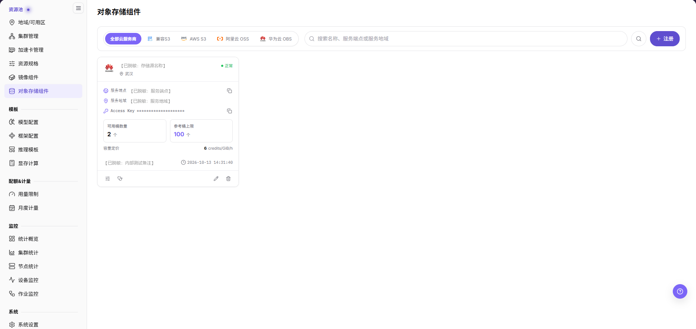
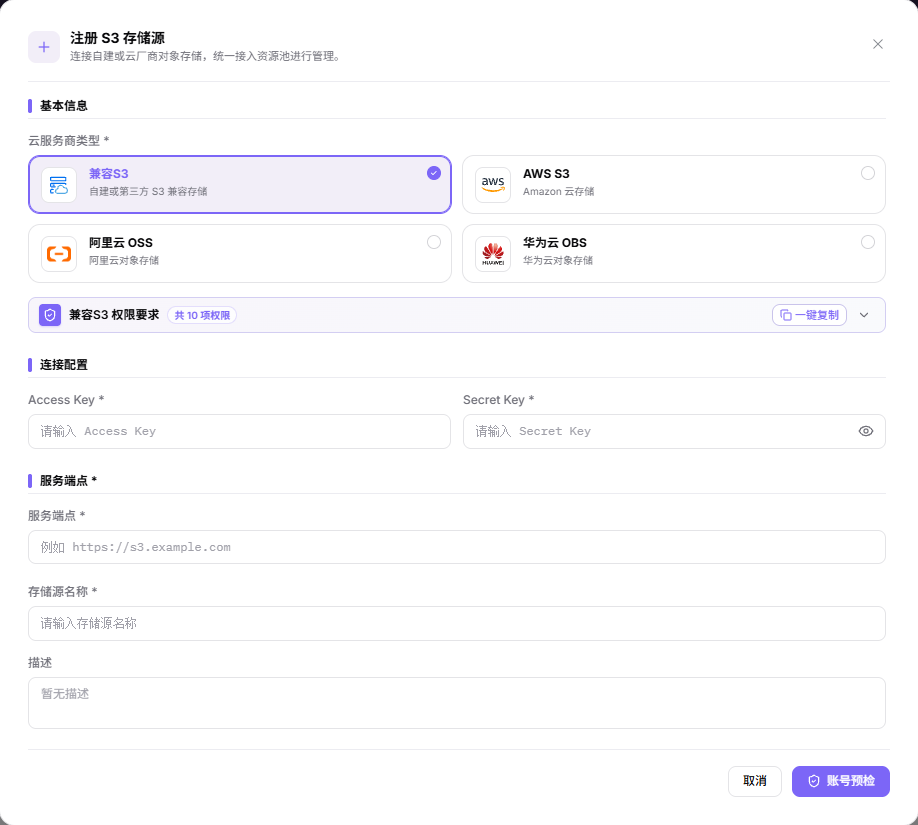
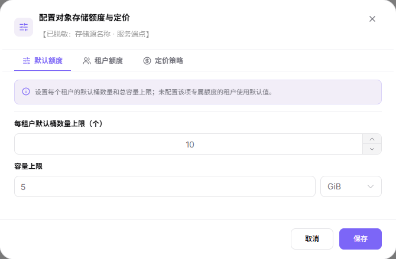
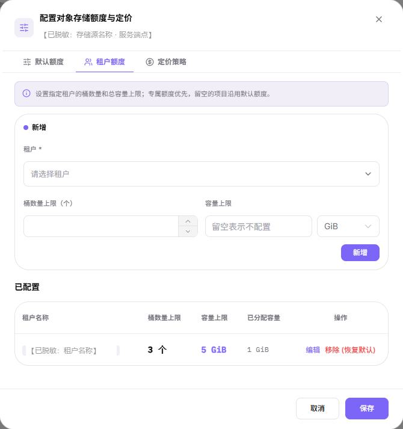
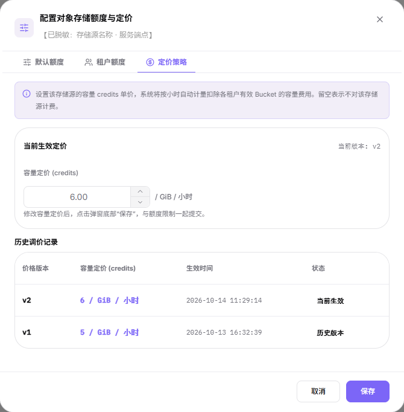
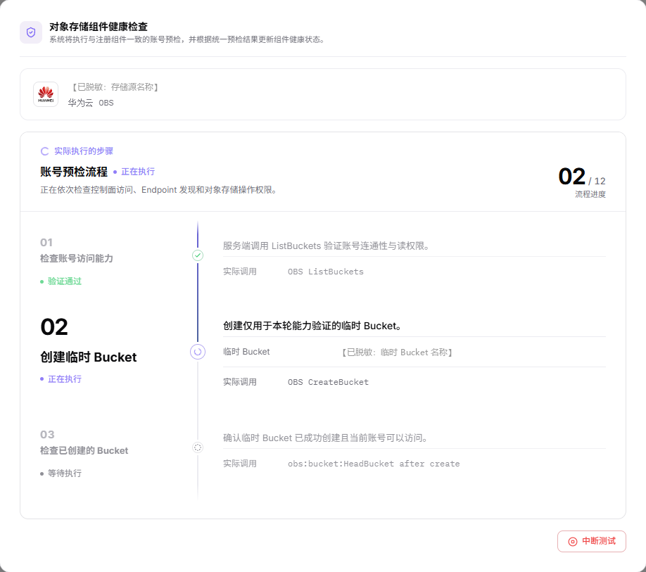
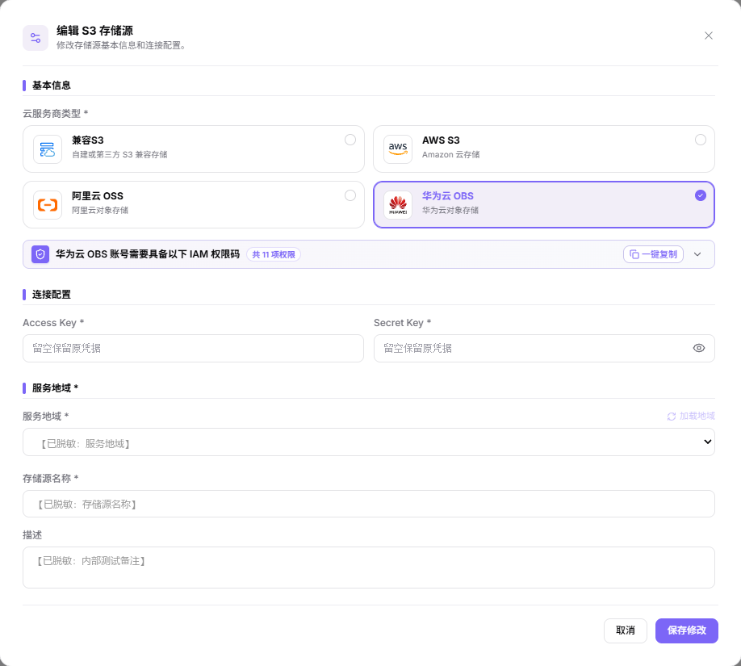

# 对象存储组件

## 功能概述

| 项目 | 内容 |
| --- | --- |
| 适用角色 | 运营管理员 |
| 导航路径 | On-Prem > 资源池 > 对象存储组件 |
| 页面路由 | `/powerone/resourcepool/storage` |
| 管理对象 | 服务商类型、存储源名称、服务端点或服务地域、访问凭据、桶与容量额度、容量定价、描述和健康状态 |

#### 新手理解

- **对象存储** 像一个按桶组织的文件仓库，适合保存模型权重、数据集、压缩包和运行产物。
- **Bucket** 像对象存储的顶层容器，用户侧创建桶后才能组织对象。
- **Endpoint** 是访问入口，平台、集群或作业需要通过它访问对象存储。
- **AK/SK** 是访问凭据，属于敏感信息，不应出现在截图、文档或工单中。

#### 术语表

| 术语 | 说明 |
| --- | --- |
| MinIO | 常见的兼容 S3 协议的对象存储实现。 |
| S3 | 对象存储的 API 协议或兼容接口。 |
| Bucket | 对象存储中用于组织对象的顶层容器。 |

#### 推荐操作顺序

先确认服务商类型、访问凭据、服务端点或服务地域、存储源名称，以及额度与定价规划的前置依赖，再按主要操作顺序处理，最后执行结果校验并进入后续页面。

#### 小白先看

先确认当前任务是否涉及服务商类型、访问凭据、服务端点或服务地域、存储源名称和额度与定价，再按照推荐顺序操作。页面字段或状态与预期不符时，先回到前置对象页核对依赖，不要跳过结果校验直接进入下游流程。

## 前提条件

1. 对象存储服务已部署完成，并能从平台管理侧和目标集群访问。
2. 已准备服务端点或服务地域、访问协议、认证方式、访问凭据、桶与容量规划、容量定价和关联地域。
3. 已确认 Bucket 命名、租户隔离、权限边界和数据保留策略。
4. 当前账号具备运营管理员资源池管理权限。

## 页面说明

页面用于维护已接入的对象存储源：服务商类型、存储源名称、服务端点或服务地域、访问凭据、桶与容量额度、容量定价、描述和健康状态。

对象以卡片形式展示，每张卡片显示 `服务端点`、`服务地域` 与掩码后的 `Access Key`，其中 `服务端点` 与 `Access Key` 两行行末各有一个图标按钮，名称下方是带定位图标的所属地域标签；卡片还显示 `可用桶数量 N 个`、`参考桶上限 N 个` 与按 credits/GiB/小时 表示的 `容量定价`，末行是描述摘要与时钟图标加时间戳。页头提供 `全部云服务商` / `兼容S3` / `AWS S3` / `阿里云 OSS` / `华为云 OBS` 页签，可在占位提示为 `搜索名称、服务端点或服务地域` 的搜索框里检索，再点击框右侧的搜索图标，最右侧另有 `注册`。

## 主要操作

### 注册对象存储组件

#### 适用场景

当需要接入新的 MinIO、S3 兼容存储或其他对象存储服务，并让地域、用户侧 Bucket 或作业读写对象路径使用该存储能力时，注册存储组件。正文中的对象存储组件仍指本页面管理的对象存储接入对象。

#### 操作步骤

1. 进入 `On-Prem > 资源池 > 对象存储组件`，点击 **"注册"** 打开 `注册 S3 存储源` 弹窗。
2. 在 `云服务商类型 *` 选择卡片：`兼容S3`、`AWS S3`、`阿里云 OSS`、`华为云 OBS`。所选服务商的权限码列在下方权限横幅里，横幅给出权限条数与 `一键复制`，右侧另有展开图标。
3. 在 `连接配置` 填写 `Access Key *` 与 `Secret Key *`，凭据框右侧的显示图标可切换明文。
4. 填写地址或地域：仅 `兼容S3` 填写 `服务端点 *`；`AWS S3`、`阿里云 OSS`、`华为云 OBS` 将该字段替换为 `服务地域 *`，候选由 `加载地域` 返回。
5. 填写 `存储源名称 *` 与 `描述`，点击最终 **"账号预检"** 提交。注册弹窗内没有额度字段，桶数量、容量与定价在注册后通过卡片配置。
6. 提交前再次核对服务商、服务端点或服务地域、Access Key 与存储源名称。

#### 结果校验

- 提交成功后，存储源以卡片形式出现，卡片显示状态、`服务端点` 或 `服务地域` 行、`可用桶数量`、`参考桶上限`、`容量定价`，末行是描述摘要与时间戳。
- 卡片底部四个入口的悬浮提示逐字为 `配置限制`、`健康检查`、`编辑`、`删除`，依次对应本页其余四节。
- 额度与定价不属于注册环节。请在卡片的 `配置限制` 入口配置，桶数量上限、容量上限与容量定价会在同一弹窗一次 `保存`。

#### 注意事项

- 注册弹窗底部只有 `取消` 与 `账号预检`；编辑弹窗的最终按钮是 `保存修改`，两者是不同入口、行为也不同。
- 仅 `兼容S3` 保留 `服务端点 *` 字段；`AWS S3`、`阿里云 OSS`、`华为云 OBS` 用 `服务地域 *` 取代它，其候选在凭据填写完整后由 `加载地域` 返回。
- 填入的账号需已具备所选服务商权限横幅列出的权限码，不同服务商的权限条数并不相同。

### 配置额度与定价

卡片上的 `配置限制` 入口打开 `配置对象存储额度与定价` 弹窗，内含 `默认额度`、`租户额度`、`定价策略` 三个页签；额度与定价一次提交。

#### 适用场景

当需要设置每租户默认桶数量与容量上限、为单个租户单独配置，或调整按小时计费的容量单价时，使用该弹窗。

#### 操作步骤

1. 在目标卡片点击 `配置限制` 入口打开弹窗，弹窗顶部显示存储源名称与其服务端点。
2. 在 `默认额度` 页签设置 `每租户默认桶数量上限（个）` 与 `容量上限`，容量上限右侧选择单位（例如 `GiB`）；页签说明写明未配置专属额度的租户使用默认值。
3. 在 `租户额度` 页签的 `新增` 区选择 `租户 *`，填写 `桶数量上限（个）` 与 `容量上限`（留空表示不配置）后点击 **"新增"**。`已配置` 列表给出 `租户名称`、`桶数量上限`、`容量上限`、`已分配容量` 与 `操作`，行内动作是 `编辑` 和 `移除 (恢复默认)`。
4. 在 `定价策略` 页签设置 `容量定价 (credits)`，单位是 `/ GiB / 小时`。页签上方是 `当前生效定价` 及其 `当前版本`，下方 `历史调价记录` 表给出 `价格版本`、`容量定价 (credits)`、`生效时间` 与 `状态`，状态取值 `当前生效` 与 `历史版本`。留空表示不计费。
5. 点击 **"保存"**。页面注明修改容量定价后与额度限制一起提交；点击 **"取消"** 放弃。

`默认额度` 页签字给出两个默认上限字段与 `GiB` 容量单位。

`租户额度` 页签字给出 `新增` 区与 `已配置` 列表及其行内动作。

`定价策略` 页签字给出上方的 `当前生效定价` 与 `当前版本`，以及下方 `历史调价记录` 表。

#### 结果校验

- 卡片显示新的容量定价，`可用桶数量` 与 `参考桶上限` 按默认额度呈现。
- `定价策略` 页签的 `当前版本` 递增，旧价格进入 `历史调价记录` 表并转为 `历史版本`。

#### 注意事项

- 定价与额度共用一次保存，即使只想改价格，被改动过的额度字段也会一并写入。
- `已分配容量` 是该租户在此存储源上活动桶的容量配额之和，不是实际文件用量。
- 调低桶数量或容量上限可能影响已创建的桶，变更前确认业务窗口。

### 健康检查对象存储组件

卡片上的 `健康检查` 入口打开 `对象存储组件健康检查` 弹窗。页面写明它执行与注册组件一致的账号预检，并根据统一预检结果更新组件健康状态。

#### 适用场景

当需要确认某个存储源的凭据、服务端点或服务地域、账号权限是否仍然可用，或在凭据与定价变更后复核组件健康状态时，执行健康检查。

#### 操作步骤

1. 在目标卡片点击 `健康检查` 入口，弹窗顶部显示被检组件的名称与所属服务商。
2. 弹窗在 `实际执行的步骤` 下按序号列出 `账号预检流程`，右侧显示 `i / 12 流程进度`，每一步标注 `验证通过`、`正在执行` 或 `等待执行`，并给出该步的实际调用。
3. 画面可见的前三步依次是 `检查账号访问能力`、`创建临时 Bucket`、`检查已创建的 Bucket`，其中第二步创建仅用于本次能力验证的临时 Bucket。
4. 需要中止时点击弹窗底部的 **"中断测试"**。

下图是执行中的健康检查弹窗：顶部显示被检组件与其服务商，中部是 `账号预检流程` 的步骤时间线，底部是 `中断测试` 按钮。

#### 结果校验

- 各步骤状态推进到 `验证通过`，弹窗按统一预检结果更新组件健康状态。
- 卡片上的状态随预检结果变化。

#### 注意事项

- 健康检查不是只读探测：弹窗写明该步 `实际调用 OBS CreateBucket` 创建临时 Bucket，属于写链路，请在业务窗口外执行。
- 该弹窗底部只有 `中断测试`，没有 `取消`；也不要把它当作可反复点击的刷新按钮。
- 临时 Bucket 的清理方式未在本文配图中收录，以页面实际提示为准。
- 账号缺少弹窗列出的权限码时，预检会停在对应步骤，先补权限再复测。

### 编辑对象存储组件

#### 适用场景

当对象存储源的服务商类型、服务端点或服务地域、存储源名称、描述或访问凭据需要调整时，编辑该存储源。

#### 操作步骤

1. 在目标卡片点击 `编辑` 入口，打开 `编辑 S3 存储源` 弹窗，弹窗顶部说明它用于修改存储源基本信息和连接配置。
2. 需要换服务商时在 `云服务商类型 *` 重新选择卡片，权限横幅同步换成新服务商的权限码与条数。
3. 凭据字段留空表示保留原凭据（提示文字逐字为 `留空保留原凭据`），填写新值则替换。
4. 修改 `服务端点 *` 或 `服务地域 *`（候选由 `加载地域` 返回）、`存储源名称 *` 与 `描述`。
5. 点击 **"保存修改"** 提交，或点击 **"取消"** 放弃。

下图是 `编辑 S3 存储源` 弹窗：`云服务商类型 *` 卡片、凭据占位提示，以及 `服务地域 *`、`存储源名称 *` 与 `描述` 字段。

#### 结果校验

- 卡片显示新的名称、服务端点或服务地域与描述。
- 编辑弹窗各字段的回填值与卡片当前值一致，可据此确认改动是否已落库。

#### 注意事项

- 编辑弹窗的最终按钮是 `保存修改`，与注册弹窗的 `账号预检` 不同。
- 凭据留空只表示沿用原凭据，不会清除已保存的 Access Key 与 Secret Key。
- 健康检查与额度定价弹窗是独立入口，不属于本次编辑。

### 删除对象存储组件

#### 适用场景

当某个存储源不再使用、需要下线或换绑其他存储源时，删除该存储源。

#### 操作步骤

1. 在目标卡片点击 `删除` 入口，打开 `删除 S3 存储源` 确认弹窗。
2. 弹窗正文逐字为「确定删除未关联地域的存储源"<存储源名称>"吗？此操作不可撤销。」，据此核对目标对象。
3. 点击 **"删除"** 执行，或点击 **"取消"** 放弃。

#### 结果校验

- 确认后该存储源从卡片列表消失，重置筛选与搜索后仍不返回该名称。
- 确认文案限定为未关联地域的存储源；已关联地域时的页面行为未在本文配图中收录，先解绑再操作。

#### 注意事项

- 页面写明此操作不可撤销，删除前确认数据迁移、备份、地域绑定和依赖作业。
- 画面未说明删除是否影响存储源内的数据，先在对象存储侧确认备份。
- 删除后如需再接入，走「注册对象存储组件」重新填写凭据。

## 参数速查表

| 字段名称 | 是否必填 | 字段类型 | 示例 | 说明 |
| --- | --- | --- | --- | --- |
| 云服务商类型 | 必填 | 卡片选择 | `兼容S3` | 弹窗内逐字标签为 `云服务商类型 *`，取值为 `兼容S3`、`AWS S3`、`阿里云 OSS`、`华为云 OBS`。该选择决定弹窗要求 `服务端点 *` 还是 `服务地域 *`。 |
| Access Key | 必填 | 凭据 / 敏感文本 | `<ACCESS_KEY_ID>` | 对象存储访问 AK。只在系统表单中填写，不要复制到共享文档、截图或工单。 |
| Secret Key | 必填 | 凭据 / 敏感文本 | `<ACCESS_KEY_SECRET>` | 对象存储访问 SK。属于敏感凭据，不要复制到共享文档、截图或工单。 |
| 服务端点 | 条件必填 | 地址 / 路径 | `<BASE_URL>` | 仅用于 `兼容S3`。对外分享时请隐去真实端点，只使用占位形式。 |
| 服务地域 | 条件必填 | 下拉 / 枚举 | `<REGION_ID>` | `AWS S3`、`阿里云 OSS`、`华为云 OBS` 用它替换 `服务端点 *`，候选在凭据填写完成后由 `加载地域` 返回。 |
| 存储源名称 | 必填 | 文本 | `<SOURCE_NAME>` | 对象存储源展示名称。建议体现存储类型、环境或地域。 |
| 描述 | 否 | 多行文本 | `<description>` | 组件用途、边界或维护说明。只记录非敏感说明。 |
| 每租户默认桶数量上限（个） / 容量上限 | 否 | 数值 / 容量 | `10` / `5 GiB` | 在 `配置对象存储额度与定价` 弹窗的 `默认额度` 页签设置，注册弹窗内没有该字段。 |
| 容量定价 | 否 | 数值 / 计价 | `<PRICE>` | 在 `定价策略` 页签设置，与额度共用一次保存。留空表示不计费。 |
| 操作 | 系统生成 | 操作入口 | `编辑` | 卡片底部四个入口的悬浮提示逐字为 `配置限制`、`健康检查`、`编辑`、`删除`，依次对应「配置额度与定价」「健康检查对象存储组件」「编辑对象存储组件」「删除对象存储组件」。健康检查会创建临时 Bucket，与 `删除` 同属高风险动作。 |

## 踩坑提示

- 注册存储组件会影响地域对象存储能力、用户侧 Bucket 创建、作业读写对象路径和数据访问范围。
- 服务端点、服务地域、证书、AK/SK、Bucket 策略或额度配置错误，可能导致作业无法读写对象存储。
- AK/SK、Token、内部连接串、生产 Bucket 路径属于敏感信息，不能写入文档、截图或工单。
- `账号预检 / Account preflight`（注册弹窗）、`保存修改 / Save changes`（编辑弹窗）、`新增 / Add`（租户额度新增区）和 `保存 / Save`（额度与定价弹窗）属于高风险最终动作。
- 不写真实 Endpoint、内网地址、AK/SK、Token、Bucket 名称、生产对象路径、集群 ID、资源池 ID 或内部测试参数。

## 结果校验

| 检查项 | 成功表现 | 异常时处理 |
| --- | --- | --- |
| 页面入口 | 可进入对象存储组件并看到目标操作入口 | 检查运营管理员权限和对应菜单是否已开放 |
| 对象记录 | 服务商类型、服务端点或服务地域、存储源名称、桶与容量额度、容量定价在卡片中可见 | 重置筛选并核对名称、所属范围和创建结果 |
| 状态结果 | 新增或变更后的状态符合页面提示 | 查看操作提示、依赖对象状态和最近更新时间 |
| 下游使用 | 后续页面能够选择或关联目标对象 | 回到前置配置核对启用状态、归属关系和可见范围 |

## 常见问题

#### 对象存储组件中找不到目标对象

**问题现象：**

页面可进入，但没有看到预期的对象存储源、服务商卡片、服务端点或服务地域、额度与定价入口。

**可能原因：**

- 筛选条件仍生效。
- 对象属于其他范围。
- 前置配置未完成。

**处理方式：**

1. 重置筛选
2. 核对所属地域或租户
3. 返回前置页面确认对象状态。

#### 对象存储组件的操作入口不可用

**问题现象：**

新增、注册或维护入口不可见或不可点击。

**可能原因：**

- 当前角色权限不足。
- 页面处于只读状态。
- 依赖对象不满足条件。

**处理方式：**

1. 检查运营管理员权限
2. 核对页面提示
3. 先完成依赖对象配置。

#### 对象存储组件的必填项没有可选值

**问题现象：**

表单能打开，但下拉框为空。

**可能原因：**

- 候选对象未启用。
- 所属范围不一致。
- 当前账号不可见。

**处理方式：**

1. 到候选对象页面核对状态
2. 确认归属关系
3. 检查可见范围后刷新表单。

#### 对象存储组件操作后状态异常

**问题现象：**

提交后记录存在，但状态不是预期值。

**可能原因：**

- 连通性或校验失败。
- 关联对象异常。
- 后台处理尚未完成。

**处理方式：**

1. 查看页面提示和更新时间
2. 检查关联对象
3. 按状态阶段排查处理任务。

#### 下游页面无法使用对象存储组件

**问题现象：**

当前页状态正常，但下游页面无法选择对象存储源、其桶与容量额度或目标租户适用的定价。

**可能原因：**

- 可见范围不匹配。
- 对象未启用。
- 下游缓存未刷新。

**处理方式：**

1. 核对启用状态和归属
2. 检查角色可见范围
3. 刷新下游页面并重新选择。

## 注意事项

- 注册存储组件会影响地域对象存储能力、用户侧 Bucket 创建、作业读写对象路径和数据访问范围。
- 不要截图或记录真实 Endpoint、内网地址、AK/SK、Token、内部连接串、生产 Bucket 名称和生产对象路径。
- 删除、禁用或替换对象存储组件前，应确认数据迁移、备份、地域绑定和依赖作业。
- `账号预检 / Account preflight`（注册弹窗）、`保存修改 / Save changes`（编辑弹窗）、`新增 / Add`（租户额度新增区）和 `保存 / Save`（额度与定价弹窗）属于高风险最终动作。执行前确认范围与影响。
- 不写真实 Endpoint、内网地址、AK/SK、Token、Bucket 名称、生产对象路径、集群 ID、资源池 ID 或内部测试参数。

## 后续操作

1. 进入 [地域/可用区](../regions-zones/) 绑定对象存储组件。
2. 指导用户在 [对象存储](../../../user/storage/object-storage/) 中创建 Bucket 并上传数据。
3. 通过测试作业验证对象读写、权限和路径配置。
4. 定期核对容量使用、Bucket 策略和数据保留策略。
