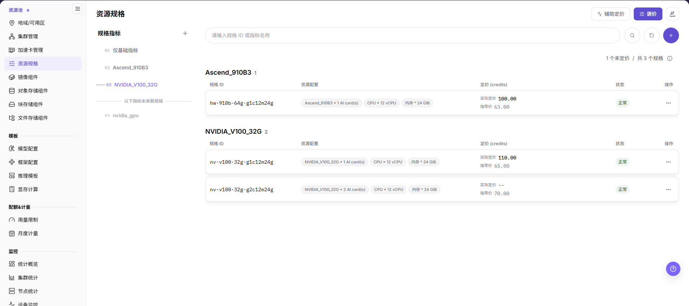
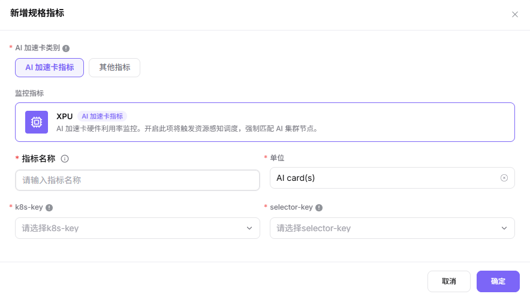
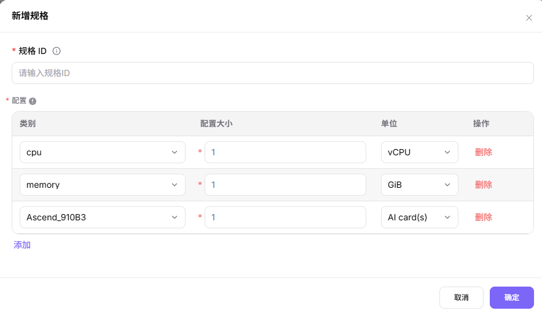
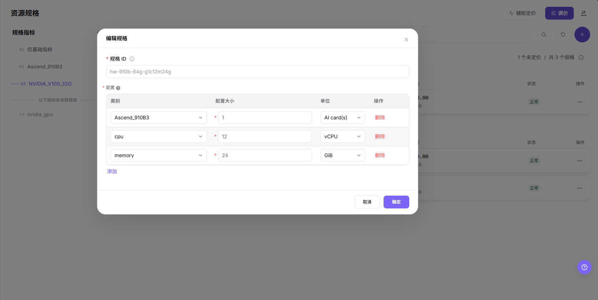
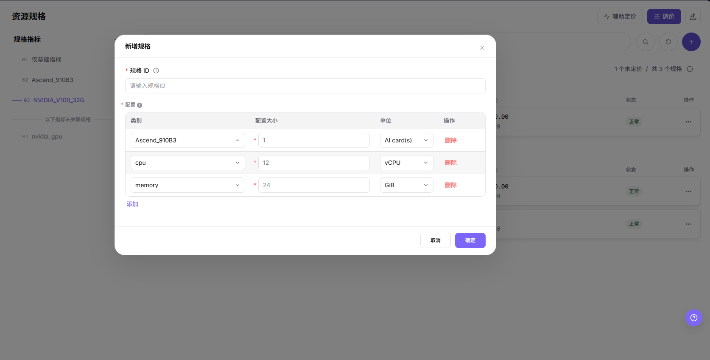
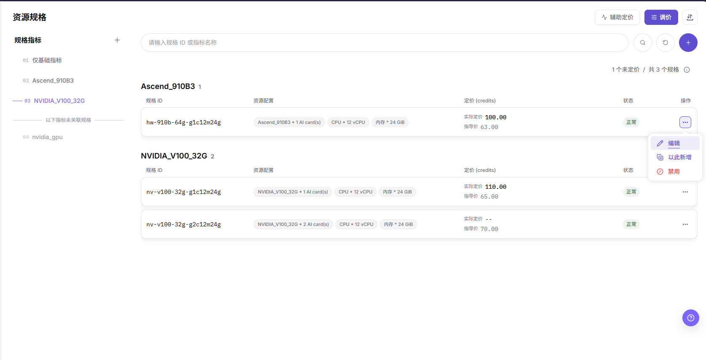
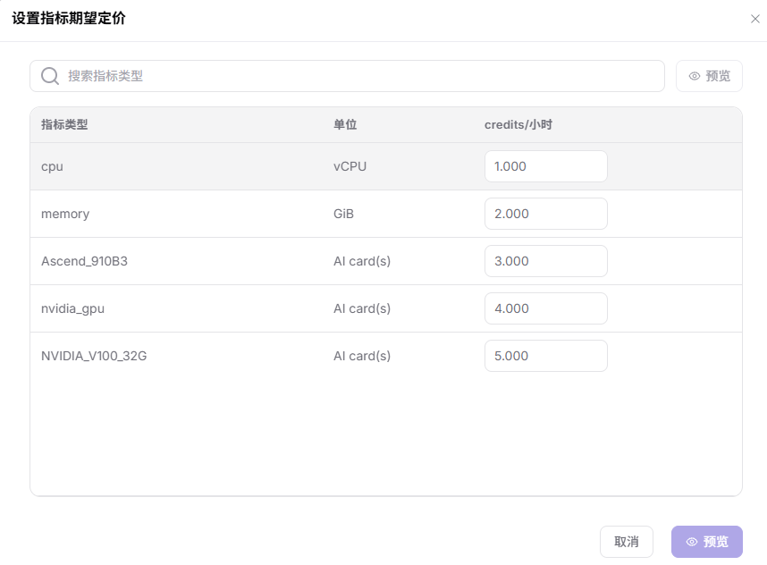
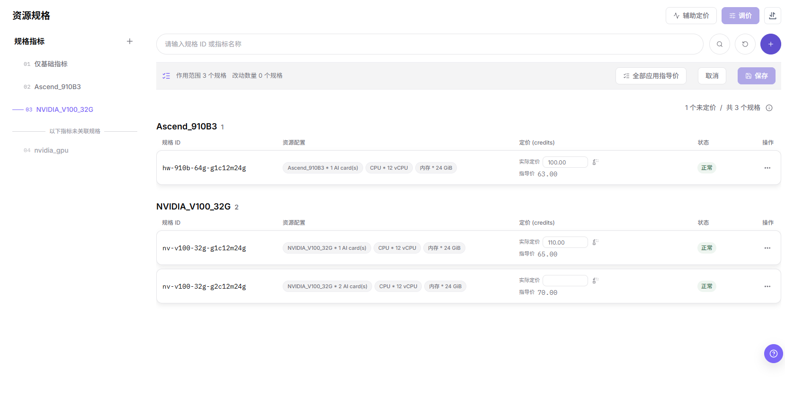

# 资源规格

## 功能概述

| 项目 | 内容 |
| --- | --- |
| 适用角色 | 运营管理员 |
| 导航路径 | On-Prem > 资源池 > 资源规格 |
| 页面路由 | `/powerone/resourcepool/flavor/list` |
| 管理对象 | 规格 ID、规格的配置项、credits 定价、状态和用于分组的规格指标 |

#### 新手理解

- **资源规格** 像资源套餐，用户创建作业或服务时选择它来申请资源。
- **规格指标** 像套餐里的资源项，先有 CPU、内存或加速卡指标，才能组合成规格。
- **关联集群** 决定规格在哪些集群可用；规格创建完成后还需要和集群资源能力匹配。

#### 术语表

| 术语 | 说明 |
| --- | --- |
| 规格 ID | 展示在用户端或作业创建页面上的资源套餐名称。 |
| CPU | 规格中包含的 CPU 核数或 CPU 指标数量。 |
| 内存 | 规格中包含的内存容量。 |

#### 推荐操作顺序

先确认规格指标、规格 ID、配置项与单位、credits 定价和状态的前置依赖，再按主要操作顺序处理，最后执行结果校验并进入后续页面。

#### 小白先看

先确认当前任务是否涉及规格 ID、规格的配置项、credits 定价、状态和规格指标，再按照推荐顺序操作。页面字段或状态与预期不符时，先回到前置对象页核对依赖，不要跳过结果校验直接进入下游流程。

## 前提条件

1. 当前账号具备运营管理员权限，并能进入 `On-Prem > 资源池 > 资源规格`。
2. 已完成规格指标配置，CPU、内存和加速卡指标处于可用状态。
3. 如规格包含加速卡，已确认加速卡型号、k8s-key、selector-key 与集群节点实际上报资源一致。
4. 已规划规格命名、资源档位、适用作业类型和后续关联集群范围。
5. 编辑、以此新增或禁用已开放给用户的规格前，已约定业务窗口，并列出引用该规格的集群、模板、租户配额和运行中实例。

## 页面说明

页面用于维护规格 ID、规格的配置项（CPU、内存、加速卡等）、credits 定价、状态，以及用于分组的规格指标。

列表按规格指标分组，每组标题显示该指标名称与其包含的规格数量；每行包含 `规格 ID`、`资源配置`、`定价 (credits)`、`状态`、`操作`，列表上方的统计行显示未定价情况，例如 `1 个未定价 / 共 3 个规格`。CPU、内存、加速卡等配置以标签形式合并在 `资源配置` 列，`实际定价` 与 `指导价` 在 `定价 (credits)` 列分两行显示。在搜索框（占位提示 `请输入规格 ID 或指标名称`）输入规格 ID 或指标名称后，用其右侧的搜索与重置图标按钮检索列表。页头提供 `辅助定价`、`调价` 与一个纯图标的导入导出入口，每行 `操作` 菜单依次为 `编辑`、`以此新增`、`禁用`。

## 主要操作

### 管理规格指标

页面左侧常驻 `规格组导航` 面板，标题为 `规格指标`。列表按这里的指标分组，因此规格指标是规格的前置对象。

#### 适用场景

当规格需要引用新的加速卡或其他资源项，或已有指标需要调整名称、单位、k8s-key、selector-key 时，维护规格指标。

#### 操作步骤

1. 进入 `On-Prem > 资源池 > 资源规格`，在 `规格组导航` 面板查看 `规格指标` 列表。列表分为 `仅基础指标`、加速卡指标，以及分隔线 `以下指标未关联规格` 下方的未关联项。
2. 点击 **"新增规格指标"**，打开指标弹窗。
3. 在 `AI 加速卡类别` 分段控件选择 `AI 加速卡指标` 或 `其他指标`。
4. 选择加速卡指标时，下方只读卡片 `监控指标` 标明其来源；`XPU` 卡片表示 AI 加速卡硬件利用率监控，开启后触发资源感知调度并强制匹配 AI 集群节点。
5. 填写 `指标名称`（1-30 字）、`单位`（加速卡指标预填 `AI card(s)`）、`k8s-key` 与 `selector-key`，四项均为必填。`k8s-key` 与 `selector-key` 的候选来自集群节点实际上报的资源。
6. 点击 **"确定"** 提交。

下图展示 `AI 加速卡指标` 态的指标弹窗，`监控指标`、`指标名称`、`单位`、`k8s-key` 与 `selector-key` 在同一表单内填写。

#### 结果校验

- 新指标出现在 `规格指标` 面板中，并可作为 `新增规格` 弹窗 `配置` 表格的 `类别` 候选。
- 尚未被任何规格使用的指标显示在 `以下指标未关联规格` 分隔线下方。

#### 注意事项

- 面板内每一项的菜单提供 `编辑` 与 `禁用`。禁用已被规格使用的指标前，先确认规格与作业影响。
- 指标一旦被规格使用，修改其名称、单位、k8s-key 或 selector-key 会同步影响这些规格的调度口径。
- `其他指标` 态下 `监控指标` 变为下拉框（示例值 `xpu`），且表单不提供 `selector-key` 字段，因此这样创建的指标不绑定节点选择器。

### 新增资源规格

#### 适用场景

当需要新增训练、推理、开发或模型服务资源档位，或需要按 CPU、内存、加速卡型号和卡数提供不同资源组合时，新增规格。

#### 操作步骤

1. 进入 `On-Prem > 资源池 > 资源规格`。
2. 点击搜索行右端的圆形加号按钮，打开 `新增规格` 弹窗。
3. 填写 `规格 ID`，建议体现资源档位与适用场景。
4. 在 `配置` 表格按行维护资源项，每行依次是 `类别`、`配置大小`、`单位`、`操作`。弹窗默认给出 `cpu`（单位 `vCPU`）与 `memory`（单位 `GiB`）两行，配置大小都是 `1`；点击表格下方 **"添加"** 增加一行，或点击行尾 **"删除"** 移除该行。
5. `类别` 的候选来自 `规格指标` 面板中的指标，因此加速卡候选必须先在面板中创建并启用才会出现。
6. 点击最终 **"确定"** 前，再次核对资源组合与命名口径。

下图展示已加入加速卡行的 `新增规格` 弹窗：`规格 ID` 为空，`配置` 表格由 `cpu`、`memory` 与 `Ascend_910B3` 三行组成，创建时应明确 CPU、内存和加速卡组合。

#### 结果校验

- 提交成功后，新规格出现在列表中，并按其加速卡行所用指标分组；该行 `资源配置` 列以芯片形式显示 `cpu`、`memory` 与加速卡条目。
- `定价 (credits)` 列把实际定价与指导价显示为两行。未完成定价的规格计入未定价，并在实际定价行显示 `--`。
- 规格能否选到某个加速卡，取决于 `规格指标` 面板中该指标是否存在，这一依赖只能在面板侧解决。

#### 注意事项

- 弹窗内没有定价字段。规格价格由指标期望定价与配置数量相乘得出，需通过 `辅助定价` 或 `调价` 维护。
- 加速卡候选必须先在 `规格指标` 面板中创建并启用才会出现。
- 修改已有规格是另一个入口：在目标行的 `操作` 菜单选择 `编辑`，或选择 `以此新增` 从它派生新规格。

### 编辑资源规格

#### 适用场景

当规格的 CPU、内存或加速卡配置行需要调整时编辑规格。`规格 ID` 为只读，需要换一个 ID 只能重新新增。

#### 操作步骤

1. 在目标行的 `操作` 菜单选择 **"编辑"**，打开 `编辑规格` 弹窗。
2. `规格 ID` 只读回显，不能修改。
3. 只在 `配置` 表格内增删行、调整 `配置大小` 与 `单位`。`类别` 候选与新增弹窗一样来自 `规格指标` 面板。
4. 点击 **"确定"** 提交，或 **"取消"** 放弃。

下图展示 `编辑规格` 弹窗：`规格 ID` 置灰只读，三行 `配置` 仍可编辑。

#### 结果校验

- 提交成功后，该行 `资源配置` 芯片按编辑后的配置显示，规格所属分组按其现在使用的指标归位。

#### 注意事项

- 需要不同 ID 时，可在 `操作` 菜单用 `以此新增` 从现有规格派生后再调整配置，详见下方「以此新增资源规格」一节。
- 修改规格会改变用户创建在线 IDE、运行实例、训练任务或模型服务时可选的资源档位，变更前确认业务窗口。

### 以此新增资源规格

#### 适用场景

当新规格与已有规格只在少数配置行上有差异，或需要为同一资源组合换一个 `规格 ID` 时，使用 `以此新增`。

#### 操作步骤

1. 进入 `On-Prem > 资源池 > 资源规格`，打开源规格所在行的 `操作` 菜单，菜单依次为 `编辑`、`以此新增`、`禁用`。
2. 点击 **"以此新增"**，打开 `新增规格` 弹窗：源规格的 `配置` 行已带入，`规格 ID` 为空。
3. 填写必填的 `规格 ID`。
4. 按需调整 `配置` 行，点击 **"确定"** 提交，或点击 **"取消"** 保持源规格不变。

下图展示 `以此新增` 打开后的弹窗：三行 `配置` 来自源规格，`规格 ID` 需要重新填写。

#### 结果校验

- 提交成功后，列表按其加速卡行所用指标分组多出一个规格，源规格的 ID、配置、定价与状态保持不变。
- 新规格的 `定价 (credits)` 与 `状态` 按页面显示取值，开放给用户前先核对。

#### 注意事项

- `以此新增` 生成新记录而不是修改源规格，源规格保持可用。
- 新档位开放给用户前，先按集群节点实际上报能力核对资源组合。

### 禁用资源规格

#### 适用场景

当某个资源档位需要暂停被选择、但配置与历史都要保留时禁用该规格，例如容量调整或定价复核期间。

#### 操作步骤

1. 打开目标行的 `操作` 菜单，菜单依次为 `编辑`、`以此新增`、`禁用`，`禁用` 是最下方的红色项。
2. 点击 **"禁用"**。页面若给出确认提示，先读再确认；提示文案以页面实际显示为准。
3. 刷新列表并核对该行 `状态` 列。

下图展示规格行的 `操作` 菜单，`编辑`、`以此新增`、`禁用` 自上而下排列。

#### 结果校验

- 该行脱离 `状态` 列所示的可用状态，且在过滤禁用规格的下游页面不再可选。
- 重新打开该行 `操作` 菜单查看页面现在提供哪些入口；恢复可用的入口以页面实际显示为准。

#### 注意事项

- 禁用规格会改变用户创建在线 IDE、运行实例、训练任务或模型服务时可选的档位，先确认业务窗口。
- 如果只需要换一种资源组合，编辑该规格即可，不必禁用。

### 设置指标期望定价

`辅助定价` 设置的是 **规格指标的单价**（credits / 小时），不是单个规格的总价；规格价格由指标单价乘以配置数量推导。

#### 适用场景

当需要整体调整某类资源的计价基准，或新增指标后需要补齐期望单价时，使用 `辅助定价`。

#### 操作步骤

1. 进入 `On-Prem > 资源池 > 资源规格`，点击页头 **"辅助定价"**，打开 `设置指标期望定价` 弹窗。
2. 弹窗列出全部指标，列为 `指标类型`、`单位`、`credits/小时`，并提供 `搜索指标类型` 输入框，其右侧另有 **"预览"** 入口。
3. 逐行修改期望单价（数值按三位小数录入，如 `1.000`），点击弹窗底部 **"预览"** 查看影响，或点击 **"取消"** 放弃；底部只提供这两个动作。

下图展示 `设置指标期望定价` 弹窗的指标清单与底部 `预览` 动作。

#### 结果校验

- 页面应用改动后，该指标的 `credits/小时` 显示新的期望单价；应用入口以页面实际显示为准。
- 引用该指标的规格在 `定价 (credits)` 列显示重新推导后的价格。

#### 注意事项

- 指标单价变更会传导到所有引用该指标的规格，应用改动前先确认受影响的规格范围。

### 调整规格定价

`调价` 是**列表内的内联编辑态，不是弹窗**；改动必须点击 **"保存"** 才会生效。

#### 适用场景

当需要批量修改规格的实际定价，或为部分乃至全部行直接采用指导价时，使用 `调价`。

#### 操作步骤

1. 点击页头 **"调价"**，列表进入编辑态，顶部横幅显示 `作用范围 <N> 个规格` 与 `改动数量 <N> 个规格`。
2. 在行内输入框逐行修改实际定价，或点击横幅 **"全部应用指导价"** 一次性套用全部行。
3. 点击 **"保存"** 提交。未产生任何改动时 **"保存"** 保持不可点；点击 **"取消"** 退出编辑态且不写入。

下图展示 `调价` 进入的编辑态：顶部横幅、`全部应用指导价` 与每行的实际定价输入框。

#### 结果校验

- 退出编辑态后，`定价 (credits)` 列的实际定价行显示新值，横幅消失。

#### 注意事项

- 在 **"保存"** 成功之前不会写入，误填的值不会落到定价上。
- 批量套用全部行之前，先确认指导价的来源与口径。

### 导入或导出资源规格

#### 适用场景

当需要批量维护资源规格，或导出规格组合供审计、核对和受控迁移时，使用页头的导入与导出入口。

#### 操作步骤

1. 进入 `On-Prem > 资源池 > 资源规格`。
2. 在页头使用最右侧的纯图标按钮打开导入与导出入口，再选择 **"导入"** 或 **"导出"**。
3. 导入时，`导入配置数据` 抽屉要求选择由后台导出的 ZIP 包并先执行预检，预检通过后才会写入；抽屉底部只提供 **"取消"**。
4. 导出时，`导出配置包` 抽屉在 `选择模块` 中列出可导出的模块（可用 **"全选"** 与 **"清空"**），底部显示已选模块数量，再点击 **"导出"** 生成配置包。
5. 导入前确认包内规格不会覆盖正在被集群关联或作业使用的规格；导出的配置包保存到受控目录。

#### 结果校验

- 导入完成后，资源规格列表显示新增或更新的规格组合。
- 导出的配置包只包含你在抽屉中选中的模块，模块清单与勾选结果一致。
- 集群关联规格或作业创建页面可以正确识别导入后的规格。

#### 注意事项

- 规格 ID、指标数量和加速卡型号必须与实际集群资源能力一致，否则会造成规格匹配或调度异常。
- 导入可能更新同标识规格的字段，操作前核对集群关联、作业依赖和文件范围。

## 参数速查表

| 字段名称 | 是否必填 | 字段类型 | 示例 | 说明 |
| --- | --- | --- | --- | --- |
| 规格 ID | 必填 | 标识 / 文本 | `gpu-a100-1card` | 用户创建在线 IDE、运行实例、训练任务或模型服务时选择的规格 ID。弹窗内为文本输入框，占位提示 `请输入规格ID`。规格 ID 应体现 CPU、内存、加速卡型号、卡数和适用场景。只能由小写字母、数字、点（.）和连字符（-）组成，且需以小写字母或数字开头或结尾。 |
| 配置类别 | 必填 | 下拉 / 枚举 | `cpu` | `配置` 表格中一行资源项对应的指标。候选来自 `规格指标` 面板，指标须先创建并启用。 |
| 配置大小 | 必填 | 数值 / 容量 | `16` | 该资源项的数量。与作业所需资源和集群节点实际上报能力匹配。 |
| 单位 | 必填 | 下拉 / 枚举 | `vCPU` | 该资源项的展示单位，如 `vCPU`、`GiB`、`AI card(s)` 或指标定义的单位。统一单位，避免展示口径与调度口径不一致。 |
| 规格指标 | 系统生成 | 分组项 | `<METRIC_NAME>` | 列表分组所依据的指标，在 `规格指标` 面板维护。其 k8s-key、selector-key 和单位须与集群节点实际上报资源一致。 |
| 资源配置 | 系统生成 | 标签组 | `cpu 16 · memory 32GiB` | 列表列，汇总该规格的全部配置项。加速卡类型不是独立列。 |
| 定价 (credits) | 否 | 数值 / 计价 | `<PRICE>` | 列表列，`实际定价` 与 `指导价` 同列分两行。统计行会给出未定价规格数量，未定价的规格不会显示在用户侧。 |
| 状态 | 系统生成 | 状态 | 以页面显示为准 | 规格在本页是否可用。对用户开放前先完成配置与定价。禁用后的规格，在过滤禁用项的下游页面不再可选。 |
| 操作 | 否 | 操作入口 | `编辑` | 行菜单依次为 `编辑`、`以此新增`、`禁用`，其余入口以页面实际显示为准。高风险动作前确认影响范围和替代方案。 |

## 踩坑提示

- 新增规格会影响用户创建在线 IDE、运行实例、训练任务或模型服务时可选择的资源套餐。
- 规格过大可能导致排队时间增加；规格过小可能导致任务启动后资源不足。
- 规格指标、k8s-key、selector-key 错误可能导致规格不可选、调度失败或资源统计异常。
- `以此新增` 带入源规格的 `配置` 行（含其指标与数量），新记录需另填 `规格 ID`，其定价与状态在开放给用户前必须重新核对。
- `确定 / Confirm`（规格指标弹窗、新增规格、编辑规格与以此新增弹窗）和 `保存 / Save`（调价编辑态）属于高风险最终动作；`禁用` 在确认后即写入，`设置指标期望定价` 弹窗底部只提供 `预览` 与 `取消`。
- 不写真实集群 ID、资源池 ID、节点标签、内部资源 key 映射、租户信息、账号、密钥、Token 或内部测试参数。

### 配置规则与影响

- **先指标后规格**：规格依赖规格指标，缺少指标时无法准确配置 CPU、内存或加速卡。
- **再关联集群**：规格创建后还需关联到集群，用户才可能选到。
- **资源组合一致**：规格中的 CPU、内存、加速卡数量应与集群可调度资源匹配。
- **命名可读**：规格 ID 应便于容量排查、用户选择和后续模板引用。
- **启停谨慎**：禁用或修改已开放规格前，先确认模板、租户配额和运行中实例影响。

## 结果校验

| 检查项 | 成功表现 | 异常时处理 |
| --- | --- | --- |
| 页面入口 | 可进入资源规格并看到目标操作入口 | 检查运营管理员权限和对应菜单是否已开放 |
| 对象记录 | 规格 ID、配置项、定价、状态与所属规格指标分组在列表中可见 | 重置筛选并核对名称、所属范围和创建结果 |
| 状态结果 | 新增或变更后的状态符合页面提示 | 查看操作提示、依赖对象状态和最近更新时间 |
| 下游使用 | 后续页面能够选择或关联目标对象 | 回到前置配置核对启用状态、归属关系和可见范围 |

## 常见问题

#### 导入的资源规格无法关联集群

**问题现象：**

资源规格导入完成，但集群详情中的规格关联列表找不到该规格。

**可能原因：**

- 规格处于不可用状态或仍在后台校验。
- 规格指标与集群上报资源不匹配。
- 规格所属范围或当前筛选条件不一致。

**处理方式：**

1. 在资源规格列表核对状态、规格 ID 和更新时间。
2. 在资源规格页左侧 `规格组导航` 的 `规格指标` 面板核对指标、k8s-key、selector-key，并在 `加速卡管理` 页核对型号。
3. 重置筛选后重新打开集群详情，确认规格可见范围。

#### 资源规格的操作入口不可用

**问题现象：**

新增、注册或维护入口不可见或不可点击。

**可能原因：**

- 当前角色权限不足。
- 页面处于只读状态。
- 依赖对象不满足条件。

**处理方式：**

1. 检查运营管理员权限。
2. 核对页面提示。
3. 先完成依赖对象配置。

#### 资源规格的必填项没有可选值

**问题现象：**

表单能打开，但下拉框为空。

**可能原因：**

- 候选对象未启用。
- 所属范围不一致。
- 当前账号不可见。

**处理方式：**

1. 到候选对象页面核对状态。
2. 确认归属关系。
3. 检查可见范围后刷新表单。

#### 资源规格操作后状态异常

**问题现象：**

提交后记录存在，但状态不是预期值。

**可能原因：**

- 连通性或校验失败。
- 关联对象异常。
- 后台处理尚未完成。

**处理方式：**

1. 查看页面提示和更新时间。
2. 检查关联对象。
3. 按状态阶段排查处理任务。

#### 下游页面无法使用资源规格

**问题现象：**

当前页状态正常，但下游页面无法选择或关联目标规格。

**可能原因：**

- 可见范围不匹配。
- 对象未启用。
- 下游缓存未刷新。

**处理方式：**

1. 核对启用状态和归属。
2. 检查角色可见范围。
3. 刷新下游页面并重新选择。

## 注意事项

- 资源规格一旦开放给用户，会直接影响模型实例、在线 IDE、运行实例和训练任务的创建选择。
- 修改规格 ID、资源数量或启停状态前，先确认关联集群、模板、租户配额和运行中实例。
- 大规格可能导致排队时间增加，小规格可能导致任务启动后资源不足，应结合监控和失败案例校准。
- 上述高风险最终动作执行前，先确认作用范围与影响。
- 不写真实集群 ID、资源池 ID、节点标签、内部资源 key 映射、租户信息、账号、密钥、Token 或内部测试参数。

## 后续操作

1. 进入 `On-Prem > 资源池 > 集群管理`，为目标集群关联规格。
2. 提交测试作业、在线 IDE 或模型服务验证规格调度结果。
3. 回到资源规格列表确认启用状态、筛选结果和关联关系符合预期。
