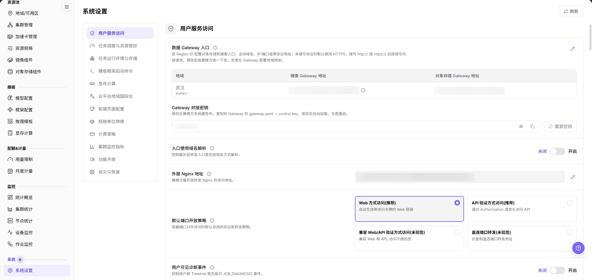
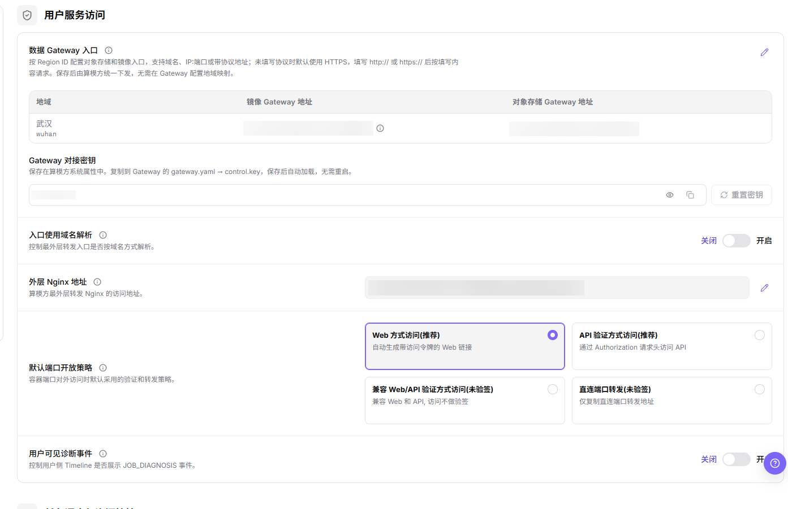
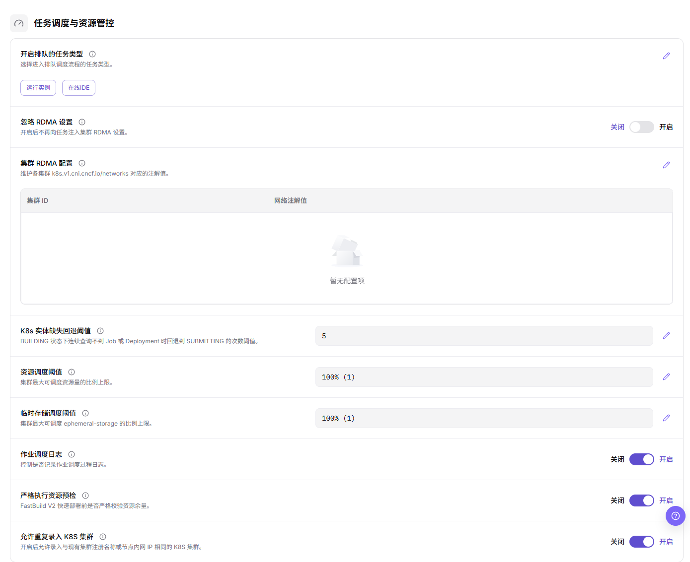
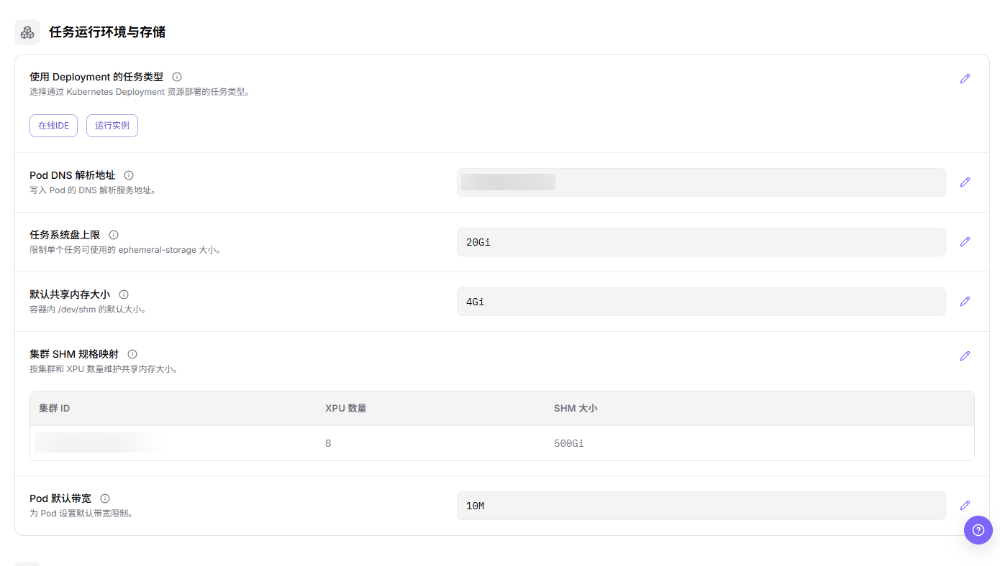
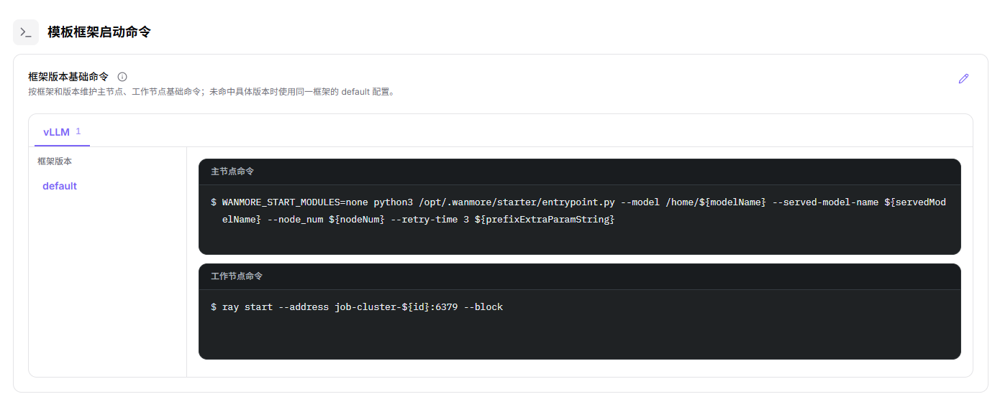
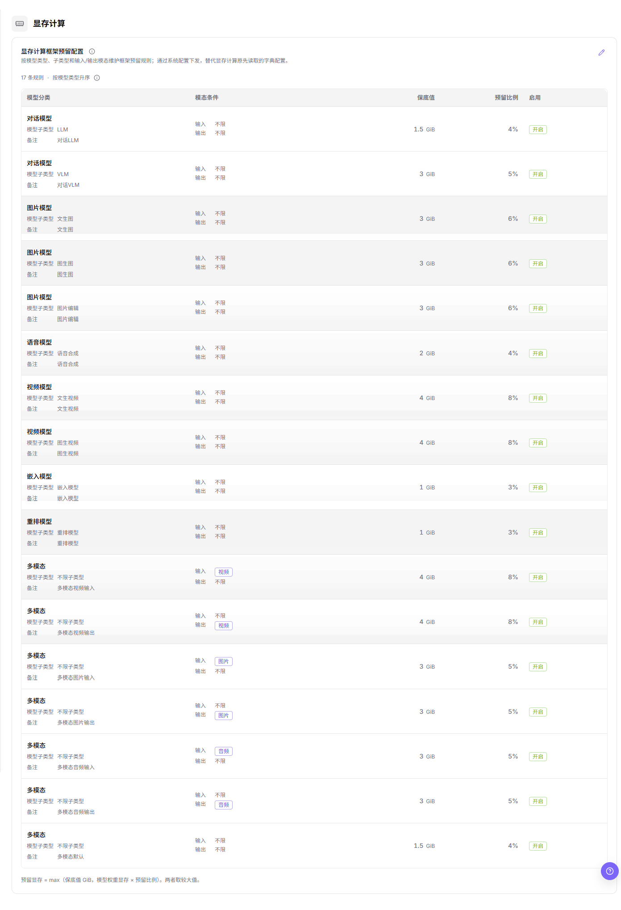
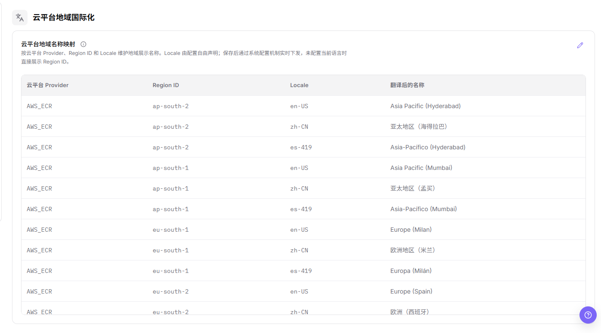
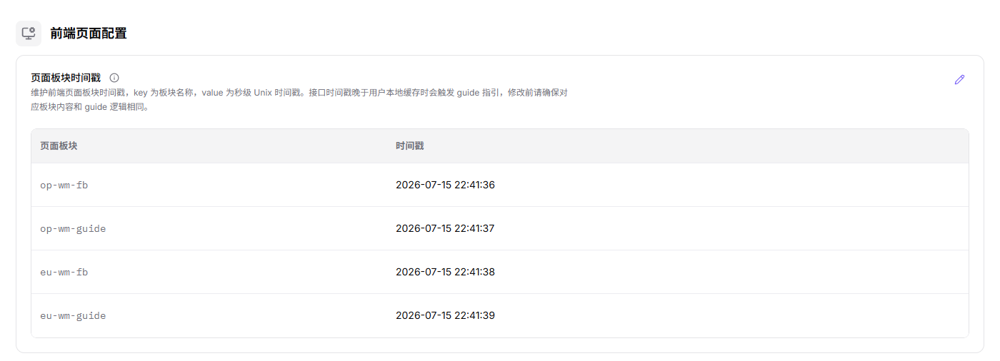
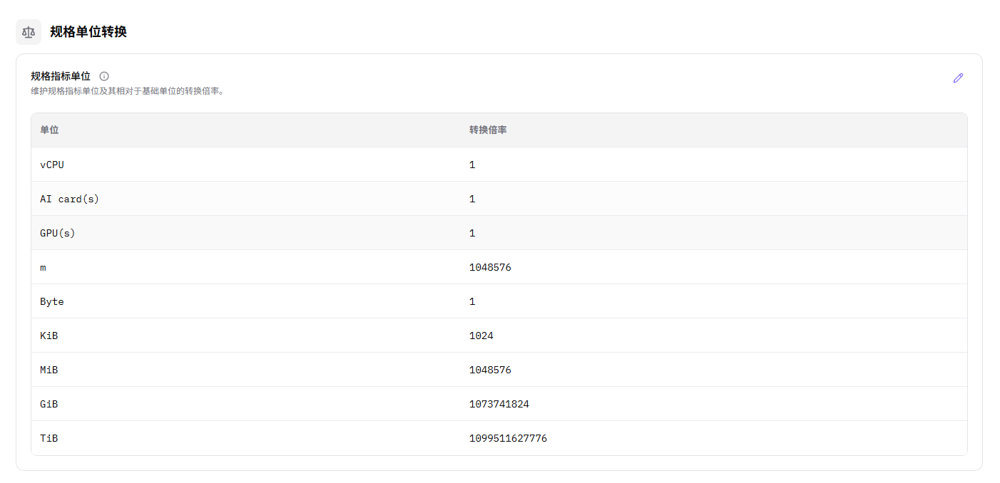
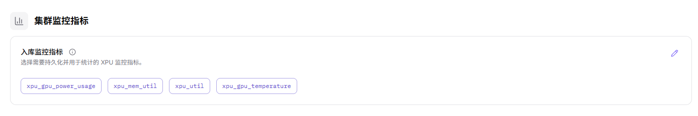

# 系统设置

## 功能概述

| 项目 | 内容 |
| --- | --- |
| 适用角色 | 运营管理员 |
| 导航路径 | On-Prem > 系统 > 系统设置 |
| 管理对象 | 系统配置项、配置值、说明、状态和操作入口 |

#### 新手理解

系统设置像平台的全局配置清单。这里的配置可能影响多个模块的默认行为、可用能力或展示逻辑，因此学习和截图时应以查看为主，不直接提交修改。

#### 术语表

| 术语 | 说明 |
| --- | --- |
| 配置项 | 平台提供的系统级参数或开关。 |
| 配置值 | 配置项当前使用的值，可以是开关、文本、枚举或数字。 |
| 状态 | 配置项是否已启用、可用或已生效。 |

#### 推荐操作顺序

先确认系统配置项、配置值、说明、状态和操作入口的前置依赖，再按主要操作顺序处理，最后执行结果校验并进入后续页面。

#### 小白先看

先确认当前任务是否涉及系统配置项、配置值、说明、状态和操作入口，再按照推荐顺序操作。页面字段或状态与预期不符时，先回到前置对象页核对依赖，不要跳过结果校验直接进入下游流程。

## 前提条件

1. 当前账号具备运营管理员权限。
2. 已进入正确的 On-Prem 环境和目标地域。
3. 已确认本次仅查看系统设置，或已具备对应变更审批。

## 页面说明

页面用于查看页面左侧的配置分组，以及每个分组内的配置项、控件形态与当前取值。

进入 `On-Prem > 系统 > 系统设置` 后，页面用于展示系统级配置项。左侧分组列表当前包含 12 个配置分组，页面右上角提供 `刷新`。

可编辑配置项在取值行末提供铅笔图标。进入编辑态属于写操作，仅查看字段层面即可，不执行最终提交动作。

## 主要操作

本节按配置分组组织。每个分组只写查看功能的操作，配图紧跟其所支撑的步骤。

### 查看用户服务访问配置

#### 适用场景

需要确认用户访问平台服务所依赖的入口地址、对接密钥、域名解析开关、对外 Nginx 地址、默认端口开放策略与用户可见诊断事件时，在 `用户服务访问` 分组查看。

#### 操作步骤

1. 进入 `On-Prem > 系统 > 系统设置`。
2. 在页面左侧的分组列表中点击 `用户服务访问`。
3. 核对 `数据 Gateway 入口` 内嵌表的 `地域`、`镜像 Gateway 地址` 与 `对象存储 Gateway 地址` 三列。表内地址为内网地址，文档、工单与截图中一律记作 `<internal address>`，不抄写真实值。
4. 核对 `Gateway 对接密钥`：只读输入框内为掩码圆点，框右侧提供 `眼睛` 与 `复制` 图标，行末为 `重置密钥` 按钮。
5. 核对 `入口使用域名解析` 与 `用户可见诊断事件` 两个开关的当前态，并核对 `外层 Nginx 地址` 的端口与路径模板。
6. 核对 `默认端口开放策略` 当前选中的卡片。四枚可选项为 `Web 方式访问(推荐)`、`API 验证方式访问(推荐)`、`兼容 Web/API 验证方式访问(未验签)`、`直连端口转发(未验签)`。

下图覆盖本分组的全部可见范围，可逐条对齐上述配置项名称与控件形态。

#### 结果校验

- 分组内 6 个配置项标题全部可见，且每项后面对应到掩码框、开关、单选卡片或带铅笔图标的取值行。
- 密钥仅以掩码形态展示，页面与文档中均不出现明文密钥。

#### 注意事项

- `重置密钥` 属写操作，画面中呈禁用态，只读核对时不要点击。
- Gateway 地址、对接密钥与内网 Endpoint 不得写入文档、截图、工单或聊天记录。

### 查看任务调度与资源管控配置

#### 适用场景

需要确认哪些任务类型进入排队、RDMA 相关设置、调度阈值与资源预检强度时，在 `任务调度与资源管控` 分组查看。

#### 操作步骤

1. 进入 `On-Prem > 系统 > 系统设置`。
2. 在页面左侧的分组列表中点击 `任务调度与资源管控`。
3. 核对 `开启排队的任务类型` 已纳入的标签，以及 `忽略 RDMA 设置` 开关的当前态。
4. 核对 `集群 RDMA 配置` 表的 `集群 ID` 与 `网络注解值` 两列；行内集群 ID 记作 `<cluster ID>`，不抄写真实值。
5. 核对 `K8s 实体缺失回退阈值`、`资源调度阈值` 与 `临时存储调度阈值` 的当前值与单位形态。
6. 核对 `作业调度日志`、`严格执行资源预检` 与 `允许重复录入 K8S 集群` 三个开关的当前态。

#### 结果校验

- 分组内 9 个配置项标题全部可见，阈值类显示取值，标签与表格类显示已选内容或空态提示。
- 开关项的当前态与页面着色一致，可据此判断排队、预检与重复录入集群的实际放行情况。

#### 注意事项

- 调度阈值、资源预检与排队任务类型直接影响任务能否被调度，变更前需确认影响范围与回滚方案。
- 铅笔图标之后展示当前可选标签。

### 查看任务运行环境与存储配置

#### 适用场景

需要确认任务运行所用的工作负载形态、DNS 解析地址、系统盘与共享内存上限时，在 `任务运行环境与存储` 分组查看。

#### 操作步骤

1. 进入 `On-Prem > 系统 > 系统设置`。
2. 在页面左侧的分组列表中点击 `任务运行环境与存储`。
3. 核对 `使用 Deployment 的任务类型` 已选标签，与 `任务调度与资源管控` 分组的排队标签集合区分清楚。
4. 核对 `Pod DNS 解析地址`。该值为内网地址，文档中记作 `<internal address>`。
5. 核对 `任务系统盘上限`、`默认共享内存大小` 与 `Pod 默认带宽` 的当前值和容量或带宽单位。
6. 核对 `集群 SHM 规格映射` 表的 `集群 ID`、`XPU 数量` 与 `SHM 大小` 三列；集群 ID 记作 `<cluster ID>`。

#### 结果校验

- 6 个配置项标题全部可见，容量类配置显示带单位的取值。
- `集群 SHM 规格映射` 的行数与已配置的集群数量一致，未配置的集群不会出现在表中。

#### 注意事项

- 系统盘上限、共享内存大小与默认带宽直接决定任务可申请的资源，放宽前需确认节点容量与配额影响。
- 切换 `使用 Deployment 的任务类型` 会改变任务的调度形态，页面显示当前已选标签。

### 查看模板框架启动命令配置

#### 适用场景

需要确认某个推理框架版本在新建任务时下发的默认启动命令模板时，在 `模板框架启动命令` 分组查看。

#### 操作步骤

1. 进入 `On-Prem > 系统 > 系统设置`。
2. 在页面左侧的分组列表中点击 `模板框架启动命令`。
3. 在分组上方的框架页签中选择目标框架，在左侧 `框架版本` 列表中选择目标版本，当前画面选中 `default`。
4. 核对右侧 `主节点命令` 面板中的命令与参数占位符，例如 `${modelName}`、`${servedModelName}`、`${nodeNum}` 与 `${prefixExtraParamString}`。
5. 核对 `工作节点命令` 面板中的命令，其地址形如 `job-cluster-${id}:6379`，表示工作节点回连主节点 Ray 集群的入口。

#### 结果校验

- 切换框架页签或 `框架版本` 条目后，右侧两块命令面板的内容随所选版本变化。
- 命令中的参数占位符保持原样，未被替换成具体模型名或节点数。

#### 注意事项

- 该命令模板直接决定新建任务的启动行为，改动会影响后续所有使用该版本的任务，需走变更流程。
- 框架页签以页面实际显示为准。

### 查看显存计算配置

#### 适用场景

需要确认不同模型分类在显存测算时预留多少显存，或核对某类模型的保底预留值与预留比例时，在 `显存计算` 分组查看。

#### 操作步骤

1. 进入 `On-Prem > 系统 > 系统设置`。
2. 在页面左侧的分组列表中点击 `显存计算`。
3. 核对 `显存计算框架预留配置` 上方的计数行，确认规则条数与排序方式。
4. 核对表列 `模型分类`、`模态条件`、`保底值`、`预留比例` 与 `启用`，并按模型分类逐行比对预留口径。
5. 阅读表下脚注中的计算式：预留显存取保底值与「模型权重显存 × 预留比例」两者中的较大值。

#### 结果校验

- 表内行数与计数行显示的规则条数一致，`启用` 列逐行可读出当前放行状态。
- 同一模型分类下不存在两条互相冲突的预留比例。

#### 注意事项

- 本分组直接决定显存测算结果，收紧预留会缩小用户可申请到的模型规格，调整前需评估典型模型。
- `启用` 列显示规则当前的开关状态。

### 查看云平台地域国际化配置

#### 适用场景

需要确认某个云平台地域在指定语言下向用户展示什么名称，或排查地域名称显示为 Region ID 而非本地化名称时，在 `云平台地域国际化` 分组查看。

#### 操作步骤

1. 进入 `On-Prem > 系统 > 系统设置`。
2. 在页面左侧的分组列表中点击 `云平台地域国际化`。
3. 核对 `云平台地域名称映射` 表的 `云平台 Provider`、`Region ID`、`Locale` 与 `翻译后的名称` 四列。
4. 按同一 `Region ID` 逐条比对不同 `Locale` 的译名，确认目标语言的映射行是否存在；缺少映射时界面会直接展示 Region ID。

#### 结果校验

- 目标 Provider 与 Region ID 组合下存在当前界面语言的映射行，且译名与界面显示一致。
- 未配置译名的地域在界面上回退为 Region ID，而非空白。

#### 注意事项

- 页面显示 `AWS_ECR` Provider。
- 译名属展示层配置，不影响实际接入的地域，但会影响用户对地域的选择判断。

### 查看前端页面配置

#### 适用场景

需要确认运营端各页面板块当前生效的内容版本，或排查某个板块内容未更新时，在 `前端页面配置` 分组查看。

#### 操作步骤

1. 进入 `On-Prem > 系统 > 系统设置`。
2. 在页面左侧的分组列表中点击 `前端页面配置`。
3. 核对 `页面板块时间戳` 表的 `页面板块` 与 `时间戳` 两列，确认每个板块对应的最近更新时间。
4. 将板块标识与用户反馈的界面位置对应起来，判断该板块是否已在预期时间刷新。

#### 结果校验

- 表中板块行数与实际开放的页面板块数量一致，无缺失板块。
- 目标板块的时间戳不早于最近一次内容发布时间。

#### 注意事项

- 板块标识与时间戳属运行数据，对外传递时应替换为 `<date>` 等形状占位符。
- 该分组只反映展示层版本，不代表后端服务或数据本身已更新。

### 查看规格单位转换配置

#### 适用场景

需要确认某种资源单位在计费与用量统计中按多少倍率换算，或排查用量数字与预期不一致时，在 `规格单位转换` 分组查看。

#### 操作步骤

1. 进入 `On-Prem > 系统 > 系统设置`。
2. 在页面左侧的分组列表中点击 `规格单位转换`。
3. 核对 `规格指标单位` 表的 `单位` 与 `转换倍率` 两列，逐行确认计算类与非计算类单位是否都有映射。
4. 对内存与存储类单位确认换算基数，避免把按 1000 递进与按 1024 递进的两套单位混用。

#### 结果校验

- 用量与账单页面出现的每种单位都能在表中找到对应行与倍率。
- 未登记的单位不会按默认倍率参与换算，需回本表确认后再使用。

#### 注意事项

- 转换倍率参与计费数值计算，改动会让历史用量与新用量的口径不一致，需与计费策略一并评估。
- 倍率属静态换算系数，只读核对时不填写、不提交。

### 查看计费策略配置

#### 适用场景

需要确认平台当前按哪种消费类型出账，或核对余额不足时待删除存储对象的保留期限时，在 `计费策略` 分组查看。

#### 操作步骤

1. 进入 `On-Prem > 系统 > 系统设置`。
2. 在页面左侧的分组列表中点击 `计费策略`。
3. 核对 `消费类型` 分段控件当前选中的一枚，两枚可选项为 `credits` 与 `规格额度`，二者互斥。
4. 核对 `credits 不足时 Bucket 待删除保留期限` 的当前取值，确认余额不足时数据是被保留还是按期清理。

#### 结果校验

- 消费类型的选中态与用户侧配额、用量与账单页面展示的计量口径一致。
- 保留期限的取值与存储侧实际的清理行为一致。

#### 注意事项

- 切换消费类型会同时改变用户侧额度的展示与出账口径，属高影响变更，必须有审批与回滚方案。
- 英文界面该控件的现行词形为 `Spec quota`，本页按画面逐字记录。

### 查看集群监控指标配置

#### 适用场景

需要确认哪些监控指标会被采集入库、排查监控图表缺少某条曲线时，在 `集群监控指标` 分组查看。

#### 操作步骤

1. 进入 `On-Prem > 系统 > 系统设置`。
2. 在页面左侧的分组列表中点击 `集群监控指标`。
3. 核对 `入库监控指标` 的指标标签集合，确认目标指标是否已在列表内。
4. 将标签与监控页面图表所用的指标名逐一对应，未入库的指标不会出现在下拉与图表中。

#### 结果校验

- 监控页面图表可选到的指标均在本分组标签内。
- 新增标签后，对应图表在数据上报周期后出现曲线。

#### 注意事项

- 指标名属采集配置，删除标签会使历史曲线在图表侧不可见，但通常不等于后端数据被清理。
- 页面的标签可选项以页面实际显示为准。

### 查看功能开放配置

#### 适用场景

需要确认某项平台能力是否对用户侧开放，或排查用户反馈的入口找不到时，在 `功能开放` 分组查看。

#### 操作步骤

1. 进入 `On-Prem > 系统 > 系统设置`。
2. 在页面左侧的分组列表中点击 `功能开放`。
3. 核对 `自动采集部署实测档案` 开关的当前态及其说明行。
4. 结合用户侧界面确认该能力是否已开放，避免只看开关而忽略下游页面表现。

#### 结果校验

- 开关态与用户侧对应入口的可见性或可用性一致。
- 变更后受影响页面在刷新即恢复，无需重新登录。

#### 注意事项

- 功能开放直接影响用户可见能力，开启前需确认采集范围与合规要求。
- 本分组画面显示 1 个配置项。

### 查看容灾与恢复配置

#### 适用场景

需要确认平台是否启用容灾调度能力，或在故障处置中判断任务能否被重新调度时，在 `容灾与恢复` 分组查看。

#### 操作步骤

1. 进入 `On-Prem > 系统 > 系统设置`。
2. 在页面左侧的分组列表中点击 `容灾与恢复`。
3. 核对 `容灾调度` 开关的当前态及其说明行。

#### 结果校验

- 开关态与故障演练或异常处置中观察到的重调度行为一致。
- 变更记录已登记审批人、影响范围与回滚方案。

#### 注意事项

- 容灾能力开关属高影响配置，仅在获批准的变更窗口内调整。
- 关闭状态下的故障表现与恢复时长不在本文描述；本分组显示 1 个配置项。

### 编辑并保存配置项

#### 适用场景

已完成变更审批、影响评估与回滚准备，需要修改 `系统设置` 中某个可编辑配置项的取值时，按本节操作。

#### 操作前确认

1. 确认当前环境、账号与目标分组符合变更目标。
2. 确认已取得变更审批，并已评估调度、存储、计费、监控或功能开放方面的影响。
3. 确认目标配置项的编辑入口形态：取值行末显示铅笔图标。

#### 操作步骤

1. 进入 `On-Prem > 系统 > 系统设置`。
2. 在页面左侧的分组列表中定位目标分组。
3. 点击目标配置项取值行末的铅笔图标进入编辑态。
4. 仅修改已批准的字段，不改动同一分组内的其他配置项。
5. 提交前再次复核变更审批、影响范围与回滚方案；未确认前不执行最终提交动作。

#### 结果校验

- 目标配置项显示新值，同一分组的其他配置项与其他分组保持原值。
- 受影响的用户服务访问、任务调度、资源管控或页面功能按变更预期生效。

#### 注意事项

- 系统设置属全局配置，一次修改可能同时影响多个租户、任务或服务；无审批、无回滚方案或不在变更窗口内时不要提交。
- `重置密钥`／`Reset key` 等写操作入口呈禁用态，只读核对时不要点击。

### 刷新配置

#### 适用场景

他人刚完成配置变更、页面显示疑似滞后，或需要重新读取当前生效值时，使用页面右上角的 `刷新` 重新拉取配置。

#### 操作步骤

1. 进入 `On-Prem > 系统 > 系统设置`。
2. 确认目标分组的内容已加载完成。
3. 点击页面右上角的 `刷新`。
4. 回到目标分组核对配置值与开关态是否为最新一次读取结果。

#### 结果校验

- 各分组的配置值与状态按最新读取结果展示，先前已提交但未反映的变更出现在页面上。
- 刷新过程不改变任何配置值。

#### 注意事项

- 页面提供 `刷新` 查看入口。
- 刷新后仍与预期不符时，先回前置配置页核对对象状态，再判断是否为生效范围问题。

## 参数速查表

| 分组 | 配置项 | 控件形态 | 画面示例 | 说明 |
| --- | --- | --- | --- | --- |
| `用户服务访问` | `数据 Gateway 入口` | 内联编辑（铅笔图标） | `<internal address>` | 按地域一行，含镜像与对象存储两类 Gateway 地址。 |
| `用户服务访问` | `Gateway 对接密钥` | 掩码框＋`眼睛`／`复制`图标＋`重置密钥` | `<value>` | 只读掩码展示，不记录明文密钥。 |
| `用户服务访问` | `入口使用域名解析` | 开关 | `关闭` | 决定入口是否走域名解析。 |
| `用户服务访问` | `外层 Nginx 地址` | 内联编辑（铅笔图标） | `<internal address>` | 对外 Nginx 入口，含端口与路径模板。 |
| `用户服务访问` | `默认端口开放策略` | 单选卡片（4 枚） | `Web 方式访问(推荐)` | 决定任务端口的默认可访问方式。 |
| `用户服务访问` | `用户可见诊断事件` | 开关 | `关闭` | 控制诊断事件是否透出到用户侧。 |
| `任务调度与资源管控` | `开启排队的任务类型` | 内联编辑（标签集） | `<option>` | 画面标签为 `运行实例`、`在线IDE`。 |
| `任务调度与资源管控` | `忽略 RDMA 设置` | 开关 | `关闭` | 决定是否跳过任务上的 RDMA 设置。 |
| `任务调度与资源管控` | `集群 RDMA 配置` | 内联编辑（表格） | `<cluster ID>` | 列 `集群 ID`、`网络注解值`；画面为空态 `暂无配置项`。 |
| `任务调度与资源管控` | `K8s 实体缺失回退阈值` | 内联编辑（数值） | `<number>` | 控制实体缺失后的回退判定阈值。 |
| `任务调度与资源管控` | `资源调度阈值` | 内联编辑（百分比＋数值） | `100%（1）` | 控制资源水位达到何值时停止调度。 |
| `任务调度与资源管控` | `临时存储调度阈值` | 内联编辑（百分比＋数值） | `100%（1）` | 针对临时存储的同类水位阈值。 |
| `任务调度与资源管控` | `作业调度日志` | 开关 | `开启` | 决定调度过程是否记录日志。 |
| `任务调度与资源管控` | `严格执行资源预检` | 开关 | `开启` | 决定预检不通过时是否直接拒绝任务。 |
| `任务调度与资源管控` | `允许重复录入 K8S 集群` | 开关 | `开启` | 决定同名集群能否被重复录入。 |
| `任务运行环境与存储` | `使用 Deployment 的任务类型` | 内联编辑（标签集） | `<option>` | 画面标签为 `在线IDE`、`运行实例`。 |
| `任务运行环境与存储` | `Pod DNS 解析地址` | 内联编辑 | `<internal address>` | 注入任务 Pod 的 DNS 解析地址。 |
| `任务运行环境与存储` | `任务系统盘上限` | 内联编辑（容量） | `20Gi` | 单个任务可使用的系统盘上限。 |
| `任务运行环境与存储` | `默认共享内存大小` | 内联编辑（容量） | `4Gi` | 未单独指定时的共享内存默认值。 |
| `任务运行环境与存储` | `集群 SHM 规格映射` | 内联编辑（表格） | `<cluster ID>` | 列 `集群 ID`、`XPU 数量`、`SHM 大小`。 |
| `任务运行环境与存储` | `Pod 默认带宽` | 内联编辑（带宽） | `10M` | Pod 的默认网络带宽。 |
| `模板框架启动命令` | `框架版本基础命令` | 页签＋版本列表＋代码面板 | `<value>` | 分 `主节点命令` 与 `工作节点命令` 两块，含 `${modelName}` 等占位符。 |
| `显存计算` | `显存计算框架预留配置` | 内联编辑（表格） | `<number>` | 列 `模型分类`、`模态条件`、`保底值`、`预留比例`、`启用`。 |
| `云平台地域国际化` | `云平台地域名称映射` | 内联编辑（表格） | `<value>` | 列 `云平台 Provider`、`Region ID`、`Locale`、`翻译后的名称`。 |
| `前端页面配置` | `页面板块时间戳` | 内联编辑（表格） | `<date>` | 列 `页面板块`、`时间戳`，按板块记录最近更新时间。 |
| `规格单位转换` | `规格指标单位` | 内联编辑（表格） | `<number>` | 列 `单位`、`转换倍率`，用于用量与计费的单位换算。 |
| `计费策略` | `消费类型` | 分段控件（2 枚） | `规格额度` | 与 `credits` 互斥，决定出账与额度口径。 |
| `计费策略` | `credits 不足时 Bucket 待删除保留期限` | 内联编辑 | `永久保留` | 余额不足时待删除对象的保留策略。 |
| `集群监控指标` | `入库监控指标` | 内联编辑（标签集） | `<option>` | 画面标签含 `xpu_util`、`xpu_mem_util` 等 4 枚指标名。 |
| `功能开放` | `自动采集部署实测档案` | 开关 | `关闭` | 决定是否自动采集部署实测档案。 |
| `容灾与恢复` | `容灾调度` | 开关 | `关闭` | 决定故障场景下是否启用容灾重调度。 |
| 页面右上角 | `刷新` | 按钮 | `刷新` | 重新拉取全部配置值，不修改配置。 |

## 踩坑提示

- 系统设置可能影响全局平台行为，修改前必须确认影响范围。
- 行末铅笔图标即写操作入口，只读学习时止步于查看。
- 功能开放、计费策略、容灾与恢复、调度与资源管控配置错误，可能影响用户访问、任务调度、计费结果和恢复能力。
- 不写真实配置值、Token、AK/SK、内部 Endpoint、租户信息、账号、密钥或测试参数。
- 如果配置项涉及认证、网络、计费、调度或资源治理，修改前需要通过内部变更流程确认。
- 显存计算与规格单位转换的取值直接参与测算与计费，调整前先核对脚注计算式与换算基数。

## 结果校验

| 检查项 | 成功表现 | 异常时处理 |
| --- | --- | --- |
| 页面入口 | 可进入系统设置并看到目标操作入口 | 检查运营管理员权限和对应菜单是否已开放 |
| 对象记录 | 系统配置项、配置值、说明、状态和操作入口在列表或详情中可见 | 重置筛选并核对名称、所属范围和创建结果 |
| 状态结果 | 新增或变更后的状态符合页面提示 | 查看操作提示、依赖对象状态和最近更新时间 |
| 下游使用 | 后续页面能够选择或关联目标对象 | 回到前置配置核对启用状态、归属关系和可见范围 |

## 常见问题

#### 系统设置保存后服务行为异常

**问题现象：**

系统设置显示保存成功，但用户服务访问、任务调度、存储或监控行为与预期不一致。

**可能原因：**

- 配置值格式或单位不符合页面要求。
- 修改的配置分组或生效范围不是目标对象。
- 下游服务缓存未刷新，或依赖服务未完成重载。

**处理方式：**

1. 返回配置分组核对新值、说明、生效范围和更新时间。
2. 检查受影响服务的状态、日志或页面提示。
3. 按回滚方案恢复上一版已验证配置，并重新确认服务状态。

#### 系统设置中找不到目标对象

**问题现象：**

页面可进入，但没有看到预期的系统配置项、配置值、说明、状态和操作入口。

**可能原因：**

- 筛选条件仍生效。
- 对象属于其他范围。
- 前置配置未完成。

**处理方式：**

1. 重置筛选
2. 核对所属地域或租户
3. 返回前置页面确认对象状态。

#### 系统设置的操作入口不可用

**问题现象：**

新增、注册或维护入口不可见或不可点击。

**可能原因：**

- 当前角色权限不足。
- 页面处于只读状态。
- 依赖对象不满足条件。

**处理方式：**

1. 检查运营管理员权限
2. 核对页面提示
3. 先完成依赖对象配置。

#### 系统设置操作后状态异常

**问题现象：**

提交后记录存在，但状态不是预期值。

**可能原因：**

- 连通性或校验失败。
- 关联对象异常。
- 后台处理尚未完成。

**处理方式：**

1. 查看页面提示和更新时间
2. 检查关联对象
3. 按状态阶段排查处理任务。

#### 下游页面无法使用系统设置

**问题现象：**

当前页状态正常，但下游页面无法选择或关联系统配置项、配置值、说明、状态和操作入口。

**可能原因：**

- 可见范围不匹配。
- 对象未启用。
- 下游缓存未刷新。

**处理方式：**

1. 核对启用状态和归属
2. 检查角色可见范围
3. 刷新下游页面并重新选择。

## 注意事项

- 系统设置属于平台级配置入口，不应作为普通页面随意修改。
- 系统设置会影响平台全局行为，正式变更前应确认影响范围、审批记录和回滚方案。
- 文档、截图或工单中不要写入真实配置值、密钥、Token、内部 Endpoint、账号或租户信息。
- 对外传递页面信息前，应先对配置值和内部标识做脱敏处理。

## 后续操作

1. 如发现配置缺失，先记录配置项名称和页面位置，再走内部确认流程。
2. 如需要修改配置，先确认影响范围、审批记录和回滚方案。
3. 修改后应回到受影响模块验证页面、任务或服务行为是否符合预期。
