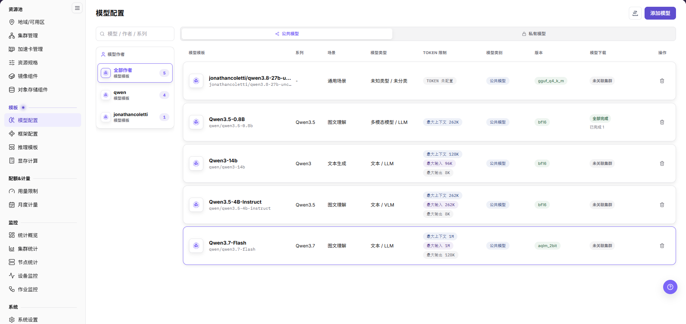
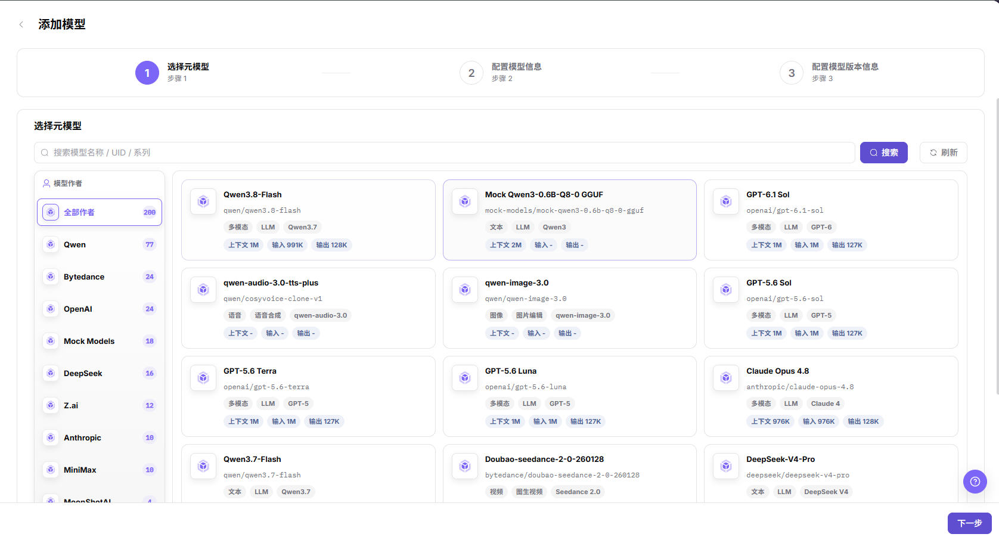
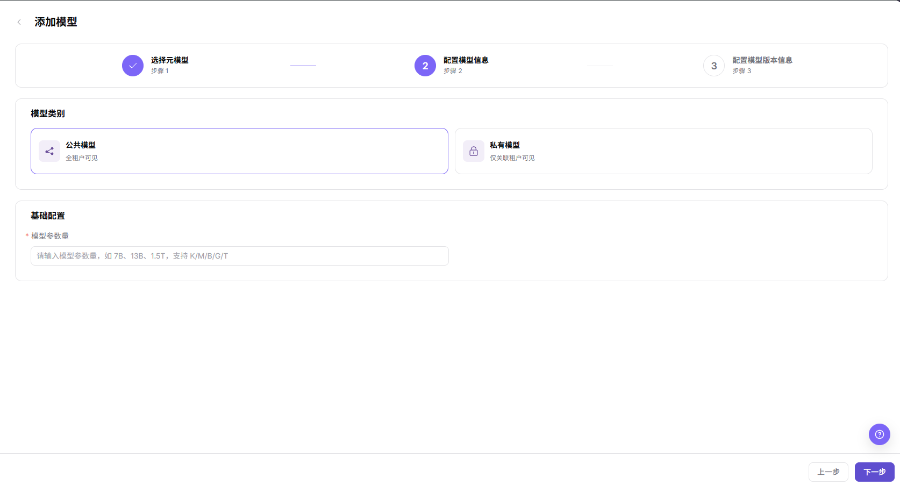
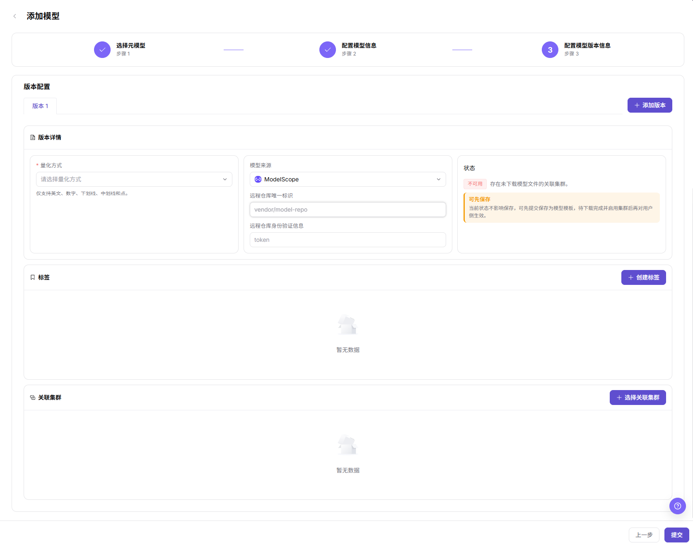
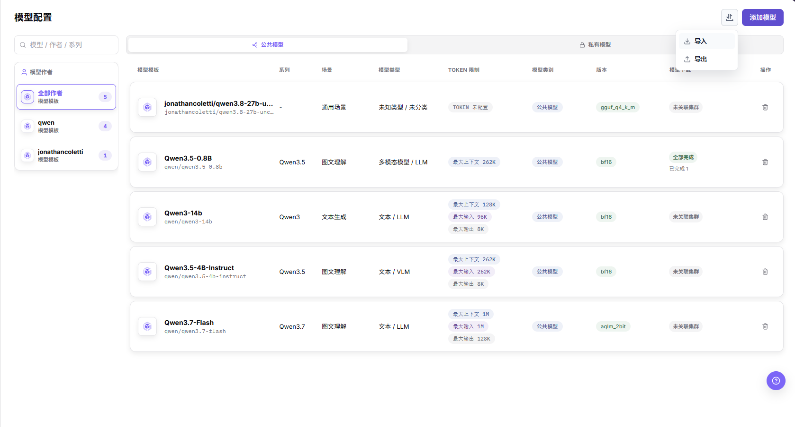
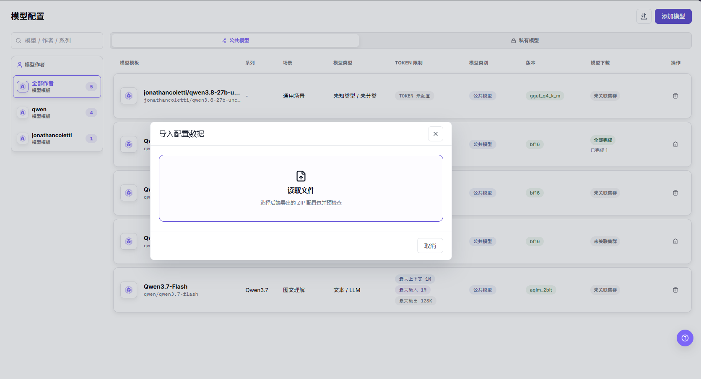
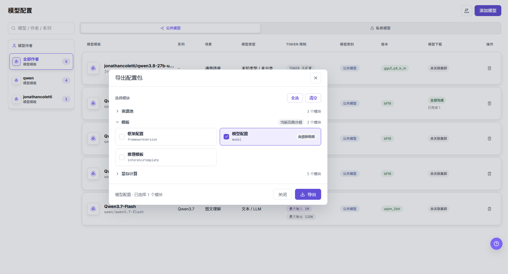
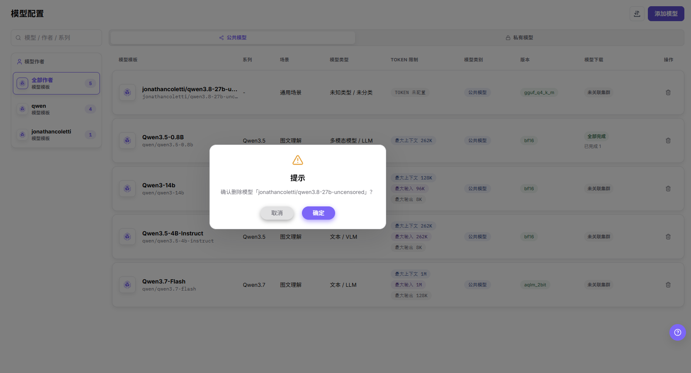

# 模型配置

## 功能概述

| 项目 | 内容 |
| --- | --- |
| 适用角色 | 运营管理员 |
| 导航路径 | On-Prem > 模板 > 模型配置 |
| 页面路由 | `/powerone/fast-build-v2/models` |
| 管理对象 | 元模型、模型版本、模型来源、量化方式、标签和关联集群 |

#### 新手理解

模型配置像模型上架前的资料卡，把模型路径、参数来源、环境变量和启动参数整理清楚，框架才能正确加载模型。

#### 术语表

| 术语 | 说明 |
| --- | --- |
| 元模型 | 模型家族或基础模型的抽象定义，例如对同一模型系列的通用描述。 |
| 模型版本 | 具体权重、量化方式、来源和文件路径的版本记录。 |
| KV Token | 与推理 KV Cache 相关并影响显存估算的 Token 数量。 |

#### 推荐操作顺序

先确认元模型、模型版本、模型来源、量化方式、标签和关联集群的前置依赖，再按主要操作顺序处理，最后执行结果校验并进入后续页面。

#### 小白先看

先确认当前任务是否涉及元模型、模型版本、模型来源、量化方式、标签和关联集群，再按照推荐顺序操作。页面字段或状态与预期不符时，先回到前置对象页核对依赖，不要跳过结果校验直接进入下游流程。

## 前提条件

1. 已确认模型来源、授权、版本和参数量。
2. 模型文件可被目标集群下载或已在共享存储中准备。
3. 显存测算中已维护相关量化方式、KV Token 或计算因子。
4. 当前账号具备模板管理权限。

## 页面说明

页面用于查看和处理元模型、模型版本、模型来源、量化方式、标签和关联集群。

页面左侧按 `模型作者` 分组并显示每组模型数量，顶部 `模型 / 作者 / 系列` 搜索框用于筛选，主体分 `公共模型` 与 `私有模型` 两个页签；列表列包括 `模型模板`、`系列`、`场景`、`模型类型`、`TOKEN 限制`、`模型类别`、`版本` 和 `模型下载`，行尾 `操作` 列是垃圾桶图标。`模型下载` 列取值有 `未关联集群`、`全部完成` 和 `已完成 N`。页头右上的图标按钮展开 `导入` / `导出` 菜单，其右侧是 `添加模型` 按钮。

## 主要操作

### 添加模型

#### 适用场景

当平台需要新增一个可被推理模板引用的模型模板时，使用页面右上的 **"添加模型"** 入口，按 `选择元模型`、`配置模型信息`、`配置模型版本信息` 三个步骤完成配置。

#### 操作步骤

1. 进入 `On-Prem > 模板 > 模型配置`，在 `公共模型` 或 `私有模型` 页签确认目标模型尚未配置。
2. 点击页面右上的 **"添加模型"**，进入标题为 `添加模型` 的三步向导。
3. 在步骤 1 `选择元模型` 中，用左侧 `模型作者` 列表或 `搜索模型名称 / UID / 系列` 输入框（配合 **"搜索"** 与 **"刷新"**）缩小候选，按卡片上的 `多模态`、`文本`、`语音`、`图像`、`视频` 等标签和 `上下文`、`输入`、`输出` 数值核对模型能力，点击 **"下一步"**。

下图展示步骤 1：左侧按作者分组并显示每组的模型数量，右侧卡片网格列出候选元模型及其能力标签。

4. 在步骤 2 `配置模型信息` 中，在 `模型类别` 选择 `公共模型`（`全租户可见`）或 `私有模型`（`仅关联租户可见`），在 `基础配置` 填写必填项 `模型参数量`（占位提示 `请输入模型参数量，如 7B、13B、1.5T，支持 K/M/B/G/T`），点击 **"下一步"**。

下图展示步骤 2：该步只有 `模型类别` 与 `基础配置` 两个区块，`模型参数量` 是唯一的必填字段。

5. 在步骤 3 `配置模型版本信息` 的 `版本配置` 区块按 `版本 1` 页签维护版本；一个模型需要配置多个版本时点击 **"+ 添加版本"**。
6. 在 `版本详情` 区块选择必填项 `量化方式`，确认 `模型来源`（画面默认 `ModelScope`），并按所选来源填写 `远程仓库唯一标识`（占位提示 `vendor/model-repo`）和 `远程仓库身份验证信息`（占位提示 `token`）。
7. 在 `标签` 区块点击 **"+ 创建标签"** 维护模型分类，在 `关联集群` 区块点击 **"+ 选择关联集群"** 圈定模型文件可下载、可部署的集群。
8. 核对 `状态` 区块的结论后点击 **"提交"**。

下图展示步骤 3：`版本详情` 三列分别是量化方式、模型来源与仓库信息、`状态` 结论，下方是 `标签` 与 `关联集群` 两个区块。

#### 结果校验

- 提交后返回 `模型配置` 列表，目标模型出现在 `模型模板` 列，`模型类别` 与步骤 2 选择的 `公共模型` 或 `私有模型` 一致。
- `版本` 列显示步骤 3 选择的量化方式，例如 `bf16`、`gguf_q4_k_m`、`aqlm_2bit`。
- `模型下载` 列显示 `未关联集群`、`全部完成` 或 `已完成 N`，用于确认模型文件在关联集群上的下载进展。

#### 注意事项

- `量化方式` 为必填项，且仅支持英文、数字、下划线、中划线和点；`模型参数量` 支持 K/M/B/G/T 后缀。
- `状态` 显示 `不可用` 并提示 `存在未下载模型文件的关联集群。` 时，页面同时给出 `可先保存` 说明：当前状态不影响保存，可先提交保存为模型模板，待下载完成并启用集群后再对用户侧生效。
- `远程仓库身份验证信息` 只填写访问远程仓库所需的凭据引用，文档、截图与工单中不得出现真实 Token、AK/SK 或账号密码。

### 导入或导出模型

#### 适用场景

当需要在环境之间迁移模型配置，或把当前页面维护的模型配置留档时，使用页头右上图标按钮展开的 `导入` / `导出` 菜单。

#### 操作步骤

1. 进入 `On-Prem > 模板 > 模型配置`，点击页面右上 `添加模型` 左侧的图标按钮，展开列出 `导入` 与 `导出` 两项的菜单。

下图展示页头菜单：`导入` 打开导入弹窗，`导出` 打开导出配置包弹窗。

2. 导入：点击 `导入`，打开标题为 `导入配置数据` 的弹窗，在 `读取文件` 区域选择后端导出的 ZIP 配置包；区域说明文字为 `选择后端导出的 ZIP 配置包并预检查`，即选中文件后页面先执行预检查。
3. 放弃本次导入时，点击弹窗底部的 `取消` 或右上角关闭图标。选择文件之后的弹窗形态与预检查结果未在本文配图中收录，以页面实际提示为准。

下图展示 `导入配置数据` 弹窗：未选择文件时弹窗只有 `读取文件` 区域和 `取消` 一个按钮。

4. 导出：点击 `导出`，打开标题为 `导出配置包` 的弹窗，在 `选择模块` 区域用 **"全选"** 或 **"清空"** 批量选择，也可逐个勾选模块卡片。
5. 展开 `模板` 分组（标记 `当前页面分组`、`3 个模块`）勾选 `模型配置`（模块 key `model`，卡片标注 `含级联明细`），按需同选 `框架配置`（`frameworkVersion`）与 `推理模板`（`inferenceTemplate`）；折叠分组 `资源池`（`3 个模块`）与 `显存计算`（`5 个模块`）同样可选。
6. 确认弹窗底部计数与目标模块一致（例如 `模型配置 · 已选择 1 个模块`），点击 **"导出"** 生成配置包；点击 **"关闭"** 放弃本次导出。

下图展示 `导出配置包` 弹窗：`模型配置` 已勾选并标注 `含级联明细`，底部计数与 **"导出"** 按钮对应。

#### 结果校验

- 导出前核对弹窗底部计数与勾选模块一致，`模型配置` 卡片的 `含级联明细` 表明导出该模块会带下级联明细。
- 导入侧以弹窗提示为准：`读取文件` 区域说明所选文件是后端导出的 ZIP 配置包，且导入前先执行预检查。
- 跨环境迁移时 `导入` 与 `导出` 成对使用，导入前确认目标环境的模型来源、集群等依赖已就绪。

#### 注意事项

- `导出` 是导出弹窗的最终动作，`关闭` 不产生配置包；导入弹窗在未选择文件时只提供 `取消`。
- 配置包可能包含模型标识与来源信息，导入前确认目标环境与预期一致，避免把配置写入错误环境。
- 导出弹窗按分组列出多个模块，只有勾选 `模型配置` 时导出范围才是本页对象。

### 删除模型

#### 适用场景

当某个模型模板不再对下游推理模板或用户侧开放时，从列表行尾 `操作` 列删除该模型。

#### 操作步骤

1. 进入 `模型配置` 列表，在 `公共模型` 或 `私有模型` 页签用左侧 `模型作者` 分组或顶部 `模型 / 作者 / 系列` 搜索框定位目标模型。
2. 点击目标行 `操作` 列的垃圾桶图标，弹出标题为 `提示` 的确认框，正文回显为 `确认删除模型「<模型标识>」？`（尖括号处是该行模型的完整标识，属占位提示）。
3. 点击 **"确定"** 执行删除；点击 **"取消"** 放弃本次删除。

下图展示删除确认框：正文只回显目标模型标识，`确定`（EN 画面为 `OK`）是最终动作。

#### 结果校验

- 确认后目标行从 `模型模板` 列表消失，并核对左侧 `模型作者` 面板的每组计数（形如 `全部作者 5`）是否同步。
- 在下游推理模板的模型选择器中确认目标模型不再出现；若仍可选择，按常见问题「模型删除后仍能被选择」排查。

#### 注意事项

- 确认框只回显模型标识，不显示级联影响，删除前先确认下游模板与运行实例的引用。
- 确认框未说明删除是否可恢复；需要保留配置时，先用 `导出` 生成 ZIP 配置包。
- `确定` 是本页的高风险最终动作，点击前核对弹窗中的模型标识与目标行一致。

## 参数速查表

| 字段名称 | 是否必填 | 字段类型 | 示例 | 说明 |
| --- | --- | --- | --- | --- |
| 模型名称 | 必填 | 文本 | `Qwen3-14b` | 平台展示和模板引用的模型名称，取自步骤 1 选中的元模型。 使用可长期维护的模型名称，不使用临时测试命名。 |
| 模型作者 | 条件必填 | 下拉 / 枚举 | `qwen` | 模型所属作者，列表左侧 `模型作者` 面板按作者分组并显示每组模型数量。 与页面筛选、模型系列和授权来源保持一致。 |
| 模型系列 | 条件必填 | 下拉 / 枚举 | `Qwen3.5` | 同一模型家族或基础模型系列，列表 `系列` 列显示该值。 便于推理模板按系列筛选模型。 |
| 模型类型 | 条件必填 | 下拉 / 枚举 | `文本 / LLM` | 模型能力类型或业务分类，列表 `模型类型` 列显示该值。 与推理框架、模板类型和用户侧选择范围保持一致。 |
| 场景 | 条件必填 | 下拉 / 枚举 | `文本生成` | 模型适用的业务场景，列表 `场景` 列显示该值。 避免把测试、训练或推理场景混用。 |
| Token 限制 | 条件必填 | 文本 | `最大上下文 262K` | 上下文长度、输入输出 Token 或 KV Cache 相关限制，列表 `TOKEN 限制` 列按最大上下文、最大输入和最大输出分行显示；未配置时显示 `未配置`。 与模型能力、显存测算和模板参数保持一致。 |
| 模型参数量 | 必填 | 文本 | `7B` | 步骤 2 `基础配置` 的唯一必填字段，占位提示支持 K/M/B/G/T 后缀。 与显存测算和下游可选资源规格保持一致。 |
| 模型来源 | 必填 | 下拉 / 枚举 | `ModelScope` | 步骤 3 `版本详情` 中的模型文件来源，画面可见候选包括 `HuggingFace`、`ModelScope` 和 `Local`。 外部来源需确认授权和网络可达性。 |
| 远程仓库唯一标识 | 条件必填 | 文本 | `vendor/model-repo` | 步骤 3 `版本详情` 中远程仓库的唯一标识，`vendor/model-repo` 是页面占位提示。 填写前确认来源仓库与目标模型一致。 |
| 远程仓库身份验证信息 | 条件必填 | 凭据 / 敏感文本 | `token` | 访问远程仓库所需的凭据引用，`token` 是页面占位提示。 只引用凭据对象，不要把真实凭据复制到共享材料。 |
| 版本 | 必填 | 文本 | `版本 1` | 在步骤 3 `版本配置` 区块以 `版本 N` 页签维护，点击 **"+ 添加版本"** 增加版本；列表 `版本` 列显示该版本的量化方式。 版本应可追溯。 |
| 量化方式 | 必填 | 下拉 / 枚举 | `bf16` | 步骤 3 `版本详情` 的必填项，画面可见值形如 `bf16`、`gguf_q4_k_m`、`aqlm_2bit`，枚举以页面为准。 与运行框架和显存测算配置保持一致。 |
| 模型路径 | 必填 | 地址 / 路径 | `s3://example-bucket/model` | 框架加载模型文件的路径、仓库标识或对象存储位置。 不写真实密钥、Token、账号密码或内网地址。 |
| 参数来源 | 条件必填 | 下拉 / 枚举 | `模板默认值` | 参数来自模型配置、模板默认值或用户输入。 避免模板默认值覆盖模型专属参数。 |
| 环境变量 | 否 | 配置文本 | `ENV=prod` | 传入容器运行环境的变量。 只填写非敏感变量，敏感值使用凭据引用。 |
| 启动参数 | 否 | 配置文本 | `--max-model-len 8192` | 附加到框架启动命令的模型参数。 与框架版本、Token 限制和资源规格匹配。 |
| 模型来源凭据 | 条件必填 | 凭据 / 敏感文本 | `对象存储` | 访问私有模型仓库或对象存储时使用的凭据引用。 只引用凭据对象，不要把真实凭据复制到共享材料。 |
| 关联集群 | 条件必填 | 文件 / 配置文本 | `cluster-a` | 模型文件可访问或可部署的集群范围。 提交前确认目标集群网络和存储可访问。 |
| 标签 | 否 | 文本 | `llm` | 用于筛选、分类或模板匹配的标签。 标签含义应稳定，避免使用临时标签。 |
| 可见范围 | 条件必填 | 下拉 / 枚举 | `租户 A` | 模型对模板、租户或用户侧的可见边界。 错误可见范围会影响用户侧可选模型。 |
| 操作 | 系统生成 | 操作入口 | `添加模型` | 页头 `添加模型` 与其左侧的 `导入` / `导出` 菜单、行尾 `操作` 列的删除图标、向导 `提交`、导入弹窗 `取消`、导出弹窗 `导出` 与 `关闭`、删除确认框 `确定`（EN 画面为 `OK`）。 `提交`、`导出` 与 `确定` / `OK` 属于高风险最终动作。 |

表中 `模型名称`、`模型路径`、`参数来源`、`环境变量`、`启动参数`、`模型来源凭据` 和 `可见范围` 未出现在 `添加模型` 三步向导画面中，字段形态与取值以页面为准，本文未收录其画面。

## 踩坑提示

- 模型路径、仓库地址、对象存储路径和凭据引用错误，会导致模板部署后模型加载失败。
- 环境变量、启动参数、模型路径中不能写真实密钥、Token、AK/SK、账号密码或内网地址。
- 错误的关联集群或可见范围会影响推理模板可选模型和用户侧可见范围。
- 参数来源要写清楚，避免模板默认值覆盖模型专属参数。
- `提交`、`导出` 与删除确认框的 `确定`（EN 画面为 `OK`）是本页的最终动作，执行前核对版本、模型来源、标签、关联集群和目标模型标识。

## 结果校验

| 检查项 | 成功表现 | 异常时处理 |
| --- | --- | --- |
| 页面入口 | 可进入模型配置并看到目标操作入口 | 检查运营管理员权限和对应菜单是否已开放 |
| 对象记录 | 元模型、模型版本、模型来源、量化方式、标签和关联集群在列表或详情中可见 | 重置筛选并核对名称、所属范围和创建结果 |
| 状态结果 | 新增或变更后的状态符合页面提示 | 查看操作提示、依赖对象状态和最近更新时间 |
| 下游使用 | 后续页面能够选择或关联目标对象 | 回到前置配置核对启用状态、归属关系和可见范围 |

## 常见问题

#### 导入的模型无法被推理模板使用

**问题现象：**

模型导入完成，但推理模板或发布流程中找不到该模型。

**可能原因：**

- 元模型、模型来源或模型版本在目标环境不存在或不可用。
- 集群关联、可见范围或模型状态不满足下游选择条件。
- 导入文件中的模型标识或版本信息不一致。

**处理方式：**

1. 打开模型详情，核对元模型、来源、版本、状态和可见范围。
2. 到模型来源和集群页面确认依赖对象可用且关联正确。
3. 对照页面要求检查导入文件中的标识和版本字段。

#### 模型删除后仍能被选择

**问题现象：**

模型配置列表已不再显示目标模型，但下游页面仍能选择它。

**可能原因：**

- 下游页面缓存尚未刷新。
- 下游模板或实例保存了历史引用。
- 删除请求仍在后台处理中。

**处理方式：**

1. 刷新下游页面并重新打开模型选择器。
2. 检查推理模板、发布记录和运行实例中的历史引用。
3. 查看模型更新时间和页面提示，确认删除处理已完成。

#### 模型配置中找不到目标对象

**问题现象：**

页面可进入，但没有看到预期的元模型、模型版本、模型来源、量化方式、标签和关联集群。

**可能原因：**

- 筛选条件仍生效。
- 对象属于其他范围。
- 前置配置未完成。

**处理方式：**

1. 重置筛选
2. 核对所属地域或租户
3. 返回前置页面确认对象状态。

#### 模型配置的操作入口不可用

**问题现象：**

新增、注册或维护入口不可见或不可点击。

**可能原因：**

- 当前角色权限不足。
- 页面处于只读状态。
- 依赖对象不满足条件。

**处理方式：**

1. 检查运营管理员权限
2. 核对页面提示
3. 先完成依赖对象配置。

#### 模型配置操作后状态异常

**问题现象：**

提交后记录存在，但状态不是预期值。

**可能原因：**

- 连通性或校验失败。
- 关联对象异常。
- 后台处理尚未完成。

**处理方式：**

1. 查看页面提示和更新时间
2. 检查关联对象
3. 按状态阶段排查处理任务。

## 注意事项

- 模型来源和授权必须可追溯。
- 不要在模型路径、描述或截图中暴露访问密钥。
- 不要在示例、截图或工单中写真实模型仓库地址、对象存储路径、AK/SK、Token、账号密码或内网地址。
- 修改关联集群、标签或可见范围前，先确认推理模板和用户侧部署入口影响。

## 后续操作

1. 进入 [框架配置](../frames/) 维护模型可用框架。
2. 进入 [推理模板](../inference-templates/) 建立模型、框架、规格和参数关系。
3. 进入 [显存计算](../vram-config/) 校准 KV Token、量化和动态表达式。
