# 显存计算

## 功能概述

| 项目 | 内容 |
| --- | --- |
| 适用角色 | 运营管理员 |
| 导航路径 | On-Prem > 模板 > 显存计算 |
| 页面路由 | `/powerone/fast-build-v2/vram-factor-forms` |
| 管理对象 | 精度规格、框架量化配置、模型 KV Token、部署实测档案、动态表达式文案、显存计算因子表单 |

#### 新手理解

显存计算像部署前的容量估算器，用模型规模、精度、上下文长度和 KV Token 估算需要多少显存，避免服务启动后才发现放不下。

#### 术语表

| 术语 | 说明 |
| --- | --- |
| VRAM | 用于存储模型权重、KV Cache 和中间计算结果的加速卡显存。 |
| KV Token | 推理上下文中与 Key/Value Cache 相关的 Token 数量。 |
| 因子 | 参与显存计算的变量，例如参数量、精度、并发数和上下文长度。 |

#### 推荐操作顺序

先确认精度规格、框架量化配置、模型 KV Token、部署实测档案、动态表达式文案与显存计算因子表单的前置依赖，再按主要操作顺序处理，最后执行结果校验并进入后续页面。

#### 小白先看

先确认当前任务涉及哪个页签（精度规格、框架量化、模型 KV Token、部署实测档案、动态表达式文案、显存计算因子表单），再按照推荐顺序操作。页面字段或状态与预期不符时，先回到前置对象页核对依赖，不要跳过结果校验直接进入下游流程。

## 前提条件

1. 已明确模型参数量、精度、上下文长度、并发和框架显存开销。
2. 已准备可被推理模板引用的资源规格。
3. 已确认不同加速卡型号的显存容量和可用余量。
4. 当前账号具备模板管理权限。

## 页面说明

页面用于维护显存测算所用的精度规格字典、框架量化配置、模型 KV Token、部署实测档案、动态表达式文案与显存计算因子表单。

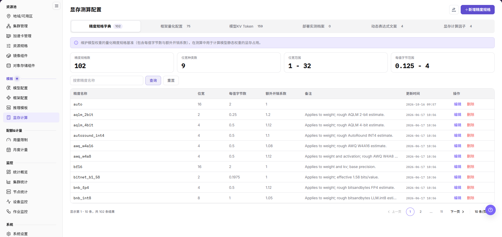

页面顶部按 `精度规格字典`、`框架量化配置`、`模型KV Token`、`部署实测档案`、`动态表达式文案`、`显存计算因子` 六个页签组织，页签名后各自显示条目数。截图为默认的 `精度规格字典` 页签，可维护各精度的 `位宽`、`每值字节数` 和 `额外开销系数`。

## 主要操作

### 维护精度规格字典

#### 适用场景

- 需要为新的量化方案补充显存测算基准（每值字节数与额外开销系数）时，新增一条精度规格。
- 已录入精度的位宽、每值字节数或额外开销系数需要修正时，编辑该条记录。

#### 操作步骤

1. 进入 `On-Prem > 模板 > 显存计算`，页面默认停在 `精度规格字典` 页签。
2. 需要新增时，点击页头右上的 **"+新增精度规格"**，打开标题为 `新增精度规格` 的弹窗；需要修改时，点击目标行 `操作` 列的 `编辑`，打开标题为 `编辑精度规格` 的弹窗。

下图展示 `新增精度规格` 弹窗：`精度名称` 输入框的占位提示为 `例如 fp16`，`位宽`、`每值字节数`、`额外开销系数` 三项为步进器，初始值分别是 `8`、`1`、`1`，底部按钮是 `取消` 与 `保存`。

3. 填写 `精度名称`，并按该精度的量化口径设置 `位宽`、`每值字节数` 和 `额外开销系数`。
4. （可选）在 `备注` 中说明适用对象或估算口径。
5. 核对数值后点击 **"保存"**；放弃本次录入时点击 `取消` 或弹窗右上角关闭图标。

下图展示 `编辑精度规格` 弹窗：`auto` 这条记录的 `位宽`、`每值字节数`、`额外开销系数` 分别是 `16`、`2`、`1`，编辑态下 `精度名称` 同样可以修改。

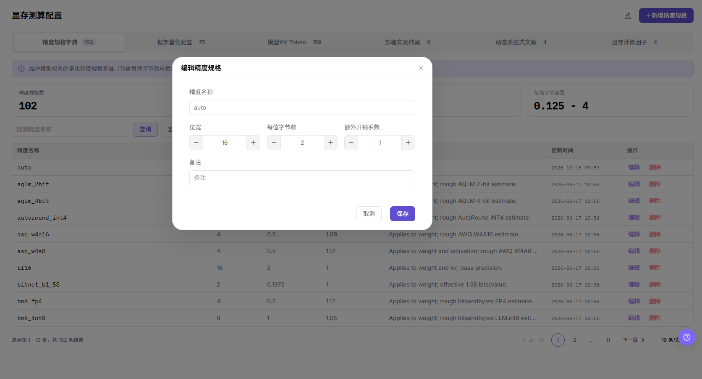

#### 结果校验

- 目标行的 `更新时间` 刷新为本次操作时间，`精度名称`、`位宽`、`每值字节数`、`额外开销系数`、`备注` 与录入值一致。
- 页签上的计数与页脚 `显示第 1 - 10 条，共 102 条结果` 中的总数随新增同步变化。
- 顶部 `精度规格数`、`位宽种类数`、`位宽范围`、`每值字节范围` 四张统计卡随之更新。

#### 注意事项

- 精度规格是显存测算的基础字典，位宽或每值字节数填错会直接让下游估算结果偏大或偏小。
- 弹窗内四项均未显示必填星号，但 `精度名称` 与三个数值项都是测算所需，保存前以页面提示为准。
- 列表可用 `搜索精度名称` 配合 `查询`、`重置` 定位记录，翻页使用右下角页码与 `10 条/页`。

### 维护框架量化配置

#### 适用场景

- 推理框架的新版本上线，需要登记它支持的权重量化与 KV Cache 量化范围时，新增一条框架量化配置。
- 已登记版本支持的量化方式需要调整时，编辑该条记录。

#### 操作步骤

1. 进入 `On-Prem > 模板 > 显存计算`，切换到 `框架量化配置` 页签。
2. 需要新增时，点击页头右上的 **"+新增框架量化配置"**，打开标题为 `新增框架量化配置` 的弹窗；需要修改时，点击目标版本行 `操作` 列的 `编辑`，打开标题为 `编辑框架量化配置` 的弹窗。

下图展示 `框架量化配置` 页签：配置按框架分组，组标题右侧标注 `N 版本配置数`，组内列出 `框架版本`、`支持权重量化`、`支持 KV Cache 量化`、`更新时间` 与 `操作`。

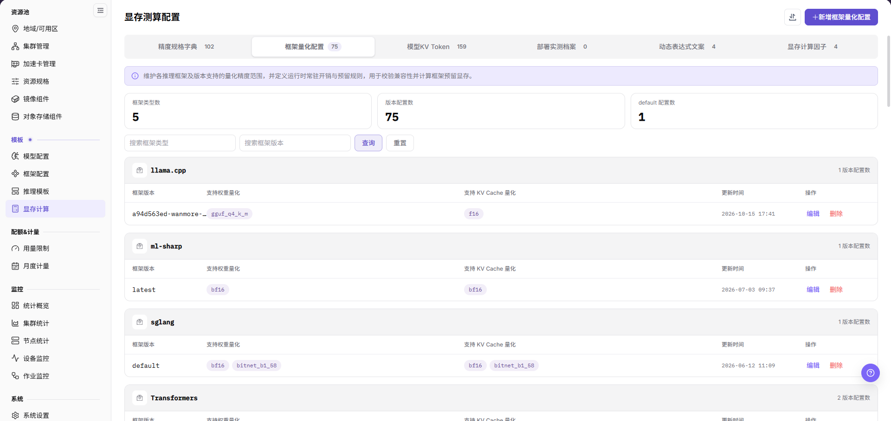

3. 在弹窗中填写 `框架类型`（占位提示 `例如 vllm`），确认 `框架版本`（标签右侧带说明图标，默认值为 `default`）。
4. 在 `权重量化` 下拉中选择该版本支持的权重量化方式（占位提示 `选择权重量化方式`），在 `KV Cache 量化` 下拉中选择 KV Cache 侧的量化方式（占位提示 `选择 KV Cache 量化方式`）。

下图展示 `新增框架量化配置` 弹窗：四个字段自上而下排列，底部按钮是 `取消` 与 `保存`。

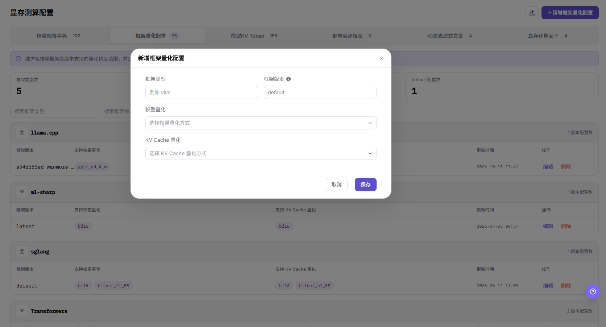

5. 核对后点击 **"保存"**。编辑态下 `框架类型` 与 `框架版本` 两栏置灰不可改，只能调整 `权重量化` 与 `KV Cache 量化`。

下图展示 `编辑框架量化配置` 弹窗：`框架类型` 为 `llama.cpp`、`框架版本` 为带构建后缀的版本标签（占位提示，正文不逐字引用画面值）且均不可编辑，`权重量化` 为 `gguf_q4_k_m`、`KV Cache 量化` 为 `f16`。

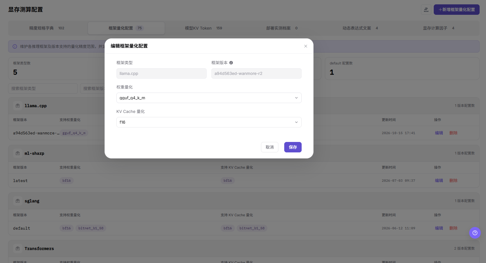

#### 结果校验

- 顶部 `框架类型数`、`版本配置数`、`default 配置数` 三张统计卡与页签计数随新增同步。
- 目标框架分组内出现该版本行，`支持权重量化` 与 `支持 KV Cache 量化` 两列以标签形式回显所选量化方式。
- 编辑后该行的 `更新时间` 刷新。

#### 注意事项

- 该页签定义各框架版本可用的量化范围与框架常驻开销口径，选错量化方式会让兼容性校验和显存测算同时失真。
- 编辑态不允许修改 `框架类型` 与 `框架版本`，登记错版本时只能删除后重新新增。
- 页签提供 `搜索框架类型` 与 `搜索框架版本` 两个筛选框，配合 `查询`、`重置` 使用。

### 维护模型 KV Token 配置

#### 适用场景

- 需要让测算引擎按模型、框架与 KV 数据类型动态计算 KV Cache 显存时，为模型新增一条 KV Token 配置。
- 已配置的 dtype 单位字节数或适用框架需要调整时，编辑该条记录。

#### 操作步骤

1. 进入 `On-Prem > 模板 > 显存计算`，切换到 `模型KV Token` 页签。
2. 需要新增时，点击页头右上的 **"+新增模型 KV Token 配置"**，从页面右侧滑出标题为 `新增模型 KV Token 配置` 的抽屉；需要修改时，点击目标行 `操作` 列的 `编辑`，滑出标题为 `编辑模型 KV Token 配置` 的抽屉。

下图展示 `模型KV Token` 页签：列表以 `模型名称/UID` 为主列，另有 `框架类型`、`已配置量化数`、`更新时间` 与 `操作`。

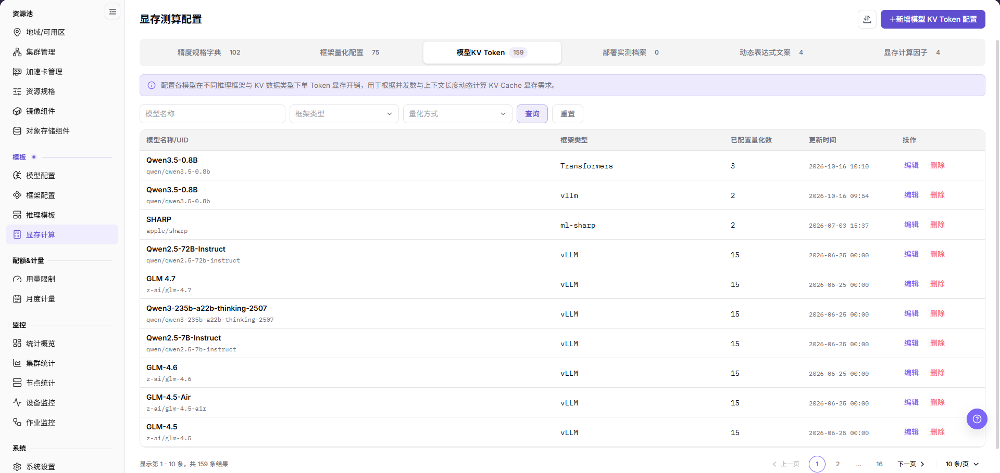

3. 在 `模型名称` 下拉中选择目标模型（占位提示 `请选择模型`），在 `框架类型` 中确认或填写框架名称。
4. 在 `单 Token 消耗配置` 区域按 dtype 逐行录入，该区域说明文字为 `下方配置的单位为 byte`；每行由 dtype 下拉、数值输入框和删除图标组成，点击 **"+ 新增 dtype 配置"** 可增加一行。

下图展示 `新增模型 KV Token 配置` 抽屉：`模型名称`、`框架类型`、`单 Token 消耗配置` 三项带必填星号，默认行为 `fp16` 与 `1`，底部按钮是 `取消` 与 `保存`。

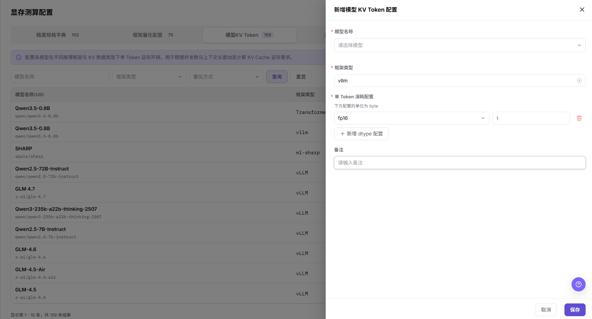

5. （可选）在 `备注` 中记录该配置的推导口径。
6. 核对后点击 **"保存"**。编辑态下 `模型名称` 回显为已选模型并附带模型来源与上下文长度标签，`单 Token 消耗配置` 会列出全部已配置的 dtype 行。

下图展示 `编辑模型 KV Token 配置` 抽屉：`float16`、`fp16`、`auto` 三行 dtype 的取值均为 `12288`，`备注` 中保存了该配置的推导说明。

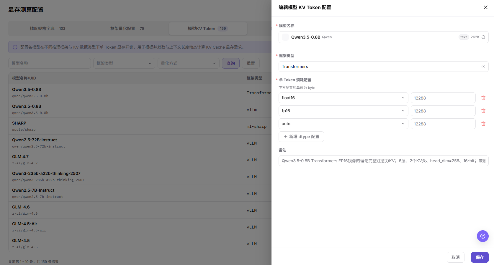

#### 结果校验

- 目标行的 `已配置量化数` 与抽屉内 dtype 行数一致，`更新时间` 刷新。
- 页签计数与页脚 `共 159 条结果` 随新增同步变化。
- 同一模型可以按不同框架分别配置，列表中会出现同模型多行，逐行核对 `框架类型`。

#### 注意事项

- 该区域单位为 byte，填成其他单位会成倍放大或缩小 KV Cache 估算结果。
- 三项必填字段未填齐时以页面提示为准，不要改用备注记录数值。
- 页签支持 `模型名称`、`框架类型`、`量化方式` 三个筛选条件，配合 `查询`、`重置` 定位记录。

### 手动录入部署实测档案

#### 适用场景

- 已有真实压测或运行数据，需要让测算引擎按实测值而非理论公式估算显存时，手动录入一条部署实测档案。
- 需要确认当前环境是否已录入实测档案时，查看 `部署实测档案` 页签。

#### 操作步骤

1. 进入 `On-Prem > 模板 > 显存计算`，切换到 `部署实测档案` 页签。
2. 点击页头右上的 **"+ 手动录入"**，打开标题为 `手动录入部署实测档案` 的弹窗。

下图展示 `部署实测档案` 页签的空态：筛选区为 `元模型`、`框架类型`、`加速卡`、`估算启用` 四个下拉（默认均为 `全部`），另有 `查询`、`重置` 与 `更多筛选`，列表区提示 `没有匹配的部署实测档案`／`调整筛选条件后重新查询。`

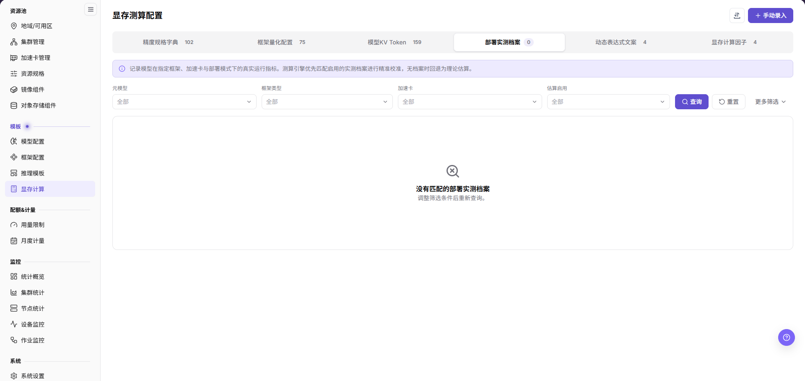

3. 在 `匹配维度` 分组内填写带必填星号的 `元模型 ID`（占位提示 `qwen/qwen3.5-9b`）、`版本`（占位提示 `fp16`）、`框架类型`、`框架版本`（占位提示 `0.10.1`）、`部署模式`、`加速卡 ID`（占位提示 `accelerator-h20-96gb`）与 `KV Cache 数据类型`。
4. 在 `显存估算字段（必填）` 分组内填写两个直接参与估算的字段：`单张加速卡运行额外开销估算`（单位 `GiB`）与 `跨加速卡有效单 Token KV Cache 字节数`（单位 `B`）。该分组说明文字为 `以下两个字段直接参与显存估算，保存档案时必须填写。`
5. 确认 `参与显存估算` 开关的状态，该开关标签右侧带说明图标。
6. 核对匹配维度与两个估算字段后点击 **"保存档案"**；放弃本次录入时点击 `取消` 或弹窗右上角关闭图标。

下图展示 `手动录入部署实测档案` 弹窗：`匹配维度` 与 `显存估算字段（必填）` 两组自上而下排列，底部按钮是 `取消` 与 `保存档案`。

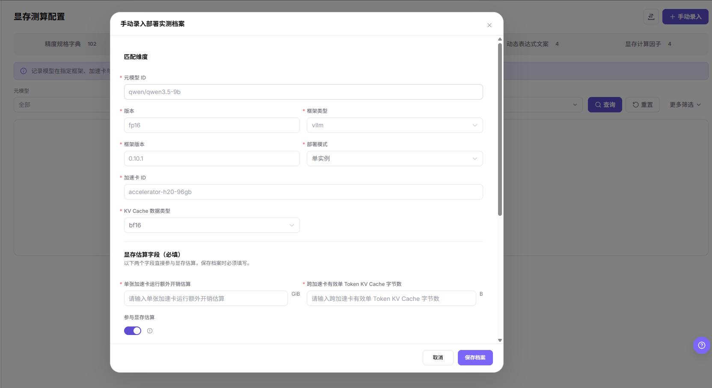

#### 结果校验

- 页签计数从 `0` 变为实际条数，列表不再显示 `没有匹配的部署实测档案`。
- 新档案的匹配维度（元模型、框架、加速卡、部署模式）与录入值逐字一致。
- `估算启用` 筛选可用来确认该档案是否处于参与估算状态。

#### 注意事项

- 同一组匹配维度重复录入会让引擎无法确定生效档案，录入前先按四个筛选下拉核对已有记录。
- 两个必填估算字段是实测档案生效的前提，未填写时保存会被拦截。
- 该页签的 `更多筛选` 展开后的字段未在本文配图中收录，以页面实际提示为准。

### 维护动态表达式文案

#### 适用场景

- 部署测算中出现的输入参数（并发数、上下文、预留比例等）缺少统一的中文展示文案或单位说明时，维护动态表达式文案。
- 已有选项的标题或描述需要更新时，在同一区域修改。

#### 操作步骤

1. 进入 `On-Prem > 模板 > 显存计算`，切换到 `动态表达式文案` 页签。
2. 用顶部下拉选择要维护的动态表达式，画面中该下拉显示为 `匹配的框架列表 · matched_framework_list`，选中后下方提示条同步回显名称与变量名。
3. 点击页头右上的 **"编辑文案"** 进入编辑态，页头按钮此时变为 `取消` 与 **"保存"**。

下图展示 `动态表达式文案` 页签的浏览态：左栏 `可编辑选项` 标注 `5 选项 · 4 未设置标题`，条目带 `L1`／`L2` 层级与 `frame:`／`frameVersion:` 变量行；右栏显示所选条目的 `标题` 与 `标题描述`，两处均标记 `多语言`，并提供 `中文`／`English` 切换，输入框下提示 `将在 中文 语言环境下显示`。

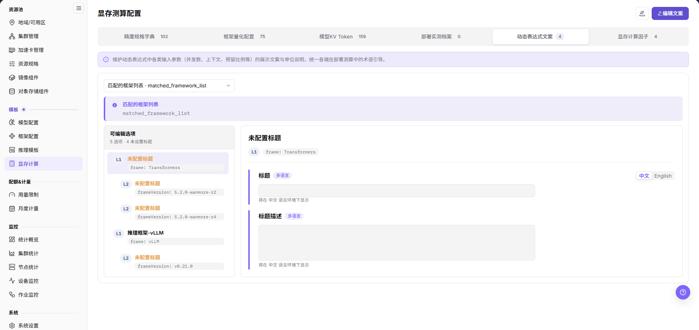

4. 在左栏选择要修改的选项条目。
5. 在右栏 `标题` 输入框填写展示标题，在 `标题描述` 输入框填写说明文案；切换 `中文`／`English` 可分别维护两种语言的文案。
6. 点击 **"保存"** 生效；放弃本次修改时点击 `取消`。

下图展示 `动态表达式文案` 页签的编辑态：`标题` 与 `标题描述` 变为可输入框，页头右上为 `取消` 与 `✓保存`。

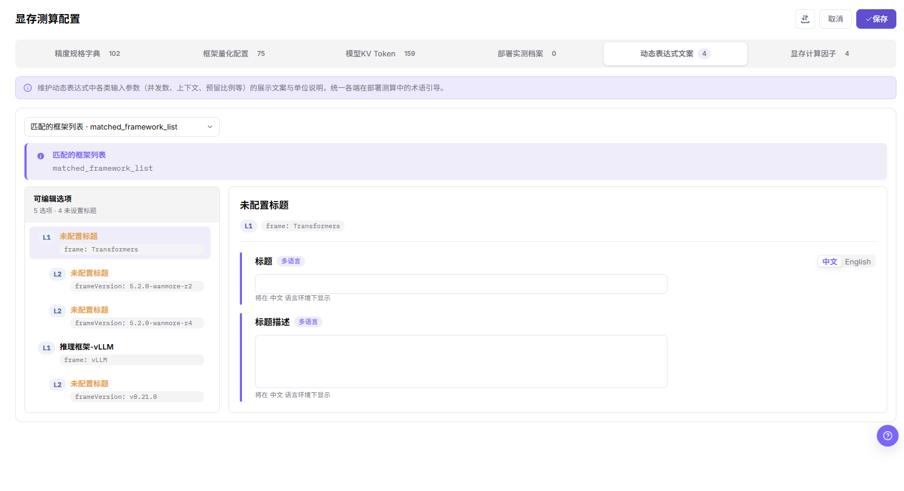

#### 结果校验

- 保存后左栏对应条目的标题不再是 `未配置标题`，`N 选项 · M 未设置标题` 中的未设置计数随之减少。
- 切换 `中文`／`English` 后两侧文案各自独立生效。
- 页面顶部的表达式下拉与提示条回显的变量名保持不变。

#### 注意事项

- 该页签只维护展示文案，不改变表达式本身的计算逻辑与变量名。
- 未设置标题的条目在用户侧会显示为占位文字，发布前先核对 `未设置标题` 计数。
- 页签内是否支持新增或删除选项未在本文配图中收录，以页面实际入口为准。

### 维护显存计算因子表单

#### 适用场景

- 需要在用户侧部署流程中收集显存测算所需的输入项时，新增一张因子表单并关联推理模板。
- 需要核对某张表单的因子构成与取值时，从列表进入详情页查看。

#### 操作步骤

1. 进入 `On-Prem > 模板 > 显存计算`，切换到 `显存计算因子` 页签。
2. 需要新增时，点击页头右上的 **"+新增表单"**，页面跳转到标题为 `新增显存测算配置` 的整页表单；需要核对时，点击目标行 `操作` 列的 `查看`，进入标题为 `显存测算配置详情` 的整页详情。

下图展示 `显存计算因子` 页签：列表列为 `表单名称`（名称下方显示数字 ID）、`因子数`、`关联模板`、`更新时间` 与 `操作`，操作列提供 `查看` 与 `删除`。

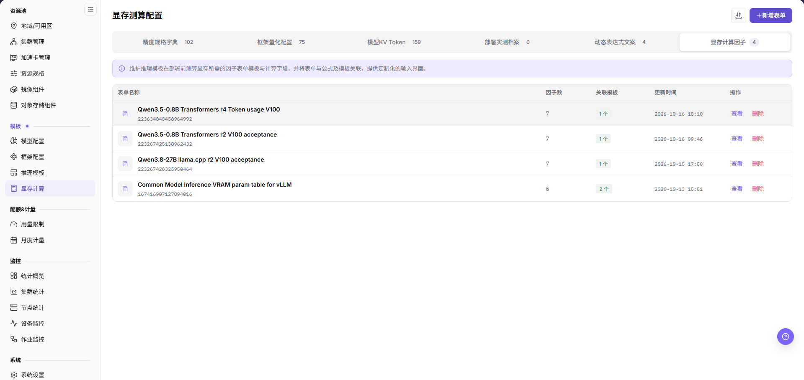

3. 在整页表单的 `业务参数` 分组中填写 `表单名称`（占位提示 `请输入显存测算配置名称`），该分组说明文字为 `根据部署用途和框架版本预估显存需求。`
4. 在 `用户侧第二步预览` 区域内维护因子：点击 **"+ 新增因子"** 增加一个因子分组，用 `1/1 业务参数 1` 右侧的齿轮图标调整该因子，在 `参数说明` 处填写说明。
5. 为因子提供候选值时，在因子行内维护 `选项 1` 与其 `说明`，点击 **"+ 新增选项"** 增加选项；预览区右上角的 `中文`／`English`／`Español` 用于切换预览语言。
6. 核对预览后点击右上角 **"保存"**；放弃本次录入时点击 `取消` 或页头左上返回图标。

下图展示 `新增显存测算配置` 整页表单：`业务参数` 分组、`用户侧第二步预览`、`+ 新增选项` 与 `+ 新增因子` 自上而下排列。

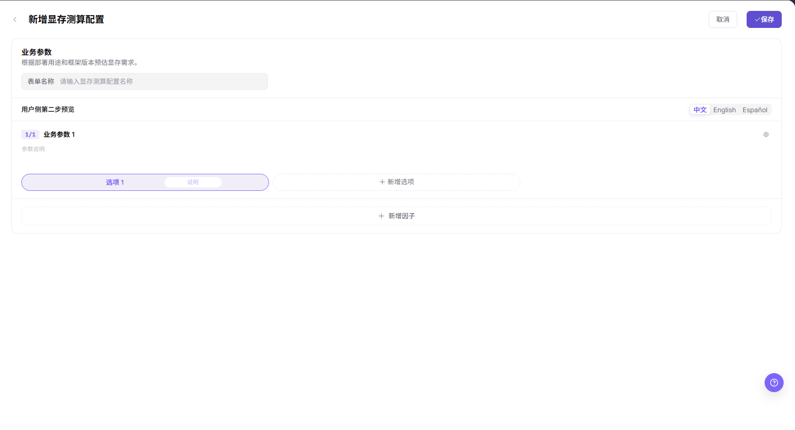

7. 详情页右上角点击 **"编辑"** 可回到同一表单修改因子；确认不再使用某张表单时，返回列表点击目标行 `操作` 列的 `删除`，并按页面提示完成确认。

下图展示 `显存测算配置详情`：因子按 `N/7` 步骤卡排列，中文界面下步骤标题仍为英文原文（如 `Inference framework`、`Accelerator`、`Acceptance concurrency`、`Acceptance context (K)`、`Weight artifact format`、`KV cache dtype`），每张卡下方同时给出候选值与 `自定义` 输入位。

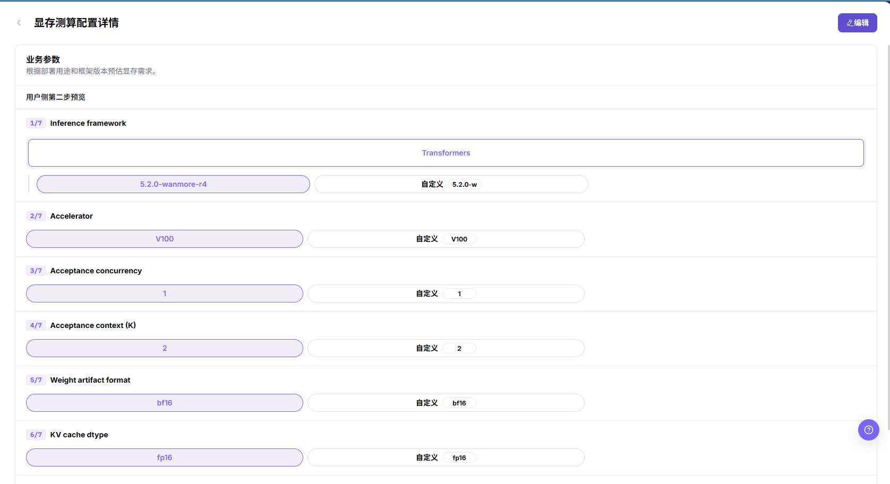

#### 结果校验

- 列表出现新表单行，`因子数` 与详情页步骤卡数量一致，`关联模板` 显示 `N 个`。
- 详情页的每一步都能回显所选候选值或 `自定义` 值，与保存前预览一致。
- 删除后在列表与页签计数中确认目标表单已不在结果内（删除后的画面未在本文配图中收录，以页面实际结果为准）。

#### 注意事项

- 因子表单决定用户侧部署第二步要填什么，改动会影响已关联模板的测算入口，先在预览中核对再保存。
- 详情页的因子标签是英文原文，配置用户侧文案时需与 `动态表达式文案` 页签对照，避免同一参数出现两套口径。
- 被推理模板关联的表单不要直接删除，先解除关联或改用替代表单；删除确认框未在本文配图中收录，以页面实际提示为准。

## 参数速查表

| 字段名称 | 是否必填 | 字段类型 | 示例 | 说明 |
| --- | --- | --- | --- | --- |
| 精度名称 | 弹窗未标注 | 文本 | `bf16` | `精度规格字典` 页签的唯一标识，占位提示为 `例如 fp16`。 |
| 位宽 | 弹窗未标注 | 数字（步进器） | `16` | 该精度的位宽，页签统计卡给出 `位宽范围 1 - 32`。 |
| 每值字节数 | 弹窗未标注 | 数字（步进器） | `2` | 单个参数值占用的字节数，页签统计卡给出 `每值字节范围 0.125 - 4`。 |
| 额外开销系数 | 弹窗未标注 | 数字（步进器） | `1` | 权重静态显存的额外开销倍率，默认 `1`。 |
| 框架类型 | 弹窗未标注 | 文本 | `llama.cpp` | `框架量化配置` 页签的分组依据，占位提示为 `例如 vllm`；编辑态不可改。 |
| 框架版本 | 弹窗未标注 | 文本 | `default` | 与框架类型共同定位一条配置，标签右侧带说明图标；编辑态不可改。 |
| 权重量化 | 弹窗未标注 | 多选下拉 | `gguf_q4_k_m` | 该框架版本支持的权重侧量化方式，占位提示为 `选择权重量化方式`。 |
| KV Cache 量化 | 弹窗未标注 | 多选下拉 | `f16` | 该框架版本支持的 KV Cache 侧量化方式。 |
| 模型名称 | 必填 | 下拉选择 | `Qwen3.5-0.8B` | `模型KV Token` 抽屉的第一项，占位提示为 `请选择模型`。 |
| 单 Token 消耗配置 | 必填 | dtype 行列表 | `fp16` = `12288` | 每个 dtype 一行，单位为 byte，可点击 **"+ 新增 dtype 配置"** 增加行。 |
| 元模型 ID | 必填 | 文本 | `qwen/qwen3.5-9b` | `手动录入部署实测档案` 弹窗的匹配维度之一，示例为占位提示。 |
| 部署模式 | 必填 | 下拉选择 | `单实例` | 与元模型、框架、加速卡共同构成档案的匹配维度。 |
| 加速卡 ID | 必填 | 文本 | `accelerator-h20-96gb` | 实测档案匹配的加速卡，示例为占位提示。 |
| 单张加速卡运行额外开销估算 | 必填 | 数字（`GiB`） | — | 直接参与显存估算的两个字段之一。 |
| 跨加速卡有效单 Token KV Cache 字节数 | 必填 | 数字（`B`） | — | 直接参与显存估算的另一个字段。 |
| 表单名称 | 页面未标注 | 文本 | — | `显存计算因子` 页签新建整页表单的名称字段，占位提示为 `请输入显存测算配置名称`。 |
| 因子 / 选项 | 页面未标注 | 分组配置 | `7` | 每张表单的因子数与候选项在 `用户侧第二步预览` 中维护，列表以 `因子数` 回显。 |

## 踩坑提示

- `单 Token 消耗配置` 的单位是 byte，实测档案的两个字段分别以 `GiB` 和 `B` 计量，跨页签录入时先确认单位。
- 精度规格的位宽或每值字节数填错，会让所有引用该精度的测算结果同向偏大或偏小。
- 框架量化配置的 `框架类型` 与 `框架版本` 在编辑态不可改，登记错版本只能删除后重新新增。
- 显存计算因子表单决定用户侧部署第二步的输入项，改动会同时影响所有关联模板。

## 结果校验

| 检查项 | 成功表现 | 异常时处理 |
| --- | --- | --- |
| 页面入口 | 可进入显存计算并看到目标操作入口 | 检查运营管理员权限和对应菜单是否已开放 |
| 对象记录 | 六个页签各自的列表、抽屉或整页详情中能看到目标记录，页签计数与页脚总数一致 | 重置筛选并核对名称、所属页签和创建结果 |
| 状态结果 | 新增或变更后的状态符合页面提示 | 查看操作提示、依赖对象状态和最近更新时间 |
| 下游使用 | 后续页面能够选择或关联目标对象 | 回到前置配置核对启用状态、归属关系和可见范围 |

## 常见问题

#### 显存测算结果异常

**问题现象：**

配置保存完成，但推理模板中的显存结果明显偏大、偏小或无法计算。

**可能原因：**

- 精度规格的位宽、每值字节数或额外开销系数口径不一致。
- 框架版本或动态表达式在目标环境不可用。
- 规则引用的资源规格不存在或资源指标不匹配。

**处理方式：**

1. 打开规则详情逐项核对因子和动态表达式。
2. 到模型、框架和资源规格页面核对版本与指标。
3. 用代表性参数重新计算，并与已验证结果交叉核对。

#### 删除配置时提示存在关联对象

**问题现象：**

点击 **"删除"** 后操作失败，或页面提示存在关联对象。

**可能原因：**

- 推理模板或部署配置仍引用该规则。
- 当前账号缺少移除权限。
- 规则仍在计算或后台处理。

**处理方式：**

1. 到推理模板和部署页面检查规则引用。
2. 核对当前账号权限、规则状态和更新时间。
3. 完成替换或解除引用后，再按审批结果移除规则。

#### 显存计算中找不到目标对象

**问题现象：**

页面可进入，但没有看到预期的精度规格、框架量化配置、模型 KV Token、部署实测档案、动态表达式文案或显存计算因子表单。

**可能原因：**

- 筛选条件仍生效。
- 对象属于其他范围。
- 前置配置未完成。

**处理方式：**

1. 重置筛选
2. 核对所属地域或租户
3. 返回前置页面确认对象状态。

#### 显存计算的操作入口不可用

**问题现象：**

新增、注册或维护入口不可见或不可点击。

**可能原因：**

- 当前角色权限不足。
- 页面处于只读状态。
- 依赖对象不满足条件。

**处理方式：**

1. 检查运营管理员权限
2. 核对页面提示
3. 先完成依赖对象配置。

#### 下游页面无法使用显存计算

**问题现象：**

当前页状态正常，但下游页面无法选择或关联精度规格、框架量化配置、模型 KV Token 或显存计算因子表单。

**可能原因：**

- 可见范围不匹配。
- 对象未启用。
- 下游缓存未刷新。

**处理方式：**

1. 核对启用状态和归属
2. 检查角色可见范围
3. 刷新下游页面并重新选择。

## 注意事项

- 显存测算是推荐和校验依据，不替代真实压测。
- 修改精度规格、量化配置或因子表单前，应确认引用它们的推理模板与用户创建流程的影响范围。

## 后续操作

1. 在推理模板中引用显存测算规则。
2. 用小、中、大模型分别验证显存估算结果。
3. 根据线上失败案例持续校准精度口径和安全余量。
