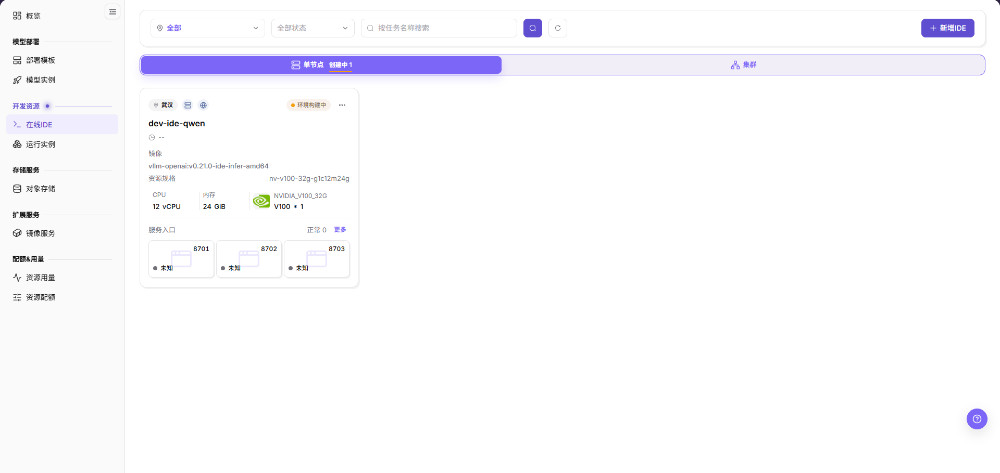
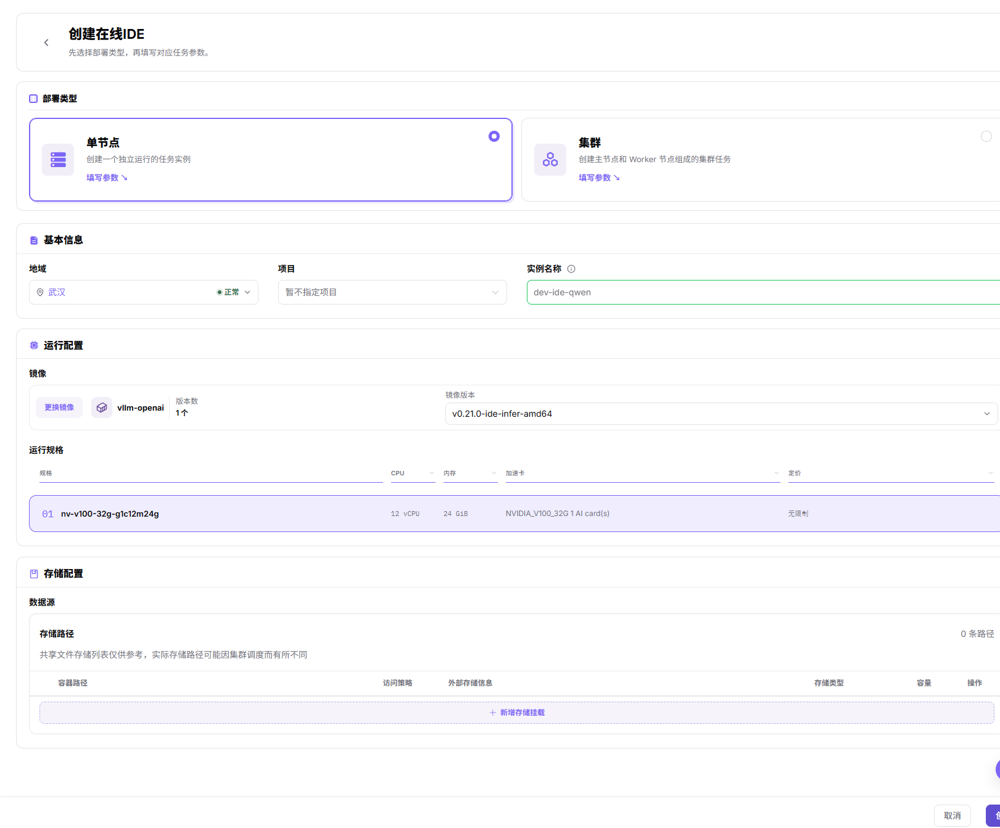
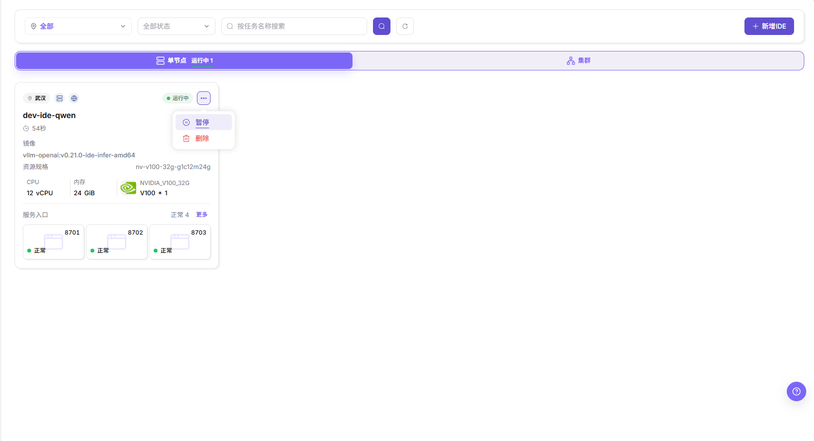
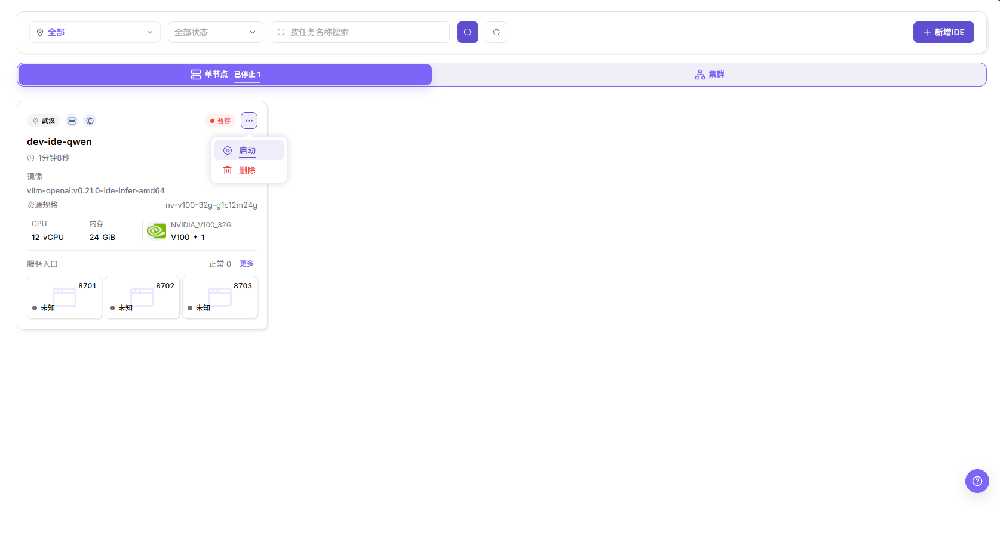
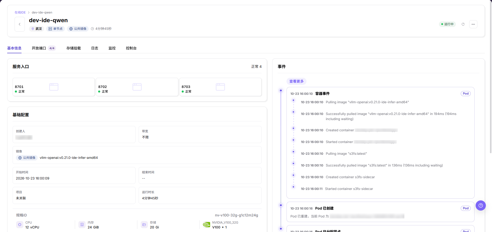
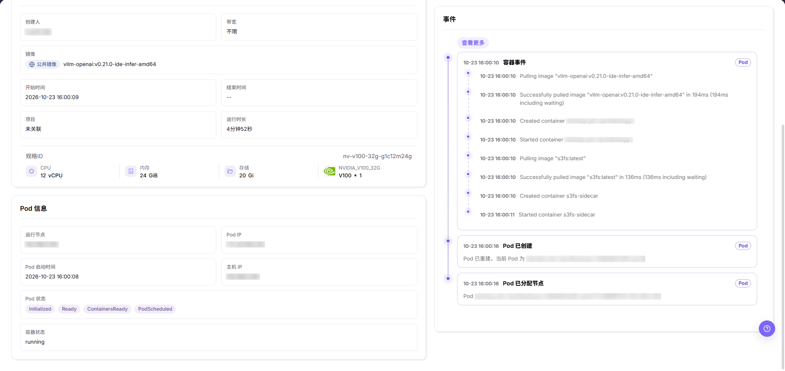
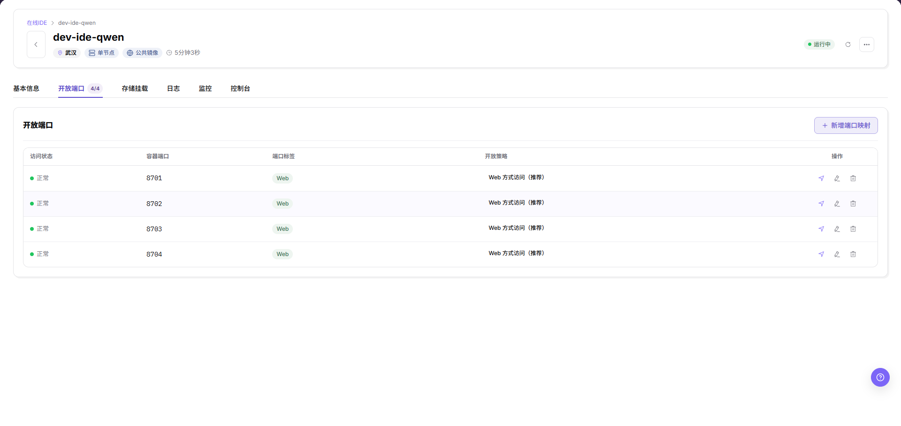
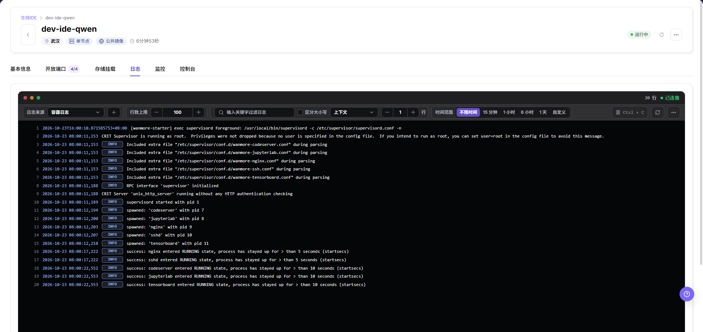
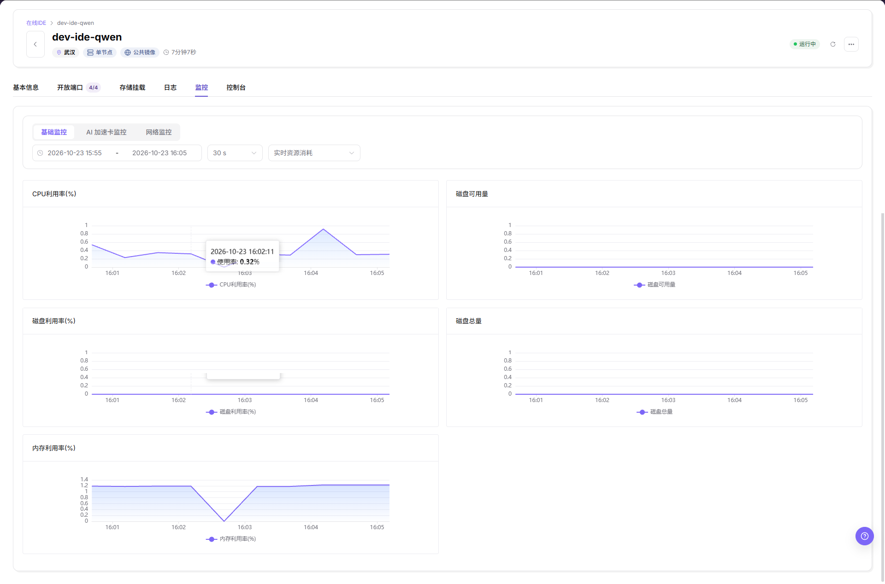
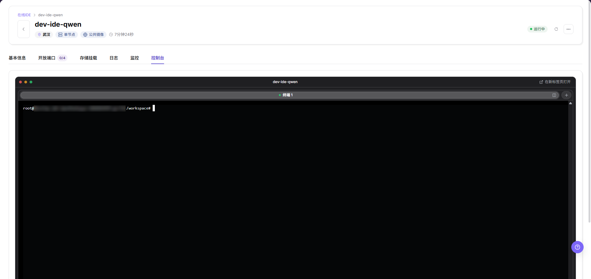

# 在线IDE

## 功能概述

| 项目 | 内容 |
| --- | --- |
| 适用角色 | 模型提供方 |
| 导航路径 | On-Prem > 开发资源 > 在线IDE |
| 页面路由 | `/powerone/dev-training/dev-ide` |
| 管理对象 | 在线 IDE 实例及其运行配置 |

#### 新手理解

在线 IDE 像运行在资源池里的云端开发机。你不需要本地安装 GPU 环境，只要选择镜像和规格，平台会创建一个可访问的开发环境。

#### 术语表

| 术语 | 说明 |
| --- | --- |
| 镜像 | 作业运行所需的容器环境，通常来自平台镜像服务或自定义镜像项目。 |
| 规格 | 作业可申请的资源套餐，例如 CPU、内存、GPU 型号和卡数。 |
| 配额 | 租户可使用的资源上限，常见维度包括 GPU、CPU、内存和规格。 |

#### 推荐操作顺序

1. 进入 `On-Prem > 开发资源 > 在线IDE`。
2. 新建环境时，按“创建在线 IDE”操作。
3. 管理已有 IDE 时，按需进入状态管理、详情、端口或存储挂载操作。
4. 排障时，查看事件、日志、监控和控制台。
5. 检查对应操作的结果。
6. 暂停或删除 IDE 前，保存代码与输出。

#### 小白先看

创建前准备好镜像、规格、配额和所需存储；管理已有 IDE 时，先定位实例卡片，再按任务选择对应操作。

## 前提条件

1. 当前账号具备创建在线 IDE 的权限。
2. 目标地域有可用规格和配额。
3. 已有可用镜像，且镜像中包含所需开发工具。
4. 如需挂载数据或代码目录，相关存储已准备。

## 页面说明

通过列表定位 IDE，在详情页签中查看配置、管理端口与挂载，或排查运行问题。

列表按部署形态和状态用页签分组 IDE，支持按地域和状态筛选，并按任务名称搜索。每张卡片展示单个 IDE 的镜像、资源规格、CPU、内存与服务入口状态。点击卡片名称进入详情页，包含基本信息、开放端口、存储挂载、日志、监控和控制台页签。

#### 页面区域

| 字段/区域 | 说明 |
| --- | --- |
| 页签 | 在单节点运行中、单节点已停止与集群之间切换 IDE 列表，并显示数量。 |
| 筛选区 | 按地域和状态筛选，并按任务名称搜索。 |
| 新增IDE | 进入创建流程的部署类型页。 |
| 卡片摘要 | 展示单个 IDE 的镜像、资源规格、CPU、内存与服务入口状态。 |
| 更多 | 打开单个卡片的状态管理菜单，含暂停或启动与删除。 |
| 分页区 | IDE 较多时分页查看。 |

## 主要操作

### 创建在线 IDE

#### 适用场景

当需要一个可交互的开发、调试或 Notebook 环境时，创建在线 IDE。

#### 操作前确认

1. 已确认目标规格和配额可用。
2. 已确认镜像包含 Python、CUDA、框架或其他开发依赖。
3. 已确认运行周期，避免长时间空转消耗资源。

#### 操作步骤

1. 进入 `On-Prem > 开发资源 > 在线IDE`。
2. 点击 **"新增IDE"**，进入部署类型页。
3. 在部署类型页选择 `单节点` 或 `集群`，并阅读形态说明。

部署类型页列出两种形态与填写参数入口。

4. 点击 **"填写参数"**，进入创建表单。
5. 在基本信息中填写实例名称，并确认地域与项目。
6. 在运行配置中选择镜像及其镜像版本，或先更换镜像。
7. 在运行规格中选择一行包含 CPU、内存、加速卡与定价的规格。
8. 在存储配置中按需添加数据源与存储路径。

创建表单收集基本信息、运行配置、运行规格与存储配置。

9. 点击 **"创建"**，等待列表出现新的 IDE。

#### 结果校验

- 提交后在列表核对新 IDE 及其状态。
- 如新 IDE 已出现，进入基本信息，将配置与提交值逐项核对。

#### 注意事项

- 创建在线 IDE 会在整个运行期间占用配额和集群资源。
- 表单中的存储路径列表仅供参考，实际挂载路径可能因集群调度而有所不同。

### 暂停、启动与删除 IDE

#### 适用场景

需要临时停止运行中的 IDE、恢复已停止的 IDE，或移除不再使用的 IDE 时使用本操作。

#### 操作步骤

1. 暂停或删除 IDE 前，将代码与输出保存到持久化存储。
2. 在列表定位卡片，打开其 **"更多"** 菜单。
3. 对运行中的卡片，选择 **"暂停"** 停止它，或选择 **"删除"** 移除它。

运行中卡片的更多菜单提供暂停与删除。

4. 对已停止的卡片，选择 **"启动"** 恢复它，或选择 **"删除"** 移除它。

已停止卡片的更多菜单提供启动与删除。

#### 结果校验

- 暂停后卡片离开运行中页签，出现在已停止页签下并带暂停状态标签。
- 启动后卡片回到运行中页签，并带运行中状态标签。

#### 注意事项

- 删除属于最终动作。
- 暂停与启动作用于整个 IDE，不作用于单个端口或挂载。

### 查看基本信息、Pod 信息与事件

#### 适用场景

需要核对单个 IDE 的运行事实时使用本操作：服务入口、配置、规格、Pod 调度与容器事件。

#### 操作步骤

1. 点击卡片名称进入详情页，默认打开 `基本信息` 页签。
2. 读取 `服务入口` 瓦片及各端口卡片的访问状态。
3. 读取 `基础配置`：创建人、带宽、镜像、开始时间、结束时间、项目与运行时长，以及 `规格ID` 下的 CPU、内存与存储。

基本信息页签展示服务入口、基础配置与 IDE 规格。

4. 读取右侧 `事件` 时间线，并点击 **"查看更多"** 查看更早条目。
5. 读取 Pod 调度事实：运行节点、Pod IP、Pod 启动时间、主机 IP、Pod 状态标签与容器状态。

Pod 信息区块与事件时间线展示调度与容器生命周期事实。

#### 结果校验

- Pod 状态标签显示 `Initialized`、`Ready`、`ContainersReady`、`PodScheduled`，容器状态为 running。
- 事件时间线按时间戳列出镜像拉取、容器创建与容器启动条目。

#### 注意事项

- Pod 信息区块中的节点与 Pod 地址仅用于诊断，外发截图前必须脱敏。
- 仅凭事件条目缺失，不能判断生命周期步骤是否执行。

### 管理开放端口

#### 适用场景

需要为单个 IDE 暴露容器端口以供 Web 或 API 访问，或调整某条映射的开放策略与白名单时使用本操作。

#### 操作步骤

1. 进入详情页并切换到 `开放端口` 页签。
2. 读取各列：访问状态、容器端口、端口标签、开放策略与操作。

开放端口页签列出每条端口映射及其访问状态与策略。

3. 点击 **"＋ 新增端口映射"**，填写 1 到 65535 范围内的整数容器端口。
4. 按需添加端口标签，选择一张开放策略卡片，并在策略要求时添加白名单 CIDR 条目。

新增端口对话框收集容器端口、端口标签、开放策略与白名单。

5. 确认对话框；如需修改已有映射，打开其编辑对话框，字段相同，再次确认即可。

编辑端口对话框对一条已有映射复用新增端口对话框的字段。

#### 结果校验

- 提交后核对映射行、访问状态与开放策略。
- Web 策略行显示推荐的 Web 访问策略。

#### 注意事项

- 四张开放策略卡片互斥；白名单仅接受 CIDR 条目。
- 容器端口必须保持在 1 到 65535 范围内，与对话框提示一致。

### 管理存储挂载

#### 适用场景

需要查看或新增存储挂载，把外部存储放入单个 IDE 的容器路径时使用本操作。

#### 操作步骤

1. 进入详情页并切换到 `存储挂载` 页签。
2. 读取各列：容器路径、访问策略、外部存储信息、存储类型、容量与操作；无挂载的 IDE 显示空状态文案。
3. 点击 **"＋ 新增挂载"**，为代码、数据或输出目录添加挂载。

存储挂载页签列出 IDE 的挂载与新增挂载入口。

#### 结果校验

- 创建时未配置存储挂载的 IDE 在本页签显示空状态文案。

#### 注意事项

- 存储可见不代表可达。
- 依赖挂载前先确认挂载路径，写在挂载之外的输出只保存在临时容器目录。

### 查看日志、监控与控制台

#### 适用场景

需要排障运行中的 IDE 时使用本操作：流式查看容器日志、观察资源图表或在网页终端中操作。

#### 操作步骤

1. 切换到 `日志` 页签，设置日志来源、行数上限、关键字过滤、区分大小写、上下文行数与时间范围。

日志页签按过滤与时间范围设置流式展示容器日志。

2. 切换到 `监控` 页签，在基础监控、AI 加速卡监控与网络监控子页签间选择，查看采样间隔与实时资源消耗图表。

监控页签展示 IDE 的资源消耗图表。

3. 切换到 `控制台` 页签使用网页终端，或在新标签页打开。

控制台页签在 IDE 的工作目录中打开一个 shell 会话。

#### 结果校验

- 日志面板显示已连接状态、行数与带时间戳的日志条目。
- 监控图表按所选间隔渲染 CPU、磁盘与内存曲线。
- 控制台在工作目录显示 shell 提示符。

#### 注意事项

- 控制台提示符中包含 Pod 主机名，外发截图前必须脱敏。
- 日志条目可能包含镜像内部路径，外发前必须脱敏。

## 参数速查表

| 字段名称 | 是否必填 | 字段类型 | 说明 |
| --- | --- | --- | --- |
| 实例名称 | 必填 | 文本 | 创建表单中在线 IDE 的展示名称。 |
| 部署类型 | 必填 | 单选 | 在部署类型页选择单节点或集群形态。 |
| 地域 | 必填 | 下拉选择 | 在线 IDE 的目标地域，并显示其状态。 |
| 项目 | 否 | 下拉选择 | 将 IDE 关联到项目；保留默认值则不关联。 |
| 镜像 | 必填 | 下拉选择 | 开发环境镜像，并选择其镜像版本。 |
| 运行规格 | 必填 | 下拉选择 | 包含 CPU、内存、加速卡与定价的算力规格行。 |
| 存储配置 | 否 | 路径 | 以存储挂载形式添加的数据源与存储路径。 |
| 启动命令 | 否 | 文本 | 配置在线 IDE 启动或运行命令。 |

## 踩坑提示

- 集群模式可能需要更多配额，普通调试优先使用单节点。
- 镜像缺少依赖时，IDE 能启动但代码可能运行失败。
- `提交`、`确定`、`确认` 属于最终动作。

#### 配置规则与影响

- 资源消耗与运行时间有关，应避免 IDE 长时间空转。
- 镜像、规格和存储由运营管理员配置；当前账号从其可见选项中选择。

## 结果校验

| 检查项 | 成功表现 | 异常时处理 |
| --- | --- | --- |
| 页面入口 | 可打开列表或所需详情页签 | 检查当前账号的操作权限及页面提示 |
| IDE 实例 | 预期卡片在所选筛选条件下可见 | 重置筛选并核对实例名称与地域 |
| 配置信息 | 基本信息中展示预期的镜像、规格与项目 | 将显示值与预期配置逐项核对 |

## 常见问题

#### 在线IDE中找不到目标对象

**问题现象：**

列表中找不到预期的 IDE 卡片。

**可能原因：**

筛选条件可能排除了该实例，或所选地域与实例所属地域不一致。

**处理方式：**

1. 重置状态与任务名称筛选。
2. 核对地域与部署形态页签。
3. 按实例名称重新搜索。

#### 在线IDE的操作入口不可用

**问题现象：**

新增IDE入口或更多菜单中的目标操作不可用。

**可能原因：**

操作权限或实例当前状态可能不满足目标动作的要求。

**处理方式：**

1. 查看页面提示与实例状态。
2. 确认当前账号具备目标操作权限。
3. 如需调整权限，联系管理员处理。

#### 在线IDE的必填项没有可选值

**问题现象：**

创建表单能打开，但没有可选镜像或规格。

**可能原因：**

可选项可能受地域或账号可见范围影响。

**处理方式：**

1. 确认所选地域。
2. 联系管理员核对可用镜像或规格。
3. 配置或权限确认后，刷新表单。

#### 在线IDE操作后状态异常

**问题现象：**

实例已出现在列表中，但状态不是预期值。

**可能原因：**

操作可能仍在处理中，或运行依赖发生异常；具体原因需结合事件与日志核实。

**处理方式：**

1. 查看实例状态与操作反馈。
2. 进入基本信息，检查 Pod 状态与事件。
3. 在日志中查看错误，求助时提供相关信息。

#### 下游页面无法使用在线IDE

**问题现象：**

在其他页面无法选择目标 IDE。

**可能原因：**

不直接归因为缓存或启用状态问题。

**处理方式：**

1. 记录目标页面与预期操作。
2. 请管理员确认流程及账号权限。
3. 按确认后的前提条件排查。

## 注意事项

- 不要把密码、Token、私钥等凭据保存在 Notebook、代码仓库或截图中。
- 外发配置、日志或截图前，检查是否包含凭据及敏感环境信息。

## 后续操作

1. 进入 IDE 编写和调试代码。
2. 将重要代码、数据、输出保存到持久化存储。
3. 不再使用时，按“暂停、启动与删除 IDE”操作。
