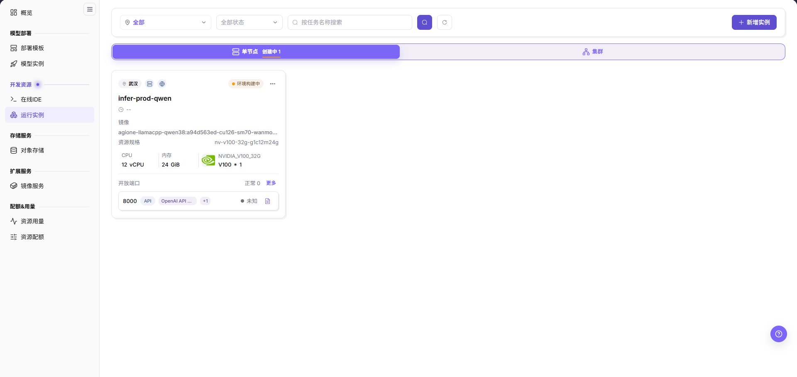
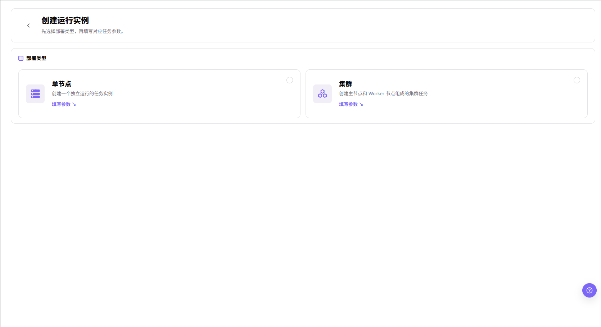
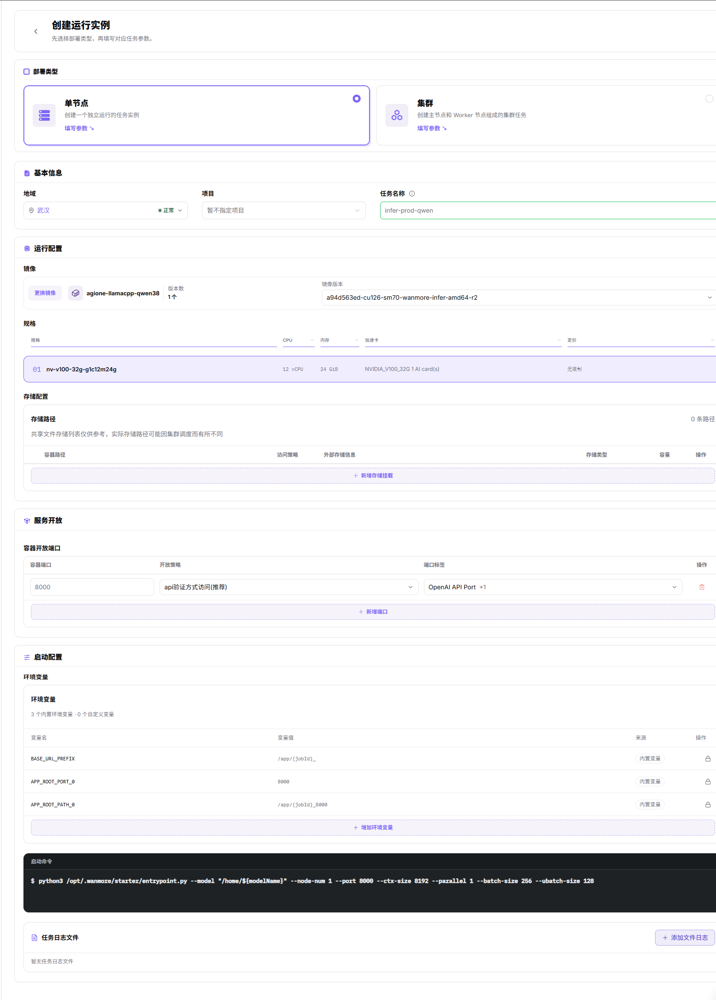
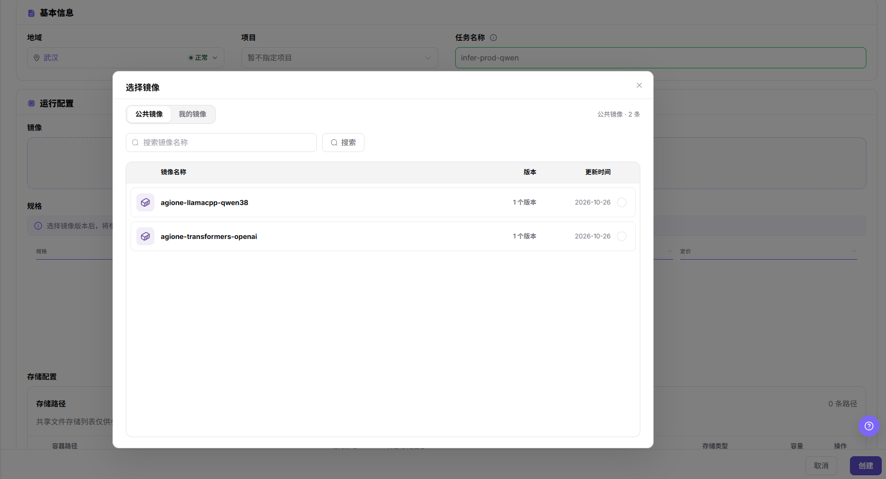
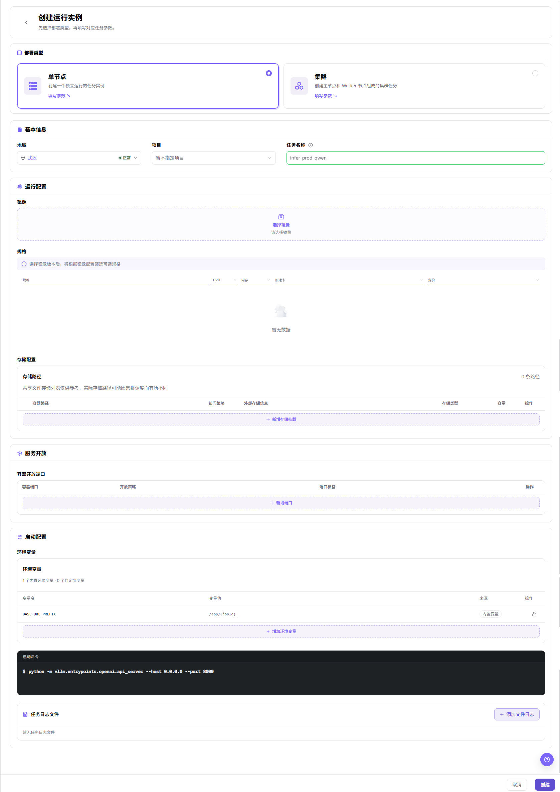

# 运行实例

## 功能概述

| 项目 | 内容 |
| --- | --- |
| 适用角色 | 模型提供方 |
| 导航路径 | On-Prem > 开发资源 > 运行实例 |
| 页面路由 | `/powerone/inference/online-inference` |
| 管理对象 | 运行实例（`单节点`／`集群` 两类卡片）、镜像与镜像版本、规格、存储路径、容器开放端口、环境变量、启动命令、任务日志文件 |

#### 新手理解

运行实例像一台按需启动的任务机器：你准备好镜像、代码、数据和启动命令，平台按所选规格启动实例。它比在线 IDE 更偏任务执行，比模型实例更灵活。

#### 术语表

| 术语 | 说明 |
| --- | --- |
| 镜像 | 实例运行时使用的容器环境。 |
| 启动命令 | 容器启动后执行的命令或脚本。 |
| 批处理 | 一次性或周期性处理数据、转换文件或生成结果的任务，通常在处理完成后退出。 |

#### 推荐操作顺序

先确认镜像、规格、存储与启动命令等前置对象已就绪，再按 `部署类型` → `基本信息` → `运行配置` → `存储配置` → `服务开放` → `启动配置` → `任务日志文件` 的顺序填写，最后执行结果校验并进入后续页面。

#### 小白先看

先确认当前任务是否需要新建运行实例，再按照推荐顺序操作。页面字段或状态与预期不符时，先回到前置对象页核对依赖，不要跳过结果校验直接进入下游流程。

## 前提条件

1. 当前账号具备创建运行实例的权限。
2. 已有可用镜像和规格。
3. 训练脚本、模型文件或输入数据已准备。
4. 输出目录已规划到对象存储、文件存储或共享目录。
5. 启动命令不包含真实密钥、密码、token 或 AK/SK。

## 页面说明

页面用于查看运行实例并进入创建流程。

列表页按 `单节点` 与 `集群` 页签组织实例，提供按地域与状态筛选、按任务名称搜索、`重置` 筛选和 `新增实例` 入口，实例以卡片形式展示状态、镜像、资源规格与开放端口；创建入口先进入部署类型选择，再进入任务参数表单。

## 主要操作

### 创建运行实例

#### 适用场景

需要以 `单节点` 形态启动一个独立运行的任务实例时使用；`集群` 用于创建主节点和 Worker 节点组成的集群任务，其参数表单多出 `集群配置` 分组，启动命令拆为 `主节点启动命令` 与 `工作节点启动命令`。

#### 操作步骤

1. 进入 `On-Prem > 开发资源 > 运行实例`。
2. 点击 `新增实例`，进入 `创建运行实例` 页面，页面提示先选择部署类型再填写对应任务参数。
3. 在 `部署类型` 区域选择 `单节点`，其说明为创建一个独立运行的任务实例。
4. 点击卡片上的 `填写参数`，进入任务参数表单。
5. 在 `基本信息` 分组中设置 `地域`（下拉中同时显示该地域的健康状态）、`项目`（可选择 `暂不指定项目`）与 `任务名称`。
6. 在 `运行配置` 分组中点击 `选择镜像`，从镜像列表中选定目标镜像，再在 `镜像版本` 中选择具体版本。
7. 在 `规格` 列表中选中目标规格行，列表按 `规格`、`CPU`、`内存`、`加速卡` 与 `定价` 列展示。
8. 在 `存储配置` 的 `存储路径` 列表中核对 `容器路径`、`访问策略`、`外部存储信息`、`存储类型`、`容量` 与 `操作` 各列，需要新增时点击 `新增存储挂载`。
9. 在 `服务开放` 分组中点击 `新增端口`，在该行的 `容器端口`、`开放策略` 与 `端口标签` 中声明容器监听端口及其访问方式。
10. 在 `启动配置` 分组中核对 `环境变量` 的 `变量名`、`变量值`、`来源` 与 `操作` 各列，按需点击 `增加环境变量`，并在 `启动命令` 中填写容器启动后执行的命令。
11. 在 `启动配置` 分组中点击 `添加文件日志`，登记实例内需要持续采集的日志文件；未登记时该区域显示 `暂无任务日志文件`。
12. 核对各分组配置后点击 `创建` 提交；放弃时点击 `取消`。

进入 `新增实例` 后先出现 `部署类型` 选择页，`单节点` 与 `集群` 两张卡片各自提供 `填写参数` 入口。

在 `部署类型` 选定 `单节点` 后，任务参数表单自上而下依次出现 `部署类型`、`基本信息`、`运行配置`、`存储配置`、`服务开放`、`启动配置` 与 `任务日志文件` 七个分组。

点击步骤 6 的 `选择镜像` 后弹出镜像选择浮层：标题为 `选择镜像`，内含 `公共镜像` 与 `我的镜像` 两个页签，列表按 `镜像名称`、`版本` 与 `更新时间` 展示，底栏为 `取消` 与 `创建`。

未填写任何字段时，`运行配置` 的 `镜像` 区显示 `选择镜像` 与 `请选择镜像` 占位，`规格` 列表为 `暂无数据`，页面右下角固定 `取消` 与 `创建` 两个按钮。

#### 结果校验

- 列表对应页签出现该实例，卡片任务名称与 `任务名称` 填写值一致。
- 卡片的镜像、资源规格、`CPU`、`内存` 与加速卡数量与创建时所选项一致。
- `开放端口` 区块出现创建时配置的端口行。

#### 注意事项

- `环境变量` 中来源为 `内置变量` 的条目由平台生成，其 `操作` 列仅提供锁定标识。
- 未选择镜像时 `规格` 与 `存储路径` 可能无数据，先完成镜像选择再核对后续配置。

## 参数速查表

| 字段名称 | 必填 | 字段类型 | 说明 |
| --- | --- | --- | --- |
| 任务名称 | 必填 | 文本 | 运行实例在列表卡片上的展示名称。 |
| 部署类型 | 必填 | 单选卡片 | 选择 `单节点` 或 `集群` 形态。 |
| 地域 | 必填 | 下拉选择 | 选择创建运行实例的目标地域，下拉中同时显示该地域的健康状态。 |
| 项目 | 未标注 | 下拉选择 | 指定实例归属范围，可选择 `暂不指定项目`。 |
| 镜像 | 必填 | 弹窗选择 | 通过 `选择镜像` 或 `更换镜像` 在 `公共镜像` 与 `我的镜像` 中选定。 |
| 镜像版本 | 必填 | 下拉选择 | 在所选镜像的版本中指定 `镜像版本`。 |
| 规格 | 必填 | 列表选择 | 在 `规格`、`CPU`、`内存`、`加速卡` 与 `定价` 列组成的列表中选中目标规格。 |
| 资源规格（列表卡片） | 不适用 | 卡片字段 | 列表卡片上展示所选计算规格的字段名，创建表单中对应 `规格` 列表。 |
| 存储路径 | 未标注 | 表格配置 | 通过 `新增存储挂载` 配置 `容器路径`、`访问策略`、`外部存储信息`、`存储类型` 与 `容量`。 |
| 容器开放端口 | 未标注 | 表格配置 | 通过 `新增端口` 配置 `容器端口`、`开放策略` 与 `端口标签`。 |
| 环境变量 | 否 | 键值配置 | 核对来源为 `内置变量` 的条目，并通过 `增加环境变量` 添加自定义变量。 |
| 启动命令 | 必填 | 文本 | 配置容器启动后执行的命令或脚本。 |
| 任务日志文件 | 未标注 | 列表配置 | 通过 `添加文件日志` 登记实例内需要关注的日志文件。 |

画面未在字段标签上显示必填标记，`必填` 列中标为 `未标注` 的行以页面提交校验结果为准。

### Python 训练脚本

用于启动训练入口脚本。文档中只说明需要核对入口脚本、数据来源、输出位置和参数传入方式，不记录真实路径或测试参数。

### Shell 脚本

用于执行批处理、数据准备或多步骤任务。创建前确认脚本存在于镜像或挂载目录中，并确认输出写入持久化路径。

### 自定义服务

用于启动长运行服务类进程。创建前确认服务入口、监听方式、健康状态和资源释放方式。

### 参数传入方式

| 方式 | 适用场景 | 说明 |
| --- | --- | --- |
| 命令行参数 | 脚本支持命令行参数。 | 随 `启动命令` 以命令行形式传入，文档不记录真实参数。 |
| 环境变量 | 框架读取环境变量控制行为。 | 仅说明字段用途，不记录真实 Token、密码或 Endpoint。 |
| 配置文件 | 参数较多或需要复用配置。 | 确认配置文件来自已挂载目录或镜像内置路径。 |
| 挂载路径 | 输入数据、模型文件或输出结果。 | 确认输入和输出目录使用持久化存储。 |

## 踩坑提示

- 训练任务启动失败时先看镜像、启动命令、数据路径和资源规格，不要只重复提交任务。
- GPU/NPU 规格充足不代表依赖库匹配，框架版本、驱动和运行时也要一起核对；本文不描述依赖库匹配的判定方式。
- 训练日志、数据集路径和模型输出目录可能包含业务信息，向支持渠道提交截图和工单时必须先脱敏。
- 最后一步的按钮名以页面实际显示为准，本页配图内可见的是 `创建` 与 `取消`。
- 创建运行实例会占用配额、调度资源和存储资源。
- 启动命令、环境变量和挂载路径配置错误可能导致实例启动失败或输出丢失。
- 看到 `开放端口` 计数为 `0` 就判断端口未开放属于误判：端口行可能已按创建配置展示，仅其状态仍为未知。

## 结果校验

| 检查项 | 成功表现 | 异常时处理 |
| --- | --- | --- |
| 页面入口 | 可进入运行实例并看到目标操作入口 | 检查当前账号是否具备运行实例的操作权限，并确认对应菜单已开放 |
| 对象记录 | 目标实例出现在对应页签，卡片可见 `镜像`、`资源规格`、`CPU`、`内存` 与 `开放端口` | 重置筛选并核对名称、所属范围和创建结果 |
| 状态结果 | 新增或变更后的状态符合页面提示 | 查看操作提示、依赖对象状态和最近更新时间 |
| 下游使用 | 后续页面能够选择或关联目标对象 | 回到前置配置核对启用状态、归属关系和可见范围 |

## 常见问题

#### 运行实例中找不到目标对象

**问题现象：**

页面可进入，但没有看到预期的运行实例。

**可能原因：**

- 筛选条件仍生效。
- 对象属于其他范围。
- 前置配置未完成。

**处理方式：**

1. 重置筛选
2. 核对所属地域或租户
3. 返回前置页面确认对象状态。

#### 运行实例的操作入口不可用

**问题现象：**

新增实例入口不可见或不可点击。

**可能原因：**

- 当前角色权限不足。
- 页面处于只读状态。
- 依赖对象不满足条件。

**处理方式：**

1. 检查当前账号权限
2. 核对页面提示
3. 先完成依赖对象配置。

#### 运行实例的必填项没有可选值

**问题现象：**

表单能打开，但下拉框为空。

**可能原因：**

- 候选对象未启用。
- 所属范围不一致。
- 当前账号不可见。

**处理方式：**

1. 到候选对象页面核对状态
2. 确认归属关系
3. 检查可见范围后刷新表单。

#### 运行实例操作后状态异常

**问题现象：**

提交后记录存在，但状态不是预期值。

**可能原因：**

- 连通性或校验失败。
- 关联对象异常。
- 后台处理尚未完成。

**处理方式：**

1. 查看页面提示和更新时间
2. 检查关联对象
3. 按状态阶段排查处理任务。

#### 下游页面无法使用运行实例

**问题现象：**

当前页状态正常，但下游页面无法选择或关联该运行实例。

**可能原因：**

- 可见范围不匹配。
- 对象未启用。
- 下游缓存未刷新。

**处理方式：**

1. 核对启用状态和归属
2. 检查角色可见范围
3. 刷新下游页面并重新选择。

## 注意事项

- 不要把密钥直接写入启动命令、环境变量或截图中。
- 输出数据建议写入持久化存储，避免实例释放后丢失。
- 正文不写真实租户、地域、镜像地址、资源规格 ID、数据路径、输出路径、Token、密码、Endpoint、启动参数、日志或测试数据；本文配图展示界面实采画面，其中的任务名称、镜像与规格取值及地域名属于界面展示内容，不在本条约束范围内。

## 后续操作

1. 进入实例详情查看日志和输出。
2. 根据用量页面评估资源消耗。
3. 任务完成后，按实例卡片上页面实际提供的操作项处理该实例。
4. 将稳定命令沉淀为团队脚本或推理模板参数。
