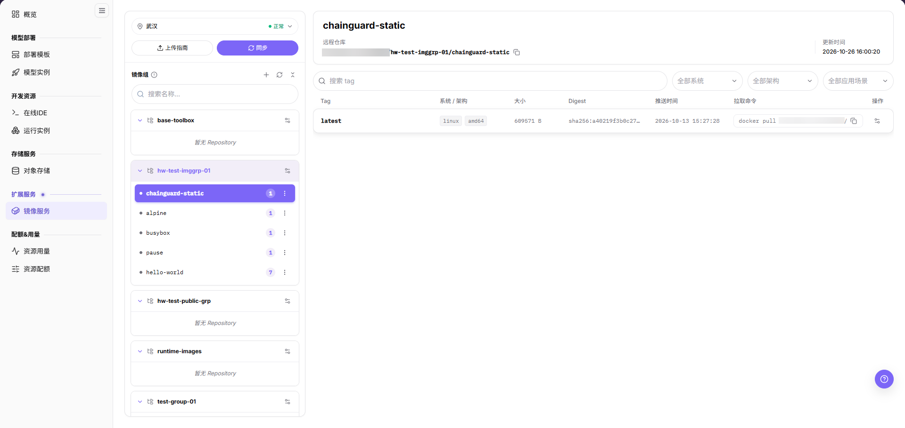
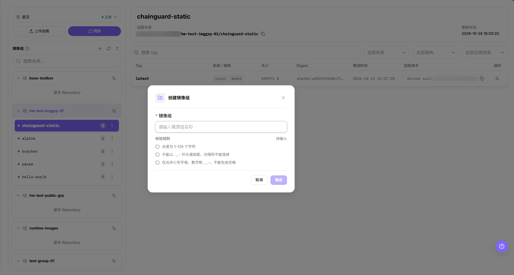
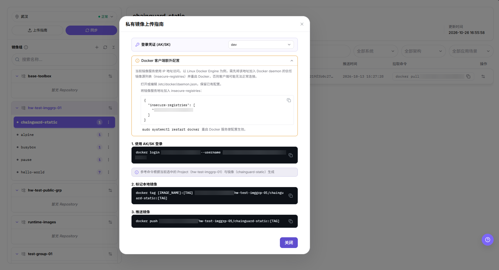
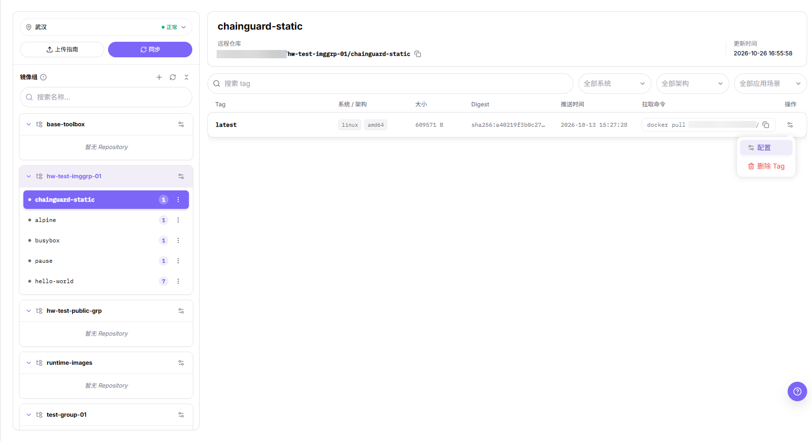
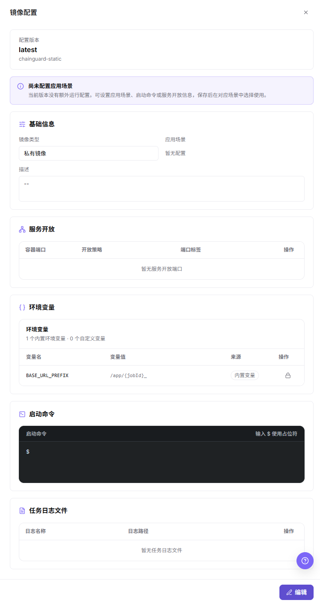

# 镜像服务

## 功能概述

| 项目 | 内容 |
| --- | --- |
| 适用角色 | 模型提供方 |
| 导航路径 | On-Prem > 扩展服务 > 镜像服务 |
| 页面路由 | `/powerone/expand-service/image-service` |
| 管理对象 | 镜像组、组下的仓库、镜像 Tag 与私有镜像上传指南 |

上表的 `适用角色` 与 `页面路由` 未出现在本批 5 张画面中，本文不把它们写成画面上的条目。导航路径以信息表这一行为本页正文唯一形态；画面没有顶栏面包屑，因此本文不声明其在画面上的段数形态。

#### 新手理解

镜像提供作业运行环境，包含操作系统、框架、Python 包、启动脚本和依赖。本页把镜像分成两级：`镜像组` 面板中的卡片是命名空间，卡片下的仓库行是一个镜像，右侧表格列出该镜像的 Tag。

#### 术语表

| 术语 | 说明 |
| --- | --- |
| 镜像 | 容器运行时使用的环境。 |
| 镜像组 | `镜像组` 面板中的一张卡片，用作镜像的命名空间。 |
| 仓库 | 镜像组下的一个镜像，其 Tag 列在右侧表格中。 |
| 镜像标签 | 镜像的版本标识，例如 `Tag` 列中的 `latest`。 |

#### 推荐操作顺序

先确认地域芯片状态为 `正常`，选中镜像组和它的一个仓库，通过 `上传指南` 推送私有镜像，点击 `同步` 刷新列表，再用 `配置` 维护 Tag，最后完成结果校验。

#### 小白先看

先看 `镜像组` 面板：组下没有仓库时显示 `暂无 Repository`。Tag 表格和右侧详情始终描述当前选中的那个仓库。执行 `上传指南` 中的命令前，先完成 `Docker 客户端额外配置`。

## 前提条件

1. 目标地域已开放镜像服务。
2. 当前账号具备查看镜像组、创建镜像组和推送镜像的权限。
3. 本地已安装 Docker 或兼容容器工具。
4. 已准备可构建的 Dockerfile 或本地镜像。
5. 当前镜像服务使用 IP 地址访问，需先把该地址加入 `/etc/docker/daemon.json` 的 `insecure-registries` 列表并重启 Docker，否则客户端可能无法正常连接。
6. 在 `上传指南` 的 `登录凭证 (AK/SK)` 中选择访问密钥；不要在截图、文档或命令记录中暴露密钥、仓库密码或访问 token。

## 页面说明

页面用于维护镜像组、查看组下的仓库、核对每个仓库的 Tag，并获取私有镜像的推送命令。

画面分为三个区域：左侧 `镜像组` 面板以卡片列出镜像组，顶部是 `搜索名称...` 输入框和工具图标；其下是所选镜像组的仓库行，每行含状态圆点、Tag 数量徽标和行菜单图标；右侧详情区显示仓库名称、带复制图标的 `远程仓库` 地址和 `更新时间`，其下是 Tag 区，包含 `搜索 tag`、`全部系统`、`全部架构` 和第三个应用场景下拉、Tag 表格，镜像组面板上方还有 `上传指南` 和 `同步` 两个按钮。

旧版正文把页面描述为 `我的镜像（My Images）`、`公共镜像（Public Images）` 和 `推送历史（Push History）` 三个视图，本画面没有出现这三个页签，本文不沿用该表述。

## 主要操作

### 查看镜像组与仓库

#### 适用场景

需要定位某个仓库、读取它的推送地址并确认当前 Tag 数量时，使用本操作。

#### 操作步骤

1. 进入 `On-Prem > 扩展服务 > 镜像服务`，确认地域芯片状态为 `正常`。
2. 阅读 `镜像组` 面板中的卡片；组下没有仓库时显示 `暂无 Repository`。
3. 选中一张组卡片，核对卡片下列出的仓库行。
4. 选中一个仓库行，让 Tag 表格和右侧详情加载它。
5. 核对该行的状态圆点和 Tag 数量徽标。

页面说明中的画面已同时展示这三个区域。

#### 结果校验

- `镜像组` 面板中可见所选组卡片和它名下的仓库行。
- 所选行的 Tag 数量徽标与 Tag 表格的行数一致。
- 右侧标题、`远程仓库` 值和 `更新时间` 都对应你选中的仓库。

#### 注意事项

- 面板头部三个图标的悬停提示逐字为 `创建镜像组`、`刷新镜像列表`、`全部折叠`，每张镜像组卡片行尾图标的悬停提示逐字为 `镜像组 操作`；这些图标在画面上没有静态文字标注，本文只记录提示文案，不描述点击后的结果。
- 旧版正文关于项目详情提供成员权限的说法未出现在本批画面中，本文不描述该页的成员权限。
- 从本画面无法判断哪些镜像组存放平台提供的基础镜像，本文不沿用旧版的 `公共镜像` 说法。

### 搜索与筛选 Tag

#### 适用场景

需要按名称缩短镜像组列表，或按关键字、操作系统、架构、应用场景缩短 Tag 列表时，使用本操作。

#### 操作步骤

1. 在 `搜索名称...` 输入关键字，筛选 `镜像组` 面板中的卡片。
2. 在 `搜索 tag` 输入关键字，筛选 Tag 表格的行。
3. 使用 Tag 表格上方的 `全部系统`、`全部架构` 和第三个应用场景下拉。
4. 按 `Tag`、`系统 / 架构`、`大小`、`Digest`、`推送时间`、`拉取命令` 和 `操作` 列核对剩余的行。

#### 结果校验

- 每一剩余行都同时命中你输入的关键字和所选的下拉值。
- 剩余行的 `拉取命令` 单元格仍显示 `docker pull` 命令和复制图标。

#### 注意事项

- 第三个下拉的标签和表头最后一列在中文画面完整显示为 `全部应用场景` 和 `操作`；正文按本语言画面逐字书写，不跨语言借值。

### 创建镜像组

#### 适用场景

现有镜像组都不适合存放新镜像，或某个团队需要自己的命名空间时，使用本操作。

#### 操作步骤

1. 进入 `On-Prem > 扩展服务 > 镜像服务`，找到 `镜像组` 面板。
2. 点击面板头部的 `+` 图标，打开 `创建镜像组` 对话框。
3. 在 `* 镜像组` 输入框填写名称，占位提示为 `请输入镜像组名称`。
4. 输入时对照 `校验规则` 下的三条提示；名称填写前，其状态为 `待输入`。
5. 点击 **"确定"** 创建镜像组，或点击 **"取消"** 关闭对话框不做创建。

下图展示 `创建镜像组` 对话框及其校验规则。

#### 结果校验

- 新镜像组以卡片形式出现在 `镜像组` 面板中。
- 在推送镜像之前，该卡片下没有仓库行。

#### 注意事项

- 名称长度为 1-128 个字符，仅允许小写字母、数字和 `. _ -`，不能以 `. _ -` 开头或结尾，分隔符不能连续，不能包含空格。
- 镜像组名称是命名空间而不是仓库：需要通过 `上传指南` 向它推送第一个镜像。
- 创建镜像组会写入共享的镜像仓库基础设施，创建前请与团队确认命名。

### 上传私有镜像

#### 适用场景

需要把本地构建的镜像推送到某个镜像组下的仓库，供在线 IDE、运行实例或模型服务选择时，使用本操作。

#### 操作前确认

1. 打开对话框前，已在 `镜像组` 面板选中目标镜像组。
2. 已应用 `Docker 客户端额外配置`：把该地址写入 `/etc/docker/daemon.json` 的 `insecure-registries`，保留已有配置，并重启 Docker 服务使配置生效。
3. 访问密钥取自 `登录凭证 (AK/SK)`，只在本地终端使用，不写入文档、脚本仓库或截图。
4. 镜像使用明确的版本标签，而不是只用 `latest`。

#### 操作步骤

1. 进入 `On-Prem > 扩展服务 > 镜像服务`，点击 **"上传指南"**。
2. 在 `登录凭证 (AK/SK)` 下拉中选择凭据。
3. 展开 `Docker 客户端额外配置`，把其中的 JSON 片段写入 `/etc/docker/daemon.json` 并保留已有条目，再执行 `sudo systemctl restart docker`。
4. 把 `1. 使用 AK/SK 登录` 下的命令复制到本地终端执行。
5. 构建或标记本地镜像，再执行 `2. 标记本地镜像` 和 `3. 推送镜像` 下的命令。
6. 点击 **"关闭"**，选中目标仓库，再点击页面上的 **"同步"**。

下图展示该对话框的登录凭证下拉、Docker 客户端额外配置块和三步命令。

#### 结果校验

- 本地终端中 `docker push` 执行成功，没有认证或连接错误。
- 点击 **"同步"** 后，该仓库出现在所选组下，Tag 数量徽标增大。
- 推送的 Tag 出现在表格中并带 `推送时间`，其 `拉取命令` 单元格有内容。

#### 注意事项

- 对话框标注「参考命令根据当前选中的 Project 与镜像生成」，因此它不是通用模板。
- 旧版描述的推送历史视图在本画面没有出现，本文不在本页描述推送记录。
- 本画面只提供 `登录凭证 (AK/SK)`；`Robot 凭据` 是否仍作为一种凭据类型存在，本文不作存在或不存在的断言。

### 配置或删除 Tag

#### 适用场景

需要维护某个 Tag 的应用场景、启动命令、服务开放端口或环境变量，或清理不再使用的 Tag 时，使用本操作。

#### 操作步骤

1. 在 Tag 表格中，点击目标行末尾的行菜单图标。
2. 点击 **"配置"** 打开 `镜像配置` 抽屉，或点击 **"删除 Tag"** 删除该 Tag。

下图展示包含这两项的行菜单。

3. 在抽屉中核对 `配置版本` 卡片，以及 `基础信息`、`服务开放`、`环境变量`、`启动命令` 和 `任务日志文件` 各块。
4. 点击抽屉底部的 **"编辑"** 进入可编辑表单。

下图展示只读状态的抽屉。

#### 结果校验

- 抽屉标题为 `镜像配置`，`配置版本` 卡片显示你打开的 Tag 和镜像名称。
- 未配置场景时，抽屉提示 `尚未配置应用场景`，`基础信息` 显示 `暂无配置`。
- 被删除的 Tag 不再出现在 Tag 表格中。

#### 注意事项

- **"删除 Tag"** 的确认步骤，以及删除镜像组或仓库的入口未出现在本批画面中，本文不描述这些操作。
- 应用场景和开放策略的可选值，以及 **"编辑"** 之后的表单在只读抽屉中看不到，本文只记录抽屉实际展示的内容。
- 抽屉分开统计内置变量与自定义变量，内置变量 `BASE_URL_PREFIX` 带有锁图标。
- 删除最后一个 Tag 会去掉该版本唯一已推送的副本；下游页面仍需要时，用 `上传指南` 重新推送。

### 查看仓库详情

#### 适用场景

需要确认镜像从哪里拉取、最近一次更新时间，以及它当前有哪些 Tag 时，使用本操作。

#### 操作步骤

1. 进入 `On-Prem > 扩展服务 > 镜像服务`，先选中镜像组卡片，再选中它的一个仓库行。
2. 在详情区标题处读取仓库名称。
3. 用复制图标复制 `远程仓库` 旁的地址。
4. 核对其下方的 `更新时间`。
5. 浏览 Tag 表格的 `Tag`、`系统 / 架构`、`大小`、`Digest`、`推送时间` 和 `拉取命令` 列。

页面说明中的画面展示了选中仓库后的详情区。

#### 结果校验

- `远程仓库` 地址以当前环境的仓库地址开头，以所选镜像名称结尾。
- 仓库行的 Tag 数量徽标与 Tag 表格行数相等。
- `更新时间` 不早于表格中最新的 `推送时间`。

#### 注意事项

- `远程仓库` 地址是内网仓库地址，只在本地终端使用，不要粘贴到公开工单或文档中。
- 本画面没有出现删除镜像组或仓库的入口，本文不据此断言该页面支持或不支持删除。

## 参数速查表

| 字段名称 | 是否必填 | 字段类型 | 示例 | 说明 |
| --- | --- | --- | --- | --- |
| 镜像组 | 必填 | 文本 | `<image-group>` | `创建镜像组` 对话框中的 `* 镜像组` 输入框。 |
| 远程仓库 | 系统生成 | URL | `<REGISTRY_HOST>:<PORT>/<image-group>/<image>:<TAG>` | `远程仓库` 旁显示的值。 |
| 镜像 Tag | 必填 | 文本 | `latest` | Tag 表格中 `Tag` 列的值。 |
| 系统 / 架构 | 系统生成 | 枚举 | `linux`、`amd64` | `系统 / 架构` 列的标签，可用 `全部系统` 和 `全部架构` 筛选。 |
| 大小 | 系统生成 | 数值 | `<bytes>` | `大小` 列的值。 |
| Digest | 系统生成 | 文本 | `sha256:...` | `Digest` 列的值。 |
| 推送时间 | 系统生成 | 时间 | `YYYY-MM-DD HH:mm:ss` | `推送时间` 列的值。 |
| 更新时间 | 系统生成 | 时间 | `YYYY-MM-DD HH:mm:ss` | 详情区的 `更新时间`。 |
| 登录凭证 (AK/SK) | 条件必填 | 密文 | `<PERSONAL_KEY>` | `私有镜像上传指南` 中的凭据下拉。 |
| Robot 凭据 | 条件必填 | 密文 | `<PERSONAL_KEY>` | 本批画面中看不到该凭据，本文不据此断言其存在或可用性。 |
| 同步状态 | 系统生成 | 枚举 | `已同步` | 本批画面中看不到该状态，本文不描述其取值与流转。 |

示例中的占位符需替换为页面实际显示的值。不要把真实仓库地址或访问密钥写入文档。

## 踩坑提示

- `docker login` 失败时，先确认该地址已写入 `/etc/docker/daemon.json` 的 `insecure-registries` 且之后重启过 Docker，再怀疑访问密钥本身。
- `私有镜像上传指南` 的命令按打开对话框前选中的镜像生成，切换对象后要重新打开指南，不要复用旧命令。
- 推送失败时先核对 `远程仓库` 地址、镜像组、镜像名称和 Tag，不要直接重建镜像。
- 镜像 Tag 建议使用明确版本，避免长期依赖 `latest` 导致运行环境不可追溯。
- 镜像中不要写入密钥、内部地址或客户数据，发布前应完成安全检查。

## 结果校验

| 检查项 | 成功表现 | 异常时处理 |
| --- | --- | --- |
| 页面入口 | 进入镜像服务页面，可见 `镜像组` 面板、`上传指南` 和 `同步` | 检查权限，以及当前地域是否已开放镜像服务 |
| 镜像组记录 | 新建的镜像组以卡片形式列在 `镜像组` 面板中 | 清空 `搜索名称...` 并切换其他组，排除筛选影响 |
| 仓库记录 | 推送的镜像以带 Tag 数量徽标的仓库行出现 | 核对推送地址、镜像组、镜像名称和 Tag |
| 状态结果 | 点击 **"同步"** 后仓库行的状态圆点和 `更新时间` 刷新 | 查看操作提示、依赖对象状态和最近更新时间 |
| 下游使用 | 下游页面能够选择或关联刚推送的镜像 | 本批画面未出现该结果，本行仅作为核对项保留 |

## 常见问题

#### 镜像服务中找不到目标对象

**问题现象：**

页面可进入，但没有看到预期的镜像组、仓库或 Tag。

**可能原因：**

- `搜索名称...` 或 `搜索 tag` 中仍有关键字。
- 仓库属于其他镜像组。
- 推送后尚未同步。

**处理方式：**

1. 清空两个搜索输入框
2. 选中该仓库所在的镜像组卡片
3. 点击 `同步` 后重新查看 Tag 表格。

#### 镜像服务的操作入口不可用

**问题现象：**

`+`、`上传指南`、`同步` 或行菜单入口不可见或不可点击。

**可能原因：**

- 当前角色权限不足。
- 页面处于只读状态。
- 依赖对象不满足条件。

**处理方式：**

1. 检查账号权限
2. 核对页面提示
3. 先完成依赖对象配置。

#### 必填项没有可选值

**问题现象：**

`创建镜像组` 对话框或 `登录凭证 (AK/SK)` 下拉能打开，但列表为空。

**可能原因：**

- 候选对象未启用。
- 所属范围不一致。
- 当前账号不可见。

**处理方式：**

1. 到候选对象页面核对状态
2. 确认归属关系
3. 检查可见范围后刷新表单。

#### 镜像服务操作后状态异常

**问题现象：**

提交后镜像组或 Tag 记录存在，但状态不是预期值。

**可能原因：**

- 名称未满足 `校验规则` 列出的条件。
- 关联对象异常。
- 后台处理尚未完成。

**处理方式：**

1. 核对 `校验规则` 的提示和 `更新时间`
2. 检查仓库行的状态圆点
3. 按状态阶段排查处理任务。

#### 下游页面无法使用该镜像

**问题现象：**

当前页状态正常，但下游页面选不到从本页推送的镜像。

**可能原因：**

- 可见范围不匹配。
- 该 Tag 尚未推送或尚未同步。
- 下游缓存未刷新。

**处理方式：**

1. 核对 `远程仓库` 地址和 Tag 行
2. 检查角色可见范围
3. 刷新下游页面并重新选择。

## 注意事项

- 不要截图 `私有镜像上传指南` 或凭据下拉中的访问密钥、仓库密码或 token。
- 生产镜像建议使用明确版本标签，避免只使用 `latest`。
- 推送失败时不要把完整仓库地址、用户名或访问密钥粘贴到公开工单中。

## 后续操作

1. 在在线 IDE 或运行实例中选择该镜像验证依赖。
2. 为生产镜像维护版本标签和变更记录。
3. 用 **"删除 Tag"** 清理无用标签，降低镜像仓库存储占用。
