# 模型实例

## 功能概述

| 项目 | 内容 |
| --- | --- |
| 适用角色 | 模型提供方 |
| 导航路径 | On-Prem > 模型部署 > 模型实例 |
| 页面路由 | `/powerone/quickstart/model-service` |
| 管理对象 | 模型服务实例及其部署配置 |

#### 新手理解

模型实例承载已部署的模型服务。你可以通过部署模板创建，也可以在本页自定义部署，再查看卡片、发布推理服务，或在不再使用时删除实例。

#### 术语表

| 术语 | 说明 |
| --- | --- |
| 实例 | 由平台创建并调度到集群运行的对象，例如模型服务、在线 IDE 或运行实例。 |
| 规格 | 作业可申请的资源套餐，例如 CPU、内存、GPU 型号和卡数。 |
| 单实例 | 独立运行的一个模型服务实例，适用于测试或低流量场景。 |

#### 推荐操作顺序

1. 进入 `On-Prem > 模型部署 > 模型实例`。
2. 新建实例时，使用部署模板或按“创建自定义模型实例”操作。
3. 管理已有实例时，先核对卡片，再按需使用详情页签查看配置、端口、存储或排障。
4. 继续私有模型登记前，检查 API 冒烟检测结果。
5. 删除前确认服务影响，并保存所需数据。

#### 小白先看

自定义部署前准备好模型版本、框架镜像、规格与地域；管理已有实例时，通过卡片识别模型、资源、状态与可用操作。

## 前提条件

1. 当前账号具备目标实例操作的权限。
2. 自定义部署时，所需模型版本、框架镜像、规格与地域可用。
3. 发布或删除前，确认目标实例及对服务用户的影响。

## 页面说明

页面用于查看模型服务实例卡片，并从列表发起自定义部署、发布或删除。

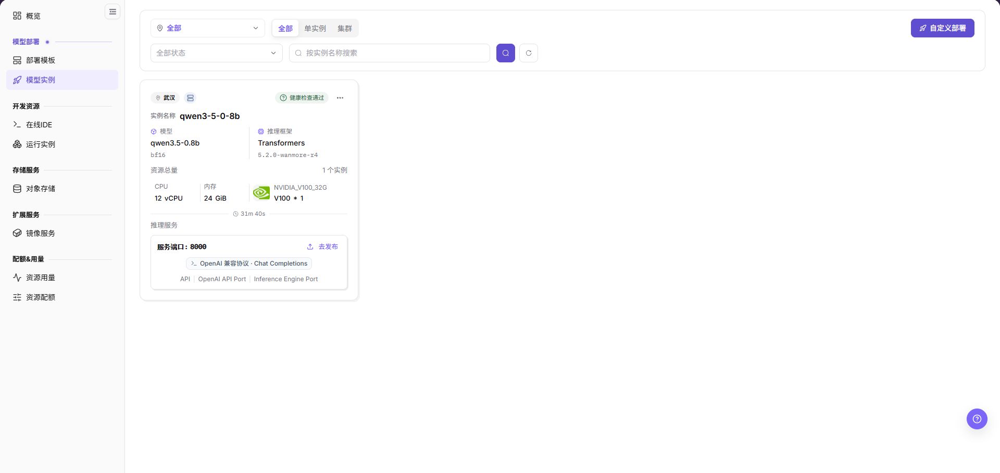

卡片展示地域标签、`推理服务已就绪` 状态、实例名称、运行时长、带精度标签的 `模型`、带版本的 `推理框架`、`资源总量` 及 CPU／内存／GPU 分配。服务入口展示 `服务端口：8000`、`OpenAI 兼容协议 · Chat Completions` 及 `API`、`OpenAI API Port`、`Inference Engine Port` 标签，并提供 `去发布` 与 `…` 菜单。

#### 页面区域

| 字段/区域 | 说明 |
| --- | --- |
| 实例类型筛选 | 在 `全部`、`单实例` 与 `集群` 之间切换。 |
| 地域与状态筛选 | 通过 `全部` 地域下拉与 `全部状态` 下拉缩小范围。 |
| 搜索区 | 在 `按实例名称搜索` 中输入关键字后使用搜索图标钮；刷新图标钮重新加载列表。 |
| 列表区 | 展示实例卡片及其状态。 |
| 详情页签 | 基本信息、任务信息、开放端口、存储挂载、日志、监控与控制台。 |

## 主要操作

### 创建自定义模型实例

#### 适用场景

需要直接从模型库创建模型服务实例，并选择部署方案、框架镜像、资源与运行配置时使用本操作。

#### 操作前确认

- 所选模型版本显示 `可部署` 标记。
- `地域与可用区` 中目标地域显示 `正常`。

#### 操作步骤

1. 进入 `On-Prem > 模型部署 > 模型实例`，点击 **自定义部署**。
2. 在 `模型库` 中使用 `搜索模型 / 作者 / 标签 / 加速卡` 搜索，选择带 `可部署` 标记的模型。
3. 在 `模型版本` 中使用 `搜索版本 / 参数量 / 推理框架` 搜索并选择版本。

模型库展示工具调用、思考模式等能力标签，右侧列出所选模型的版本。

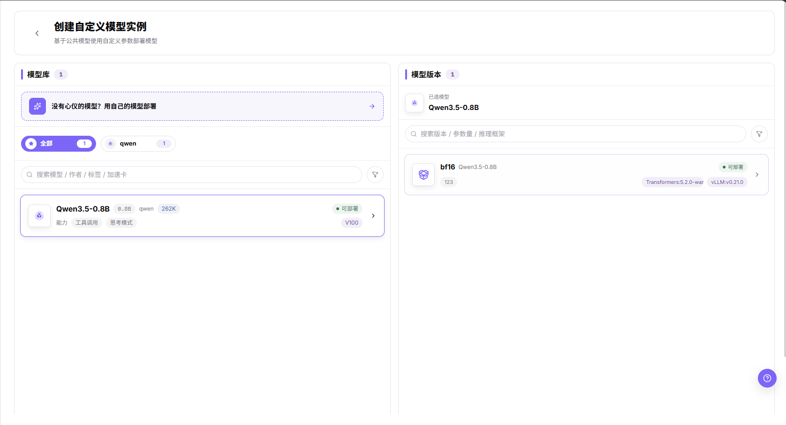

4. 在 `选择部署方案` 中选择 `单实例` 或 `集群部署`；下图表单使用单实例。
5. 选择 `选择推理框架` 下的镜像与 `选择规格` 下的规格行，核对 CPU、内存和加速卡分配；图中镜像筛选为 `全部镜像 2`。
6. 核对 `地域与可用区` 中的地域，按需配置 `挂载存储`。
7. 核对 `开放端口`，包括 `模型服务 API 端口` 的指定状态和 `API 推理协议`。
8. 检查 `环境变量` 与 `启动命令`；图中为 `3 个内置环境变量 · 0 个自定义变量`。

表单包含存储、端口、环境变量与启动命令，内置变量包括 `BASE_URL_PREFIX`、`APP_ROOT_PORT_0` 和 `APP_ROOT_PATH_0`。

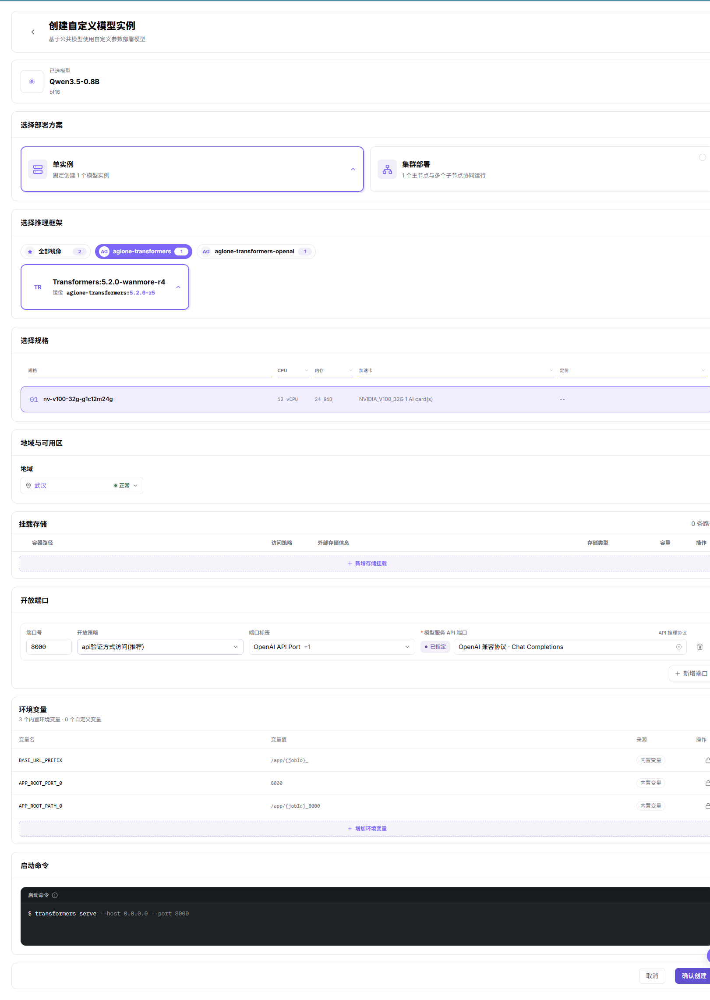

9. 核对配置及资源影响后，点击 **确认创建**。

#### 结果校验

- 提交后在列表核对实例及其状态。
- 如实例已出现，将卡片上的模型、框架与资源摘要同预期部署逐项核对。

#### 注意事项

### 查看基本信息与任务配置

#### 适用场景

排查服务问题前，核对实例的模型属性、部署信息、资源分配与运行配置。

#### 操作步骤

1. 在目标实例详情中选择 `基本信息`。
2. 读取 `模型属性`：场景、模型类型、函数/工具调用、思考模式、Token 限制、输入/输出模态、架构、注意力机制、参数规模、上下文窗口与量化精度。
3. 在 `任务实例` 中核对部署名称、项目、创建时间、更新时间、运行时长及资源配置。

基本信息将模型属性与任务实例信息分区展示，并列出 CPU、内存、存储与加速卡分配。

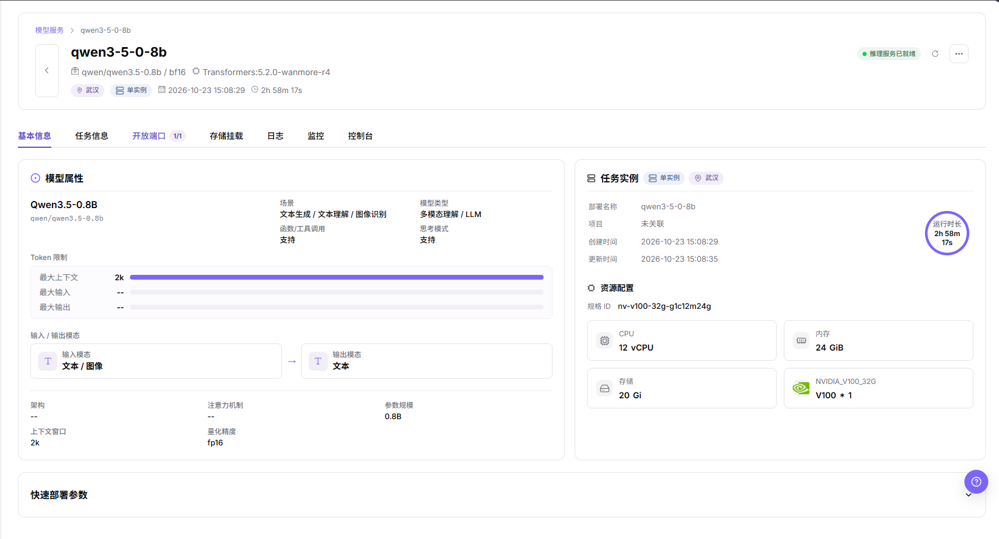

4. 选择 `任务信息`，核对基础配置中的镜像、开始时间、结束时间、项目、运行时长与规格ID。

任务配置展示所选镜像、时间字段、项目关联、运行时长与资源规格。

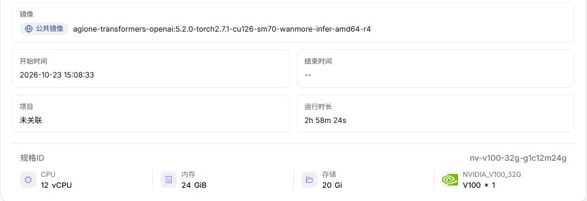

#### 结果校验

- 确认任务实例信息属于目标部署，将资源分配与预期规格核对。
- 分别读取创建时间与运行时长，前者是时间点，后者是已运行时间。

#### 注意事项

- 模型属性标签描述元数据，不能单独证明部署服务已具备某项能力。
- 页头精度标签与量化精度字段分别读取，不将二者显示值视为可互换。

### 管理开放端口

#### 适用场景

查看模型实例的端口映射，或调整映射的开放策略、标签与允许访问的来源网段。

#### 操作步骤

1. 在实例详情中选择 `开放端口`，读取访问状态、端口号、开放策略、端口标签与操作列。

端口表展示正常状态的记录及带协议的模型服务 API 端口标记。

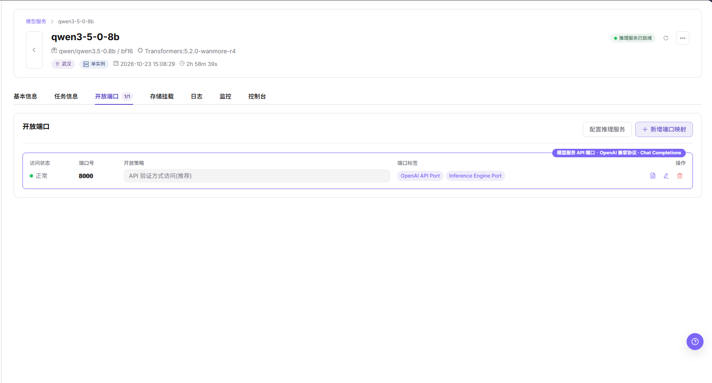

2. 点击 **新增端口映射** 打开新增端口，填写 1 到 65535 范围内的整数容器端口。
3. 选择开放策略：`Web 方式访问(推荐)`、`API 验证方式访问(推荐)`、`兼容 Web/API 验证方式访问(未验签)` 或 `直连端口转发(未验签)`。
4. 按需设置端口标签；如需限制来源，使用 **新增白名单** 添加目标 CIDR 网段，核对设置后再点击 **确定**。

新增端口对话框包含容器端口、策略卡片、端口标签、白名单、取消与确定。

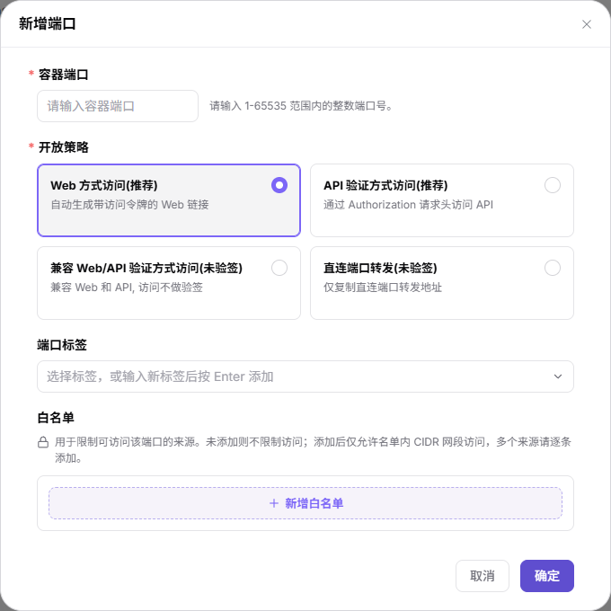

5. 修改已有记录时，使用行内铅笔图标打开编辑端口，核对策略、标签与白名单，确认访问影响后再确定。

编辑端口显示已有端口值，图中的容器端口字段为禁用状态。

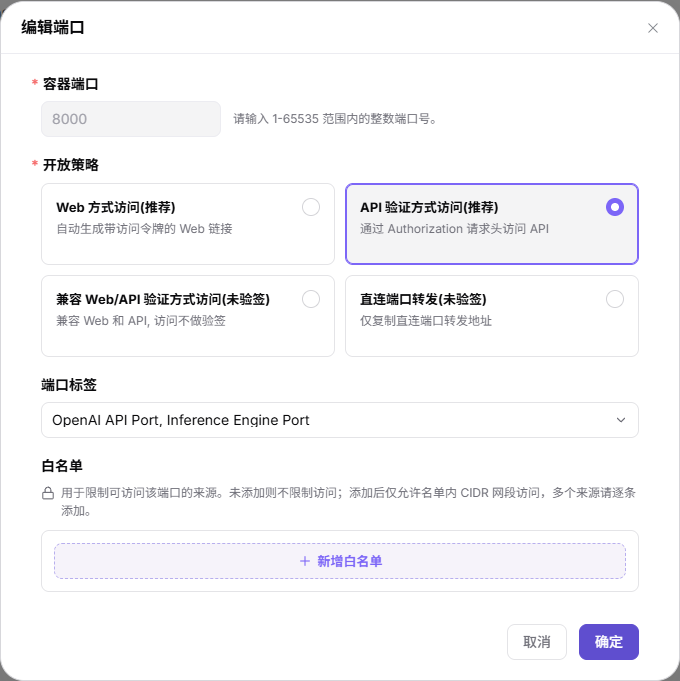

6. 点击端口行的 API 访问信息图标，打开 **API 调用信息** 浮层。其中展示服务 **Endpoint** 与所需的 **请求 Header**（`Authorization: Bearer <token>`），底部提示将该 Header 加入请求。

截图中的 Endpoint 与令牌值已脱敏，请勿复制到文档。

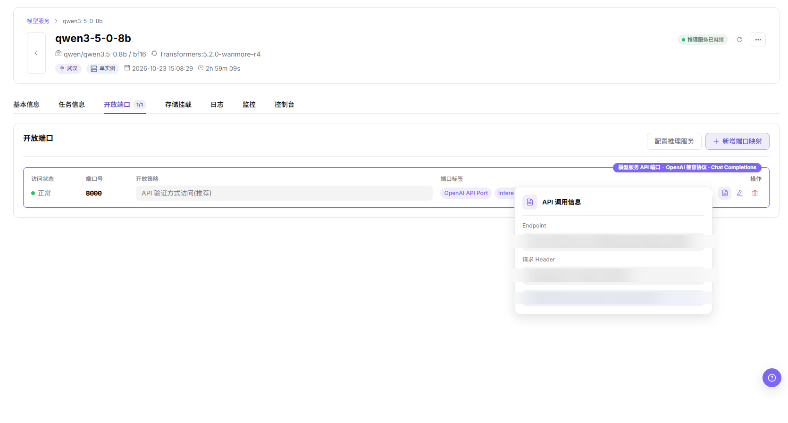

#### 结果校验

- 确定后将映射行与开放策略同预期设置核对。

#### 注意事项

- 白名单提示说明：未添加时允许所有来源，添加 CIDR 后仅允许这些网段访问；确定前核对暴露范围。
- API 调用信息浮层会展示 Endpoint 与 Bearer 令牌，两者在上方截图中均已脱敏；请勿将 Endpoint 或鉴权值复制到文档。

### 配置推理服务

#### 适用场景

发布前，选择用于模型服务 API 的开放端口，并核对 API 推理协议。

#### 操作步骤

1. 在 `开放端口` 中点击 **配置推理服务**。
2. 选择 `模型服务 API 端口`，核对 `API 推理协议`。

对话框显示端口 8000 与 OpenAI 兼容协议 · Chat Completions，并提供取消和确定。

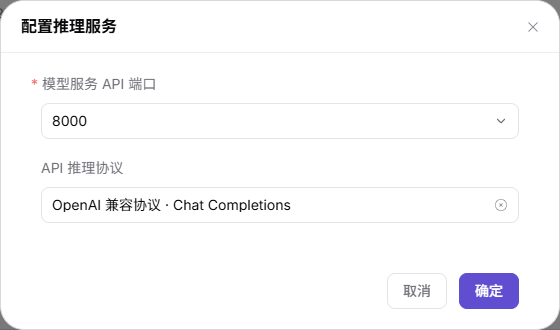

3. 核对目标端口和协议后再 **确定**；不确认时使用 **取消**。

#### 结果校验

- 将端口行的 API 端口指定标记及协议同预期配置核对。

#### 注意事项

- 此弹窗配置实例的推理服务端口与协议，不等同于发布弹窗中的调整请求配置面板。

### 管理存储挂载

#### 适用场景

查看实例关联的存储，或定位为代码、数据与输出目录新增挂载的入口。

#### 操作步骤

1. 在实例详情中选择 `存储挂载`。
2. 读取容器路径、开放策略、外部存储信息、存储类型、容量与操作列；空状态为 `暂无存储挂载`。

存储挂载页签显示空表格与新增挂载入口。

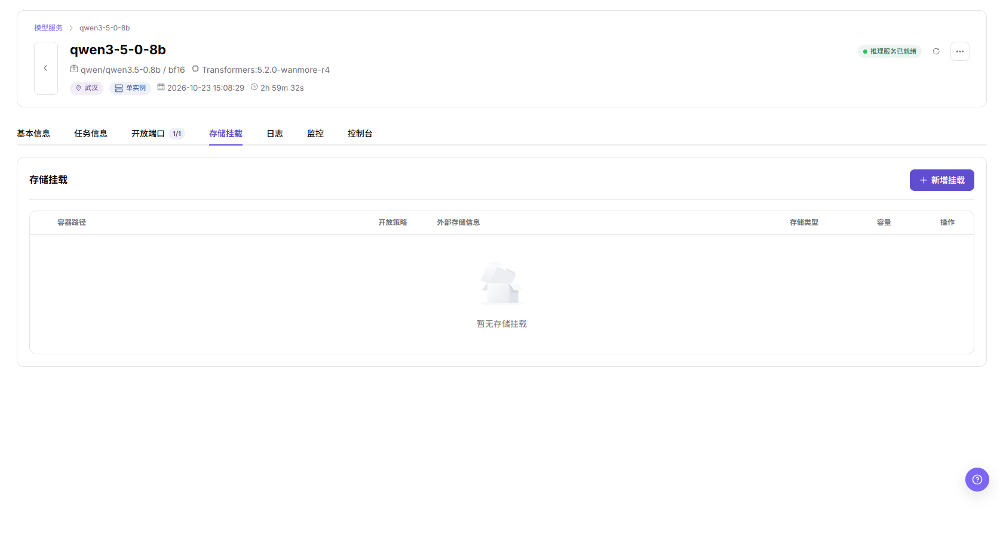

3. 如需挂载，使用 **新增挂载**。

#### 结果校验

- 空表格显示暂无存储挂载。

#### 注意事项

- 依赖挂载保存输出前，先确认目标持久化路径。

### 查看日志、监控与控制台

#### 适用场景

排查模型服务实例时，查看日志、资源图表，或定位网页终端。

#### 操作步骤

1. 选择 `日志`，查看日志来源、行数上限、输入关键字过滤日志、区分大小写、上下文与时间范围。

日志控件显示容器日志、已连接状态，以及不限时间、15 分钟、1 小时、6 小时、1 天与自定义时间范围。

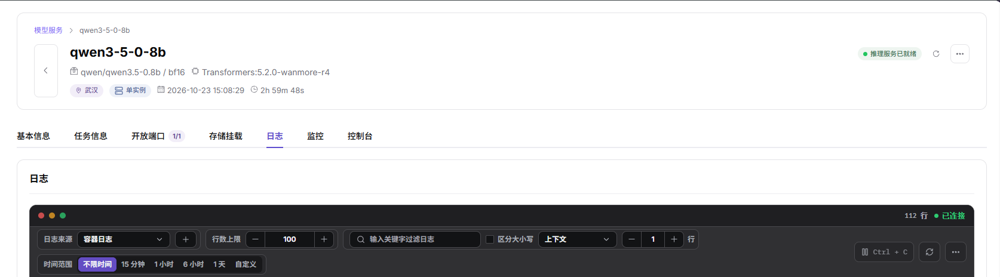

2. 选择 `监控`，子页签为 `基础监控`、`AI 加速卡监控` 与 `网络监控`；查看所选时间范围、采样间隔及实时资源消耗图表。

基础监控面板展示 CPU利用率(%)、磁盘可用量、磁盘利用率(%)、磁盘总量与内存利用率(%)。

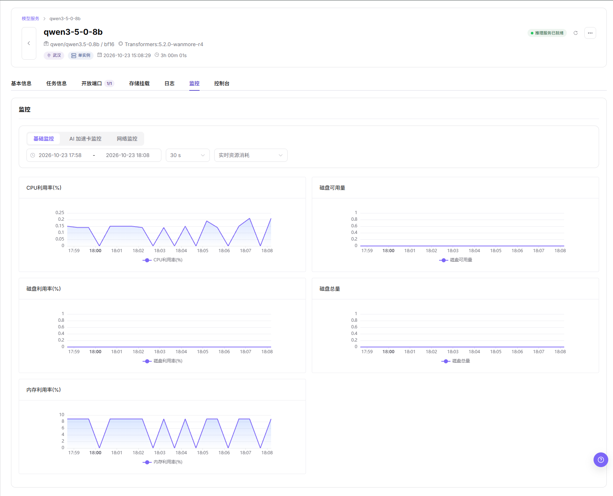

3. 选择 `控制台`，定位 `终端 1` 与 **在新标签页打开**。

控制台头部提供终端页签与新标签页入口。

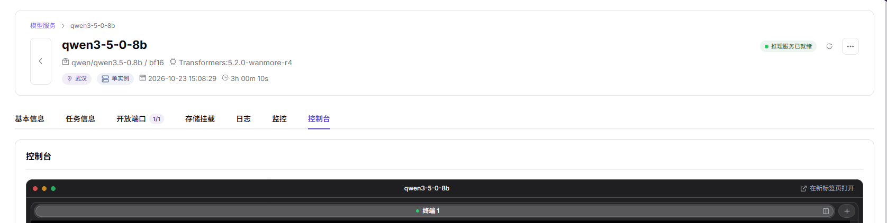

#### 结果校验

- 日志显示连接状态与行数，监控显示基础 CPU、磁盘与内存图表，控制台显示终端 1。
- 静态图表不能证明服务健康。

#### 注意事项

- 使用终端前核对命令及影响；外发日志或终端输出前，先处理凭据与敏感环境信息。
- 本节从实例详情开始，不假定列表卡片的点击动作。

### 发布模型

#### 适用场景

需要检查 API 连通性并进入模型登记，将实例推理服务发布为私有模型时使用本操作。

#### 操作前确认

- 卡片显示 `推理服务已就绪`，发布弹窗中的 `所选服务端口` 显示 `正常`。
- 冒烟检测会发送真实请求，执行前确认调用授权及请求影响。

#### 操作步骤

1. 在目标卡片上打开 `…` 菜单，选择 **发布模型**。

卡片菜单提供发布模型与删除。

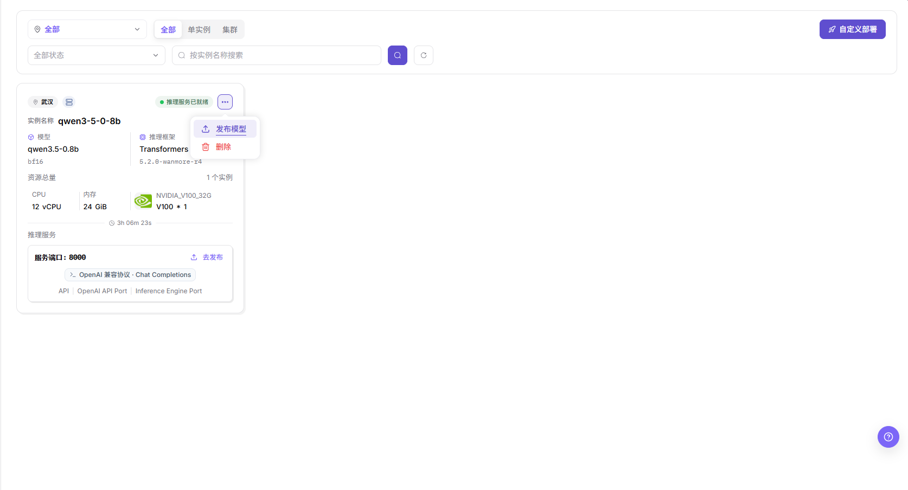

2. 在 `选择发布类型` 中查看 `私有模型` 与 `公共模型`；私有模型路径使用 **发布为私有模型**。

公共模型卡片提供联系我们入口。

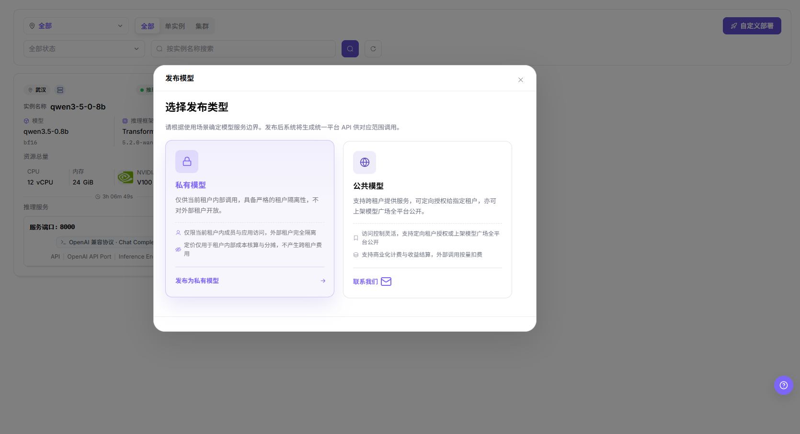

3. 在冒烟检测弹窗中核对 `所选服务端口` 和带 `已使用推理服务配置` 标记的 `推理请求协议规范`。
4. 检查 `API 连通性冒烟检测` 结果，仅在出现 **API 冒烟检测通过** 后点击 **跳转发布**。

通过提示与跳转发布入口标明可继续进入登记的阶段。

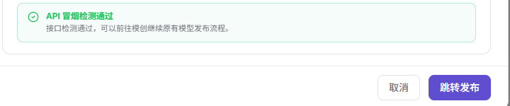

5. 在带 `私有` 标签的 `我的模型` 页面核对登记入口；向导标题为 `基本信息`、`计费配置` 和 `限流配置`。

落地页从基本信息开始；跳转到此页不代表模型已发布。

#### 结果校验

- 冒烟检测通过提示只确认检测结果，不代表模型发布完成。

#### 注意事项

- 不要外发请求凭据、内部地址或原始冒烟检测输出。
- 公共模型选项或联系我们入口可见，不代表公共模型发布流程已完成。

### 删除模型实例

#### 适用场景

需要下线不再使用的实例时，先确认服务影响，再使用本操作。

#### 操作步骤

1. 确认目标实例与业务影响，并在继续前保存所需数据。
2. 打开目标卡片的 `…` 菜单，点击 **删除**。
3. 最终动作前仔细核对屏幕上的提示。

#### 结果校验

- 仅点击菜单入口不能证明删除成功。

#### 注意事项

- 删除可能中断服务，执行前须确认业务影响。
- 本页不把 `停止` 与 `重启` 写为可执行操作。

## 参数速查表

| 字段名称 | 说明 |
| --- | --- |
| 实例名称 | 卡片展示的模型服务实例名称。 |
| 实例类型 | 列表页签为 `全部`、`单实例`、`集群`；表单提供单实例与集群部署方案。 |
| 状态 | 卡片状态，例如 `推理服务已就绪`。 |
| 模型 | 部署的模型及其精度标签。 |
| 推理框架 | 卡片展示的框架及版本。 |
| 规格 | 部署时选择的 CPU、内存与加速卡分配。 |
| 地域 | 实例所属地域，在卡片展示并在创建表单中选择。 |
| 运行时长 | 卡片展示的已运行时间，不能替代创建时间。 |
| 创建时间 | 基本信息中任务实例的创建时间点，与运行时长分开读取。 |
| 更新时间 | 基本信息中任务实例的更新时间点。 |
| 服务入口 | 端口与协议标签，以及去发布入口。 |
| 操作 | 卡片 `…` 菜单中的 `发布模型` 与 `删除`。 |

## 踩坑提示

- 找不到实例时先检查筛选与地域。
- API 冒烟检测通过并跳转我的模型，不代表发布完成。
- 不从其他资源页面推导 `停止` 与 `重启` 行为。

## 结果校验

| 检查项 | 成功表现 | 异常时处理 |
| --- | --- | --- |
| 页面入口 | 列表及所需操作可用 | 检查当前账号权限及页面提示 |
| 实例卡片 | 可看到预期实例及其模型与资源摘要 | 重置筛选并核对实例名称与地域 |
| API 冒烟检测 | 弹窗显示 `API 冒烟检测通过` | 核对服务端口、协议与检测反馈，不外发凭据 |
| 发布衔接 | 打开带私有标签的我的模型页面 | 核对跳转结果。 |

## 常见问题

#### 模型实例中找不到目标对象

**问题现象：**

列表中找不到预期的模型服务实例卡片。

**可能原因：**

筛选条件或所选地域可能排除了实例。

**处理方式：**

1. 重置状态与名称筛选。
2. 核对地域与实例类型页签。
3. 按实例名称搜索，如有创建提示则一并核对。

#### 模型实例的操作入口不可用

**问题现象：**

自定义部署或目标卡片操作不可用。

**可能原因：**

账号权限或实例状态可能不满足目标动作的要求。

**处理方式：**

1. 查看页面提示与实例状态。
2. 确认当前账号具备目标操作权限。
3. 如需调整权限，联系管理员。

#### 模型实例的必填项没有可选值

**问题现象：**

自定义部署时没有可选模型版本、框架镜像或规格。

**可能原因：**

搜索条件或可用部署配置可能限制了选项。

**处理方式：**

1. 清除对应模型或版本的搜索条件。
2. 核对所选模型、版本与地域。
3. 联系管理员核对所需部署资源。

#### 模型实例状态不符合预期

**问题现象：**

操作后卡片显示非预期状态。

**可能原因：**

处理进度或运行依赖可能需要进一步排查，不能只凭状态确定原因。

**处理方式：**

1. 记录实例名称、卡片状态与操作反馈。
2. 在任务信息、日志与监控中检查相关运行信息，不单凭状态推断原因。
3. 求助时仅提供相关且已脱敏的诊断信息。

#### 跳转后尚未完成发布

**问题现象：**

冒烟检测通过并打开我的模型，但尚未完成登记。

**可能原因：**

跳转发布只打开登记入口，不证明发布完成。

**处理方式：**

1. 确认落地页是带私有标签的我的模型。
2. 继续前确认剩余登记要求。
3. 单独核实最终结果，不将冒烟检测通过当作发布成功。

## 注意事项

- 不在文档、代码仓库或截图中保存、外发凭据、接口密钥及敏感环境信息。
- 冒烟检测前确认请求影响，删除前确认业务影响。
- 分别读取实例各页签；发布弹窗与开放端口中的请求协议设置属于不同配置区域。

## 后续操作

1. 自定义部署后，核对实例卡片及操作反馈。
2. 发布时，确认冒烟检测结果后再继续登记。
3. 排障时使用基本信息、任务信息、日志与监控。
