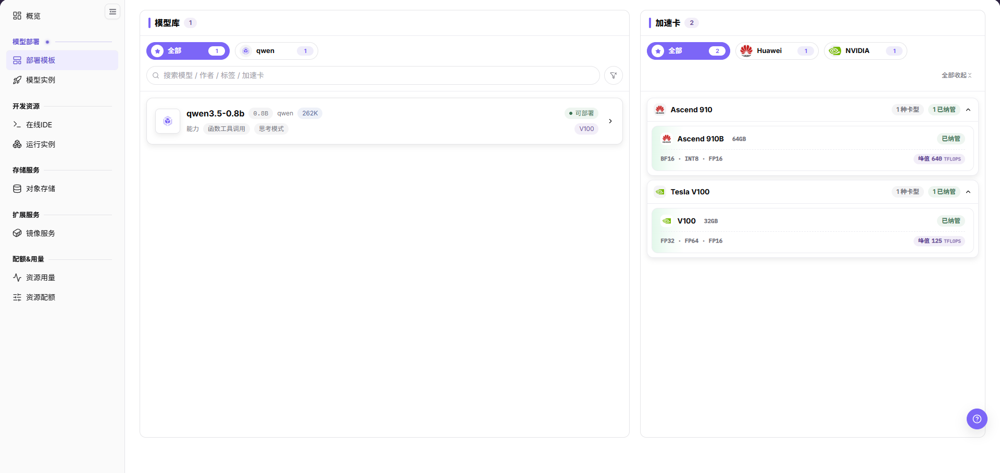
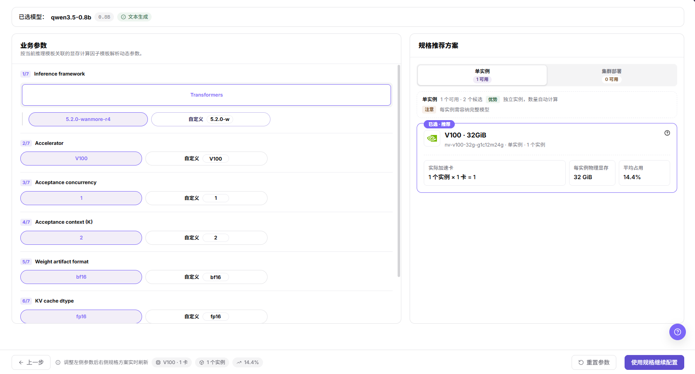
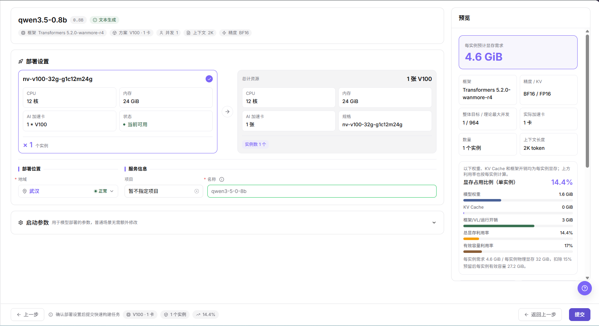
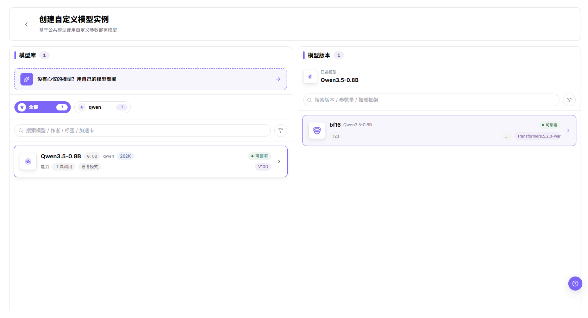

# 部署模板

## 功能概述

| 项目 | 内容 |
| --- | --- |
| 适用角色 | 模型提供方 |
| 导航路径 | On-Prem > 模型部署 > 部署模板 |
| 页面路由 | `/powerone/quickstart/inference-template` |
| 管理对象 | 模型库、加速卡、业务参数、推荐规格、部署设置和预览信息 |

#### 新手理解

模板可以理解为模型服务的点单页。用户先选模型，再查看可用加速卡和推荐规格；确实需要创建实例时，再填写部署设置，并在预览页核对后提交。

#### 术语表

| 术语 | 说明 |
| --- | --- |
| 模板 | 由运营管理员维护的可部署方案，组合模型、框架、镜像、规格、启动参数和可见范围规则。 |
| 模型库 | 展示当前用户或租户可用模型的区域。 |
| 加速卡 | 可运行所选模型的 GPU、NPU 等硬件选项。 |

#### 推荐操作顺序

先确认模型库、加速卡、业务参数、推荐规格、部署设置和预览信息的前置依赖，再按主要操作顺序处理，最后执行结果校验并进入后续页面。

#### 小白先看

先确认当前任务是否涉及模型库、加速卡、业务参数、推荐规格、部署设置和预览信息，再按照推荐顺序操作。页面字段或状态与预期不符时，先回到前置对象页核对依赖，不要跳过结果校验直接进入下游流程。

## 前提条件

1. 运营管理员已发布至少一个当前租户可见的模板。
2. 当前租户在目标地域下有可用配额。
3. 模板依赖的镜像、加速卡、规格和框架参数已由运营管理员配置完成。
4. 如果部署会暴露服务，创建实例前应确认访问范围和安全策略。

## 页面说明

页面用于查看和处理模型库、加速卡、业务参数、推荐规格、部署设置和预览信息。

页面按向导展示模型库、加速卡、业务参数、推荐规格、部署设置和预览信息。截图中展示了部署模板列表区域。

#### 页面区域

| 字段/区域 | 说明 |
| --- | --- |
| 模型库 | 按模型厂商和模型名称展示可部署模型。 |
| 加速卡 | 展示加速卡厂商、型号、显存、适配状态和峰值能力。 |
| 业务参数 | 展示模型能力、上下文、启动或运行参数等需要确认的信息。 |
| 推荐规格 | 展示可选实例形态和推荐资源规格。 |
| 部署设置 | 用于填写实例名称、地域、规格、启动参数等部署信息。 |
| 预览 | 提交前汇总本次选择的部署配置。 |

## 主要操作

### 查看部署模板

#### 适用场景

- 在发起部署前，需要找到可部署模型并确认哪些加速卡能运行该模型时使用本入口。

#### 操作步骤

1. 进入 `模型部署 > 部署模板`。
2. 在 `模型库` 通过厂商页签、`搜索模型 / 作者 / 标签 / 加速卡` 输入框、`默认排序` 或 `清空筛选` 缩小范围。
3. 核对模型卡片中的模型名称、参数量、厂商、上下文长度、`能力` 标签和 `可部署` 状态。点选卡片后，向导会把 `模型库` 列表整体替换为 `已选模型：qwen3.5-0.8b 0.8B 文本生成` 汇总条，屏上不再留下描边卡片。
4. 在 `加速卡` 通过厂商页签缩小范围，再用 `展开全部` 或 `全部收起` 查看卡型分组。
5. 核对每个卡型分组的卡型名称、显存容量、`已纳管` 或 `未纳管` 状态、支持的精度和 `峰值 … TFLOPS` 数值。
6. 在向导中核对模型版本、资源规格与副本数量。本步画面不出现镜像、端口、存储三项；它们只属于自定义部署流程（`选择推理框架` 的 `全部镜像` 列表、`开放端口`、`挂载存储`）。

#### 结果校验

- 模型列表返回目标模型且状态为 `可部署`，加速卡面板至少返回一个卡型分组。
- 列表为空时先清空筛选，再确认当前选中的是哪个厂商页签。

#### 注意事项

- `未纳管` 的加速卡可能无法直接部署。
- `模型库` 和 `加速卡` 旁的计数是当前账号可见的记录数，不是平台总量。

### 复核部署参数和费用

#### 适用场景

- 选定模型后，在占用资源前确认业务参数并比较推荐规格时使用本入口。

#### 操作步骤

1. 核对 `已选模型：` 一行回显的模型名称、参数量和 `文本生成` 等能力标识。
2. 在 `业务参数` 按编号逐项确认，依次为 `1/7 Inference framework`、`2/7 Accelerator`、`3/7 Acceptance concurrency`、`4/7 Acceptance context (K)`、`5/7 Weight artifact format`、`6/7 KV cache dtype` 和 `7/7 Planning headroom (%)`（本画面参数标签为英文）。
3. 为每个参数选择与业务负载匹配的选项。每行参数在解析值旁提供 `自定义` 输入项，如 `自定义 V100` 和 `自定义 bf16`。
4. 在 `规格推荐方案` 切换 `单实例` 和 `集群部署`，比较各页签下方标注的可用数量，如 `1 可用` 与 `0 可用`。本画面未出现 `多实例部署` 页签。
5. 阅读所选页签的 `优势` 与 `注意` 说明，如 `独立实例，数量自动计算` 与 `每实例需容纳完整模型`，再横向比较各候选卡片的 `实际加速卡`、`每实例物理显存` 和 `平均占用`。

下图为业务参数与规格推荐方案并列的画面。

6. 执行最终部署动作前确认资源和费用影响，并取得授权后再部署。

#### 结果校验

- 修改左侧任一参数后，右侧列表随之刷新，与页面提示 `调整左侧参数后右侧规格方案实时刷新` 一致。
- 至少有一个规格卡片可选，且所选卡片标有 `已选 · 推荐`。

#### 注意事项

- 各页签的可用数量均为 0 时，优先检查加速卡适配、资源规格、配额和地域；向导刚打开时先等列表加载完成再判定，加载过程中的 `0 可用` 与 `等待业务参数加载完成` 属瞬态，不是稳态无可用规格。
- 适配该模型的规格仍可能超出当前租户配额；提交前页面不会预留资源。

### 部署模板

#### 适用场景

- 将已选的模型、业务参数和规格转为运行中的模型实例时使用本入口。

#### 操作前确认

1. 确认当前账号可以进入 `模型部署 > 部署模板`。
2. 本页面顶栏不提供全局租户或地域选择器，切换器只在 `On-Cloud` 与 `On-Prem` 之间切换；地域在部署表单内作为必填项确认。

#### 操作步骤

1. 在已选模型栏核对 `框架 Transformers 5.2.0-wanmore-r4`、`方案 V100 · 1 卡`、`并发 1`、`上下文 2K` 和 `精度 BF16` 汇总标签。
2. 在 `部署设置` 核对规格卡片的 `CPU 12 核`、`内存 24 GiB`、`AI 加速卡 1 * V100` 和 `状态`（如 `当前可用`）。本画面未出现 `切换规格` 按钮。
3. 在 `总计资源` 面板核对汇总后的 `CPU`、`内存`、`AI 加速卡`、`规格` 和 `实例数`，如 `1 张` 与 `nv-v100-32g-g1c12m24g`。
4. 在 `部署位置` 设置 `地域`（如 `武汉`）并确认其状态，再按需要设置 `项目`；默认值为 `暂不指定项目`。本画面未出现 `可用区` 字段；它出现在自定义部署流程的 `地域与可用区` 分区。
5. 在 `服务信息` 核对必填的 `名称`，只有在带出的值不适用时才展开 `启动参数` 调整；该区提示为 `用于模型部署的参数，普通场景无需额外修改`。
6. 在 `预览` 面板核对 `每实例预计显存需求`、`框架`、`精度 / KV`、`整体目标 / 理论最大并发`、`实际加速卡`、`数量`、`上下文长度`、`显存占用比例（单实例）`、`模型权重`、`KV Cache`、`框架/VL/运行开销`、`总显存利用率` 和 `有效容量利用率`。
7. 阅读每实例口径说明 `以下权重、KV Cache 和框架开销均为每实例显存；上方利用率也按每实例计算。`，其下方一行逐字为 `每实例需求 4.6 GiB / 每实例物理显存 32 GiB，扣除 15% 预留后每实例有效容量 27.2 GiB。`
8. 阅读底部提示 `确认部署设置后提交快速构建任务`，再点击 `提交`。需要回改时用 `上一步` 或 `返回上一步`。

下图为同一次提交的部署设置与预览画面。

#### 结果校验

- 提交前，所选规格卡片的 `状态` 显示为 `当前可用`。
- 提交后，实例出现在模型实例页，且配置与 `预览` 面板一致。

#### 注意事项

- 模板参数由运营管理员维护，不要随意修改启动参数，错误参数可能导致模型服务启动失败。
- `名称` 输入框按模型名带出默认值，请按本方命名规范替换生成的默认值。

### 创建自定义模型实例（选择模型与版本）

#### 适用场景

- 需要的模型不在列表内，或要用自定义参数部署公共模型时使用本入口。

#### 操作步骤

1. 打开 `自定义部署` 入口。
2. 在 `创建自定义模型实例` 页阅读副标题 `基于公共模型使用自定义参数部署模型`。
3. 在 `模型库` 通过厂商页签和 `搜索模型 / 作者 / 标签 / 加速卡` 输入框缩小范围。
4. 核对模型卡片的模型名称、参数量、厂商、上下文长度、`能力` 下的 `工具调用` 与 `思考模式` 标签，以及 `可部署` 状态。选中卡片后卡片出现描边并高亮标题。
5. 没有合适模型时，用引导条 `没有心仪的模型？用自己的模型部署` 转到自己的模型。
6. 在 `模型版本` 核对 `已选模型` 一行，用 `搜索版本 / 参数量 / 推理框架` 缩小范围，再按精度标签、参数量和框架标识选择版本卡片。

下图为本步的模型库与模型版本画面。

#### 结果校验

- 右栏 `已选模型` 一行与左栏所选模型一致。
- 所选版本卡片显示 `可部署` 状态。

#### 注意事项

- 在本次采集的窗口宽度下，版本卡片的框架标识已在自身框内被裁断：屏上为 `Transformers:5.2.0-war`，完整标识是 `Transformers:5.2.0-wanmore-r4`，其右缘没有省略号字形。
- `模型库` 与 `模型版本` 旁的计数是当前账号可见的记录数。

### 创建自定义模型实例（配置与提交）

#### 适用场景

- 模型和版本选定后，完成部署配置并创建实例时使用本入口。

#### 操作步骤

1. 在 `选择部署方案` 选择 `单实例` 或 `集群部署`；集群方案下核对 `主节点数量` 和 `子节点数量`。
2. 在 `选择推理框架` 用 `全部镜像` 与厂商页签筛选，再选中一张框架卡片。
3. 在 `选择规格` 表格比较 `规格`、`CPU`、`内存`、`加速卡` 和 `定价` 并选择一行。
4. 在 `地域与可用区` 选择地域，并确认其状态为 `正常`。
5. 在 `挂载存储`、`开放端口`、`环境变量` 和 `启动命令` 各区核对带出的默认值，再创建实例。
6. 阅读 `启动命令` 生成的命令行，然后点击 `确认创建`。

以上分区名逐字取自本步中文画面。

#### 结果校验

- 提交前，所选框架卡片与所选规格行保持选中态。
- 创建后，新实例出现在模型实例页。

#### 注意事项

- 本画面 `定价` 单元格为 `--`，不代表所有规格的定价均为空。
- 页面内 `挂载存储` 汇总为 `0 条路径`；截图里该值右端被应用外浮动控件压住，属取证限制，不是产品缺陷。

## 参数速查表

| 字段名称 | 是否必填 | 字段类型 | 说明 |
| --- | --- | --- | --- |
| 模板名称 | 系统生成 | 文本 | 平台展示的可部署模板名称。 |
| 模型 | 必填 | 选择项 | 从模型库中选择的目标模型。 |
| 加速卡 | 必填 | 选择项 | 本次部署使用的加速卡厂商和型号。 |
| 业务参数 | 取决于模板 | 表单字段 | 模板维护的模型能力、上下文、启动或运行参数。 |
| 推荐规格 | 必填 | 选择项 | 模板推荐或允许选择的资源规格。 |
| 地域 | 创建实例时必填 | 选择项 | 模型实例将要创建到的地域或资源池。 |
| 实例名称 | 创建实例时必填 | 文本 | 将要创建的模型实例名称。文档中不要使用真实客户或敏感名称。 |
| 启动参数 | 取决于模板 | 文本或表单字段 | 模板带出的启动参数，只有在明确业务需要时才调整。 |
| 状态 | 系统生成 | 枚举 | 模板或当前选择项是否可用于创建实例。 |

## 踩坑提示

- 加速卡显示 `未适配` 或 `未纳管` 时，可能无法直接部署。
- 推荐规格为空时，优先检查加速卡适配、资源规格、配额和地域。
- `提交` 与 `确认创建` 是本页面画面上的高风险最终动作，取证期间均未执行。`确定` 只出现在切换配置前清空不兼容下游配置的弹窗里，不是部署动作。

## 结果校验

| 检查项 | 成功表现 | 异常时处理 |
| --- | --- | --- |
| 页面入口 | 可进入部署模板并看到目标操作入口 | 检查运营管理员权限和对应菜单是否已开放 |
| 对象记录 | 模型库、加速卡、业务参数、推荐规格、部署设置和预览信息在列表或详情中可见 | 重置筛选并核对名称、所属范围和创建结果 |
| 状态结果 | 新增或变更后的状态符合页面提示 | 查看操作提示、依赖对象状态和最近更新时间 |
| 下游使用 | 后续页面能够选择或关联目标对象 | 回到前置配置核对启用状态、归属关系和可见范围 |

## 常见问题

#### 部署模板中找不到目标对象

**问题现象：**

页面可进入，但没有看到预期的模型库、加速卡、业务参数、推荐规格、部署设置和预览信息。

**可能原因：**

- 筛选条件仍生效。
- 对象属于其他范围。
- 前置配置未完成。

**处理方式：**

1. 重置筛选
2. 核对所属地域或租户
3. 返回前置页面确认对象状态。

#### 部署模板的操作入口不可用

**问题现象：**

新增、注册或维护入口不可见或不可点击。

**可能原因：**

- 当前角色权限不足。
- 页面处于只读状态。
- 依赖对象不满足条件。

**处理方式：**

1. 检查运营管理员权限
2. 核对页面提示
3. 先完成依赖对象配置。

#### 部署模板的必填项没有可选值

**问题现象：**

表单能打开，但下拉框为空。

**可能原因：**

- 候选对象未启用。
- 所属范围不一致。
- 当前账号不可见。

**处理方式：**

1. 到候选对象页面核对状态
2. 确认归属关系
3. 检查可见范围后刷新表单。

#### 部署模板操作后状态异常

**问题现象：**

提交后记录存在，但状态不是预期值。

**可能原因：**

- 连通性或校验失败。
- 关联对象异常。
- 后台处理尚未完成。

**处理方式：**

1. 查看页面提示和更新时间
2. 检查关联对象
3. 按状态阶段排查处理任务。

#### 下游页面无法使用部署模板

**问题现象：**

当前页状态正常，但下游页面无法选择或关联模型库、加速卡、业务参数、推荐规格、部署设置和预览信息。

**可能原因：**

- 可见范围不匹配。
- 对象未启用。
- 下游缓存未刷新。

**处理方式：**

1. 核对启用状态和归属
2. 检查角色可见范围
3. 刷新下游页面并重新选择。

## 注意事项

- 通过模板部署可能创建真实模型实例、占用资源并产生用量，提交前必须确认实例名称、地域、规格和运行周期。
- 截图或工单中不要包含内部服务地址、访问密钥、Endpoint、敏感启动参数、日志或客户信息。
- 模板、规格和加速卡由运营管理员维护。用户侧无法选择目标项时，应联合运营管理员核对发布范围、租户可见性、配额和资源池状态。

## 后续操作

1. 进入 [模型实例](../instances/) 查看实例状态。
2. 进入 [资源用量](../../quotas-usage/usage/) 或 [资源配额](../../quotas-usage/quotas/) 复核配额和用量变化。
