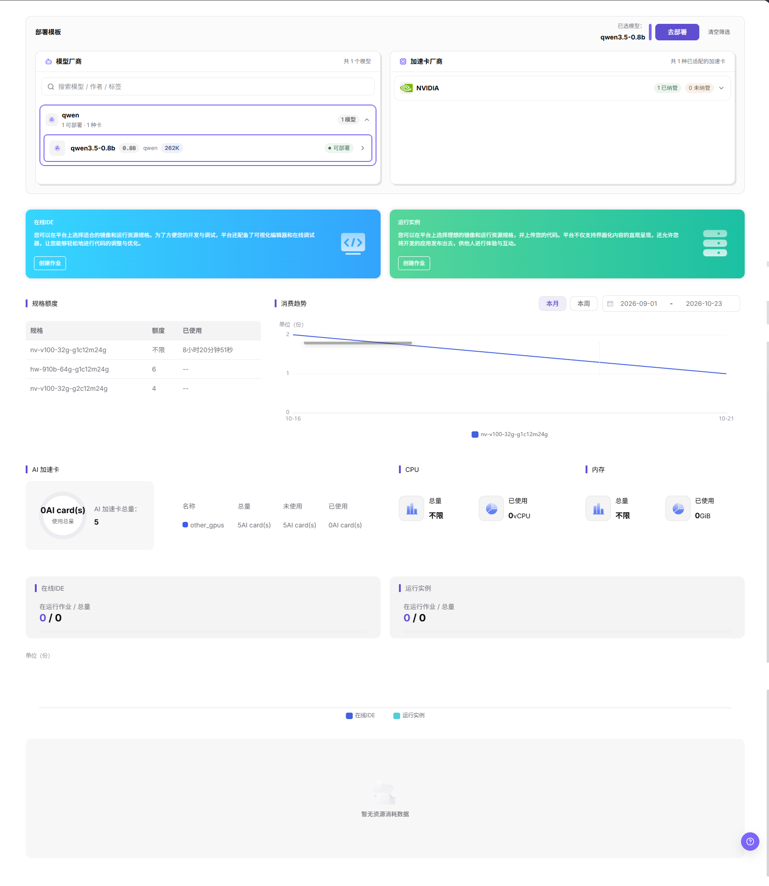
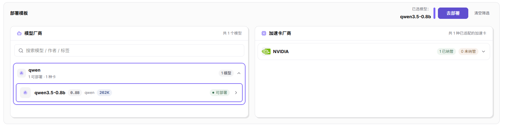
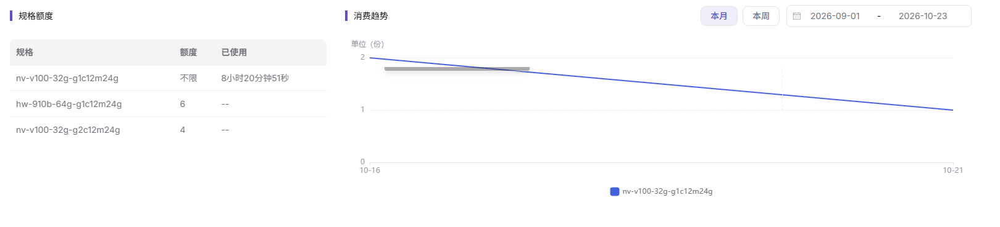

# 概览

## 功能概述

| 项目 | 内容 |
| --- | --- |
| 适用角色 | 模型提供方、模型调用方 |
| 导航路径 | On-Prem > 概览 |
| 页面路由 | `/powerone/overview` |
| 管理对象 | 部署模板、加速卡资源、快速入口、规格配额、资源用量趋势 |

#### 新手理解

概览页像异构卡纳管用户控制台的首页：上半部分告诉你当前能部署哪些模型、有哪些加速卡；中部提供在线 IDE 和运行实例的快捷入口；下方帮助你确认配额是否足够、资源有没有消费记录。

#### 术语表

| 术语 | 说明 |
| --- | --- |
| 规格 | 作业可申请的资源套餐，例如 CPU、内存、GPU 型号和卡数。 |
| 配额 | 租户可使用的资源上限，常见维度包括 GPU、CPU、内存和规格。 |
| 加速卡 | GPU、NPU 等 AI 计算设备，页面按厂商和型号展示。 |

#### 推荐操作顺序

1. 进入 `On-Prem > 概览`。
2. 查看 `部署模板`，确认是否有可部署模型。
3. 查看 `加速卡厂商`，确认当前资源池支持的加速卡类型。
4. 通过 `在线IDE` 或 `运行实例` 卡片进入创建流程。
5. 查看 `规格额度`、`消费趋势` 与资源用量面板，确认是否具备创建作业所需资源条件。

#### 小白先看

先确认当前任务是否涉及部署模板、加速卡资源、快速入口、规格配额、资源用量趋势，再按照推荐顺序操作。页面字段或状态与预期不符时，先回到前置对象页核对依赖，不要跳过结果校验直接进入下游流程。

## 前提条件

1. 当前账号能进入 `异构卡纳管` 子系统。
2. 运营管理员已为租户开放可见的地域、可用区、集群、规格和模板。
3. 如需创建在线 IDE、运行实例或模型实例，账号需要具备对应创建权限和可用配额。

## 页面说明

页面用于查看和处理部署模板、加速卡资源、快速入口、规格配额、资源用量趋势。

页面上方展示部署模板和加速卡厂商；中部提供在线IDE、运行实例两张快速入口卡片；下方展示规格额度、消费趋势和资源用量面板。下图为页面内容区的整页纵向画面，不含左侧固定菜单。

#### 页面区域

| 字段/区域 | 说明 |
| --- | --- |
| 部署模板 | 展示可部署模型和部署入口，未选择模型时部署按钮通常不可用。 |
| 加速卡厂商 | 按厂商展示加速卡型号与适配状态。中文画面可见 `NVIDIA`，英文画面另可见 `Huawei`。 |
| 快速入口 | `在线IDE` 与 `运行实例` 两张卡片各提供 `创建作业` 入口。 |
| 规格额度（Specification Quota） | 以 `规格`、`额度`、`已使用` 三列展示规格级上限与已用量。 |
| 消费趋势（Consumption Trend） | 展示当前周期的消费趋势，并提供 `本月`／`本周` 切换与日期区间；若没有作业消费则显示空态。 |
| 资源用量 | 展示 `AI 加速卡`、`CPU`、`内存`、`在线IDE`、`运行实例` 五块面板的总量与已用量。 |

## 主要操作

本节按页面区域组织。每个区域只写功能操作，配图紧跟其所支撑的步骤。

### 查看可部署模型

#### 适用场景

需要在 `部署模板` 区域确认当前租户可部署哪些模型，并进入部署入口时，在本区域操作。

#### 操作步骤

1. 进入 `On-Prem > 概览`。
2. 在 `模型厂商` 列表核对厂商行与其计数，例如 `qwen` 行显示 `1 可部署 · 1 种卡` 与 `1 模型`。
3. 展开厂商行读取模型行。模型行给出参数标签与状态，例如 `qwen3.5-0.8b` 带 `0.8B`、`qwen`、`262K`，状态为 `可部署`。
4. 用 `搜索模型 / 作者 / 标签` 输入框筛选列表，用 `清空筛选` 恢复全量列表。
5. 点击模型行行末的 `>` 可进入该模型的详情视图。选中模型后，区域右上角显示 `已选模型：` 与所选模型名，`去部署` 随之可点击。

下图为 `部署模板` 区域特写，可逐条对齐上述厂商计数、模型标签、状态文案与部署入口。

#### 结果校验

- 厂商行、模型行与状态文案全部可见，可部署模型的状态读作 `可部署`。
- 在 `搜索模型 / 作者 / 标签` 输入关键词后，`模型厂商` 的计数随之变化，点击 `清空筛选` 后恢复完整列表。

#### 注意事项

- 本次画面已选中 `qwen3.5-0.8b`，故 `去部署` 呈可点击态。
- 厂商行与模型行的数量、型号来自运营管理员为该租户开放的配置，模型提供方与模型调用方无法在概览页修改。
- 旧版配图中的 `展开剩余 13 模型` 折叠行在本次采样画面中不存在（本次模型总数为 1），不得据旧图书写。

### 查看加速卡厂商

#### 适用场景

需要在 `加速卡厂商` 区域确认当前资源池已适配哪些加速卡类型，以及卡型是否已纳管时，在本区域查看。

#### 操作步骤

1. 在 `加速卡厂商` 标题右侧读取已适配数量，本次画面为 `共 1 种已适配的加速卡`。
2. 在每个厂商行读取两枚计数，本次画面的 `NVIDIA` 行显示 `1 已纳管` 与 `0 未纳管`。
3. 展开厂商行读取卡型行，卡型行给出型号、显存与纳管状态，其下一行为精度串与算力峰值。

#### 结果校验

- 已适配数量与厂商行计数同时可见，且厂商行的箭头方向与其折叠态一致。
- 卡型行的型号、显存、纳管状态三项在同一行内可读，精度串与峰值算力位于该行下方。

#### 注意事项

- 本次画面 `NVIDIA` 行处于折叠态；英文画面可证该结构为型号＋显存＋`Managed`＋精度串＋`Peak … TFLOPS`。
- 本节不描述卡型行行末的详情入口。
- 厂商行随接入的加速卡类型而异，以页面实际显示为准。

### 通过快速入口创建作业

#### 适用场景

需要从概览页直接进入交互式开发环境或运行实例的作业创建流程时，使用中部两张快速入口卡片。

#### 操作步骤

1. 在页面中部确认两张卡片：蓝色 `在线IDE` 卡片与绿色 `运行实例` 卡片，每张卡片内含一段说明文案与一枚 `创建作业` 按钮。
2. 点击 `在线IDE` 卡片内的 `创建作业`，进入在线开发环境的创建流程。
3. 点击 `运行实例` 卡片内的 `创建作业`，进入运行实例的创建流程。

#### 结果校验

- 两张卡片与其内的 `创建作业` 按钮同时可见，卡片标题与左侧菜单的 `在线IDE`、`运行实例` 两项逐字一致。
- 点击后页面离开概览页；概览页本身不显示创建结果。

#### 注意事项

- 本节不书写两个创建流程的目标表单字段与提交细节。
- 卡片只是入口，不替代 `模型部署 > 模型实例` 与 `开发资源` 下的对应页面。
- 创建是否成功还取决于额度与资源余量，先按本页 `规格额度` 与资源用量面板核对。

### 查看规格额度与消费趋势

#### 适用场景

需要确认各规格可申请的上限与已用量，以及当前统计周期的消费走势时，在下半屏的 `规格额度` 与 `消费趋势` 两块查看。

#### 操作步骤

1. 在 `规格额度` 表读取三列：`规格`、`额度`、`已使用`。
2. 核对额度取值形态：不限额显示为 `不限`，有限额显示为数字，例如 `6` 与 `4`。
3. 核对已使用形态：无消耗记录显示为 `--`，有消耗记录以时长显示，例如 `8小时20分钟51秒`。
4. 在 `消费趋势` 右上角切换 `本月` 与 `本周`，并核对日期区间例如 `2026-09-01` - `2026-10-23`；纵轴单位为 `单位（份）`，图例按规格名给出，例如 `nv-v100-32g-g1c12m24g`。

下图覆盖规格额度与消费趋势所在区域，可逐条对齐规格额度三列、消费趋势的周期切换与规格图例。

#### 结果校验

- 切换 `本月` 与 `本周` 后日期区间随周期变化，图例中的规格名与 `规格额度` 表内规格行可一一对应。
- `额度` 与 `已使用` 两列的取值形态在同一屏内保持一致，不出现同一列混用数字与时长。

#### 注意事项

- 页面底部 `单位（份）` 图给出 `暂无资源消耗数据`；趋势为空不等于额度为 0，需回到 `配额&用量 > 资源用量` 复核。
- 概览页的统计范围与筛选以页面实际显示为准。

### 查看资源用量面板

#### 适用场景

需要确认加速卡、CPU、内存与两类作业当前的总量与已用量时，在下半屏的资源用量面板查看。

#### 操作步骤

1. 在 `AI 加速卡` 面板核对环形中心的用量读数与 `使用总量` 标签，以及面板标题行的 `AI 加速卡总量：5`。
2. 在同一面板的明细表读取四列：`名称`、`总量`、`未使用`、`已使用`，例如 `other_gpus` 行显示 `5 AI card(s)`、`5 AI card(s)`、`0 AI card(s)`。
3. 在 `CPU` 面板核对 `总量` 为 `不限`、`已使用` 为 `0vCPU`。
4. 在 `内存` 面板核对 `总量` 为 `不限`、`已使用` 为 `0GiB`。
5. 在 `在线IDE` 与 `运行实例` 两块面板分别核对 `在运行作业 / 总量`，本次画面均为 `0 / 0`；面板区底部给出空态 `暂无资源消耗数据`。

#### 结果校验

- 五块面板的标题与取值同时可见，且 `AI 加速卡` 明细表的卡数单位统一为 `AI card(s)`。
- 环形读数、明细表与面板标题三处的总量口径一致，不出现同一资源在不同位置给出不同总量。

#### 注意事项

- 旧版配图的面板标题为 `显卡` 与 `AI 加速卡总量：不限`，本次为 `AI 加速卡` 与 `AI 加速卡总量：5`，属版本差异，正文以本次画面为准。
- 面板只给汇总值，单卡与单作业的明细需到 `监控` 下的对应页面复核。

### 排查配额或资源异常

#### 适用场景

部署入口不可用、目标规格无法申请，或实例创建后调度失败时，先在本页定位是额度不足还是资源不足。

#### 操作步骤

1. 回到 `规格额度` 表记录目标规格行及其 `额度` 与 `已使用` 取值，并记录所属厂商与卡型。
2. 前往 `配额&用量 > 资源用量` 核对当前租户或项目的具体分配额度与消耗记录。
3. 若额度充足但实例仍调度失败，结合 `监控 > 统计概览`、`集群统计`、`节点统计` 与 `设备监控` 核对物理卡是否已被全部占用。

#### 结果校验

- 能在 `规格额度` 表内定位到目标规格行，且该行的额度与已用量与 `配额&用量 > 资源用量` 的记录可对应。
- 概览页的加速卡用量读数与 `监控` 侧的设备统计在同一时间范围内不出现方向性矛盾。

#### 注意事项

- 额度充足不等于集群一定有空闲资源，创建失败时还需核对可用区与规格。
- 概览数据可能存在统计延迟，排障应进入实例详情、监控或额度页面复核，不以本页汇总值定论。
- 本页不提供额度调整入口，额度变更由运营管理员在运营侧完成。

## 参数速查表

| 字段名称 | 是否必填 | 字段类型 | 示例 | 说明 |
| --- | --- | --- | --- | --- |
| 地域 | 否 | 下拉选择 | `示例地域` | 概览统计地域。 |
| 资源类型 | 否 | 枚举 | `示例资源类型` | 概览资源类别。 |
| 配额 | 系统生成 | 数字 | `示例额度` | 当前账号可用配额。 |
| 已用量 | 系统生成 | 数字 | `示例已用量` | 当前已使用资源量。 |
| 更新时间 | 系统生成 | 日期时间 | `示例更新时间` | 概览数据更新时间。 |

## 踩坑提示

- 部署按钮不可用时，通常是尚未选中模型或加速卡。
- 配额充足不等于集群一定有空闲资源，创建失败时还需查看地域、可用区和规格。

- 不记录真实租户、地域、集群、规格、资源用量、消费数据或测试参数。
- 概览数据可能存在统计延迟，排障应进入实例详情、监控或配额页面复核。

## 结果校验

| 检查项 | 成功表现 | 异常时处理 |
| --- | --- | --- |
| 页面入口 | 可进入概览并看到筛选或统计区域 | 检查菜单权限、当前业务身份和所属租户范围 |
| 数据范围 | 列表或统计与所选时间、地域和对象一致 | 重置筛选并核对时间边界、时区和统计口径 |
| 数据更新 | 更新时间或最新记录符合预期周期 | 到来源页核对任务、计量或配额记录是否已生成 |
| 交叉核对 | 部署模板、加速卡资源、快速入口、规格配额、资源用量趋势可与详情、账单或监控记录对应 | 按对象标识和时间范围到对应详情页逐项比对 |

## 常见问题

#### 概览没有记录

**问题现象：**

页面正常打开，但列表或统计为空。

**可能原因：**

- 筛选范围过窄。
- 来源记录尚未生成。
- 当前角色不可见。

**处理方式：**

1. 重置筛选
2. 核对来源任务或计量周期
3. 检查当前业务身份和租户范围。

#### 概览范围不正确

**问题现象：**

显示的数据不属于预期时间、地域或对象。

**可能原因：**

- 时间边界不一致。
- 地域筛选未生效。
- 对象归属已变化。

**处理方式：**

1. 重新选择时间和地域
2. 核对对象标识
3. 到来源详情确认当前归属。

#### 概览更新延迟

**问题现象：**

来源操作已完成，但页面尚未出现最新记录。

**可能原因：**

- 统计任务尚未结束。
- 缓存未刷新。
- 来源状态仍在处理中。

**处理方式：**

1. 核对来源状态
2. 等待一个统计周期后刷新
3. 持续延迟时检查处理任务。

#### 详情或下载入口不可用

**问题现象：**

详情、展开或下载按钮不可点击。

**可能原因：**

- 当前记录不支持该操作。
- 角色权限不足。
- 文件尚未生成。

**处理方式：**

1. 选择可用记录
2. 检查角色权限
3. 确认对应统计或导出任务已经完成。

#### 汇总与明细不一致

**问题现象：**

汇总值与逐条明细相加结果不同。

**可能原因：**

- 统计周期不同。
- 存在舍入。
- 部分记录仍在处理。

**处理方式：**

1. 统一周期和时区
2. 按对象逐条核对
3. 等待未完成记录结算后复查。

## 注意事项

- 不要仅凭首页汇总判断故障原因，关键实例状态以对应详情页为准。
- 创建前先确认地域、规格和镜像来源，避免提交后因资源不可调度失败。
- 概览页只做汇总展示，不替代具体模块的创建、详情和排障页面。
- 模板、规格和加速卡由运营管理员配置，模型提供方或模型调用方无法在概览页直接修改。

## 后续操作

1. 进入 `模型部署 > 部署模板` 创建模型实例。
2. 进入 `开发资源 > 在线IDE` 创建交互式开发环境。
3. 进入 `配额&用量 > 资源配额` 查看资源上限。
