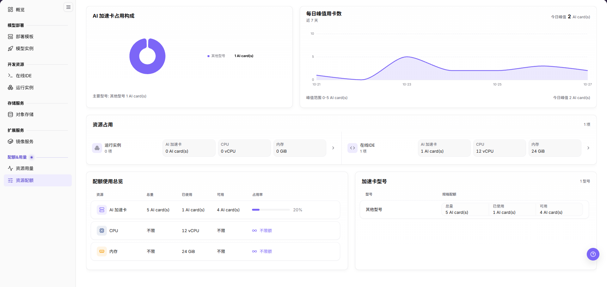

# 资源配额

## 功能概述

| 项目 | 内容 |
| --- | --- |
| 适用角色 | 模型提供方、模型调用方 |
| 导航路径 | On-Prem > 配额&用量 > 资源配额 |
| 页面路由 | `/powerone/quota-usage/quota` |
| 管理对象 | AI 卡、CPU、内存、在线 IDE 和运行实例配额 |

#### 新手理解

我的额度像个人资源余额表，用来查看当前还能创建多少实例、使用多少算力和存储。

#### 术语表

| 术语 | 说明 |
| --- | --- |
| 配额 | 租户可使用的资源上限，常见维度包括 GPU、CPU、内存和规格。 |
| AI card | AI 加速卡配额，可包括 GPU、NPU 或其他类型的加速卡。 |
| 已使用 | 已经被当前运行中实例占用的资源数量。 |

#### 推荐操作顺序

1. 进入 `配额&用量 > 资源配额`。
2. 在【配额使用总览】查看 `AI 加速卡`、`CPU`、`内存` 的 `总量` 与 `已使用`。
3. 在【加速卡型号】按 `型号` 查看 `规格配额`。
4. 在【资源占用】查看 `运行实例` 与 `在线IDE` 各自的占用，点击卡片右端 `>` 进入明细。
5. 配额不足时释放闲置实例或联系运营管理员调整。

#### 小白先看

先确认当前任务是否涉及AI 卡、CPU、内存、在线 IDE 和运行实例配额，再按照推荐顺序操作。页面字段或状态与预期不符时，先回到前置对象页核对依赖，不要跳过结果校验直接进入下游流程。

## 前提条件

1. 当前账号具备查看配额的权限。
2. 运营管理员已为租户分配资源配额。
3. 如需申请调整配额，需明确目标规格和业务需求。

## 页面说明

页面用于查看 AI 加速卡、CPU、内存的额度与占用情况，以及运行实例和在线 IDE 的资源占用。

页面自上而下由五个面板组成：`AI 加速卡占用构成`、`每日峰值用卡数`、`资源占用`、`配额使用总览` 与 `加速卡型号`。

#### 页面区域

| 字段/区域 | 说明 |
| --- | --- |
| `AI 加速卡占用构成` | 以环形图展示占用中的加速卡型号构成，图例给出型号与卡数，底部给出 `主要型号`。 |
| `每日峰值用卡数` | 以面积折线图展示 `近 7 天` 的每日用卡峰值，右上角给出 `今日峰值`。 |
| `资源占用` | 并排展示 `运行实例` 与 `在线IDE` 两张卡片，卡片内给出 `AI 加速卡`、`CPU`、`内存` 占用量。 |
| `配额使用总览` | 按 `资源` 逐行展示 `总量`、`已使用`、`可用` 与 `占用率`。 |
| `加速卡型号` | 按 `型号` 逐行展示 `规格配额` 下的 `总量`、`已使用` 与 `可用`。 |
| `>` | 位于 `资源占用` 卡片右端，用于进入对应类型的占用明细。 |

## 主要操作

### 查看资源配额

#### 适用场景

需要确认还剩多少 AI 加速卡、CPU 或内存额度，或需要按型号核对规格配额时。

#### 操作步骤

1. 进入 `On-Prem > 配额&用量 > 资源配额`。

下文配图展示页面整体布局。

2. 在【配额使用总览】按 `资源` 行核对 `总量`、`已使用`、`可用` 与 `占用率`。
3. 未设上限的资源行，`总量` 与 `可用` 显示 `不限`，`占用率` 显示 `∞ 不限额`。
4. 在【加速卡型号】按 `型号` 行核对 `规格配额` 下的 `总量`、`已使用` 与 `可用`。

#### 结果校验

- 【配额使用总览】的 `资源` 列包含 `AI 加速卡`、`CPU`、`内存` 三行，单位依次为 `AI card(s)`、`vCPU`、`GiB`。
- 【加速卡型号】的列头为 `型号` 与 `规格配额`。
- 同一行的 `总量`、`已使用`、`可用` 数值可相互对应。

#### 注意事项

- 额度表示可用上限，不等同于底层集群的实时空闲量。
- 额度数值外发前必须脱敏。

### 查看 AI 加速卡占用构成

#### 适用场景

需要确认当前占用的加速卡由哪些型号构成时。

#### 操作步骤

1. 进入 `On-Prem > 配额&用量 > 资源配额`。
2. 在【AI 加速卡占用构成】查看环形图与右侧图例。
3. 核对图例中的型号名称与卡数，以及面板底部的 `主要型号` 一行。

#### 结果校验

- 图例中的型号与卡数同【加速卡型号】的 `型号` 行和 `已使用` 一致。
- 卡数以 `AI card(s)` 为单位。

#### 注意事项

- 该面板只反映 AI 加速卡的占用构成，不含 CPU 与内存。
- 型号名称为平台归并展示，不等同于集群内的具体硬件编号。

### 查看每日峰值用卡数

#### 适用场景

需要判断近期用卡量是上升还是回落时。

#### 操作步骤

1. 进入 `On-Prem > 配额&用量 > 资源配额`。
2. 在【每日峰值用卡数】查看副标题 `近 7 天` 对应的面积折线图。
3. 核对面板右上角的 `今日峰值`，以及面板底部的 `今日峰值` 与 `峰值范围` 两行。

#### 结果校验

- 横轴按日期标注，纵轴为用卡数量级。
- 面板右上角的 `今日峰值` 与底部的 `今日峰值` 数值一致。

#### 注意事项

- 峰值按天统计，与【配额使用总览】的 `已使用` 口径不同。
- 图中数值随时间变化，引用时须同时记录查看时间。

### 查看资源占用

#### 适用场景

当创建失败提示配额不足，或需要确认资源被哪一类负载占用时。

#### 操作步骤

1. 进入 `On-Prem > 配额&用量 > 资源配额`。
2. 在【资源占用】查看并排的 `运行实例` 与 `在线IDE` 两张卡片。
3. 核对卡片名称下方的占用项数，以及卡片内 `AI 加速卡`、`CPU`、`内存` 三个数据块。
4. 点击卡片右端的 `>`，在当前页右侧展开【资源项占用详情】抽屉，页面不发生跳转。
5. 在抽屉顶部的 `占用资源项` 输入框中输入关键字，点击 `搜索` 过滤明细，或点击 `重置` 还原。

下文配图展示资源项占用详情抽屉，用于查看实例维度的资源使用情况。

6. 在明细表按 `占用资源项`、`状态`、`CPU已使用`、`显卡已使用`、`内存已使用` 逐列核对。
7. 定位占用实例后进入对应实例列表处理；明细行本身不提供跳转入口。

#### 结果校验

- 【资源占用】中 `AI 加速卡` 的占用量可与【配额使用总览】的 `已使用` 对应。
- `运行实例` 与 `在线IDE` 的占用量分别统计，不相互合并。

#### 注意事项

- 占用明细为空但 `已使用` 不为 0 时，可能存在统计延迟。
- 明细表无数据时显示 `暂无数据`，分页区显示 `共 0 条` 与 `10条/页`。
- 释放实例后配额回收可能存在短暂延迟。

### 识别配额风险并进入申请

#### 适用场景

需要判断哪一类资源接近上限，或需要准备扩容依据时。

#### 操作步骤

1. 进入 `On-Prem > 配额&用量 > 资源配额`。
2. 在【配额使用总览】按 `占用率` 列定位比例较高的资源行。
3. `占用率` 显示 `∞ 不限额` 的资源行表示未设上限，不按占用率判断风险。
4. 到【加速卡型号】确认风险集中在哪个型号。
5. 确需增加额度时，联系运营管理员调整配额并准备业务依据。

#### 结果校验

- 设有上限的资源行同时给出 `总量`、`已使用`、`可用` 与百分比形式的 `占用率`。
- 额度调整后重新进入页面，以【配额使用总览】的 `总量` 与 `可用` 为准核对结果。

#### 注意事项

- 提交调整前须确认数值和影响，并在获得授权后执行。
- 占用率仅反映额度使用程度，不代表集群一定能够创建成功。

## 参数速查表

| 字段名称 | 是否必填 | 字段类型 | 示例 | 说明 |
| --- | --- | --- | --- | --- |
| `资源` | 系统生成 | 枚举 | `AI 加速卡` | 额度总览中统计的资源类别。 |
| `总量` | 系统生成 | 数字 / 容量 | `5 AI card(s)` | 当前可使用的资源上限，未设上限时显示 `不限`。 |
| `已使用` | 系统生成 | 数字 / 容量 | `1 AI card(s)` | 已被当前占用资源使用的额度。 |
| `可用` | 系统生成 | 数字 / 容量 | `4 AI card(s)` | 仍可用于创建资源的额度，未设上限时显示 `不限`。 |
| `占用率` | 系统生成 | 百分比 | `20%` | 已使用量占总量的比例，未设上限时显示 `∞ 不限额`。 |
| `型号` | 系统生成 | 文本 | `其他型号` | 加速卡型号的归并展示名称。 |
| `规格配额` | 系统生成 | 分组 | `总量` / `已使用` / `可用` | 按型号给出的三项配额数值。 |
| 抽屉顶部搜索框 | 选填 | 文本输入 | `ide` | 用于过滤资源项占用详情明细，配合 `搜索`／`重置` 使用。 |

## 踩坑提示

- 配额充足但创建失败时，可能是实际集群资源不足。
- 占用详情为空但已使用不为 0 时，可能存在统计延迟。

### 配置规则与影响

- 配额控制租户可用上限，不等同于底层集群实时空闲量。
- 在线 IDE 和运行实例分别统计资源占用。
- 释放实例后配额回收可能存在短暂延迟。

## 结果校验

| 检查项 | 成功表现 | 异常时处理 |
| --- | --- | --- |
| 页面入口 | 可进入资源配额并看到配额与占用统计面板 | 检查菜单权限、当前业务身份和所属租户范围 |
| 数据范围 | 列表或统计与所选时间、地域和对象一致 | 重置筛选并核对时间边界、时区和统计口径 |
| 数据更新 | 更新时间或最新记录符合预期周期 | 到来源页核对任务、计量或配额记录是否已生成 |
| 交叉核对 | AI 卡、CPU、内存、在线 IDE 和运行实例配额可与详情、账单或监控记录对应 | 按对象标识和时间范围到对应详情页逐项比对 |

## 常见问题

#### 资源配额没有记录

**问题现象：**

页面正常打开，但列表或统计为空。

**可能原因：**

- 筛选范围过窄。
- 来源记录尚未生成。
- 当前角色不可见。

**处理方式：**

1. 重置筛选
2. 核对来源任务或计量周期
3. 检查当前业务身份和租户范围。

#### 资源配额范围不正确

**问题现象：**

显示的数据不属于预期时间、地域或对象。

**可能原因：**

- 时间边界不一致。
- 地域筛选未生效。
- 对象归属已变化。

**处理方式：**

1. 重新选择时间和地域
2. 核对对象标识
3. 到来源详情确认当前归属。

#### 资源配额更新延迟

**问题现象：**

来源操作已完成，但页面尚未出现最新记录。

**可能原因：**

- 统计任务尚未结束。
- 缓存未刷新。
- 来源状态仍在处理中。

**处理方式：**

1. 核对来源状态
2. 等待一个统计周期后刷新
3. 持续延迟时检查处理任务。

#### 详情或下载入口不可用

**问题现象：**

详情、展开或下载按钮不可点击。

**可能原因：**

- 当前记录不支持该操作。
- 角色权限不足。
- 文件尚未生成。

**处理方式：**

1. 选择可用记录
2. 检查角色权限
3. 确认对应统计或导出任务已经完成。

#### 汇总与明细不一致

**问题现象：**

汇总值与逐条明细相加结果不同。

**可能原因：**

- 统计周期不同。
- 存在舍入。
- 部分记录仍在处理。

**处理方式：**

1. 统一周期和时区
2. 按对象逐条核对
3. 等待未完成记录结算后复查。

## 注意事项

- 剩余额度充足不代表一定能创建成功，还需满足地域、规格、镜像、存储和集群能力。
- 截图时不要暴露租户名称、业务项目名或内部资源编号。
- 额度刷新可能存在延迟，释放资源后可等待页面更新时间更新。

## 后续操作

1. 剩余额度不足时，释放不再使用的实例、作业或存储资源。
2. 确认业务确需扩容后，联系运营管理员申请调整额度。
3. 创建实例失败时，同时核对额度、规格可用性和集群容量。
4. 定期查看额度变化，避免长期运行资源占满配额。
