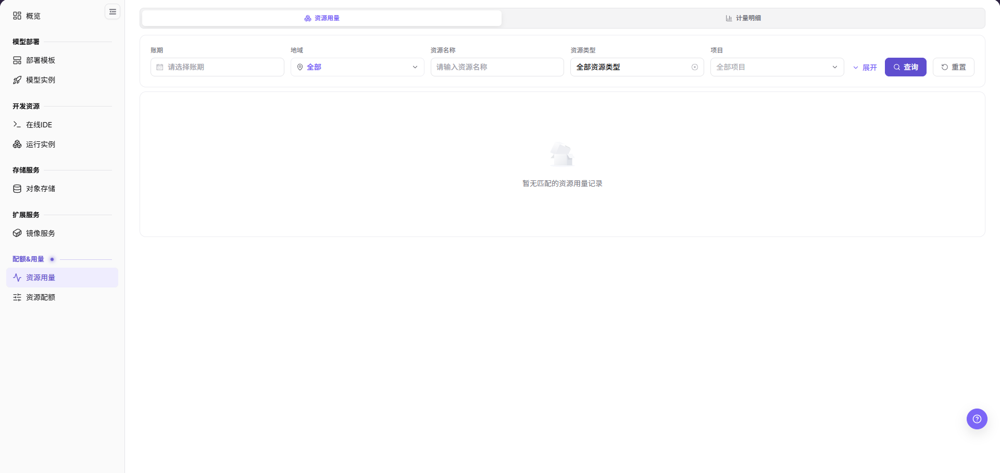
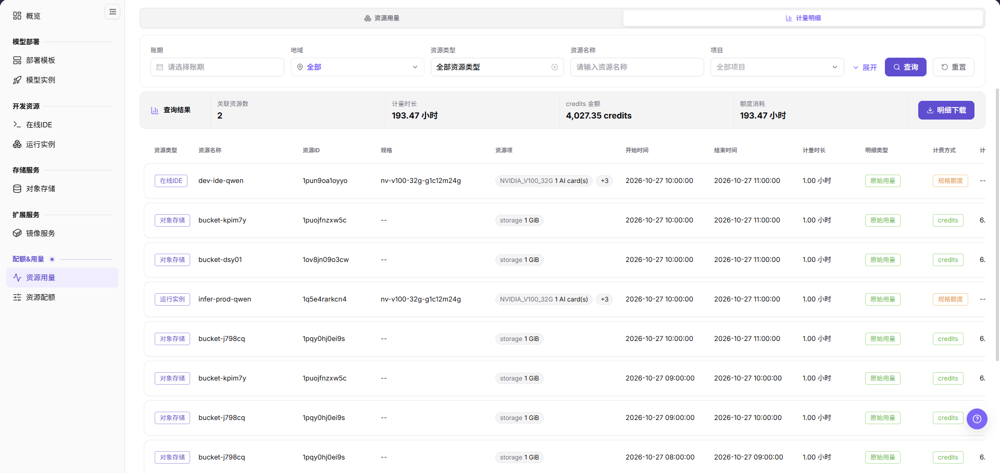
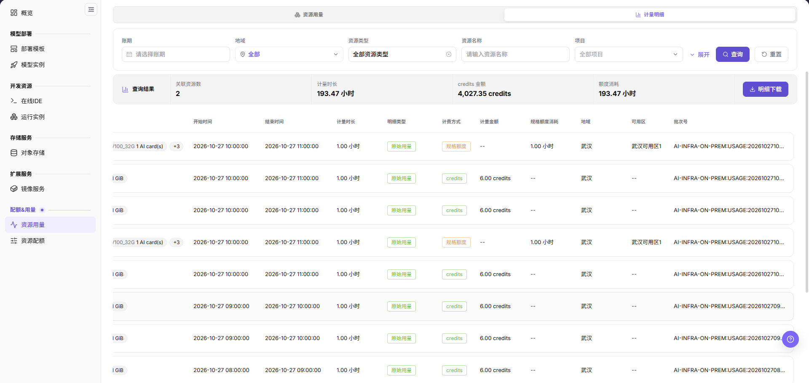
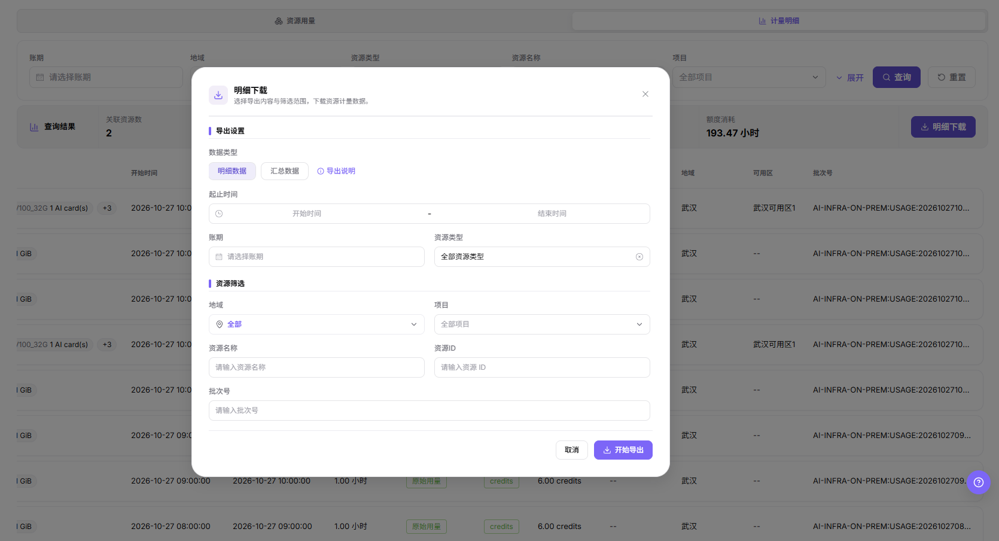

# 资源用量

## 功能概述

| 项目 | 内容 |
| --- | --- |
| 适用角色 | 模型提供方、模型调用方 |
| 导航路径 | On-Prem > 配额&用量 > 资源用量 |
| 页面路由 | `/powerone/quota-usage/usage` |
| 管理对象 | 资源规格用量、配额占用、消费明细 |

#### 新手理解

我的用量像个人资源消费记录，用来查看一段时间内用了多少算力、存储和服务资源。

#### 术语表

| 术语 | 说明 |
| --- | --- |
| 配额 | 租户可使用的资源上限，常见维度包括 GPU、CPU、内存和规格。 |
| 规格 | 资源套餐标识，在计量明细中以 `规格` 列展示，例如 `nv-v100-32g-g1c12m24g`。 |
| 计量明细 | `计量明细` 页签中按时间区间逐条列出的资源计量记录。 |
| 明细下载 | 从 `计量明细` 页签导出计量数据的弹窗入口。 |

#### 推荐操作顺序

1. 进入 `On-Prem > 配额&用量 > 资源用量`。
2. 在 `资源用量` 页签设置筛选条件并点击 `查询`。
3. 切换到 `计量明细` 页签，核对 `查询结果` 汇总带与明细列。
4. 需要留档或外部核对时，点击 `明细下载` 导出当前筛选范围。
5. 对异常记录按 `资源名称`、`规格` 和 `批次号` 逐条定位来源。

#### 小白先看

先确认当前任务是否涉及资源规格用量、配额占用、消费明细，再按照推荐顺序操作。页面字段或状态与预期不符时，先回到前置对象页核对依赖，不要跳过结果校验直接进入下游流程。

## 前提条件

1. 当前账号具备查看资源用量的权限。
2. 平台已有配额或用量统计数据。
3. 如需定位具体实例，需具备对应实例查看权限。

## 页面说明

页面用于按账期、地域、资源名称、资源类型和项目查看资源用量，并逐条核对计量明细或导出计量数据。

页面顶部提供 `资源用量` 与 `计量明细` 两个页签。截图中 `资源用量` 页签处于选中态，筛选区含 `账期`、`地域`、`资源名称`、`资源类型`、`项目`，右侧提供 `展开`、`查询`、`重置`；无匹配记录时列表区显示 `暂无匹配的资源用量记录`。

#### 页面区域

| 字段/区域 | 说明 |
| --- | --- |
| 页签区 | 在 `资源用量` 与 `计量明细` 之间切换。 |
| 筛选区 | 按 `账期`、`地域`、`资源名称`、`资源类型`、`项目` 组合查询，`展开` 用于追加条件。 |
| 查询结果带 | 展示 `关联资源数`、`计量时长`、`credits 金额` 和 `额度消耗`。 |
| 明细列表 | 逐条展示资源类型、规格、时间区间、计量金额与额度消耗等列。 |
| 明细下载 | 打开导出弹窗，选择数据类型与筛选范围后导出计量数据。 |

## 主要操作

### 查看资源用量

#### 适用场景

- 需要按账期、地域、资源名称、资源类型或项目查看资源用量时。
- 需要确认当前筛选范围内是否有可用用量记录时。

#### 操作步骤

1. 进入 `On-Prem > 配额&用量 > 资源用量`，确认处于 `资源用量` 页签。
2. 选择 `账期`，按需设置 `地域`、`资源名称`、`资源类型`、`项目`。
3. 点击 `查询` 加载结果。
4. 需要更多条件时点击 `展开`；恢复默认条件时点击 `重置`。

#### 结果校验

- 有匹配记录时列表区展示用量结果；无匹配时显示 `暂无匹配的资源用量记录`。
- 查询后核对筛选区取值与本次条件一致。

#### 注意事项

- 无结果时先确认 `账期` 与 `项目` 范围，再判断是否需要切换到 `计量明细` 页签。
- 用量数据可能包含业务资源名称，对外沟通前按平台口径脱敏。

### 查询计量明细

#### 适用场景

- 需要逐条核对资源在某个时间段的计量记录时，切换到 `计量明细` 页签。
- 需要判断消耗来自 `规格额度` 还是 `credits` 时。

#### 操作步骤

1. 点击页面顶部的 `计量明细` 页签。
2. 设置 `账期`、`地域`、`资源类型`、`资源名称`、`项目`，点击 `查询`。
3. 读取 `查询结果` 汇总带中的 `关联资源数`、`计量时长`、`credits 金额` 和 `额度消耗`。
4. 横向滚动列表，核对 `计量金额`、`规格额度消耗`、`地域`、`可用区`、`批次号` 各列。

下图对应汇总带与列表左半列。

列表右半列见下图。

#### 结果校验

- 列头依次为 `资源类型`、`资源名称`、`资源ID`、`规格`、`资源项`、`开始时间`、`结束时间`、`计量时长`、`明细类型`、`计费方式`、`计量金额`、`规格额度消耗`、`地域`、`可用区`、`批次号`。
- `明细类型` 显示为 `原始用量`；`计费方式` 显示为 `规格额度` 或 `credits`。
- 汇总带标题为 `查询结果`，其数值对应当前筛选条件命中的记录。

#### 注意事项

- 无数据的列显示为 `--`，不等同于计量异常。
- `资源项` 中的规格与卡数标记随资源类型变化，跨类型比较前先确认口径。
- 明细按时间区间成行，逐条时长以 `计量时长` 列为准。

### 下载计量明细

#### 适用场景

- 需要把当前筛选范围内的资源计量数据导出留档或交外部核对时。
- 需要按 `明细数据` 或 `汇总数据` 两种口径分别取数时。

#### 操作步骤

1. 在 `计量明细` 页签完成筛选并点击 `查询`。
2. 点击汇总带右侧的 `明细下载`。
3. 在 `导出设置` 的 `数据类型` 中选择 `明细数据` 或 `汇总数据`。
4. 按需设置 `起止时间`、`账期`、`资源类型`。
5. 在 `资源筛选` 中按需设置 `地域`、`项目`、`资源名称`、`资源ID`、`批次号`。
6. 点击 `开始导出`；放弃本次导出时点击 `取消` 或右上角 ×。

下图对应弹窗内的分组、字段与按钮。

#### 结果校验

- 弹窗标题为 `明细下载`，副标题提示选择导出内容与筛选范围后下载资源计量数据。
- 弹窗包含 `导出设置` 与 `资源筛选` 两个分组，字段与上文步骤一致。
- 点击 `取消` 或 × 后弹窗关闭，页签与筛选条件保持不变。

#### 注意事项

- 选择 `明细数据` 或 `汇总数据` 时弹窗字段集合相同，差异在导出的数据形态。
- 导出文件包含业务资源名称与资源 ID，外发前按平台口径脱敏。
- 导出范围由弹窗内的筛选条件决定，与页面列表条件分开确认。

## 参数速查表

| 字段名称 | 是否必填 | 字段类型 | 示例 | 说明 |
| --- | --- | --- | --- | --- |
| 账期 | 否 | 日期 | `2026-10` | 按账期筛选用量与计量明细记录。 |
| 资源名称 | 否 | 文本 | `dev-ide-qwen` | 定位产生用量的具体资源。 |
| 资源类型 | 否 | 枚举 | `在线IDE` | `资源类型` 列展示 `在线IDE`、`运行实例`、`对象存储` 等取值。 |
| 计量时长 | 系统生成 | 时长 | `1.00 小时` | 单条明细的计量时长。 |
| credits 金额 | 系统生成 | 数字 | `4,027.35 credits` | 汇总带中当前查询范围的 credits 金额。 |
| 额度消耗 | 系统生成 | 时长 | `193.47 小时` | 汇总带中当前查询范围的额度消耗读数。 |

## 踩坑提示

- 如果明细为空，可能是该规格当前没有消费记录。
- 统计数据可能有延迟，不适合替代实时实例状态。

#### 配置规则与影响

- 资源用量用于统计和核对，不直接创建或释放资源。
- 额度显示“不限”表示没有固定上限，但仍受底层资源和调度条件影响。
- 消费明细可能存在延迟，应结合实例详情判断实时状态。

## 结果校验

| 检查项 | 成功表现 | 异常时处理 |
| --- | --- | --- |
| 页面入口 | 可进入资源用量并看到筛选或统计区域 | 检查菜单权限、当前业务身份和所属租户范围 |
| 数据范围 | 列表或统计与所选时间、地域和对象一致 | 重置筛选并核对时间边界、时区和统计口径 |
| 数据更新 | 更新时间或最新记录符合预期周期 | 到来源页核对任务、计量或配额记录是否已生成 |
| 交叉核对 | 资源规格用量、配额占用、消费明细可与详情、账单或监控记录对应 | 按对象标识和时间范围到对应详情页逐项比对 |

## 常见问题

#### 资源用量没有记录

**问题现象：**

页面正常打开，但列表或统计为空。

**可能原因：**

- 筛选范围过窄。
- 来源记录尚未生成。
- 当前角色不可见。

**处理方式：**

1. 重置筛选
2. 核对来源任务或计量周期
3. 检查当前业务身份和租户范围。

#### 资源用量范围不正确

**问题现象：**

显示的数据不属于预期时间、地域或对象。

**可能原因：**

- 时间边界不一致。
- 地域筛选未生效。
- 对象归属已变化。

**处理方式：**

1. 重新选择时间和地域
2. 核对对象标识
3. 到来源详情确认当前归属。

#### 资源用量更新延迟

**问题现象：**

来源操作已完成，但页面尚未出现最新记录。

**可能原因：**

- 统计任务尚未结束。
- 缓存未刷新。
- 来源状态仍在处理中。

**处理方式：**

1. 核对来源状态
2. 等待一个统计周期后刷新
3. 持续延迟时检查处理任务。

#### 详情或下载入口不可用

**问题现象：**

详情、展开或下载按钮不可点击。

**可能原因：**

- 当前记录不支持该操作。
- 角色权限不足。
- 文件尚未生成。

**处理方式：**

1. 选择可用记录
2. 检查角色权限
3. 确认对应统计或导出任务已经完成。

#### 汇总与明细不一致

**问题现象：**

汇总值与逐条明细相加结果不同。

**可能原因：**

- 统计周期不同。
- 存在舍入。
- 部分记录仍在处理。

**处理方式：**

1. 统一周期和时区
2. 按对象逐条核对
3. 等待未完成记录结算后复查。

## 注意事项

- 用量统计可能晚于资源状态变化，短时间内出现差异属于常见现象。
- 用量数据可能包含业务资源名称，对外沟通前应脱敏。
- 费用或 Credits 解释应以平台计量规则为准，不要用单次截图作为最终结算依据。

## 后续操作

1. 用量异常增长时，按资源名称或时间范围定位高消耗实例和作业。
2. 与额度变化不一致时，等待计量同步后再次核对，必要时联系运营管理员。
3. 需要成本复盘时，导出或记录用量趋势、资源类型和业务用途。
4. 对长期运行资源设置停用或清理计划，避免持续消耗额度。
