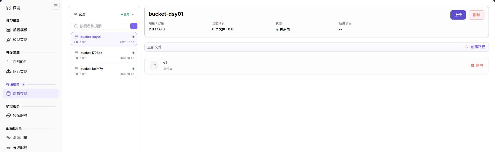
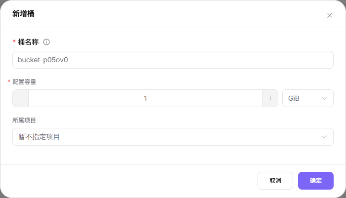
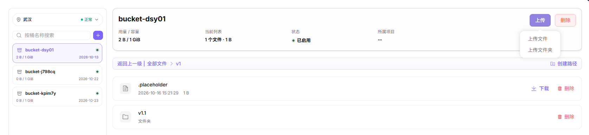

# 对象存储

## 功能概述

| 项目 | 内容 |
| --- | --- |
| 适用角色 | 模型提供方 |
| 导航路径 | On-Prem > 存储服务 > 对象存储 |
| 页面路由 | `/powerone/storage-service/object` |
| 管理对象 | 对象存储桶、对象文件、对象路径和地域内对象存储能力 |

#### 新手理解

对象存储像模型和数据的云盘，用桶和对象保存文件、数据集、模型包和输出结果。它适合按路径上传、下载和共享文件，但不等同于可直接挂载的 POSIX 共享目录。

#### 术语表

| 术语 | 说明 |
| --- | --- |
| 桶 | 对象存储中的顶层容器。 |
| 对象 | 桶中的单个文件或数据项。 |
| 对象路径 | 桶内的文件路径，用于在作业中定位数据。 |

#### 推荐操作顺序

先确认对象存储桶、对象文件、对象路径和地域内对象存储能力的前置依赖，再按主要操作顺序处理，最后执行结果校验并进入后续页面。

#### 小白先看

先确认当前任务是否涉及对象存储桶、对象文件、对象路径和地域内对象存储能力，再按照推荐顺序操作。页面字段或状态与预期不符时，先回到前置对象页核对依赖，不要跳过结果校验直接进入下游流程。

## 前提条件

1. 目标地域已由运营管理员开放对象存储能力。
2. 当前账号具备查看、创建桶和管理对象的权限。
3. 桶名称、对象路径和数据保留策略已规划。
4. 如用于作业，作业所在地域应能访问该对象存储。

## 页面说明

页面用于查看和处理对象存储桶、对象文件、对象路径和地域内对象存储能力。

左侧桶面板顶部显示地域，`按桶名称搜索`右侧的`+`为新增入口。选择桶后读取用量 / 容量、当前列表、状态及所属项目；文件和文件夹操作对应当前目录。

## 主要操作

### 搜索并读取桶概览

#### 适用场景

按桶名称定位目标并读取当前概览。

#### 操作步骤

1. 进入对象存储，在左侧桶面板顶部核对地域。
2. 在`按桶名称搜索`中输入桶名，并在左侧列表选择目标桶。
3. 读取桶概览中的`用量 / 容量`、`当前列表`、`状态`和`所属项目`。

#### 结果校验

- 检查选中桶名和概览是否对应目标桶；区分桶用量与当前列表的文件数量、大小。

#### 注意事项

- 截图只证明搜索框与地域选择器的入口，不能当作搜索成功或切换地域后的结果记录。
- 挂载或连接、创建时间、事件与异常排查未出现在本次画面中，本文不描述其操作。

### 新增桶

#### 适用场景

规划好桶名、容量和项目归属后新增桶。

#### 操作步骤

1. 在左侧面板顶部核对地域；地域不在右上角。
2. 点击`按桶名称搜索`右侧的`+`，打开`新增桶`弹窗。
3. 填写`桶名称`和`配置容量`；可见单位为`GiB`。核对`所属项目`，示例显示`暂不指定项目`。
4. 核对参数并取得授权后，点击`确定`提交。

下图对应`桶名称`、`配置容量`、`GiB`、`所属项目`及`确定`按钮。

#### 结果校验

- 提交后应检查实际提示，以及目标桶是否出现、容量和所属项目是否符合预期。

#### 注意事项

- 表单显示`桶名称`和`配置容量`的必填标记；名称校验、容量上限、其他单位、项目选项及提交后行为以页面实际提示为准。
- 用户侧左侧菜单为三层：顶层是单个节点`AI基础设施 On-Prem`，其下依次是`存储服务`、`对象存储`。原四段串`On-Prem > 存储服务 > 对象存储`把一个节点写成两段，仅作历史原串保留，不是页面写法。

### 创建路径

#### 适用场景

在选定桶或目录内规划对象路径。

#### 操作步骤

1. 选择目标桶，定位预期的父目录。
2. 点击文件列表上方目录栏右侧的`创建路径`；该栏在根目录显示`全部文件`，进入文件夹后显示`返回上一级`与面包屑。
3. 核对`当前根路径`，填写`路径名称`，确认目标位置后再点击`确定`。

下图标明当前根路径和必填的`路径名称`输入框。

#### 结果校验

- 提交后应检查实际提示和路径是否出现在预期父目录。

#### 注意事项

- 路径校验、嵌套路径支持、同名处理及提交后行为以页面实际提示为准；看到弹窗不等于已经创建成功。

### 浏览文件夹与返回

#### 适用场景

从桶根目录进入文件夹并返回。

#### 操作步骤

1. 选择桶，在对象列表点击文件夹名称，例如`v1`。
2. 核对面包屑；已采目录画面显示`全部文件 > v1`。
3. 使用`返回上一级`入口返回父级，或使用`全部文件`入口返回根目录，再核对当前位置。

#### 结果校验

- 每次导航后应检查面包屑和当前列表。

#### 注意事项

- 目录状态和返回入口可见，但截图没有记录导航过程，不能证明各返回动作已经验证成功。

### 上传文件或文件夹

#### 适用场景

为当前桶目录选择上传类型。

#### 操作步骤

1. 选择桶并进入目标目录，核对面包屑位置。
2. 打开桶概览中的`上传`，按本地来源选择`上传文件`或`上传文件夹`。
3. 确认目标位置和授权后，仅按实际选择界面及提示继续。

下图展开两种上传入口；同一目录画面也可定位文件行的`下载`和行内`删除`入口。

#### 结果校验

- 获批上传后应检查实际提示、目标目录条目、文件大小及必要的内容。

#### 注意事项

- 菜单只证明两种上传入口；大小限制、覆盖策略、目录布局与传输结果以页面实际反馈为准。

### 下载文件

#### 适用场景

从选定目录获取单个文件。

#### 操作步骤

1. 在目标桶目录找到文件，核对名称和显示大小。
2. 点击该文件行的`下载`，按浏览器实际响应继续，不预设特定弹窗。

#### 结果校验

- 应检查收到的文件是否为目标文件且可读取，必要时比对大小或校验和。

#### 注意事项

- 已采文件行有`下载`入口，尚无文件夹下载证据；不要从文件操作推导文件夹下载流程。

### 删除文件或文件夹

#### 适用场景

检查依赖和备份后，删除获批的文件或文件夹。

#### 操作步骤

1. 在选定桶目录定位目标文件或文件夹，核对完整上下文。
2. 取得授权并检查依赖后，使用该行的`删除`，而非桶级`删除`。

#### 结果校验

- 若执行删除，应检查实际提示并重新核对目标目录条目。

#### 注意事项

- 文件行和文件夹行各有`删除`入口；确认文案、递归删除、恢复方式及删除限制以页面实际提示为准，不能假定文件夹会递归删除。

### 删除桶

#### 适用场景

仅在桶数据及依赖影响获批后删除选定桶。

#### 操作步骤

1. 选择目标桶，核对桶名、地域和概览。
2. 获批并完成数据保护检查后，使用`上传`旁的桶级`删除`。

#### 结果校验

- 若执行删除，应检查实际提示并在桶列表核对目标结果。

#### 注意事项

- 此入口不同于文件或文件夹的行内删除；空桶限制、确认弹窗、删除范围及恢复方式以页面实际提示为准，本文不作断言。

## 参数速查表

| 字段名称 | 要求 / 来源 | 含义 | 证据边界 |
| --- | --- | --- | --- |
| `桶名称` | 新增桶必填标记 | 待创建桶的名称。 | 名称校验以页面实际提示为准。 |
| `配置容量` / `GiB` | 新增桶必填标记 | 桶的配置容量和可见单位。 | 上限及其他单位选项以页面实际提示为准。 |
| `所属项目` | 新增桶 / 桶概览 | 项目归属；表单显示`暂不指定项目`。 | 选项和关联行为以页面实际提示为准。 |
| `用量 / 容量` | 桶概览 | 桶的用量与容量。 | 不等同于当前目录的文件数量。 |
| `当前列表` | 桶概览 | 当前列表的文件数量和大小。 | 文件夹计数规则以页面实际显示为准。 |
| `状态` | 桶概览 | 画面示例为`已启用`。 | 其他状态字样与转换条件未出现在本次画面中。 |
| 地域 | 左侧桶面板顶部 | 画面示例为`武汉`、`正常`。 | 切换地域后的联动未出现在本次画面中。 |
| 原资源名称 / 访问路径 / 可用 | 历史速查词形 | 原示例为`storage-a`、`/mnt/data`、`可用`；原容量 / 配额示例为`100GiB`。 | 对应字段、挂载语义和枚举映射未在本次画面中出现，不能判定为不存在。 |

## 踩坑提示

- 挂载失败时先确认地域、权限和存储组件状态；挂载入口的可用性以实际页面为准。
- 删除存储资源前确认没有实例、任务或输出产物依赖。（避免把当前列表为空误判为没有依赖。）
- 桶属于地域内存储资源，跨地域访问能力以运营管理员配置为准。
- 对象存储适合非结构化文件，不适合需要 POSIX 共享目录语义的场景。
- 删除桶或对象前必须确认没有实例、模型、脚本或作业依赖。（桶或对象的依赖范围不等于当前目录。）
- 对象路径可以进入启动命令或参数，但不要把访问密钥写进命令。（下游对接以实际页面为准；密钥保护边界仍须遵守。）

## 结果校验

| 检查项 | 成功表现 | 异常时处理 |
| --- | --- | --- |
| 页面入口 | 可进入对象存储并看到目标操作入口 | 检查运营管理员权限和对应菜单是否已开放 |
| 对象记录 | 对象存储桶、对象文件、对象路径和地域内对象存储能力在列表或详情中可见 | 重置筛选并核对名称、所属范围和创建结果 |
| 状态结果 | 新增或变更后的状态符合页面提示 | 查看操作提示、依赖对象状态和最近更新时间 |
| 下游使用 | 后续页面能够选择或关联目标对象 | 回到前置配置核对启用状态、归属关系和可见范围 |

## 常见问题

#### 对象存储中找不到目标对象

**问题现象：**

页面可进入，但没有看到预期的对象存储桶、对象文件、对象路径和地域内对象存储能力。

**可能原因：**

- 筛选条件仍生效。
- 对象属于其他范围。
- 前置配置未完成。

**处理方式：**

1. 重置筛选
2. 核对所属地域或租户
3. 返回前置页面确认对象状态。

#### 对象存储的操作入口不可用

**问题现象：**

新增、注册或维护入口不可见或不可点击。

**可能原因：**

- 当前角色权限不足。
- 页面处于只读状态。
- 依赖对象不满足条件。

**处理方式：**

1. 检查运营管理员权限
2. 核对页面提示
3. 先完成依赖对象配置。

#### 对象存储的必填项没有可选值

**问题现象：**

表单能打开，但下拉框为空。

**可能原因：**

- 候选对象未启用。
- 所属范围不一致。
- 当前账号不可见。

**处理方式：**

1. 到候选对象页面核对状态
2. 确认归属关系
3. 检查可见范围后刷新表单。

#### 对象存储操作后状态异常

**问题现象：**

提交后记录存在，但状态不是预期值。

**可能原因：**

- 连通性或校验失败。
- 关联对象异常。
- 后台处理尚未完成。

**处理方式：**

1. 查看页面提示和更新时间
2. 检查关联对象
3. 按状态阶段排查处理任务。

#### 下游页面无法使用对象存储

**问题现象：**

当前页状态正常，但下游页面无法选择或关联对象存储桶、对象文件、对象路径和地域内对象存储能力。

**可能原因：**

- 可见范围不匹配。
- 对象未启用。
- 下游缓存未刷新。

**处理方式：**

1. 核对启用状态和归属
2. 检查角色可见范围
3. 刷新下游页面并重新选择。

## 注意事项

- 不要在对象路径或文件名中写入密钥、账号、token 或客户敏感信息。
- 重要数据删除前先确认备份可用；依赖范围的误判见踩坑提示。
- 以下为原手册的历史查看说明，保留以供对照，不作为当前界面的操作断言。
- 历史说明：“进入对应存储服务页面，按名称、项目、状态、容量或更新时间筛选。”
- 历史说明：“打开详情，核对容量、已用空间、访问方式、挂载或连接状态和创建时间。”
- 历史说明：“无结果时重置筛选并检查项目与地域；内部地址和访问凭据不得外发。”
- 历史说明：“容量或状态异常时先检查配额、事件和关联实例，不重复创建资源。”
- 以下说明摘自原手册，需先在实际界面确认能力与入口后再参考。
- 将以下原说明视为取证队列而非可执行流程，不据此尝试扩容、挂载、卸载、权限变更或恢复。
- 能力在实际界面确认后，再规划容量、连接状态和事件的检查；本页未记录此类操作或恢复结果。
- 历史说明：“打开目标资源的操作菜单，确认扩容、挂载、卸载、权限或删除入口的影响。”
- 历史说明：“变更前记录当前容量、关联实例和数据保护状态。”
- 历史说明：“扩容、卸载或删除前确认任务和备份；执行最终操作前，应确认资源、数据和影响，并取得授权。”
- 历史说明：“获批变更后检查容量、连接状态和事件；异常时停止后续操作并按恢复流程处理。”

## 后续操作

1. 在运行实例、在线 IDE 或模型服务中引用对象路径。
2. 定期清理无用对象，控制存储占用。
3. 对重要模型和数据集建立备份或版本归档规则。
