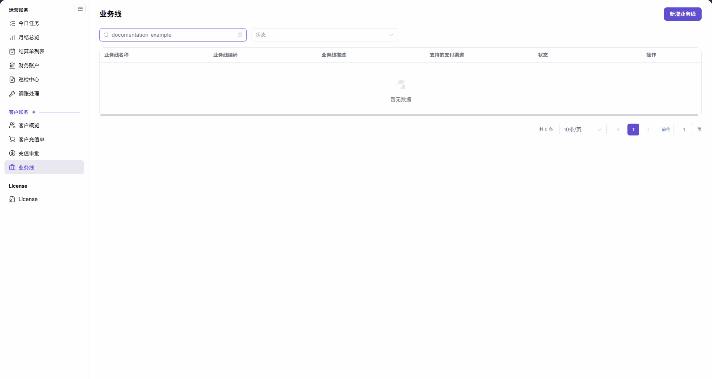

# 业务线

::: info 文档信息
版本：v2.1
更新日期：2026-11-05
:::

## 功能概述

| 项目 | 内容 |
| --- | --- |
| 适用角色 | 运营管理员 |
| 导航路径 | 账务 > 客户账务 > 业务线 |
| 页面路由 | `/billing/customers/business-units` |
| 管理对象 | 业务线、支付渠道、单笔充值限制、初始余额和最大透支额度 |

本页用于查询业务线，并通过 `新增业务线` 和行内 `编辑业务线` 入口维护业务配置。

#### 新手理解

业务线像充值业务的收银台配置，将支付渠道、单笔充值限制和透支设置放在同一个业务范围内管理。

#### 术语速查

| 术语 | 说明 |
| --- | --- |
| 业务线 | 承载充值渠道、单笔充值限制和余额相关配置的业务对象。 |
| 业务线编码 | 标识业务线的编码，修改前应确认业务归属。 |
| 支付渠道 | 在业务线表单中选择的支付渠道。 |
| 单笔充值限制 | 分别设置单笔最小充值金额和单笔最大充值金额。 |
| 最大透支额度 | 与初始余额分开的透支配置项。 |

## 前提条件

1. 已登录平台，并能访问 `账务 > 客户账务 > 业务线`。
2. 新增或编辑前，确认当前账号具备对应操作权限。
3. 事先确认目标业务线、适用客户范围、渠道和余额策略；不要为查看表单而提交配置。

## 页面说明

| 区域 | 说明 |
| --- | --- |
| 筛选区 | 包含 `业务线名称` 和 `状态`。 |
| 新增入口 | `新增业务线` 打开新增表单。 |
| 列表区 | 展示名称、编码、描述、渠道、状态和行内操作。 |
| 分页区 | 展示当前查询的总条数和分页控件。 |

| 区域 | 说明 |
| --- | --- |
| 业务线名称 | 业务线显示名称。 |
| 业务线编码 | 业务线编码。 |
| 业务线描述 | 列表中的业务说明。 |
| 支持的支付渠道 | 业务线配置的渠道。 |
| 状态 | 业务线当前状态。 |
| 操作 | 有记录时可从对应行进入 `编辑业务线`。 |

图示为业务线名称输入 `documentation-example` 后的空结果；表格保留六列，显示 `暂无数据` 和 `共 0 条`。

## 主要操作

### 查询业务线

1. 进入 `账务 > 客户账务 > 业务线`。
2. 按需输入 `业务线名称`，选择 `状态`。
3. 查看匹配记录的名称、编码、描述、支持的支付渠道和状态。
4. 如显示 `暂无数据`，核对名称和状态条件，并按需要调整或清空输入。

### 新增业务线

1. 点击 `新增业务线` 打开表单。
2. 填写带必填标记的 `业务线名称`、`业务线编码` 和 `联系人信息`；联系人信息包含 `联系人姓名`、`联系人电话`。
3. 按需分别设置 `单笔最小充值金额` 和 `单笔最大充值金额`，两项各有 `不设额外业务限制` 按钮。核对提示：`不设置业务上限时，仍受系统单次最高 10,000,000.00 credits 限制。`
4. 核对默认值为 `0` 的 `初始余额`；按业务策略设置选填的 `最大透支额度`，或使用 `禁止透支` 按钮。
5. 按需填写 `备注`，选择 `支付渠道`。支付渠道字段没有必填星号。
6. 仅在确需创建且已核对名称、编码、联系人、充值限制、余额、透支额度和渠道时点击 `确定`；不提交时点击 `取消`。

图示为尚未填写的新建表单：名称、编码和联系人信息组带必填标记，最小与最大充值金额分开设置，初始余额为 `0`，底部为 `取消` 和 `确定`。

### 编辑业务线

1. 在列表中定位目标业务线，核对名称、编码和状态。
2. 点击该行的 `编辑业务线` 进入编辑表单，核对原有配置及计划修改的范围。
3. 重点复核支付渠道、充值限制、初始余额和最大透支额度；仅在确认业务影响后提交，放弃修改时使用 `取消`。

## 参数速查表

| 字段名称 | 是否必填 | 字段类型 | 示例 | 说明 |
| --- | --- | --- | --- | --- |
| 业务线名称 | 必填 | 文本 | `documentation-example` | 表单带必填标记；列表也可按名称筛选。 |
| 业务线编码 | 必填 | 文本 | `<业务线编码>` | 表单带必填标记。 |
| 联系人信息 | 字段组必填 | 字段组 | `<联系人信息>` | 必填标记位于组级，包含姓名和电话。 |
| 联系人姓名 | 随联系人信息组 | 文本 | `<联系人姓名>` | 联系人信息组内字段。 |
| 联系人电话 | 随联系人信息组 | 文本 | `<联系人电话>` | 联系人信息组内字段。 |
| 单笔最小充值金额 | 否 | 数值 | `0` | 独立选填项，旁有 `不设额外业务限制` 按钮。 |
| 单笔最大充值金额 | 否 | 数值 | `0` | 独立选填项；不设业务上限仍受系统单次最高 10,000,000.00 credits 限制。 |
| 初始余额 | 无必填标记 | 数值 | `0` | 新增表单默认值为 0。 |
| 最大透支额度 | 否 | 数值 | `0` | 选填，旁有 `禁止透支` 按钮。 |
| 备注 | 否 | 多行文本 | `<业务说明>` | 表单中的补充说明字段。 |
| 支付渠道 | 无必填标记 | 下拉选择 | `<支付渠道>` | 按业务需要选择渠道。 |
| 状态 | 查询时选填 | 下拉选择 / 列表值 | `<状态>` | 用于筛选和查看当前状态。 |
| 不设额外业务限制 | 不适用 | 按钮 | `不设额外业务限制` | 分别位于最小、最大充值金额旁；不代表无限金额。 |
| 禁止透支 | 不适用 | 按钮 | `禁止透支` | 透支配置的快捷按钮。 |
| 确定 | 不适用 | 按钮 | `确定` | 表单最终确认入口；点击前完成业务复核。 |
| 取消 | 不适用 | 按钮 | `取消` | 不提交当前表单。 |

## 踩坑提示

- `不设额外业务限制` 不等于无限金额：`不设置业务上限时，仍受系统单次最高 10,000,000.00 credits 限制。`
- `联系人信息` 的必填标记在字段组上，不要把组级标记理解成每个输入框都有独立必填星号。
- 列表中的 `业务线描述` 与表单中的 `备注` 使用不同标签，查找字段时按所在区域识别。
- `初始余额` 和 `最大透支额度` 是两个独立字段，不要将二者合并理解。

## 结果校验

| 检查项 | 成功表现 | 异常时处理 |
| --- | --- | --- |
| 查询范围 | 名称和状态条件与目标业务线一致 | 调整或清空对应条件。 |
| 空结果 | 无匹配结果时显示 `暂无数据`、`共 0 条` | 核对当前筛选条件，不将空结果当作配置被删除的证明。 |
| 表单定位 | 新增表单包含名称、编码、联系人信息和独立的充值限制字段 | 确认进入的是 `新增业务线`。 |
| 上限提示 | 最大充值金额旁显示系统单次最高 10,000,000.00 credits 的提示 | 按该上限复核业务策略，不以无限金额理解。 |

## 常见问题

#### 为什么输入名称后列表为空？

**问题现象：** 列表显示 `暂无数据`、`共 0 条`。

**可能原因：** 当前名称和状态条件下没有匹配结果。

**处理方式：** 核对 `业务线名称` 和 `状态`，按需调整或清空条件后查看列表。

#### 为什么不设业务上限仍显示系统上限？

**问题现象：** 最大充值金额旁仍显示 10,000,000.00 credits 的提示。

**可能原因：** 界面明确说明：`不设置业务上限时，仍受系统单次最高 10,000,000.00 credits 限制。`

**处理方式：** 将业务限制和系统上限分开理解，按界面提示核对单次充值策略。

## 注意事项

- 支付渠道、充值限制、初始余额和透支额度属于关键业务配置；变更前确认适用客户范围和业务授权，不以提交配置试探效果。
- 联系人信息仅供授权业务使用；共享记录时遵循最小必要范围，不传播凭证或无关客户信息。
- 调整状态或处理业务线下线前，先评估关联客户和充值业务影响，不以更改状态替代完整的业务确认。
- 只查看配置时不要点击最终 `确定`，使用 `取消` 退出。

## 后续操作

- 前往 [客户充值单](../top-up-orders/) 按订单核对来源、金额、到账 credits 和状态。
- 前往 [客户概览](../customer-overview/) 核对相关客户信息。
