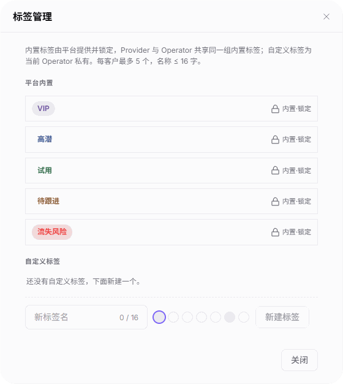

# 客户概览

::: info 文档信息
版本：v2.1
更新日期：2026-11-05
:::

## 功能概述

| 项目 | 内容 |
| --- | --- |
| 适用角色 | 运营管理员 |
| 导航路径 | 账务 > 客户账务 > 客户概览 |
| 页面路由 | `/billing/customers/overview` |
| 管理对象 | 客户身份、标签、消费账户和收益账户信息 |

`客户概览` 用于按业务身份、关键字和标签定位客户，查看余额与消费信息，并提供详情、发放额度和回收额度入口。

#### 新手理解

客户概览像一本客户账务索引：End User 以表格呈现消费信息，Provider 以卡片分别呈现消费账户和收益账户。

#### 术语速查

| 术语 | 说明 |
| --- | --- |
| End User | 终端用户业务身份，对应客户消费信息表格。 |
| Provider | 服务提供方业务身份，对应消费账户和收益账户卡片。 |
| Credits | 页面用于展示余额、消费和收益的计量单位。 |
| 内置标签 | 平台提供并锁定的标签，Provider 与 Operator 共享同一集合。 |
| 自定义标签 | 当前 Operator 私有的标签。 |

## 前提条件

1. 已登录运营管理员账号，并能进入 `客户账务 > 客户概览`。
2. 查询前确认要查看的业务身份；发放或回收额度前确认目标客户和业务原因。

## 页面说明

| 区域 | 说明 |
| --- | --- |
| 页面顶部 | 显示 `本月消费更新:` 时间，提供 `刷新` 和 `管理标签` 入口。 |
| 筛选区 | `业务身份` 使用 `End User` / `Provider` 分段控件；关键字框提示为 `输入关键字`。`按标签筛选` 支持多选，命中任一已选标签即匹配（OR）。 |
| 汇总区 | 展示客户规模、资金、消费和余额风险四张汇总卡，与下方客户结果区分开阅读。 |
| End User 结果区 | 使用表格展示客户身份、标签、余额和消费。 |
| Provider 结果区 | 使用客户卡片展示消费账户、收益账户及开户时间，不使用 End User 表格布局。 |

四张汇总卡的名称及可见口径如下；不应由关键字查询后的空表格推断汇总值为 0。

| 区域 | 说明 |
| --- | --- |
| 客户总规模 | 客户总量、End User / Provider 数量及本月活跃消费客户数。 |
| 资金健康度 | Credits 资金量、上月消耗及按本月日均可支撑天数。 |
| 本月消耗总览 | 本月消耗、日均消耗及与上月日均的比较。 |
| 异常预警 | 余额不足 3 天的客户数量及剩余可支撑天数。 |

End User 表格列名和含义如下。

| 区域 | 说明 |
| --- | --- |
| 租户 | 客户租户身份信息。 |
| 管理员 | 客户管理员身份信息。 |
| 标签 | 客户已应用的标签。 |
| 可用余额 | 客户当前可用的 Credits。 |
| 历史总消费 | 客户累计消费的 Credits。 |
| 上月消费 | 客户上月消费的 Credits。 |
| 本月消费 | 客户本月消费的 Credits。 |
| 开户时间 | 客户开户时间。 |
| 操作 | 提供 `详情`、`发放额度`、`回收额度` 等入口；另有 `操作` 入口。 |

图示为 End User 关键字查询后的空结果表格，展示租户、管理员、标签、余额、消费、开户时间和操作列；图中不包含汇总卡或 Provider 卡片。

Provider 卡片分为 `消费账户` 和 `收益账户`：前者包含 `可用余额`、`本月消费`、`上月消费`；后者包含 `收益账户余额`、`本月待结算收益`、`上月收益`。卡片还显示 `开户时间`，并提供 `详情`、`发放额度`、`回收额度` 和 `操作` 入口。

## 主要操作

### 查询 End User 客户

1. 进入 `账务 > 客户账务 > 客户概览`。
2. 在 `业务身份` 分段控件中选择 `End User`。
3. 按需在 `输入关键字` 中输入查询词，并选择标签；多选标签按 OR 匹配。
4. 查看结果表格，核对目标客户的租户、管理员、标签、可用余额和各消费字段。
5. 需要查看客户信息时，先核对目标客户，再使用该行的 `详情` 入口。

### 查看 Provider 客户

1. 在 `业务身份` 分段控件中选择 `Provider`。
2. 按需输入关键字并选择标签，定位目标客户卡片。
3. 核对 `消费账户` 的 `可用余额`、`本月消费`、`上月消费`。
4. 分别核对 `收益账户` 的 `收益账户余额`、`本月待结算收益`、`上月收益` 及卡片的 `开户时间`。

### 查看标签管理

1. 点击 `管理标签`，打开 `标签管理` 弹窗。
2. 查看 `平台内置` 标签：`VIP`、`高潜`、`试用`、`待跟进`、`流失风险`，均标注为 `内置·锁定`。
3. 查看 `自定义标签` 区域。图示状态为 `还没有自定义标签，下面新建一个。`；区域提供 `新标签名` 输入框、颜色选择和 `新建标签` 入口，名称限制为 16 字。
4. 点击 `关闭` 或右上角关闭按钮退出弹窗。

图示为标签管理弹窗，展示锁定的五个内置标签、空的自定义标签区域，以及新标签名输入框、颜色选择、新建标签和关闭入口。

### 发放额度

1. 定位并核对目标客户，点击 `发放额度`。
2. 核对表单预填的只读客户标识，确认与目标客户一致。
3. 填写 `发放额度` 和 `原因`；两项均有必填标记。
4. 再次核对客户、额度和原因；需要提交时点击 `确定`。
5. 放弃操作时，点击 `取消` 或右上角关闭按钮。

### 回收额度

1. 定位并核对目标客户，点击 `回收额度`。
2. 核对表单预填的只读客户标识，确认与目标客户一致。
3. 填写 `回收额度` 和 `原因`；两项均有必填标记。表单另提供 `全部回收` 按钮。
4. 再次核对客户、额度和原因；需要提交时点击 `确定`。
5. 放弃操作时，点击 `取消` 或右上角关闭按钮。

## 参数速查表

| 字段名称 | 是否必填 | 字段类型 | 示例 | 说明 |
| --- | --- | --- | --- | --- |
| 业务身份 | 查询时选择 | 分段选择 | `End User` | 可选择 `End User` 或 `Provider`。 |
| 输入关键字 | 否 | 文本 | `<查询词>` | 按当前业务身份和输入的关键字定位客户。 |
| 按标签筛选 | 否 | 多选 | `VIP` | 多选命中任一即匹配（OR）。 |
| 租户 | 只读 | 身份信息 | `<租户>` | End User 表格中的客户租户。 |
| 管理员 | 只读 | 身份信息 | `<管理员>` | End User 表格中的管理员。 |
| 标签 | 只读 | 标签集合 | `VIP` | 每客户最多 5 个标签。 |
| 可用余额 | 只读 | Credits | `0` | End User 表格或 Provider 消费账户的可用余额。 |
| 历史总消费 | 只读 | Credits | `0` | End User 表格中的累计消费。 |
| 上月消费 | 只读 | Credits | `0` | End User 表格或 Provider 消费账户的上月消费。 |
| 本月消费 | 只读 | Credits | `0` | End User 表格或 Provider 消费账户的本月消费。 |
| 开户时间 | 只读 | 时间 | `<开户时间>` | End User 表格和 Provider 卡片均展示。 |
| 收益账户余额 | 只读 | Credits | `0` | Provider 收益账户余额。 |
| 本月待结算收益 | 只读 | Credits | `0` | Provider 本月待结算的收益。 |
| 上月收益 | 只读 | Credits | `0` | Provider 上月收益。 |
| 新标签名 | 新建时填写 | 文本 | `<标签名>` | 名称不超过 16 字；自定义标签为当前 Operator 私有。 |
| 颜色选择 | 未标注必填 | 颜色选项 | `<颜色>` | 自定义标签区域提供的颜色选择。 |
| 客户标识 | 只读 | 预填信息 | `<客户标识>` | 发放和回收额度表单中用于核对目标客户。 |
| 发放额度 | 是 | 数字 | `<额度>` | 发放额度表单的必填项。 |
| 回收额度 | 是 | 数字 | `<额度>` | 回收额度表单的必填项。 |
| 原因 | 是 | 多行文本 | `<业务原因>` | 两种额度表单均要求填写。 |
| 全部回收 | 否 | 按钮 | `全部回收` | 回收额度表单提供的独立入口。 |

## 踩坑提示

- 标签多选是命中任一（OR），不是要求客户同时具有全部已选标签。
- End User 使用表格，Provider 使用账户卡片；不能按同一套表格列比较两种身份。
- 关键字查询得到 `暂无数据` 只说明当前查询结果为空，不代表整个平台没有客户，也不能据此判断汇总卡金额或数量为 0。
- `每客户最多 5 个` 限制的是单个客户的标签数量，不是标签管理库的总数量。

## 结果校验

| 检查项 | 成功表现 | 异常时处理 |
| --- | --- | --- |
| 业务身份与布局 | End User 展示表格；Provider 展示消费账户和收益账户卡片 | 核对当前选中的业务身份。 |
| 查询结果范围 | 能按当前关键字、已选标签核对结果；空结果显示 `暂无数据` | 先检查当前关键字和已选标签，不将空结果等同于平台客户总量。 |
| 标签管理 | 弹窗显示五个内置标签及其锁定标记，自定义区域显示当前内容 | 对照弹窗的内置标签和自定义标签区域分别核对。 |
| 额度表单 | 发放表单显示必填的 `发放额度`、`原因`；回收表单显示必填的 `回收额度`、`原因` | 核对表单入口及只读客户标识；不继续时取消或关闭。 |

## 常见问题

#### 为什么查询表格为空，却不能判断平台没有客户？

**问题现象：**

输入关键字后的 End User 表格显示 `暂无数据`。

**可能原因：**

当前关键字查询没有匹配结果；该表格显示的是查询结果，而非客户总规模。

**处理方式：**

核对当前关键字、业务身份和已选标签，并分别阅读汇总卡与客户结果区。

#### 为什么 Provider 页面没有 End User 的表格列？

**问题现象：**

切换到 Provider 后，客户信息以卡片而非表格呈现。

**可能原因：**

Provider 视图采用 `消费账户` 与 `收益账户` 分区的卡片布局。

**处理方式：**

在卡片中分别核对消费和收益字段，不使用 End User 表格列作为 Provider 的展示要求。

## 注意事项

- 发放和回收额度涉及客户额度处理，使用 `确定` 提交入口前必须再次核对客户、额度和原因；打开表单或看到必填标记不等于额度处理完成。
- `全部回收` 与 `确定` 是回收表单中的不同按钮，不应将两者混同。
- 内置标签由平台提供并锁定，Provider 与 Operator 共享同一内置集合；自定义标签为当前 Operator 私有。
- 共享核对信息时，只提供必要内容，不公开真实客户身份、账号、邮箱、账务金额或凭证。

## 后续操作

- 核对充值订单，参见 [客户充值单](../top-up-orders/)。
- 查看客户业务线配置，参见 [业务线](../business-units/)。
