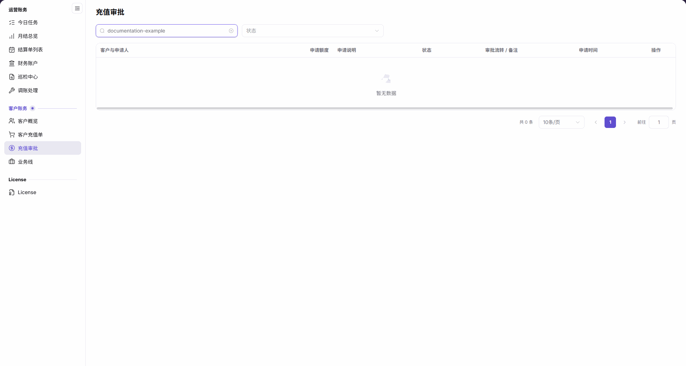

# 充值审批

::: info 文档信息
版本：v2.0
更新日期：2026-11-05
:::

## 功能概述

| 项目 | 内容 |
| --- | --- |
| 适用角色 | 运营管理员 |
| 导航路径 | 账务 > 客户账务 > 充值审批 |
| 页面路由 | `/billing/customers/top-ups/approvals` |
| 管理对象 | 客户充值申请及其审批信息 |

`充值审批` 页面提供客户名称和状态筛选，用于定位充值申请并核对申请额度、申请说明、审批流转与备注。

#### 新手理解

充值审批像充值申请台账：先确定要查的客户和状态，再读取对应申请的信息。

#### 术语速查

| 术语 | 说明 |
| --- | --- |
| 申请额度 | 充值申请中请求的 credits。 |
| 审批流转 / 备注 | 列表中用于展示审批信息和备注的列。 |

## 前提条件

1. 已登录平台，能从左侧菜单进入 `账务 > 客户账务 > 充值审批`。
2. 按客户查询时，准备需要查找的客户名称。

## 页面说明

| 区域 | 说明 |
| --- | --- |
| 筛选区 | 位于列表上方，包含 `客户名称` 输入框和 `状态` 下拉框。 |
| 申请列表 | 包含 `客户与申请人`、`申请额度`、`申请说明`、`状态`、`审批流转 / 备注`、`申请时间`、`操作` 七列。 |
| 分页区 | 展示当前查询的总条数、每页条数和页码。 |

图示为客户名称输入 `documentation-example` 后的充值审批列表：筛选区保留状态选择，结果显示 `暂无数据` 和 `共 0 条`，仅代表当前查询范围。

## 主要操作

### 按客户名称查询

1. 进入 `账务 > 客户账务 > 充值审批`。
2. 在 `客户名称` 中输入需要查找的名称；例如输入 `documentation-example` 可查看该示例名称对应的查询结果。
3. 查看列表和总条数，确认当前名称条件下是否有记录。

### 按状态缩小范围

1. 在列表上方打开 `状态` 下拉框。
2. 从界面当前提供的选项中选择需要查询的状态。
3. 结合 `客户名称` 条件查看结果，并核对列表中的 `状态` 列。

### 核对申请信息

1. 先核对 `客户与申请人`，确认正在阅读的申请对象。
2. 阅读同一行的 `申请额度`、`申请说明`、`状态`、`审批流转 / 备注` 和 `申请时间`。
3. 列表为空时，先核对当前客户名称和状态条件；不要将此结果理解为全部客户都没有申请。

## 参数速查表

下表区分查询输入与列表显示项；显示项无需填写。

| 字段名称 | 是否必填 | 字段类型 | 示例 | 说明 |
| --- | --- | --- | --- | --- |
| 客户名称 | 否 | 文本筛选 | `documentation-example` | 输入需要查询的客户名称。 |
| 状态（筛选） | 否 | 下拉筛选 | 界面当前选项 | 选择状态以缩小查询范围。 |
| 客户与申请人 | 不适用（显示项） | 列表列 | — | 核对申请对应的客户和申请人。 |
| 申请额度 | 不适用（显示项） | 列表列 | — | 查看申请的 credits 数量。 |
| 申请说明 | 不适用（显示项） | 列表列 | — | 阅读申请说明。 |
| 状态 | 不适用（显示项） | 列表列 | — | 核对该申请的状态。 |
| 审批流转 / 备注 | 不适用（显示项） | 列表列 | — | 阅读审批信息和备注。 |
| 申请时间 | 不适用（显示项） | 列表列 | — | 核对申请时间。 |
| 操作 | 不适用（显示项） | 列表列 | — | 记录行的操作区域。 |

## 踩坑提示

- `客户名称` 与 `状态` 是查询条件；列表中的 `状态` 是申请记录的显示字段，核对时不要混淆两者。
- 输入 `documentation-example` 后出现的 `共 0 条` 属于该查询范围，不是全部客户的申请总量。

## 结果校验

| 检查项 | 成功表现 | 异常时处理 |
| --- | --- | --- |
| 页面定位 | 页面显示 `充值审批`，筛选区包含 `客户名称` 和 `状态`。 | 从 `客户账务 > 充值审批` 重新定位页面。 |
| 列表字段 | 表头包含客户与申请人、申请额度、申请说明、状态、审批流转 / 备注、申请时间、操作。 | 核对是否进入充值审批，而非客户充值单。 |
| 空结果范围 | 示例名称 `documentation-example` 对应结果显示 `暂无数据` 和 `共 0 条`。 | 先核对名称和状态条件，不据此判断其他客户的记录。 |

## 常见问题

#### 空结果是否表示所有客户都没有充值申请？

**问题现象：**

客户名称输入 `documentation-example` 后，列表显示 `暂无数据`、`共 0 条`。

**可能原因：**

当前结果受客户名称及状态条件限定，查询范围不等于全部客户。

**处理方式：**

核对名称输入和状态选择，按需要修改查询条件，再读取对应范围的列表；不要从一个名称的空结果推断全部客户都没有申请。

## 注意事项

- 申请额度、审批状态与充值到账是不同信息；不要把申请列表或空结果当作资金到账凭据。
- 本页操作说明限于查询与列表核对，不提供批准、拒绝或其他资金处理的提交步骤。

## 后续操作

1. 需要核对客户信息时，参阅 [客户概览](../customer-overview/)。
2. 需要查询充值订单时，参阅 [客户充值单](../top-up-orders/)。
