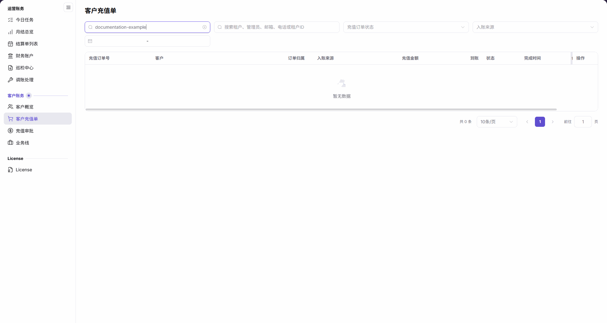

# 客户充值单

::: info 文档信息
版本：v2.1
更新日期：2026-11-05
:::

## 功能概述

| 项目 | 内容 |
| --- | --- |
| 适用角色 | 可访问客户充值单的运营人员 |
| 导航路径 | 账务 > 客户账务 > 客户充值单 |
| 页面路由 | `/billing/customers/top-ups/orders` |
| 管理对象 | 客户充值订单、订单归属、入账来源、充值金额、到账 credits 和状态 |

本页用于按订单号、客户身份、状态、来源和时间范围定位充值订单，并核对订单金额、到账 credits 和时间。充值审批从独立的 [充值审批](../top-up-approvals/) 页面进入。

#### 新手理解

客户充值单像充值流水台账：先定位订单，再分别核对原币金额、到账 credits 和订单状态。

#### 术语速查

| 术语 | 说明 |
| --- | --- |
| 充值订单号 | 用于定位充值订单的标识。 |
| 订单归属 | 表格中展示的订单所属范围。 |
| 入账来源 | 表格中的来源信息，也可作为筛选条件。 |
| 充值金额 | 按订单原币种显示的支付金额。 |
| 到账 | 以 credits 表示的到账数额，与原币金额分开核对。 |

## 前提条件

1. 已登录平台，并能访问 `账务 > 客户账务 > 客户充值单`。
2. 准备目标订单号或客户身份信息，并确认允许查看的客户范围。
3. 只有查询返回订单记录后，才能按对应行查看详情；不为查询而创建充值或调整余额。

## 页面说明

| 区域 | 说明 |
| --- | --- |
| 订单号输入 | 占位文字为 `输入充值订单号`。 |
| 客户身份输入 | 占位文字为 `搜索租户、管理员、邮箱、电话或租户ID`。 |
| 状态筛选 | `充值订单状态` 下拉框。 |
| 来源筛选 | `入账来源` 下拉框。 |
| 时间范围 | 通过日期范围控件限定查询范围。 |
| 结果与分页 | 显示匹配记录、总条数和分页控件。 |

| 区域 | 说明 |
| --- | --- |
| 充值订单号 | 充值订单标识。 |
| 客户 | 对应的客户身份。 |
| 订单归属 | 订单所属范围。 |
| 入账来源 | 订单的入账来源。 |
| 充值金额 | 订单原币金额，不统一按人民币解释。 |
| 到账 | 到账 credits，不与充值金额视为同一值。 |
| 状态 | 订单当前状态。 |
| 完成时间 | 订单完成时间。 |
| 创建时间 | 订单创建时间。 |
| 操作 | 有记录时从对应行查看 `详情`。 |

图示为订单号输入 `documentation-example` 后的空结果，显示 `暂无数据`、`共 0 条`，可见订单归属、入账来源、充值金额、到账和完成时间。`创建时间` 列位于当前可读视区之外，需横向滚动表格查看，不要将未入镜理解为没有该字段。

## 主要操作

### 查询客户充值单

1. 进入 `账务 > 客户账务 > 客户充值单`。
2. 在 `输入充值订单号` 中输入目标订单号，或在 `搜索租户、管理员、邮箱、电话或租户ID` 中输入客户身份信息。
3. 按需选择 `充值订单状态`、`入账来源` 和时间范围，再查看列表结果。
4. 如显示 `暂无数据`、`共 0 条`，核对并调整当前输入、状态、来源和时间范围。

### 查看充值单详情

1. 有匹配记录时，先核对目标行的 `充值订单号`、`客户`、`订单归属` 和 `入账来源`。
2. 分别阅读 `充值金额` 的原币金额和 `到账` 的 credits，核对 `状态`、`完成时间` 和 `创建时间`；时间列不在可视区时横向滚动表格。
3. 点击目标行的 `详情`，核对该订单的订单信息、状态、金额和时间。
4. 需要核对客户余额时，前往 [客户概览](../customer-overview/) 对照目标客户；不要仅凭订单金额推定当前余额。

### 进入充值审批

1. 如需处理审批，从 `客户账务` 菜单进入独立的 `充值审批` 页面。
2. 按 [充值审批](../top-up-approvals/) 文档核对审批对象和操作边界，不将订单查询与审批混为同一流程。

## 参数速查表

| 字段名称 | 是否必填 | 字段类型 | 示例 | 说明 |
| --- | --- | --- | --- | --- |
| 输入充值订单号 | 否 | 文本 | `<充值订单号>` | 订单号查询输入框。 |
| 搜索租户、管理员、邮箱、电话或租户ID | 否 | 文本 | `documentation-example` | 综合客户身份查询输入框。 |
| 充值订单状态 | 否 | 下拉选择 | `<订单状态>` | 按订单状态筛选。 |
| 入账来源 | 否 | 下拉选择 / 列表文本 | `<入账来源>` | 用于筛选并展示订单来源。 |
| 时间范围 | 否 | 日期范围 | `<开始日期> - <结束日期>` | 限定查询时间范围。 |
| 充值订单号 | 只读 | 文本 | `<充值订单号>` | 列表中的订单标识。 |
| 客户 | 只读 | 客户信息 | `<客户>` | 对应客户身份。 |
| 订单归属 | 只读 | 范围信息 | `<订单归属>` | 对应订单的所属范围。 |
| 充值金额 | 只读 | 原币金额 | `<币种> <金额>` | 按订单原币种核对。 |
| 到账 | 只读 | Credits | `0` | 与原币金额分别核对。 |
| 状态 | 只读 | 状态值 | `<状态>` | 当前订单状态。 |
| 完成时间 | 只读 | 时间 | `<完成时间>` | 订单完成时间。 |
| 创建时间 | 只读 | 时间 | `<创建时间>` | 订单创建时间。 |
| 详情 | 不适用 | 行内入口 | `详情` | 有记录时进入目标订单核对信息。 |

## 踩坑提示

- `充值金额` 与 `到账` 是不同列：前者按订单原币种展示，后者为 credits，不应统一写成同一币种或同一数值。
- `订单归属` 与 `入账来源` 是不同维度，定位订单时分别核对。
- `完成时间` 与 `创建时间` 是两个独立字段，不要相互替代。
- 审批通过独立的 `充值审批` 菜单进入，不将订单 `状态` 当作审批操作入口。

## 结果校验

| 检查项 | 成功表现 | 异常时处理 |
| --- | --- | --- |
| 查询对象 | 订单号和客户身份输入与目标对象一致 | 核对或调整对应输入。 |
| 空结果 | 当前条件无匹配记录时显示 `暂无数据`、`共 0 条` | 逐项核对订单号、客户身份、状态、来源和时间范围。 |
| 金额口径 | 分别读取原币充值金额和到账 credits | 返回目标行核对两列，勿直接视为同一值。 |
| 时间口径 | 分别核对完成时间和创建时间 | 时间列不在可视区时横向滚动表格。 |

## 常见问题

#### 为什么列表显示暂无数据？

**问题现象：** 表格显示 `暂无数据`，总条数为 `共 0 条`。

**可能原因：** 当前查询条件下没有匹配记录。

**处理方式：** 核对订单号、客户身份、状态、来源和时间范围，按需调整条件后查看结果。

#### 为什么充值金额和到账的单位不同？

**问题现象：** `充值金额` 使用订单币种，`到账` 使用 credits。

**可能原因：** 两列分别表示原币支付金额和到账 credits，并非同一计量字段。

**处理方式：** 分别记录两列及其单位，结合订单状态和时间核对，不直接比较其数值是否相等。

## 注意事项

- 本页用于订单查询与核对；需要审批时进入 [充值审批](../top-up-approvals/)。
- 金额或状态存在疑问时，先核对订单和客户范围，不通过重复充值或人工调账试探结果。
- 客户身份和订单信息仅在授权业务范围内使用；共享时只提供排查必需内容，不传播凭证或无关客户信息。

## 后续操作

- 前往 [客户概览](../customer-overview/) 核对目标客户余额和客户信息。
- 前往 [充值审批](../top-up-approvals/) 处理独立的审批流程。
