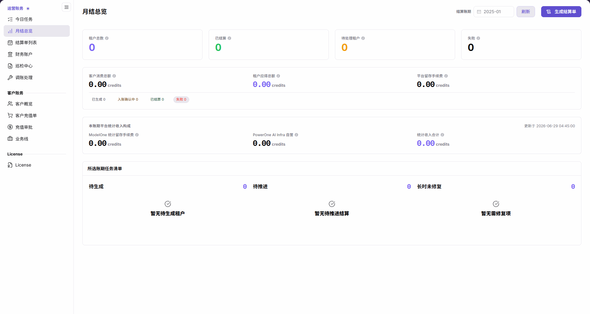

# 月结总览

::: info 文档信息
版本：v2.1
更新日期：2026-11-05
:::

## 功能概述

| 项目 | 内容 |
| --- | --- |
| 适用角色 | 运营管理员 |
| 导航路径 | 账务 > 运营账务 > 月结总览 |
| 页面路由 | `/billing/admin/provider-settlements/monthly-overview` |
| 管理对象 | 账期内租户结算统计、金额汇总、平台统计收入构成和任务清单 |

`月结总览` 用于选择账期并刷新统计，查看租户结算状态、客户消费总额、租户应得总额、平台留存手续费、统计收入构成和待处理任务，并打开结算生成入口。

#### 新手理解

月结总览像账期月报：选好月份后点击刷新，再读人数、金额和任务清单，最后决定去哪里核对明细。

#### 术语速查

| 术语 | 说明 |
| --- | --- |
| 结算账期 | 本页统计对应的月份；更改后需点击刷新加载统计。 |
| 租户结算统计 | 租户总数、已结算、待处理租户和失败四个统计卡。 |
| 本账期平台统计收入构成 | ModelOne 统计留存手续费、PowerOne AI Infra 自营和统计收入合计。 |
| 所选账期任务清单 | 待生成、待推进和长时未修复的数量及相应提示。 |

## 前提条件

1. 当前账号能够进入 `运营账务 > 月结总览`。
2. 已明确要查询的结算月份。
3. 如需继续生成结算单，先确认目标账期、租户和账务数据范围，并准备所需操作依据。

## 页面说明

中文主内容标题为 `月结总览`；英文菜单为 `Monthly Overview`，主内容标题为 `Billing Cycle Settlement Overview`。

图示为选择账期 2025-01 并点击“刷新”后的空结果：四个统计卡、各项金额和任务数量均为 0，任务清单显示对应空态提示。

| 区域 | 说明 |
| --- | --- |
| 结算账期与刷新 | 选择或输入月份，再点击“刷新”加载对应账期统计；仅改变月份不会加载对应统计。 |
| 生成结算单 | 打开结算生成页面，不表示已生成或到账。 |
| 四个统计卡 | 展示租户总数、已结算、待处理租户和失败数量。 |
| 金额汇总与状态 | 展示客户消费总额、租户应得总额、平台留存手续费，以及已生成、入账确认中、已结算和失败计数。 |
| 本账期平台统计收入构成 | 展示更新于时间、ModelOne 统计留存手续费、PowerOne AI Infra 自营和统计收入合计。 |
| 所选账期任务清单 | 展示待生成、待推进和长时未修复；空结果分别提示“暂无待生成租户”“暂无待推进结算”“暂无需修复项”。 |

## 主要操作

### 选择账期并读取统计

1. 进入 `账务 > 运营账务 > 月结总览`。
2. 在 `结算账期` 中选择或输入目标月份，例如 `2025-01`。
3. 点击 **"刷新"**，加载该月份统计；不要仅更改输入后就读取旧统计。
4. 阅读 `租户总数`、`已结算`、`待处理租户` 和 `失败` 四个统计卡。
5. 核对 `客户消费总额`、`租户应得总额` 和 `平台留存手续费`，再读 `已生成`、`入账确认中`、`已结算` 和 `失败` 计数。
6. 阅读本账期平台统计收入构成的更新时间、`ModelOne 统计留存手续费`、`PowerOne AI Infra 自营` 和 `统计收入合计`。金额单位均为 `credits`。
7. 阅读任务清单的 `待生成`、`待推进` 和 `长时未修复` 数量及提示。空结果示例中三项均为 `0`，并显示各自空态文案。

### 打开结算生成入口

1. 确认目标账期已选择并点击过 **"刷新"**。
2. 核对四个统计卡、金额汇总和任务清单，明确准备继续处理的范围。
3. 点击 **"生成结算单"**，进入结算生成页面。
4. 按 [结算单列表](../settlement-list/) 中的四步生成流程继续；本页按钮只打开入口，不代表生成成功、结算完成或资金到账。

## 参数速查表

| 字段名称 | 是否必填 | 字段类型 | 示例 | 说明 |
| --- | --- | --- | --- | --- |
| 结算账期 | 必填 | 月份 | `2025-01` | 设置查询月份后需点击刷新。 |
| 刷新 | 操作入口 | 按钮 | 刷新 | 加载所选账期统计。 |
| 租户总数 | 系统展示 | 数值 | `0` | 所选账期纳入统计的租户数量。 |
| 已结算 | 系统展示 | 数值 | `0` | 四个统计卡中的已结算租户数量。 |
| 待处理租户 | 系统展示 | 数值 | `0` | 所选账期待处理租户数量。 |
| 失败 | 系统展示 | 数值 | `0` | 四个统计卡中的失败数量。 |
| 客户消费总额 | 系统展示 | 金额 | `0.00 credits` | 所选账期客户消费金额汇总。 |
| 租户应得总额 | 系统展示 | 金额 | `0.00 credits` | 所选账期租户应得金额合计。 |
| 平台留存手续费 | 系统展示 | 金额 | `0.00 credits` | 金额汇总区域中的平台留存手续费。 |
| 已生成 / 入账确认中 / 已结算 / 失败 | 系统展示 | 数值 | `0` | 金额汇总下方展示的对应结算状态计数，与租户统计卡分开阅读。 |
| ModelOne 统计留存手续费 | 系统展示 | 金额 | `0.00 credits` | 本账期平台统计收入构成中的 ModelOne 项。 |
| PowerOne AI Infra 自营 | 系统展示 | 金额 | `0.00 credits` | 本账期平台统计收入构成中的 PowerOne AI Infra 自营项。 |
| 统计收入合计 | 系统展示 | 金额 | `0.00 credits` | 本账期平台统计收入构成的合计金额。 |
| 待生成 | 系统展示 | 数值 | `0` | 任务清单中的待生成租户数量；空态为“暂无待生成租户”。 |
| 待推进 | 系统展示 | 数值 | `0` | 任务清单中的待推进结算数量；空态为“暂无待推进结算”。 |
| 长时未修复 | 系统展示 | 数值 | `0` | 任务清单中的长时未修复数量；空态为“暂无需修复项”。 |
| 生成结算单 | 操作入口 | 按钮 | 生成结算单 | 打开结算生成页面，后续步骤参见结算单列表。 |

## 踩坑提示

- 只更改 `结算账期` 不会加载对应统计，必须再点击 `刷新`。
- 四个租户统计卡与金额汇总下方的结算状态计数是不同展示区域，不应混为同一组数量。
- `ModelOne 统计留存手续费` 位于收入构成区域，应与金额汇总中的 `平台留存手续费` 按各自标签区分。
- `生成结算单` 只进入生成流程，不是成功提示，也不是到账凭证。

## 结果校验

| 检查项 | 成功表现 | 异常时处理 |
| --- | --- | --- |
| 账期加载 | 已确认月份并点击刷新后读取统计 | 重新核对月份，再点击刷新 |
| 空结果 | 2025-01 示例中四个统计卡和金额均为 0，任务清单显示三项空态提示 | 先核对账期及是否已刷新，不将空态解释为生成失败 |
| 统计口径 | 已分别读取租户统计、金额、收入构成和任务清单 | 按区域名称及字段标签重新核对 |
| 生成入口 | 点击生成结算单后进入生成页面 | 从结算单列表继续核对入口；不能将进入页面当作已生成 |

## 常见问题

#### 为什么更改账期后统计没有随输入变化？

**问题现象：** 账期输入已经改变，但统计仍不是目标月份的结果。

**可能原因：** 本页需要点击“刷新”才会加载所选账期统计，仅修改月份不会触发对应统计加载。

**处理方式：** 核对结算账期后点击“刷新”，再读取统计卡、金额和任务清单。

#### 为什么任务清单显示没有待处理项？

**问题现象：** 任务数量为 0，并显示“暂无待生成租户”“暂无待推进结算”“暂无需修复项”。

**可能原因：** 这些是所选账期任务清单的空结果提示；2025-01 的空结果示例即显示此状态。

**处理方式：** 先确认所选月份并已点击刷新，按该账期读取结果；不要将空态当作生成失败或已完成资金到账的证明。

## 注意事项

- 继续结算生成流程前确认账期、租户和金额范围，并保留所需操作依据。
- 不要仅凭总览金额作出到账结论，应结合结算单详情和账户流水核对。
- 分享账务信息时遵守数据访问与保密要求，不在公开材料中记录客户数据或凭证。

## 后续操作

1. 继续四步生成流程或核对结算记录，进入 [结算单列表](../settlement-list/)。
2. 核对平台账户和流水，进入 [财务账户](../financial-accounts/)。
3. 查看账务巡检信息，进入 [巡检中心](../reconciliation-center/)。
4. 返回日常结算与账户汇总，进入 [今日任务](../today-tasks/)。
