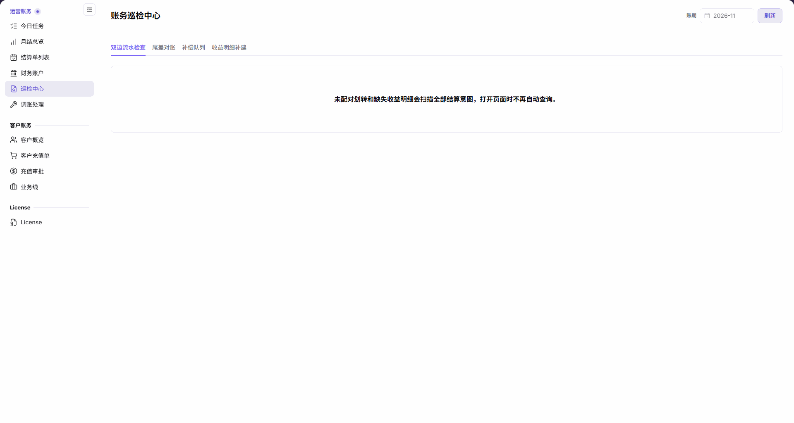
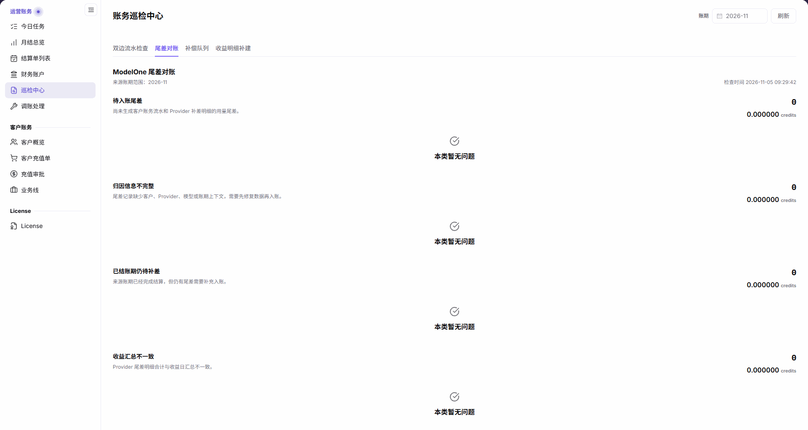
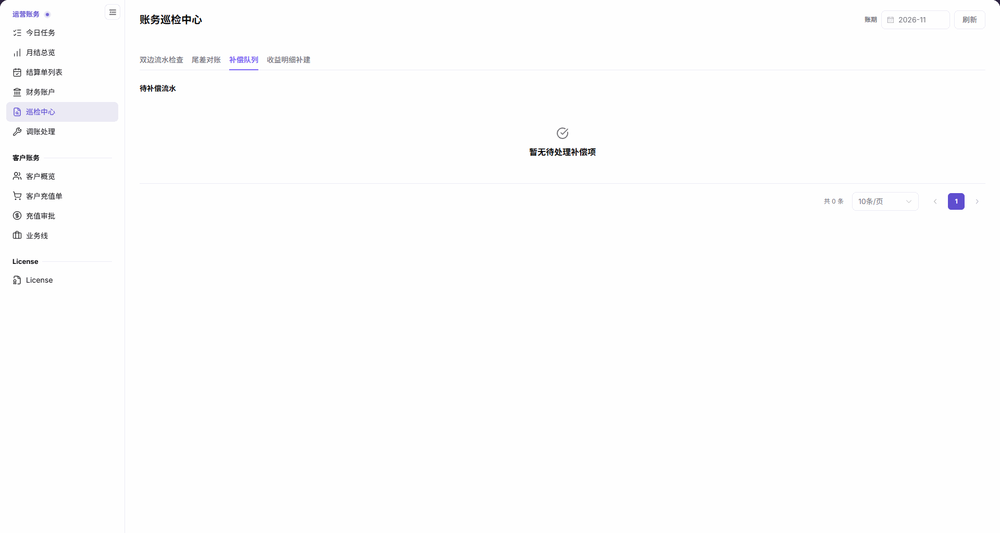
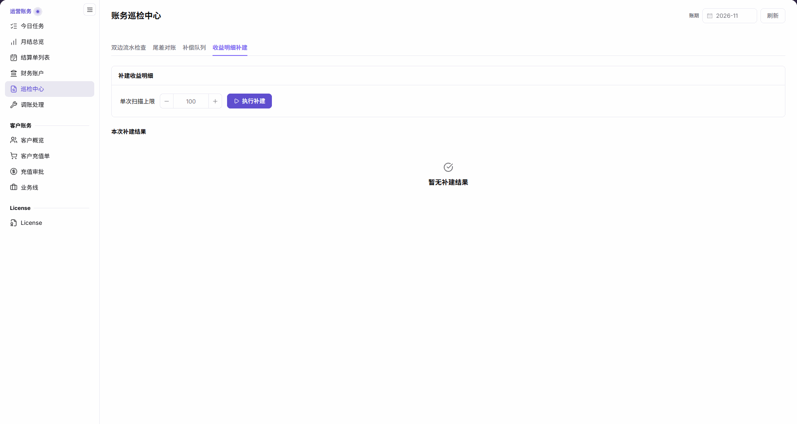

# 巡检中心

::: info 文档信息
版本：v2.1
更新日期：2026-11-05
:::

## 功能概述

| 项目 | 内容 |
| --- | --- |
| 适用角色 | 运营管理员 |
| 导航路径 | 账务 > 运营账务 > 巡检中心 |
| 页面路由 | `/billing/admin/reconciliation` |
| 管理对象 | 双边流水检查、尾差对账、补偿队列和收益明细补建 |

本页通过四个页签分别提供账务检查、尾差分类、待补偿流水和收益明细补建入口。

#### 新手理解

巡检中心像账务体检台，各页签检查不同问题；某一类空结果不能代替所有检查的结论。

#### 术语速查

| 术语 | 说明 |
| --- | --- |
| 双边流水检查 | 查看未配对划转和缺失收益明细；查询扫描全部结算意图。 |
| 尾差对账 | 查看 ModelOne 尾差的五类检查及其数量、金额。 |
| 补偿队列 | 查看待补偿流水。 |
| 收益明细补建 | 提供单次扫描上限和执行补建入口，结果单独显示。 |
| 来源账期范围 | 尾差对账结果标明的来源账期窗口。 |

## 前提条件

1. 当前账号能够访问 `账务 > 运营账务 > 巡检中心`。
2. 已明确本次要查看的检查类别与账期，并备有关联账户流水或结算单作为核对依据。
3. 若计划执行收益明细补建，先确认操作授权、扫描范围和单次扫描上限；只读核对不需要执行补建。

## 页面说明

菜单名称为 `巡检中心`，内容主标题为 `账务巡检中心`。顶部包含 `账期` 和 `刷新`，下方依次是四个按钮页签。

| 区域 | 说明 |
| --- | --- |
| 双边流水检查 | 页面提示“未配对划转和缺失收益明细会扫描全部结算意图，打开页面时不再自动查询。” |
| 尾差对账 | 显示“ModelOne 尾差对账”、来源账期范围、检查时间，以及五类数量和六位小数 credits 金额。 |
| 补偿队列 | 显示“待补偿流水”；空态为“暂无待处理补偿项”。 |
| 收益明细补建 | 显示“补建收益明细”、单次扫描上限、“执行补建”和“本次补建结果”；无结果时显示“暂无补建结果”。 |

尾差对账的五类检查含义如下，均以页面说明为准：

| 区域 | 说明 |
| --- | --- |
| 待入账尾差 | 尚未生成客户账务流水和 Provider 补差明细的用量尾差。 |
| 归因信息不完整 | 尾差记录缺少客户、Provider、模型或账期上下文，需要先修复数据再入账。 |
| 已结账期仍待补差 | 来源账期已经完成结算，但仍有尾差需要补充入账。 |
| 收益汇总不一致 | Provider 尾差明细合计与收益日汇总不一致。 |
| 入账金额不一致 | 原始尾差、两位小数账务流水、结转金额和 Provider 明细未能对平。 |

## 主要操作

### 查看双边流水检查

1. 进入 `账务 > 运营账务 > 巡检中心`，点击 `双边流水检查`。
2. 阅读全历史扫描提示；打开页面时未自动查询，不能把尚未出现结果表格当作“没有异常”。
3. 核对顶部账期，但不要把它理解成未配对划转和缺失收益明细只扫描该账期。
4. 当页面已有查询结果时，分别查看未配对划转和缺失收益明细；需要追溯时，结合财务账户和结算单核对，不把页签切换视为查询完成。

图示为双边流水检查页签的全历史扫描提示，说明打开页面时不再自动查询；当前视图没有提供异常查询结论。

### 查看尾差对账

1. 点击 `尾差对账`，核对顶部 `账期`；需要重新读取时使用 `刷新`。
2. 在 `ModelOne 尾差对账` 中读取 `来源账期范围` 和 `检查时间`。
3. 分别检查待入账尾差、归因信息不完整、已结账期仍待补差、收益汇总不一致、入账金额不一致的数量与金额。
4. 某类显示 `本类暂无问题` 时，只对该类别和所示范围记录结论；保留六位小数 credits 精度，不与两位小数流水金额直接混同。

图示为 ModelOne 尾差对账页面上部的前四类检查，包含数量、六位小数 credits 金额和“本类暂无问题”，上方注明来源账期范围与检查时间。第五类 `入账金额不一致` 位于页面下方；核对时继续向下滚动，不要只检查图中可见的四类。

### 查看补偿队列

1. 点击 `补偿队列`。
2. 查看 `待补偿流水` 及记录总数；存在多页时使用分页。
3. 显示 `暂无待处理补偿项` 时，将其记录为当前队列的空态，不扩大为双边检查或尾差检查均无异常。

图示为“待补偿流水”的空态“暂无待处理补偿项”及分页区域，不展示失败原因、重试次数或处理成功结果。

### 查看收益明细补建入口与结果

1. 点击 `收益明细补建`。
2. 查看 `单次扫描上限`，数字输入框默认值为 `100`。
3. 识别 `执行补建` 入口；仅查看参数和结果时，不点击该按钮。确需执行时，先确认授权与扫描范围。
4. 查看 `本次补建结果`；显示 `暂无补建结果` 时，不能据此判断历史收益明细是否完整。
5. 若结果区已有记录，按其完成时间、扫描上限、已扫描、已生成、已跳过核对本次扫描结果；这些结果字段仅在有结果时读取，不将空态写成补建成功。

图示为默认扫描上限 100、“执行补建”入口与“本次补建结果”的“暂无补建结果”空态，不表示已执行补建。

## 参数速查表

| 字段名称 | 是否必填 | 字段类型 | 示例 | 说明 |
| --- | --- | --- | --- | --- |
| 账期 | 按需选择 | 月份 | 2026-11 | 顶部账期选择；不限定双边检查的全结算意图扫描范围。 |
| 刷新 | 按需操作 | 按钮 | 刷新 | 顶部刷新入口，不以计数变化作为成功前提。 |
| 双边流水检查 / 尾差对账 / 补偿队列 / 收益明细补建 | 按需选择 | 按钮页签 | 尾差对账 | 切换四种任务视图。 |
| 来源账期范围 | 只读 | 账期窗口 | 2026-11 | 尾差结果所注明的来源范围。 |
| 检查时间 | 只读 | 日期时间 | 按页面显示 | 尾差结果的检查时间。 |
| 五类尾差数量 | 只读 | 整数 | 0 | 每一类别单独显示数量。 |
| 五类尾差金额 | 只读 | 金额 | 0.000000 credits | 六位小数，不与两位小数流水混用。 |
| 待补偿流水 | 只读 | 队列 | 0 条 | 无待处理项时显示对应空态。 |
| 单次扫描上限 | 执行前确认 | 数字输入框 | 100 | 默认值为 100，不据此推定未显示的最大值或最小值。 |
| 执行补建 | 需操作授权 | 按钮 | 执行补建 | 补建执行入口，不是只读查询按钮。 |
| 本次补建结果 | 只读 | 结果区 | 暂无补建结果 | 有结果时读取完成时间、扫描上限、已扫描、已生成、已跳过。 |

## 踩坑提示

- 双边检查提示明确说明不再自动查询；初始没有结果表格不是“未发现异常”的证据。
- 未配对划转和缺失收益明细扫描全部结算意图，不能将顶部账期选择解释为这两类检查的全部范围。
- 尾差六位小数 credits 与两位小数账务流水存在精度口径差异；“入账金额不一致”说明还同时涉及结转金额和 Provider 明细。
- “本类暂无问题”“暂无待处理补偿项”“暂无补建结果”分别属于不同区域，不能互相代替。

## 结果校验

| 检查项 | 成功表现 | 异常时处理 |
| --- | --- | --- |
| 检查入口 | 四个页签名称及对应内容可核对 | 确认当前选择的页签，不混用不同区域结论。 |
| 双边检查范围 | 能读到全结算意图扫描及不自动查询提示 | 未有查询结果时不作无异常结论。 |
| 尾差结果 | 能核对来源账期范围、检查时间和五类数量、金额或类别空态 | 按具体类别与范围记录，再结合流水和结算单核对。 |
| 补偿队列 | 待补偿流水显示记录或“暂无待处理补偿项” | 不从队列空态推断其他检查结果。 |
| 补建结果 | 能区分“暂无补建结果”与实际结果记录 | 有结果时核对扫描统计；无结果时不宣称执行成功。 |

## 常见问题

#### 打开双边检查却没有结果表格，能认为没有异常吗？

**问题现象：** 进入双边流水检查后只看到提示，没有异常结果表格。

**可能原因：** 页面明确说明“未配对划转和缺失收益明细会扫描全部结算意图，打开页面时不再自动查询。”

**处理方式：** 将初始视图与实际查询结果区分，不据此判断无异常，也不把账期选择当成全历史检查的范围限制。

#### “暂无补建结果”是否表示收益明细完整？

**问题现象：** 本次补建结果显示“暂无补建结果”。

**可能原因：** 该提示描述的是本次补建结果区，而不是全部收益明细的完整性检查。

**处理方式：** 只记录结果区为空；需要执行补建时先确认授权、范围与扫描上限，不用空态代替执行结果。

## 注意事项

- 检查结果用于定位核对范围，不作为直接修改账务数据的唯一依据。
- `执行补建` 是执行入口；阅读本页或切换页签不代表已获得执行授权。
- 五类尾差均为空也不能证明平台所有账务均无异常，双边检查和补偿队列需分别判断。
- 不在公开材料中写入真实账务金额、账户标识、客户数据或凭证。

## 后续操作

1. 通过 [财务账户](../financial-accounts/) 核对资金方向和账户流水。
2. 通过 [结算单列表](../settlement-list/) 核对结算单状态与金额。
3. 通过 [月结总览](../monthly-overview/) 查看账期汇总。
4. 确需人工修正时，按审批流程参考 [调账处理](../account-adjustment/)，不直接依据单一巡检空态操作。
