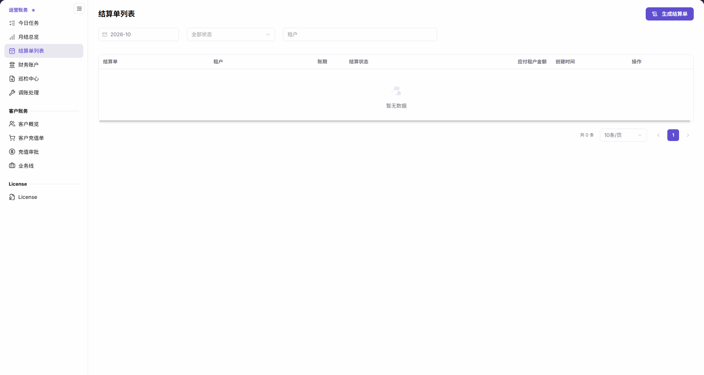
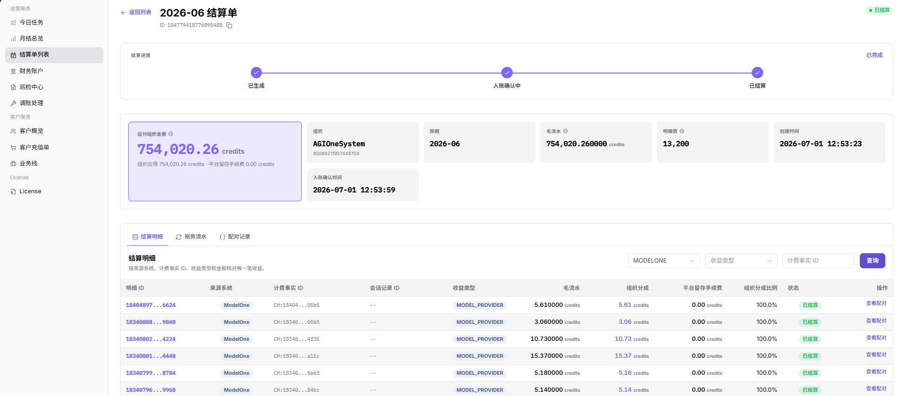
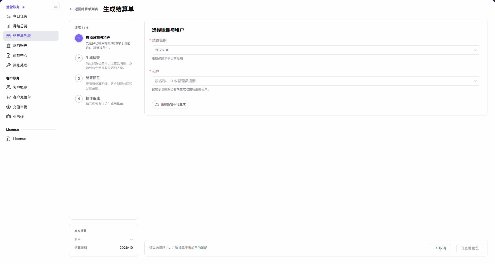
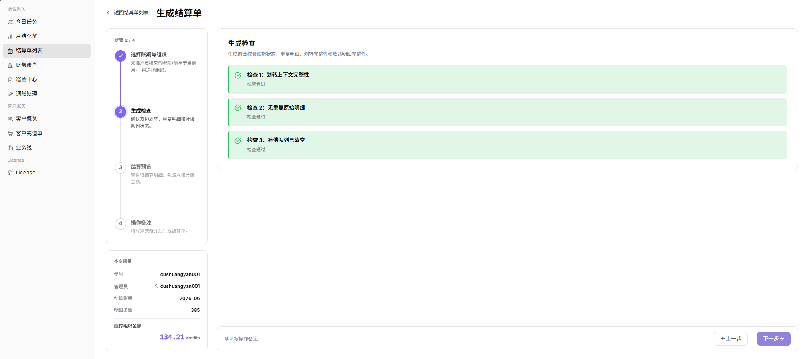
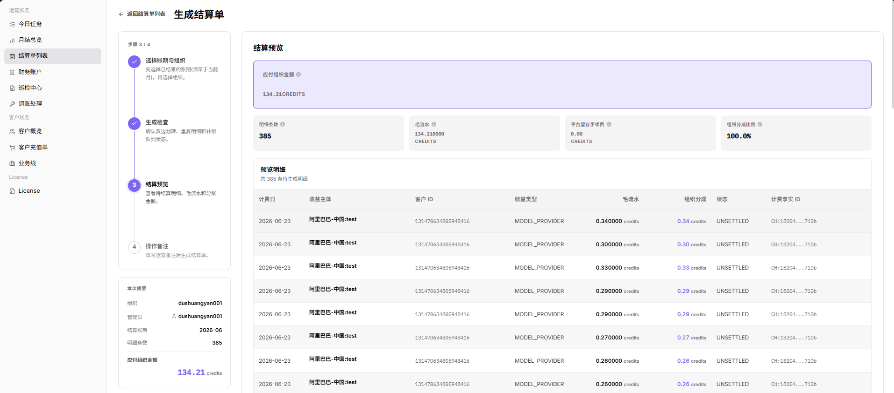
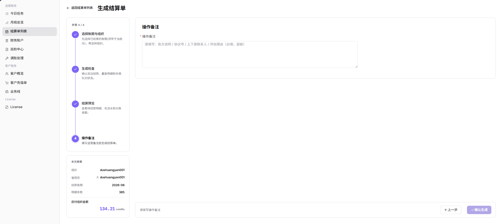

# 结算单列表

::: info 文档信息
版本：v2.1
更新日期：2026-11-05
:::

## 功能概述

| 项目 | 内容 |
| --- | --- |
| 适用角色 | 运营管理员 |
| 导航路径 | 账务 > 运营账务 > 结算单列表 |
| 页面路由 | `/billing/admin/provider-settlements` |
| 管理对象 | 租户各账期的结算单、结算金额及入账确认信息 |

本页用于按结算账期、结算状态和租户定位结算单，进入详情核对结算进度与明细，也提供结算单生成流程入口。

#### 新手理解

结算单像按“租户 + 账期”整理的对账清单；打开生成页面只是开始准备清单，不代表已经生成或入账。

#### 术语速查

| 术语 | 说明 |
| --- | --- |
| 结算账期 | 查询或生成结算单对应的月份。 |
| 应付租户金额 | 结算单中应付给租户的金额，单位为 credits。 |
| 生成检查 | 核对划转、重复明细和补偿队列等信息的阶段。 |
| 结算预览 | 确认生成前核对金额拆分及待结算明细的阶段。 |
| 入账确认 | 详情中用于核对入账处理进度和确认时间的信息。 |

## 前提条件

1. 已进入运营管理员的 `账务 > 运营账务 > 结算单列表`。
2. 已明确待核对的账期、租户、金额与审批依据。
3. 需要生成时，选择早于当前月的账期；租户选项仅展示该账期仍有未生成收益明细的租户。
4. 涉及最终确认生成时，先完成业务核对和所需审批；只读核对时不要执行最终确认。

## 页面说明

| 区域 | 说明 |
| --- | --- |
| 顶部入口 | `生成结算单` 打开生成页面，不会仅因点击入口就完成生成。 |
| 筛选区 | 仅包含结算账期、结算状态和租户三个筛选。 |
| 结果表格 | 列为结算单、租户、账期、结算状态、应付租户金额、创建时间、操作；金额单位为 credits。 |
| 分页区 | 显示记录总数、每页条数和翻页入口。 |
| 生成页面 | 分为选择账期与租户、生成检查、结算预览、操作备注四个阶段。 |

图示为结算单列表的三个筛选、七列表格和顶部生成入口；`暂无数据` 表示当前筛选范围没有列表记录。

## 主要操作

### 查询结算单

1. 进入 `账务 > 运营账务 > 结算单列表`。
2. 选择 `结算账期`，按需调整结算状态和租户筛选。
3. 在结果中核对结算单、租户、账期、结算状态、应付租户金额及创建时间。
4. 列表显示 `暂无数据` 时，先核对当前三个筛选值，不据此判断其他账期或租户没有结算单。

### 查看结算单详情

1. 在有记录的列表中定位目标结算单，点击该行的 `查看详情`。
2. 核对租户与账期，查看结算进度、应付金额、毛流水、明细数量及入账确认时间。
3. 在结算明细中定位目标记录，结合来源系统、收益类型和计费事实 ID 核对明细来源。
4. 查看账务流水和配对记录，并通过查看配对入口核对关联信息。
5. 将金额、明细与审批依据交叉核对；发现差异时进入财务账户或巡检中心继续核查，不用重新生成代替对账。

图示为结算单详情中的结算进度、金额、明细数量、入账确认时间，以及结算明细、账务流水和配对记录入口。

### 生成结算单

1. 在列表顶部点击 `生成结算单`，进入生成页面；入口携带所选账期，例如 `/billing/admin/provider-settlements/generate?cycle=2026-10`。
2. 在 `选择账期与租户` 阶段选择必填的 `结算账期` 和 `租户`。账期必须早于当前月，租户可按名称、ID 或管理员搜索，且仅展示该账期仍有未生成收益明细的租户。
3. 核对摘要中的租户和结算账期。未选租户时，`查看预览` 禁用，页面提示 `该账期暂不可生成` 和 `请先选择租户，并选择早于当前月的账期`；符合页面要求后再点击 `查看预览`。

图示为第一阶段的必填账期、租户和摘要；`查看预览` 是继续核对的入口，不是最终生成按钮。

4. 在 `生成检查` 阶段阅读检查结果，核对划转上下文完整、无重复原始明细、补偿队列清空等检查项，再通过下一步继续核对。

图示为生成检查中的划转上下文、重复原始明细和补偿队列检查结果，继续前应逐项阅读。

5. 在 `结算预览` 阶段核对租户、账期、应付金额、金额拆分和待结算明细，再通过下一步进入备注阶段。

图示为结算预览中的金额拆分与明细范围，应与本次账期、租户及审批依据逐项核对。

6. 在 `操作备注` 阶段填写必填备注，仅记录必要的业务说明，不填写银行账号、凭证或客户敏感信息。
7. 最终核对结算范围、金额和审批依据；只有获准执行生成时才点击 `确认生成`。只需查看时，不执行此动作。

图示为必填的操作备注及最终 `确认生成` 按钮；填写备注不等于已经完成生成。

8. 执行生成后返回列表，按账期和租户核对是否有对应记录，并进入详情核对金额、结算进度及入账确认信息；不要仅以打开生成页或点击按钮作为生成、到账完成的依据。

## 参数速查表

| 字段名称 | 是否必填 | 字段类型 | 示例 | 说明 |
| --- | --- | --- | --- | --- |
| 结算账期 | 生成时必填 | 月份选择 | `2026-10` | 列表查询条件；生成时必须早于当前月。 |
| 租户 | 生成时必填 | 租户选择 | `<租户>` | 列表查询条件；生成时仅列出该账期仍有未生成收益明细的租户。 |
| 结算状态 | 查询时按需 | 状态选择 / 结果字段 | `<结算状态>` | 列表筛选及结算单当前状态，不等同于入账确认时间。 |
| 结算单 | 系统展示 | 文本 | `<结算单标识>` | 用于定位单据及对应详情。 |
| 应付租户金额 | 系统展示 | 金额 | `0 credits` | 列表和详情中应付给租户的金额。 |
| 创建时间 | 系统展示 | 日期时间 | `<创建时间>` | 结算单的创建时间。 |
| 生成结算单 | 按需操作 | 导航入口 | `生成结算单` | 打开生成页面，不等于完成生成。 |
| 查看预览 | 按需操作 | 按钮 | `查看预览` | 第一阶段继续核对的入口；未选择租户时禁用。 |
| 生成检查 | 系统展示 | 检查结果 | `<检查结果>` | 阅读划转上下文、重复原始明细和补偿队列等检查项。 |
| 结算预览 | 系统展示 | 金额与明细 | `0 credits` | 核对生成范围、金额拆分及明细。 |
| 操作备注 | 是 | 文本 | `<业务说明>` | 最终确认前填写必要的操作说明。 |
| 确认生成 | 需业务授权 | 最终按钮 | `确认生成` | 最终生成动作，执行前核对审批依据。 |
| 查看详情 | 按需操作 | 详情入口 | `查看详情` | 核对结算进度、金额、明细、流水、配对记录和入账确认时间。 |

## 踩坑提示

- `生成结算单` 是进入四阶段流程的入口，不能把导航成功当作生成成功。
- 列表 `暂无数据` 仅描述所选筛选范围，不能由此判断历史单据没有详情。
- 生成页的账期和租户都必填；列表中的租户范围不应与生成页的可选租户范围混为一谈。
- 最终按钮是 `确认生成`，第一阶段的 `查看预览` 不是最终确认。

## 结果校验

| 检查项 | 成功表现 | 异常时处理 |
| --- | --- | --- |
| 查询范围 | 三个筛选值与待核对的账期、状态和租户一致 | 调整对应筛选，不将空列表视为全部历史记录为空。 |
| 生成入口 | 打开生成页，展示四个阶段及第一阶段表单 | 返回列表核对所选账期，不把导航当作已生成。 |
| 首步输入 | 摘要中的租户和结算账期与目标一致 | 核对必填租户及早于当前月的账期要求。 |
| 单据核对 | 对应记录的租户、账期和 credits 金额与业务依据一致 | 打开详情，结合月结总览核对差异。 |
| 详情核对 | 可核对结算进度、明细数量、流水、配对记录和入账确认时间 | 结合财务账户和巡检中心核查，不仅凭列表金额确认到账。 |

## 常见问题

#### 未选择租户时为什么不能查看预览？

**问题现象：** `查看预览` 禁用，页面提示 `该账期暂不可生成`。

**可能原因：** 当前租户尚未选择；页面要求 `请先选择租户，并选择早于当前月的账期`。

**处理方式：** 选择早于当前月的账期及符合页面条件的租户，再核对摘要。租户选项仅展示该账期仍有未生成收益明细的租户。

#### 点击生成结算单后是否已生成？

**问题现象：** 点击 `生成结算单` 后看到第一阶段表单。

**可能原因：** 该按钮是生成页面入口；页面仍列有生成检查、结算预览和操作备注阶段。

**处理方式：** 先按四阶段核对范围及金额，依据审批决定是否执行最终 `确认生成`；用列表和详情核对结果，不把进入页面当作生成完成。

## 注意事项

- 只读核对不得执行最终生成；涉及生成须先核对账期、租户、金额及审批依据。
- 不以重复生成或重复点击资金相关动作处理金额差异；先核对现有单据、明细和流水。
- 结算单状态与入账确认分别核对，不仅凭列表状态或金额认定资金到账。
- 备注、工单和对外材料仅保留必要的业务信息；不要写入客户敏感信息、银行账号、密码、Token 或 Key。

## 后续操作

1. 进入 [月结总览](../monthly-overview/) 核对同一账期和租户的结算范围。
2. 进入 [财务账户](../financial-accounts/) 核对关联流水及资金信息。
3. 需要继续核查差异时，进入 [巡检中心](../reconciliation-center/)，结合结算单明细和配对记录核对。
