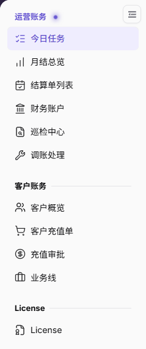

# 今日任务

::: info 文档信息
版本：v2.1
更新日期：2026-11-05
:::

## 功能概述

| 项目 | 内容 |
| --- | --- |
| 适用角色 | 运营管理员 |
| 导航路径 | 账务 > 运营账务 > 今日任务 |
| 页面路由 | `/billing/admin/tasks` |
| 管理对象 | 账期结算指标、平台账户汇总、结算工作台和平台账户对账 |

`今日任务` 集中展示结算进度、平台账户金额和告警项，并通过两个任务卡片连接结算单和财务账户页面。

#### 新手理解

今日任务像账务值班台：先读顶部指标，再读两个任务卡片，最后进入对应详情核对。

#### 术语速查

| 术语 | 说明 |
| --- | --- |
| 上一已关闭账期 | 顶部结算指标所指向的账期提示。 |
| 平台清算账户 | 平台清算账户的实时余额，不是所示账期的已结算金额。 |
| 结算工作台 | 汇总结算状态并提供查看详情和生成结算单入口的卡片。 |
| 平台账户对账 | 展示清算义务与账户平衡信息的卡片。 |

## 前提条件

1. 当前账号能够进入 `运营账务 > 今日任务`。
2. 已明确需要核对的是账期结算进度，还是平台账户的实时余额。
3. 如需继续生成结算单，先确认目标账期、租户范围和操作依据。

## 页面说明

页面主视图由顶部账期结算指标、平台账户汇总和两个任务卡片组成。

图示为当前左侧运营账务菜单中的“今日任务”入口与高亮位置。

| 区域 | 说明 |
| --- | --- |
| 顶部结算指标 | 展示结算账期已结算金额、账期及“上一已关闭账期”提示，以及待运营结算、结算处理中和已结算数量。 |
| 平台账户汇总 | 展示平台清算账户、待结算给 Provider、平台收益账户和告警项；平台账户余额采用实时账户口径。 |
| 结算工作台 | 展示待运营结算、入账确认中、已结算、失败、已结算比例、结算单数量和入账确认超过 48 小时的数量；提供“生成结算单”和“查看详情”。 |
| 平台账户对账 | 展示清算账户差额、待付服务商分成、待转平台留存、平台收益账户、资金覆盖率及对账结果；对账范围为“清算义务与账户平衡”，提供“查看详情”。 |

## 主要操作

### 读取结算与账户指标

1. 进入 `账务 > 运营账务 > 今日任务`。
2. 阅读顶部账期及 `上一已关闭账期` 提示，再核对 `结算账期已结算金额`。
3. 阅读 `待运营结算`、`结算处理中` 和 `已结算` 数量。
4. 阅读 `平台清算账户`、`待结算给 Provider`、`平台收益账户` 和 `告警项`；将实时账户余额与账期结算指标分开理解。

### 读取卡片并打开详情

1. 在 `结算工作台` 核对各结算状态、已结算比例以及 `入账确认超过 48 小时` 数量。
2. 点击该卡片的 **"查看详情"**，进入结算单页面核对具体记录；后续操作参见 [结算单列表](../settlement-list/)。
3. 在 `平台账户对账` 阅读清算账户差额、待付服务商分成、待转平台留存、资金覆盖率和对账结果。
4. 点击该卡片的 **"查看详情"**，进入财务账户页面核对账户与流水；后续操作参见 [财务账户](../financial-accounts/)。

### 打开结算生成入口

1. 核对结算工作台显示的账期结算信息。
2. 点击 **"生成结算单"**，进入结算生成页面。
3. 按 [结算单列表](../settlement-list/) 的生成流程继续；打开入口不等于已经生成结算单或完成到账。

## 参数速查表

| 字段名称 | 是否必填 | 字段类型 | 示例 | 说明 |
| --- | --- | --- | --- | --- |
| 结算账期已结算金额 | 系统展示 | 金额 | `0.00 credits` | 顶部所示结算账期的已结算金额。 |
| 待运营结算 | 系统展示 | 数值 | `0` | 待运营推进的结算数量；卡片内按服务商展示。 |
| 结算处理中 | 系统展示 | 数值 | `0` | 顶部展示的结算处理中数量。 |
| 已结算 | 系统展示 | 数值 | `0` | 已结算数量；卡片另展示已结算比例。 |
| 平台清算账户 | 系统展示 | 金额 | `0.00 credits` | 平台清算账户实时余额，不随结算账期切换统计范围。 |
| 待结算给 Provider | 系统展示 | 金额 | `0.00 credits` | 平台账户汇总中的待结算给 Provider 金额。 |
| 平台收益账户 | 系统展示 | 金额 | `0.00 credits` | 平台收益账户实时余额，不是所示账期的统计收入。 |
| 告警项 | 系统展示 | 数值 | `0` | 平台账户汇总中的告警项数量。 |
| 入账确认中 / 失败 | 系统展示 | 数值 | `0` | 结算工作台中的对应状态数量。 |
| 入账确认超过 48 小时 | 系统展示 | 数值 | `0` | 结算工作台单独列示的超时入账确认数量。 |
| 清算账户差额 / 待付服务商分成 / 待转平台留存 | 系统展示 | 金额 | `0.00 credits` | 平台账户对账卡片中的对应金额。 |
| 资金覆盖率 | 系统展示 | 百分比 | `0%` | 与资金状态和对账结果一同阅读。 |
| 查看详情 | 操作入口 | 按钮 | 查看详情 | 从对应卡片进入结算单或财务账户页面。 |
| 生成结算单 | 操作入口 | 按钮 | 生成结算单 | 打开结算生成入口，不直接表示生成成功。 |

## 踩坑提示

- 顶部的 `上一已关闭账期` 指向结算指标；平台清算账户和平台收益账户余额采用实时账户口径，不能将它们当作该账期的结算金额。
- 结算工作台的待运营结算以服务商计数，入账确认中、已结算和失败以笔数展示，比较时先看单位。
- `入账确认超过 48 小时` 是卡片中单独展示的指标，应与入账确认中数量一并核对。
- `生成结算单` 是后续流程入口，不能据此认定结算已经完成。

## 结果校验

| 检查项 | 成功表现 | 异常时处理 |
| --- | --- | --- |
| 账期范围 | 已读到顶部账期和“上一已关闭账期”提示 | 回到顶部核对提示，再到月结总览查询目标账期 |
| 卡片范围 | 已分别核对结算工作台和平台账户对账 | 按卡片名称区分结算状态与账户平衡信息 |
| 结算详情 | 从结算工作台进入结算单页面 | 通过左侧“结算单列表”继续核对 |
| 账户详情 | 从平台账户对账进入财务账户页面 | 通过左侧“财务账户”继续核对 |

## 常见问题

#### 为什么平台账户余额不能直接与顶部已结算金额比较？

**问题现象：** 同页展示平台账户余额和结算账期已结算金额，无法按同一口径直接比较。

**可能原因：** 顶部金额对应“上一已关闭账期”，平台账户余额采用实时账户口径，两者范围不同。

**处理方式：** 在月结总览核对目标账期的结算统计，在财务账户核对实时余额和账户流水。

#### 为什么待运营结算数量不能直接当作结算单笔数？

**问题现象：** 结算工作台同时展示服务商数量和结算单笔数。

**可能原因：** 卡片中待运营结算使用“家服务商”，入账确认中、已结算和失败使用“笔”，并非同一计数单位。

**处理方式：** 先核对每个指标的单位，再点击“查看详情”检查结算单记录。

## 注意事项

- 本页是汇总与导航入口，最终核对应结合结算单详情和财务账户流水。
- 继续结算生成流程前确认账期、租户和金额范围，并保留所需操作依据。
- 分享账务信息时遵守数据访问与保密要求，不在公开材料中记录客户数据或凭证。

## 后续操作

1. 按账期查看统计，进入 [月结总览](../monthly-overview/)。
2. 核对结算记录或继续生成流程，进入 [结算单列表](../settlement-list/)。
3. 核对平台账户余额与流水，进入 [财务账户](../financial-accounts/)。
4. 查看账务巡检信息，进入 [巡检中心](../reconciliation-center/)。
