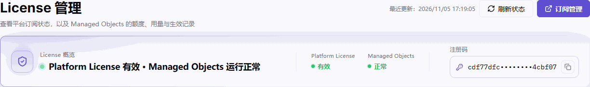
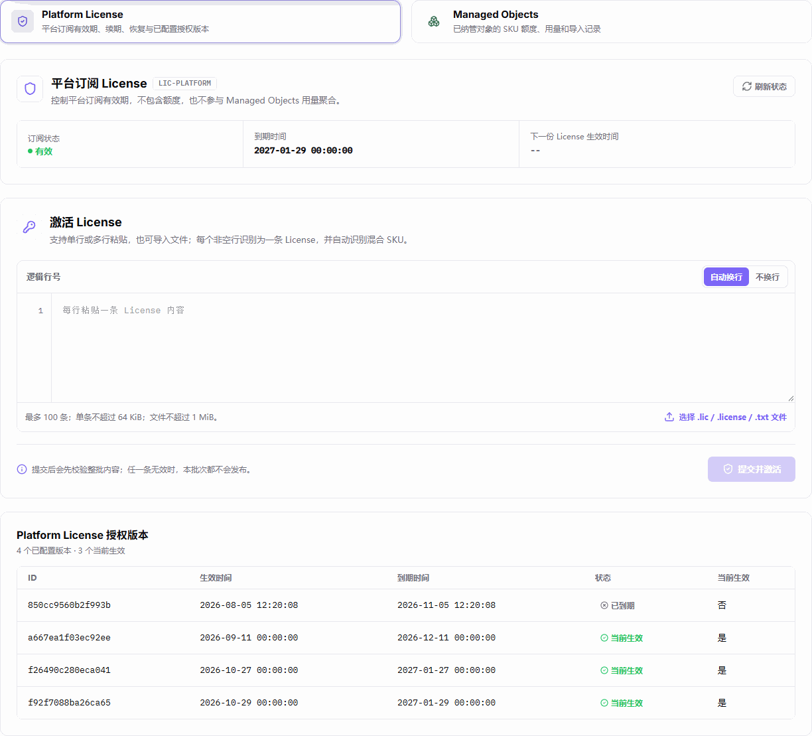
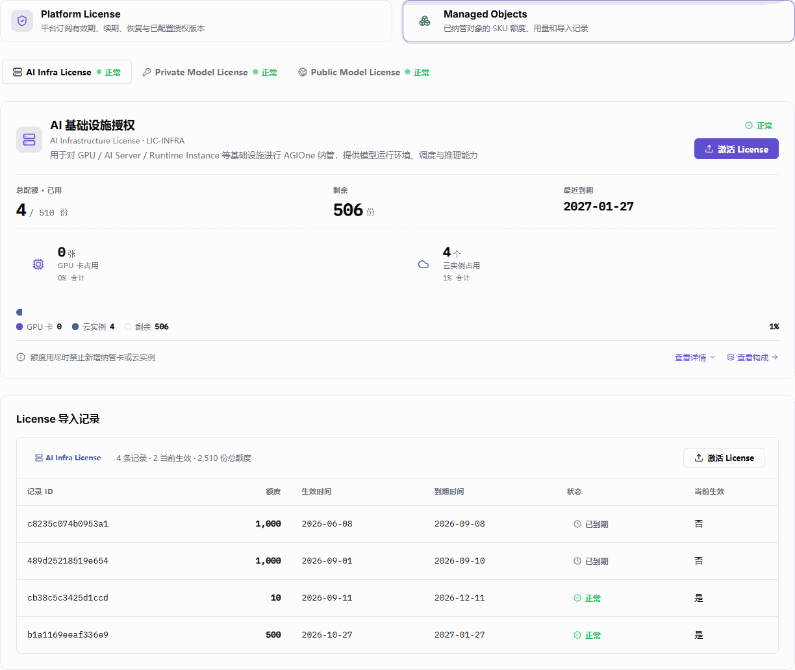

# License

::: info 文档信息
版本：v2.1
更新日期：2026-11-05
:::

## 功能概述

| 项目 | 内容 |
| --- | --- |
| 适用角色 | 运营管理员 |
| 导航路径 | 账务 > License > License |
| 页面路由 | `/user/usercenter/license/managed-objects`（默认）；Platform License 区域为 `/user/usercenter/license/platform-license` |
| 管理对象 | Platform License 订阅状态与授权版本；Managed Objects 的 SKU 额度、用量、有效期和导入记录 |

`License 管理` 分为 `Platform License` 与 `Managed Objects` 两个页签。顶部 `License 概览` 汇总两个区域的当前状态和系统缩略显示的注册码；下方按页签查看平台订阅或纳管对象的授权。

#### 新手理解

Platform License 决定平台订阅能用到什么时候；Managed Objects 决定每类纳管对象还能增加多少容量。两者互不替代，先看概览状态，再进入对应页签。

#### 术语速查

| 术语 | 说明 |
| --- | --- |
| Platform License | 平台订阅有效期、续期、恢复和已配置授权版本，不包含 SKU 额度。 |
| Managed Objects | 对 AI 基础设施、私有模型和公共模型等纳管对象的 SKU 授权。 |
| SKU | Managed Objects 下的授权分类，当前包含 AI Infra、Private Model 和 Public Model。 |
| 注册码 | 当前部署的标识，用于获取匹配的 License；页面默认以缩略形式显示。 |
| 导入记录 | 每次 License 导入形成的记录，包含额度、生效时间、到期时间和生效状态。 |

## 前提条件

1. 当前账号可以进入 `账务 > License > License`。
2. 已确认当前页面属于目标环境和目标部署。
3. 激活前已取得内部审批，并确认 License 来源可信。
4. 浏览器会话有效。只读核对不需要激活码；激活需要对应授权。

## 页面说明

页面自上而下包含：

图示为页面上部：上方切换页签、订阅状态与到期时间；中部概览显示 Platform License 与 Managed Objects 状态及系统缩略显示的注册码。

| 区域 | 说明 |
| --- | --- |
| License 概览 | 显示 Platform License 与 Managed Objects 的状态，以及系统缩略显示的注册码。 |
| 区域页签 | `Platform License` 与 `Managed Objects`，切换后分别展示订阅授权和 SKU 授权。 |
| Platform License 区域 | 显示订阅状态、到期时间、下一份 License 生效时间、激活编辑器、批量规则和授权版本表。 |
| Managed Objects 区域 | 显示 AI Infra、Private Model、Public Model 三个 SKU 页签；每个 SKU 有额度卡片和 License 导入记录。 |
| SKU 额度卡片 | 显示 SKU 编码与说明、总配额与已用、剩余、最近到期、占用构成和额度不足时的限制说明。 |
| License 导入记录 | 按记录展示记录 ID、额度、生效时间、到期时间、状态和当前生效标记。 |
| 激活窗口 | 点击 `激活 License` 打开，包含激活码输入、注册码、文件导入和最终激活按钮。 |

`Platform License` 区域同时提供逻辑行输入和文件导入。编辑器规则为：每个非空行识别为一条 License，可混合不同 SKU；最多 100 条，单条不超过 64 KiB，文件不超过 1 MiB。提交时先校验整批内容，任意一条无效则整批都不发布。

图示为 Platform License 区域：上方切换页签、订阅状态与到期时间，中部为激活编辑器和批量校验提示，下方为授权版本表。

`Managed Objects` 区域以 AI Infra、Private Model、Public Model 三个 SKU 页签组织。每个 SKU 卡片显示总配额与已用、剩余、最近到期及占用构成；额度用尽时会阻止该 SKU 对应的新增操作，具体限制以卡片说明为准。卡片下方的导入记录按记录 ID 展示额度、生效时间、到期时间、状态和当前生效标记。

图示为 Managed Objects 的 AI Infra License 分类：上方为三个 SKU 页签，中部为额度与占用卡片，下方为 License 导入记录及其记录字段。

## 主要操作

### 核对概览并切换授权区域

1. 进入 `账务 > License > License`。
2. 在 `License 概览` 中核对 Platform License 与 Managed Objects 的当前状态。
3. 确认注册码属于目标部署；页面只显示缩略值，不要将其复制到公开材料。
4. 点击 `Platform License` 或 `Managed Objects` 页签，进入对应授权区域。
5. 状态需要更新时点击 `刷新状态`；不要通过重复提交 License 强制刷新。

### 查看 Platform License 与授权版本

1. 选择 `Platform License` 页签。
2. 核对 `订阅状态`、`到期时间` 和 `下一份 License 生效时间`。
3. 在 `激活 License` 编辑器中按行粘贴 License，或通过 `选择 .lic / .license / .txt 文件` 导入。
4. 使用 `自动换行` 或 `不换行` 调整显示；该设置只影响显示，不改变 License 内容。
5. 核对批量规则：最多 100 条、单条不超过 64 KiB、文件不超过 1 MiB。
6. 阅读整批校验提示；只读核查应停在 `提交并激活` 前。
7. 在 `Platform License 授权版本` 表中核对 ID、生效时间、到期时间、状态和当前生效标记。

### 查看 Managed Objects 与导入记录

1. 选择 `Managed Objects` 页签。
2. 在 `AI Infra License`、`Private Model License`、`Public Model License` 之间切换目标 SKU。
3. 核对 SKU 编码、说明、状态、总配额与已用、剩余、最近到期和占用构成。
4. 阅读额度不足时的限制说明，确认该 SKU 的新增操作是否会被阻止。
5. 在 `License 导入记录` 中按记录 ID 核对额度、生效时间、到期时间、状态和当前生效标记。
6. 需要进一步核对时，使用卡片提供的 `查看详情` 或 `查看构成` 入口。

### 只读核对激活窗口

1. 在目标 SKU 或导入记录区域点击 `激活 License`。
2. 窗口标题为 `获取并激活 License`；选择 `我已有激活码`。
3. `我要购买` 属于购买入口，不在只读核对范围内。
4. 核对窗口显示的注册码属于目标部署；完整注册码不进入文档配图或公开材料。
5. 激活码编辑区支持单行或多行粘贴，也支持 `.lic`、`.license`、`.txt` 文件导入。
6. 未输入内容时 `激活` 按钮为禁用状态；只读核对不输入激活码，也不点击 `激活`。
7. 完成后点击 `关闭` 退出窗口。

## 参数速查表

| 字段名称 | 是否必填 | 字段类型 | 示例 | 说明 |
| --- | --- | --- | --- | --- |
| Platform License 页签 | 否 | 区域切换 | `Platform License` | 查看平台订阅和授权版本。 |
| Managed Objects 页签 | 否 | 区域切换 | `Managed Objects` | 查看 SKU 额度和导入记录。 |
| 注册码 | 系统生成 | 敏感文本 | 系统缩略显示 | 标识当前部署；页面默认不显示完整值。 |
| 刷新状态 | 否 | 按钮 | `刷新状态` | 重新读取当前授权状态。 |
| 订阅状态 | 系统生成 | 状态 | `有效` | Platform License 当前是否可用。 |
| 到期时间 | 系统生成 | 时间 | `2027-01-29 00:00:00` | 当前 Platform License 的到期时间。 |
| 下一份 License 生效时间 | 系统生成 | 时间 | `--` | 已配置的下一份 Platform License 生效时间。 |
| 逻辑行号 | 粘贴时必填 | 多行编辑器 | `1` | 每个非空行按一条 License 处理。 |
| 自动换行 / 不换行 | 否 | 显示控制 | `自动换行` | 只改变显示方式，不改变 License 内容。 |
| License 文件 | 否 | 文件导入 | `.lic` / `.license` / `.txt` | 导入包含多条 License 的文件。 |
| 批量数量上限 | 系统限制 | 数量 | `100` | 单批最多 100 条 License。 |
| 单条大小上限 | 系统限制 | 大小 | `64 KiB` | 每条 License 的最大内容大小。 |
| 文件大小上限 | 系统限制 | 大小 | `1 MiB` | 导入文件的最大大小。 |
| 提交并激活 | 最终动作 | 按钮 | `提交并激活` | 会改变部署授权状态，只读核查不执行。 |
| SKU 页签 | 否 | 分类切换 | `AI Infra License` | 切换 AI 基础设施、私有模型或公共模型授权。 |
| SKU 编码 | 系统生成 | 文本 | `LIC-INFRA` | 当前 SKU 的授权编码。 |
| 总配额与已用 | 系统生成 | 数量 | `4 / 510 份` | 当前 SKU 的总额度及已使用数量。 |
| 剩余 | 系统生成 | 数量 | `506 份` | 当前 SKU 剩余可用额度。 |
| 最近到期 | 系统生成 | 时间 | `2027-01-27` | 当前 SKU 最近一份授权的到期时间。 |
| 占用构成 | 系统生成 | 统计 | `GPU 卡 0` / `云实例 4` | 按对象类型展示额度占用。 |
| 查看详情 / 查看构成 | 否 | 按钮 | `查看详情` | 打开当前 SKU 的详情或额度构成。 |
| 记录 ID | 系统生成 | 标识 | `记录 ID` | 导入记录的唯一标识，不是 License 内容本身。 |
| 额度 | 系统生成 | 数量 | `1,000` | 该条导入记录对应的额度。 |
| 生效时间 / 到期时间 | 系统生成 | 时间 | `2026-06-08` | 该条记录的生效和到期日期。 |
| 状态 / 当前生效 | 系统生成 | 状态 | `正常` / `是` | 该条记录的状态与是否当前生效。 |
| 激活 | 最终动作 | 按钮 | `激活` | 会改变部署授权状态；未输入内容时禁用。 |

## 踩坑提示

- Platform License 与 Managed Objects 是不同授权维度；一个区域正常不能证明另一个区域也正常。
- 注册码和激活码属于部署级敏感信息；不要在截图、工单或公开材料中暴露完整值。
- `自动换行` 和 `不换行` 只改变显示，不会合并或拆分 License。
- 批量激活采用整批预校验：任意一条无效都会阻止整批发布。
- 授权额度不等于账务余额；资金与结算问题需要到账务页面核对。
- 导入记录中的记录 ID 用于定位记录，不能当作 License 内容或激活码使用。

## 结果校验

| 检查项 | 成功表现 | 异常时处理 |
| --- | --- | --- |
| 页面可进入 | `License 管理` 正常打开，`账务 > License > License` 菜单高亮。 | 核对账号权限和页面加载状态。 |
| 概览状态 | `License 概览` 显示 Platform License 与 Managed Objects 状态。 | 点击 `刷新状态` 后重新核对；不要重复提交 License。 |
| Platform 区域 | 订阅状态、到期时间和授权版本表可核对。 | 确认已选择 Platform License 页签，再核对状态和时间。 |
| Managed Objects 区域 | 三个 SKU 页签可切换，额度卡片和导入记录可见。 | 核对当前 SKU 页签和记录范围。 |
| 批量规则 | 逻辑行编辑器、换行控件、文件类型和大小限制可见。 | 确认已进入 Platform License 页签并重新加载页面。 |
| 激活窗口 | 标题为 `获取并激活 License`，可切换激活码与购买页签。 | 核对当前 SKU 和账号权限；不输入激活码，不点击激活。 |

## 常见问题

#### 为什么激活按钮是禁用状态？

**问题现象：**

打开 `获取并激活 License` 窗口后，`激活` 按钮不可点击。

**可能原因：**

当前编辑区没有可提交的激活码内容；窗口在未输入时保持按钮禁用。

**处理方式：**

只读核对到此为止；需要实际激活时，先取得授权并粘贴或导入有效 License，再按窗口提示继续。不要在未确认来源和审批时尝试激活。

#### Platform License 正常但 Managed Objects 额度不足怎么办？

**问题现象：**

Platform License 显示有效，但某个 SKU 的剩余额度接近或已经用尽。

**可能原因：**

两类授权分开计算：平台订阅状态不包含 SKU 额度，额度由导入记录中的授权数量决定。

**处理方式：**

进入对应 SKU 核对总配额、已用、剩余和导入记录；根据卡片说明确认哪些新增操作会被阻止，再决定是否补充 License。

#### 导入记录中的状态和当前生效有什么不同？

**问题现象：**

同一条记录可能显示 `已到期` 或 `正常`，同时又显示当前生效为 `是` 或 `否`。

**可能原因：**

状态描述该条记录的有效性，当前生效标记描述它是否正在为当前 SKU 提供额度。

**处理方式：**

同时核对额度、生效时间、到期时间、状态和当前生效；不要只看其中一列判断授权是否可用。

## 注意事项

- 完整注册码、激活码和 License 内容属于敏感信息，不写入文档、截图、工单或公开材料。
- `提交并激活` 和 `激活` 会改变当前部署状态，必须另行确认后执行；只读核查停在最终动作前。
- 不要在未确认环境、部署和来源时跨环境复用 License。
- 无法确认的状态或额度差异，保留页面原状并交由授权管理员处理，不通过重复提交试错。

## 后续操作

1. 核对平台账户资金时，进入 [财务账户](../../finance-operations/financial-accounts/)。
2. 核对结算单时，进入 [结算单列表](../../finance-operations/settlement-list/)。
3. 需要定位当前账期任务时，返回 [今日任务](../../finance-operations/today-tasks/)。
