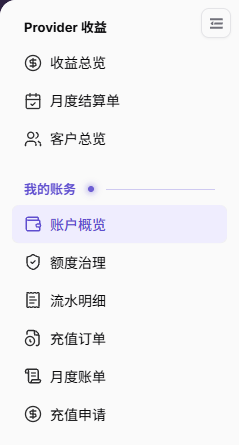

# 账户概览

::: info 文档信息
版本：v2.1
更新日期：2026-11-05
:::

## 功能概述

| 项目 | 内容 |
| --- | --- |
| 适用角色 | 模型提供方&用户中具备账务查看权限的账号；配置变更还需对应管理权限。 |
| 导航路径 | 账务 > 我的账务 > 账户概览 |
| 页面路由 | `/billing/my/account` |
| 管理对象 | 账户余额、消费趋势、预警阈值、最近交易与账务入口。 |

账户概览汇总当前账户的余额和消费信息，具体记录需进入明细核对。

#### 新手理解

本页像账务仪表盘：余额是可用资金，趋势与预估是参考读数，具体收支仍需查明细。

#### 术语速查

| 术语 | 说明 |
| --- | --- |
| 账户余额 | 当前账户可用的 credits。 |
| 预计可用天数 | 按近期消费速度估计的可用时间，不是时长保证。 |
| 本月预估 | 本月消费的预估值，不是最终账单。 |
| 预警阈值 | 余额提醒配置，页面显示当前设置并提供编辑入口。 |
| 最近交易 | 部分近期账务记录，不代表完整流水。 |

## 前提条件

1. 使用具备账务查看权限的账号进入 `账务 > 我的账务 > 账户概览`。
2. 核对当前账户及最近更新时间。
3. 修改阈值或发起充值前，确认对应操作权限和目标账户。

## 页面说明

图示为左侧我的账务菜单，可定位账户概览、额度治理、流水明细、充值订单、月度账单和充值申请；图中不包含账户指标。

| 区域 | 说明 |
| --- | --- |
| 最近更新与刷新本账期 | 显示更新信息，并提供 `刷新本账期` 按钮。 |
| 账户余额与预计可用天数 | 上方显示余额及天数估计；无近期消费时提示“近7天暂无消费，无法估算可用天数”。 |
| 近7天消费 | 展示近期消费及与上周的对比。 |
| 本月已支出、本月已充值、本月预估 | 分别展示本月至今的支出、充值和预估消费。 |
| 上次充值与账单支持 | 展示最近充值信息及账单支持联系信息，以当前页面为准。 |
| 预警阈值 | 当前可显示 `不设限制`；点击 `编辑` 打开表单。 |
| 消费速率 | 展示日均、最高支出、低谷及近期对比。 |
| 本月至今 vs 上月同期 | 对比本月至今、上月同期、上月全月和环比。 |
| 收支分析 | 可切换 `按消费服务`、`按支出归属`，以及 `模型`、`AI Infra` 等服务分类。 |
| 主要消费来源与最近交易 | 定位消费来源和近期账务变化，完整记录需进入明细核对。 |
| 交易明细、充值单、充值 | 分别是交易明细、充值订单和发起充值的独立入口。 |

## 主要操作

### 查看余额与消费汇总

1. 进入账户概览，核对最近更新时间，按需要点击 `刷新本账期`。
2. 查看余额、预计可用天数与近7天消费；无法估算不代表剩余天数为零。
3. 对照 `本月已支出`、`本月已充值`、`本月预估` 和 `上次充值`。
4. 向下查看 `消费速率`、`本月至今 vs 上月同期`，并在 `收支分析` 中按需要切换 `按消费服务`、`按支出归属` 及服务分类。

### 查看或编辑预警阈值

1. 在 `预警阈值` 区域核对当前设置，例如 `不设限制`。
2. 具备对应权限且需要调整时点击 `编辑`，打开 `编辑预警阈值` 弹窗。
3. 填写必填的 `预警阈值`，继续前核对目标账户和输入内容。
4. 不提交时点击 `取消`；需要提交且已确认权限与内容时点击 `确定`。

图示为编辑预警阈值弹窗，必填的预警阈值输入框内可见灰色 `0`，并显示取消、确定按钮；不据图中的 `0` 判断占位提示、当前配置值或空值保存含义。

### 核对最近交易并选择后续入口

1. 查看 `最近交易` 的时间、类型、金额方向和说明。
2. 需要完整核对时使用 `查看全部 →` 或 `交易明细`，继续阅读 [流水明细](../transactions/)。
3. 核对充值订单时使用 `充值单`，继续阅读 [充值订单](../top-up-orders/)。
4. 发起充值使用独立的 `充值` 入口；办理申请从左侧菜单进入 [充值申请](../top-up-requests/)，不要将充值与申请视为同一操作。

## 参数速查表

| 字段名称 | 是否必填 | 字段类型 | 示例 | 说明 |
| --- | --- | --- | --- | --- |
| 账户余额 | 不适用 | credits 指标 | 0 | 当前账户可用余额。 |
| 预计可用天数 | 不适用 | 估计或提示 | 暂无法估算可用天数 | 近7天无消费时无法估算。 |
| 近7天消费 | 不适用 | credits 指标 | 0 | 最近7天消费。 |
| 本月已支出 | 不适用 | credits 指标 | 0 | 本月至今已支出。 |
| 本月已充值 | 不适用 | credits 指标 | 0 | 本月至今已充值。 |
| 本月预估 | 不适用 | credits 预估 | 0 | 本月消费预估，不是最终账单。 |
| 上次充值 | 不适用 | 信息区 | [最近充值信息] | 最近一次充值的金额与时间。 |
| 账单支持 | 不适用 | 联系信息 | [支持联系人] | 使用当前页面提供的支持信息。 |
| 预警阈值 | 是 | 文本输入 | [阈值] | 表单显示必填标记；不将空输入框提交等同于不设限制。 |
| 消费速率 | 不适用 | 指标组 | 0 | 日均、最高支出、低谷与近期对比。 |
| 本月至今 vs 上月同期 | 不适用 | 对比指标 | 0 | 本月至今、上月同期、上月全月和环比。 |
| 收支分析 | 不适用 | 分析视角 | 按消费服务 | 按消费服务、按支出归属及模型、AI Infra 等分类。 |
| 最近交易 | 不适用 | 记录区 | [交易记录] | 部分近期记录，完整核对需查看流水明细。 |
| 交易明细 | 否 | 入口 | 交易明细 | 进入交易明细。 |
| 充值单 | 否 | 入口 | 充值单 | 进入充值订单。 |
| 充值 | 否 | 入口 | 充值 | 独立充值入口，不等同于充值申请。 |

## 踩坑提示

- 暂无法估算可用天数不是剩余天数为零，应同时阅读近7天无消费的提示。
- 本月预估和预计可用天数均为估计，不是最终账单或服务时长保证。
- 最近交易仅提供部分记录，单条赠送记录不能证明完整余额变动连续性。
- `不设限制` 是当前配置显示值，不能据此推定空输入框提交后的含义。

## 结果校验

| 检查项 | 成功表现 | 异常时处理 |
| --- | --- | --- |
| 账户范围 | 当前账户、更新时间及余额可核对。 | 重新核对账户与更新时间，不跨账户比较。 |
| 消费汇总 | 近7天消费、本月支出、充值和预估分别可见。 | 区分近期、本月至今和预估口径，再查明细。 |
| 阈值编辑入口 | 编辑打开包含预警阈值、取消和确定的弹窗。 | 未核对表单与输入内容前不确认提交。 |
| 交易核对范围 | 已区分近期记录与完整流水范围。 | 转到流水明细和月度账单核对。 |

## 常见问题

#### 为什么无法估算可用天数？

**问题现象：** 页面显示“暂无法估算可用天数”。

**可能原因：** 页面提示“近7天暂无消费，无法估算可用天数”。

**处理方式：** 同时查看余额和近7天消费，不将该提示理解为可用天数为零。

#### 为什么最近交易不足以解释余额变化？

**问题现象：** 最近交易中的部分记录不足以完成余额核对。

**可能原因：** 账户概览是汇总页，最近交易不包含完整流水。

**处理方式：** 使用交易明细或查看全部入口，按需要核对完整流水及月度账单。

## 注意事项

- 查看权限不代表配置权限；只有具备对应权限的人员才能修改阈值或执行充值。
- 提交阈值前核对输入内容，不自行推定最小值、最大值或空值含义。
- 共享核对结果时仅提供必要信息，不公开真实账号、邮箱、联系人、账务金额、项目或成员信息，也不附带凭证。

## 后续操作

1. 单笔余额变动，进入 [流水明细](../transactions/)。
2. 充值状态核对，进入 [充值订单](../top-up-orders/)；申请事项进入 [充值申请](../top-up-requests/)。
3. 月度对账，进入 [月度账单](../monthly-bill/)。
4. 成员与项目用量判断，进入 [额度治理](../quota-governance/)。
