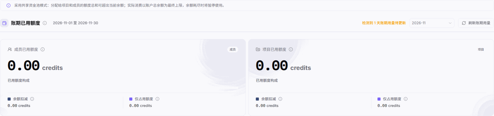

# 额度治理

::: info 文档信息
版本：v2.1
更新日期：2026-11-05
:::

## 功能概述

| 项目 | 内容 |
| --- | --- |
| 适用角色 | 模型提供方&用户 |
| 导航路径 | 账务 > 我的账务 > 额度治理 |
| 页面路由 | `/billing/my/quota-governance` |
| 管理对象 | 账期用量、成员与项目额度、用量构成、风险分类和设置入口。 |

额度治理用于按成员和项目两个维度查看额度用量及风险，并定位相应设置入口。

#### 新手理解

本页像共享钱包的用量看板：成员和项目各有额度规则，但实际可消费资金仍受账户总余额限制。

#### 术语速查

| 术语 | 说明 |
| --- | --- |
| 共享资金池 | 分配额度总和可超过余额，实际消费仍以账户总余额为最终上限。 |
| 余额扣减 | 已用额度构成中标记为扣减账户余额的部分。 |
| 仅占用额度 | 已用额度构成中与余额扣减分列的额度占用部分，不等同于实际余额扣减。 |
| 当前额度周期 | 当前额度规则对应的周期，需与所选账期分别核对。 |
| 不参与判断 | 风险分类之一，不等同于暂无风险。 |

## 前提条件

1. 使用具备账务查看权限的账号进入 `账务 > 我的账务 > 额度治理`。
2. 核对所选账期、日期范围及账期用量待更新提示。
3. 进入成员额度设置或项目默认设置前，确认对应管理权限与影响对象。

## 页面说明

页面提示：“采用共享资金池模式：分配给项目和成员的额度总和可超出当前余额；实际消费以账户总余额为最终上限，余额耗尽时将暂停使用。”

图示为零用量的账期汇总局部，包含共享资金池说明、账期范围、刷新账期用量，以及成员和项目的余额扣减、仅占用额度构成；不包含成员或项目卡片。

| 区域 | 说明 |
| --- | --- |
| credits 兑换比例 | 显示 USD 与 credits 的兑换比例，以页面当前值为准。 |
| 账期已用额度 | 显示所选账期及起止日期；有待更新提示时显示待更新天数，并提供 `刷新账期用量`。 |
| 成员已用额度 | 按成员维度展示已用额度，并拆分 `余额扣减` 和 `仅占用额度`。 |
| 项目已用额度 | 按项目维度展示已用额度，并拆分 `余额扣减` 和 `仅占用额度`。 |
| 额度用量明细 | 默认先展示成员，使用 `成员`、`项目` 按钮切换维度，按对象阅读明细，不按传统项目表格逐列查找。 |
| 成员额度设置与项目默认设置 | 成员视角显示 `成员额度设置`；项目视角显示 `项目默认设置`。 |
| 风险分类 | `全部`、`严重`、`预警`、`配置提醒`、`暂无风险`、`不参与判断` 及对应数量。 |
| 周期信息 | `按月重置，每月1日` 是周期说明；`当前额度周期`、`下次重置` 是显示项，不是一键重置操作。 |

对象明细如显示已用额度、上限、比例、可用剩余或用尽即停策略，应结合对应对象和周期阅读；这些值与策略不应被当作账户余额或充值记录。

## 主要操作

### 查看账期用量与构成

1. 进入额度治理，核对 `账期已用额度` 的月份与日期范围。
2. 阅读待更新提示，例如“检测到 N 天账期用量待更新”；按需要使用 `刷新账期用量`，再核对页面实际显示的用量与提示，不预设数值必然变化。
3. 查看 `成员已用额度` 和 `项目已用额度`，分别核对 `余额扣减` 与 `仅占用额度`。
4. 结合共享资金池说明判断账户资金边界；核对可用余额时进入 [账户概览](../overview/)。

### 切换成员和项目明细

1. 在 `额度用量明细` 中先查看默认的 `成员` 视角。
2. 核对风险分类及数量，区分 `严重`、`预警`、`配置提醒`、`暂无风险` 和 `不参与判断`。
3. 点击 `项目`，查看项目维度；需要返回时点击 `成员`。
4. 按对象核对当前额度周期与下次重置时间；如显示已用与上限、比例、剩余或处理策略，结合当前对象阅读，不把周期说明当作手动重置按钮。

### 按权限进入额度设置

1. 需要成员额度配置时，在成员视角点击 `成员额度设置`，进入 `/user/user-space/settings?tab=member` 的租户设置；配置变更需具备对应权限。
2. 需要项目默认规则时，切换到 `项目`，点击 `项目默认设置`。
3. 该入口导航到 `/user/user-space/settings?tab=project` 的租户设置；阅读“新项目会继承这些默认值；已有项目可在项目内单独覆盖。”
4. 根据需要核对默认值及新项目、已有项目的适用范围；仅由有权限的人员在确认影响后按目标设置页操作。

## 参数速查表

| 字段名称 | 是否必填 | 字段类型 | 示例 | 说明 |
| --- | --- | --- | --- | --- |
| credits 兑换比例 | 不适用 | 比例显示 | [兑换比例] | 当前页面显示的 USD 与 credits 比例。 |
| 账期已用额度 | 不适用 | 账期汇总 | 0 | 结合所选月份和日期范围阅读。 |
| 账期用量待更新 | 不适用 | 提示 | 检测到 N 天账期用量待更新 | 提示有待更新的账期用量。 |
| 刷新账期用量 | 否 | 按钮 | 刷新账期用量 | 使用后以页面实际显示为准，不保证数值变化。 |
| 成员已用额度 | 不适用 | credits 指标 | 0 | 成员维度汇总。 |
| 项目已用额度 | 不适用 | credits 指标 | 0 | 项目维度汇总。 |
| 余额扣减 | 不适用 | credits 构成 | 0 | 两个维度均单独显示此项。 |
| 仅占用额度 | 不适用 | credits 构成 | 0 | 与余额扣减分开显示。 |
| 成员、项目 | 否 | 切换按钮 | 成员 | 默认成员在先，项目在后。 |
| 风险分类 | 不适用 | 分类与数量 | 暂无风险 | 全部、严重、预警、配置提醒、暂无风险、不参与判断。 |
| 按月重置，每月1日 | 不适用 | 周期说明 | 按月重置，每月1日 | 不是手动重置操作。 |
| 当前额度周期 | 不适用 | 日期范围 | [周期起止日期] | 当前对象的额度周期。 |
| 下次重置 | 不适用 | 时间显示 | [下次重置时间] | 显示下一次重置时间。 |
| 已用、上限、比例与剩余 | 不适用 | 对象用量 | 0 | 如显示，按当前对象和周期核对，不能等同于账户余额。 |
| 处理策略 | 不适用 | 策略显示 | [当前策略] | 如显示用尽即停等策略，按当前对象实际文字理解。 |
| 成员额度设置 | 否 | 导航入口 | 成员额度设置 | 导航至租户设置的成员配置分区，配置变更需对应权限。 |
| 项目默认设置 | 否 | 导航入口 | 项目默认设置 | 导航至租户设置中的项目默认规则。 |

## 踩坑提示

- 分配给项目和成员的额度总和可以超过当前余额，不代表可消费资金增加；余额耗尽时暂停使用。
- 成员与项目是两个统计视角，不要将两者用量直接相加作为总消费。
- 仅占用额度与余额扣减分开显示，不能把全部已用额度都解释为余额扣减。
- 按月重置说明、当前周期和下次重置时间不构成手动重置流程。

## 结果校验

| 检查项 | 成功表现 | 异常时处理 |
| --- | --- | --- |
| 账期范围 | 所选月份与账期起止日期可核对。 | 重新核对月份和日期范围，不混用不同账期。 |
| 用量构成 | 成员与项目均分别显示余额扣减、仅占用额度。 | 分开阅读两个维度及其构成，不直接相加。 |
| 维度切换 | 成员、项目按钮对应不同对象视角与设置入口。 | 核对当前选中维度，再定位对应入口。 |
| 周期与风险 | 当前周期、下次重置及风险分类可分别核对。 | 不将不参与判断当作暂无风险，也不将周期文字当作按钮。 |
| 项目默认设置去向 | 进入租户设置的项目默认规则，并显示继承与覆盖说明。 | 未核对目标设置范围前不修改配置。 |

## 常见问题

#### 为什么分配额度可以超过余额？

**问题现象：** 项目和成员额度总和可超出账户余额。

**可能原因：** 页面明确采用共享资金池模式，实际消费以账户总余额为最终上限。

**处理方式：** 同时核对账户余额和对象额度，不把分配额度总和当作可消费资金；余额耗尽时将暂停使用。

#### 为什么已用额度不等于余额扣减？

**问题现象：** 已用额度汇总与余额扣减不是同一项。

**可能原因：** 页面将已用额度构成拆分为余额扣减和仅占用额度。

**处理方式：** 在成员和项目视角分别核对构成；需要实际资金变动时继续查看流水明细。

#### 项目默认设置是否只影响新项目？

**问题现象：** 需要判断默认规则与已有项目的关系。

**可能原因：** 目标设置页提示“新项目会继承这些默认值；已有项目可在项目内单独覆盖。”

**处理方式：** 分清默认规则与项目内覆盖，按对应项目的实际设置核对适用范围。

## 注意事项

- 查看账务不等于拥有成员或项目配置权限；进入设置和变更规则须具备对应授权。
- 修改默认规则前确认新项目继承与已有项目覆盖的范围，不把进入设置页面当作设置已保存。
- 共享结果时不公开真实成员、邮箱、项目名称、额度值或消费明细，不附带凭证。

## 后续操作

1. 核对资金变动，进入 [流水明细](../transactions/)。
2. 核对账户总余额，进入 [账户概览](../overview/)。
3. 按月核对费用，进入 [月度账单](../monthly-bill/)。
