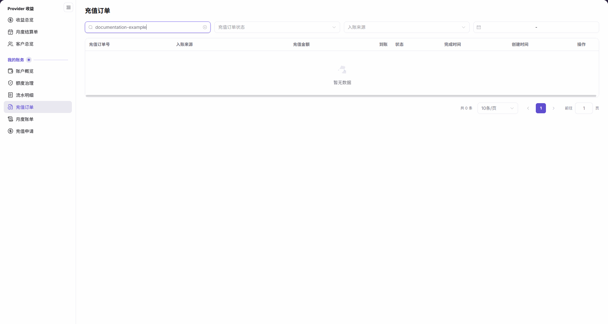

# 充值订单

::: info 文档信息
版本：v2.1
更新日期：2026-11-05
:::

## 功能概述

| 项目 | 内容 |
| --- | --- |
| 适用角色 | 可访问“我的账务”的账号 |
| 导航路径 | 账务 > 我的账务 > 充值订单 |
| 页面路由 | `/billing/my/top-ups/orders` |
| 管理对象 | 当前账号的充值订单、入账来源、原币支付金额、到账 credits 和订单状态 |

充值订单用于按订单号、充值订单状态、入账来源和时间范围定位充值记录，并分别核对支付金额、到账 credits 与订单处理状态。

#### 新手理解

充值订单像一张充值小票：付款金额和账户 credits 分开列示，是否完成不能只看“到账”列里有没有数字。

#### 术语速查

| 术语 | 说明 |
| --- | --- |
| 充值订单号 | 充值订单的标识，不与支付流水号或账务流水号混用。 |
| 入账来源 | 订单展示的充值来源，也可作为筛选条件。 |
| 充值金额 | 订单的原币支付金额，需连同币种阅读。 |
| 到账 | 订单展示的 credits 数量，不单独作为已入账证明。 |
| 状态 | 订单的处理状态，与到账数字分列展示。 |
| Invoice | 部分符合条件的订单可显示的创建入口，以行内实际展示为准。 |

## 前提条件

1. 当前账号可以进入 `账务 > 我的账务 > 充值订单`。
2. 已准备需要查询的订单号或筛选范围。
3. 核对订单时，同时关注状态、金额单位和时间，不只读取到账数字。

## 页面说明

英文左侧分组名为 `Billing`。页面包含订单号输入、充值订单状态、入账来源和时间范围四项筛选。订单号输入框提示为 `输入充值订单号`。订单列表共八列，行内查看入口为 `详情`。

| 区域 | 说明 |
| --- | --- |
| 订单号输入 | 在 `输入充值订单号` 中输入查询值，按 Enter 查询。 |
| 充值订单状态 | 按订单处理状态筛选。 |
| 入账来源 | 按充值来源筛选。 |
| 时间范围 | 通过起止日期限定查询范围。 |
| 订单列表 | 充值订单号、入账来源、充值金额、到账、状态、完成时间、创建时间、操作。 |
| 行内详情 | 在目标记录的操作列使用 `详情`。 |
| 条件化 Invoice 入口 | 部分符合条件的订单行可显示 `创建 Invoice`，并非每笔订单都有；以该行实际入口为准。 |
| 横向滚动与空结果 | 可横向滚动查看时间列和末列操作；没有匹配订单时显示 `暂无数据` 和 `共 0 条`。 |

图示为订单号输入 `documentation-example` 后的充值订单空结果；时间列不一定同时出现在视区内，可横向滚动查看时间列与末列操作。

## 主要操作

### 查询充值订单

1. 进入 `账务 > 我的账务 > 充值订单`。
2. 如按订单号查询，在 `输入充值订单号` 中输入查询值并按 Enter；示例使用占位值 `documentation-example`。
3. 按需选择 `充值订单状态` 和 `入账来源`。
4. 按需设置时间范围，并查看列表随条件更新后的结果。
5. 阅读匹配订单；若显示 `暂无数据`，核对四项筛选，需要其他范围时直接修改条件。

### 查看目标订单

1. 在结果中定位目标 `充值订单号`，阅读 `入账来源`、`充值金额`、`到账` 和 `状态`。
2. 横向滚动，核对 `完成时间`、`创建时间` 和末列 `操作`。
3. 使用该行的 `详情` 查看对应订单，以打开页面实际展示的信息为准。

### 核对订单与账务记录

1. 在订单行分别阅读原币 `充值金额`、`到账` credits 和 `状态`，不直接将两个金额列按同一单位比较。
2. 核对该行的完成时间与创建时间，不把订单号、支付流水号和账务流水号作为同一个标识。
3. 进入 [流水明细](../transactions/)，按相关日期范围查看收支记录，不仅凭到账列有数字就认定已经入账。
4. 如需查看当前账户余额，进入 [账户概览](../overview/)；订单记录与当前余额应分别阅读。

## 参数速查表

| 字段名称 | 是否必填 | 字段类型 | 示例 | 说明 |
| --- | --- | --- | --- | --- |
| 充值订单号（筛选） | 否 | 文本输入 | `documentation-example` | 输入框提示 `输入充值订单号`；输入后按 Enter 查询。 |
| 充值订单状态 | 否 | 下拉选择 | — | 按订单处理状态筛选，以可选项实际文案为准。 |
| 入账来源（筛选） | 否 | 下拉选择 | — | 按充值来源筛选。 |
| 时间范围 | 否 | 日期范围 | — | 设置查询起止日期。 |
| 充值订单号 | 不适用 | 列表列 | — | 订单标识，不等同于支付或账务流水号。 |
| 入账来源 | 不适用 | 列表列 | — | 该笔订单展示的充值来源。 |
| 充值金额 | 不适用 | 原币金额列 | `0` | 连同该行币种阅读，不直接当作 credits。 |
| 到账 | 不适用 | Credits 列 | `0` | 与订单状态一同核对，不单独证明已入账。 |
| 状态 | 不适用 | 状态列 | — | 按该行实际展示的订单状态阅读。 |
| 完成时间 | 不适用 | 时间列 | — | 读取该行显示的完成时间或占位内容。 |
| 创建时间 | 不适用 | 时间列 | — | 订单的创建时间。 |
| 操作 / 详情 | 否 | 行内入口 | `详情` | 查看对应的充值订单。 |
| 创建 Invoice | 否 | 条件化行内入口 | — | 部分订单行提供，是否可用以该行显示为准。 |

## 踩坑提示

- `充值金额` 是原币支付金额，`到账` 是 credits，两个数字不能脱离单位直接比较。
- `到账` 列有数字不等于订单已完成入账，还需核对 `状态` 及相关账务记录。
- 横向滚动会影响哪些列同时可见，时间列或操作列不在视区内不代表没有这些列。
- `创建 Invoice` 是条件化入口，不能从其他订单行未显示该入口推断所有订单都不支持。

## 结果校验

| 检查项 | 成功表现 | 异常时处理 |
| --- | --- | --- |
| 查询条件 | 订单号、充值订单状态、入账来源和时间范围与查询目标一致。 | 直接修改相应条件；订单号输入后按 Enter。 |
| 空结果 | 占位值 `documentation-example` 的示例结果显示 `暂无数据` 和 `共 0 条`。 | 核对当前输入与其他筛选，不将示例空结果推广到其他订单。 |
| 列表结构 | 八个列名包括原币金额、到账 credits、状态及两个时间列。 | 横向滚动核对未在视区内的列。 |
| 行内入口 | 有记录时可在操作列定位 `详情`；Invoice 以该行实际入口为准。 | 先确认目标记录和操作列，不把其他行的入口套用到当前行。 |

## 常见问题

#### 为什么输入示例值后没有订单？

**问题现象：** 输入 `documentation-example` 并按 Enter 后，列表显示 `暂无数据`。

**可能原因：** 该占位值对应的查询结果为空，当前页面仍保留订单表头和 `共 0 条`。

**处理方式：** 查询实际授权范围内的订单时更换输入值，并核对订单状态、入账来源和时间范围。

#### 为什么到账数字不能直接作为入账证明？

**问题现象：** 订单行有 `到账` 数字，但需要确认是否已经入账。

**可能原因：** 页面将 `到账` 和 `状态` 作为不同列展示，到账 credits 与原币支付金额也不是同一口径。

**处理方式：** 同时阅读状态、金额单位和时间，再到流水明细核对相关账务记录，不仅依据到账列作结论。

#### 为什么看不到时间列或详情入口？

**问题现象：** 当前表格视区内没有同时显示两个时间列或末列操作。

**可能原因：** 表格可横向滚动，部分列位于当前视区之外。

**处理方式：** 横向滚动查看 `完成时间`、`创建时间` 和 `操作`；有目标记录时再使用该行的 `详情`。

## 注意事项

- 不公开真实客户信息、账号邮箱、订单号、支付凭证或私人账务金额；公开示例使用 `0` 或占位符，配图使用空结果。
- 本页的查询、详情和条件化 Invoice 入口不能作为重新支付、取消、退款或其他资金操作的授权。
- 核对差异时保留金额单位和状态的区别，不根据空结果推断支付失败、同步延迟或资金去向。

## 后续操作

1. 核对收支记录，进入 [流水明细](../transactions/)。
2. 查看当前余额，进入 [账户概览](../overview/)。
3. 核对账期汇总，进入 [月度账单](../monthly-bill/)。
