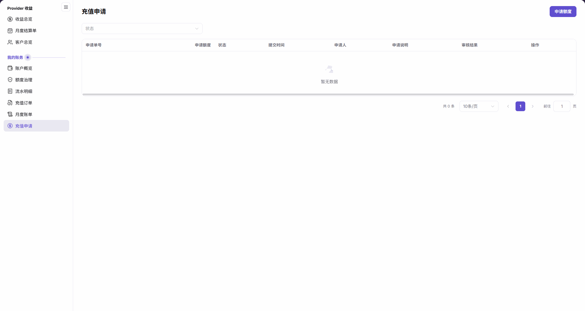

# 充值申请

::: info 文档信息
版本：v2.0
更新日期：2026-11-05
:::

## 功能概述

| 项目 | 内容 |
| --- | --- |
| 适用角色 | 左侧菜单可见充值申请的模型提供方或用户账号 |
| 导航路径 | 账务 > 我的账务 > 充值申请 |
| 页面路由 | `/billing/my/top-ups/requests` |
| 管理对象 | 当前账号可见的账户额度申请及其审核信息 |

`充值申请` 用于发起账户 credits 额度申请，并按状态查看申请记录。页面主按钮为 `申请额度`，打开的弹窗标题为 `账户额度申请`。本页是额度申请入口，不是支付充值入口。

#### 新手理解

充值申请像一张额度申请单：先核对申请账户和所需 credits，再填写申请；申请记录、审核结果和实际余额需要分别核对。

#### 术语速查

| 术语 | 说明 |
| --- | --- |
| 申请额度 | 本次希望增加的 credits 数量。 |
| 审核结果 | 申请列表中展示审核信息的列。 |
| Credit Balance | 弹窗提示中用于说明审批通过后增加 credits 的余额名称。 |

## 前提条件

1. 已登录平台，能从左侧菜单进入 `账务 > 我的账务 > 充值申请`。
2. 发起申请前，明确所需的 credits 数量及申请用途。
3. 在弹窗中核对显示的申请账户、账户类型和当前余额，确认申请对象符合本次业务范围。

## 页面说明

| 区域 | 说明 |
| --- | --- |
| 筛选区 | 位于列表上方，提供 `状态` 下拉筛选。 |
| 申请入口 | 点击 `申请额度` 打开 `账户额度申请` 弹窗。 |
| 申请列表 | 包含 `申请单号`、`申请额度`、`状态`、`提交时间`、`申请人`、`申请说明`、`审核结果`、`操作` 八列。 |
| 分页区 | 显示当前列表的总条数、每页条数和页码。 |
| 申请弹窗 | 上部显示 `申请账户`、`账户类型`、`当前余额`；填写项为 `申请额度` 和 `申请说明`，底部提供 `取消` 和 `提交申请`。 |

图示为充值申请的空列表：上方提供 `申请额度` 和 `状态`，下方保留八列表头；`暂无数据`、`共 0 条` 仅表示当前账号可见及当前状态条件下的结果，不代表全平台没有充值申请。

弹窗提示为“提交账户额度申请；审批通过后，同数量 credits 将自动增加至 Credit Balance。”该提示以审批通过为前提，不能把点击 `提交申请` 等同于审批通过或余额已增加。

## 主要操作

### 按状态查看申请记录

1. 进入 `账务 > 我的账务 > 充值申请`。
2. 打开列表上方的 `状态` 下拉框，按需要选择界面当前提供的状态选项。
3. 查看当前范围的列表和总条数；有记录时，先核对 `申请单号`，再读取同一行的申请额度、状态、提交时间、申请人、申请说明和审核结果。
4. 列表显示 `暂无数据` 时，核对当前状态条件和账号可见范围，不据此判断其他账号的申请情况。

### 填写并核对账户额度申请

1. 点击 `申请额度`，打开 `账户额度申请` 弹窗。
2. 核对上部显示的 `申请账户`、`账户类型` 和 `当前余额`；这三项是显示信息，无需手动填写。
3. 在必填项 `申请额度` 中填写所需的 credits 数量，每次申请范围为 `0.01 ~ 10,000,000.00 credits`。
4. 按需填写选填项 `申请说明`，并核对字符计数；空白时显示 `0 / 200`，最多填写 200 个字符。

图示为账户额度申请中的空白输入字段：`申请额度` 下方标明每次可申请 `0.01 ~ 10,000,000.00 credits`，`申请说明` 显示 `0 / 200` 字符计数。

5. 提交前再次核对显示的申请账户、填写的申请额度及申请说明，阅读弹窗中的审批与 Credit Balance 提示。
6. 确认要发起该申请时，点击 `提交申请`；本次不发起申请时，点击 `取消`。

## 参数速查表

下表区分筛选项、表单输入与显示信息；显示信息无需填写，示例额度仅说明输入格式。

| 字段名称 | 是否必填 | 字段类型 | 示例 | 说明 |
| --- | --- | --- | --- | --- |
| 状态（筛选） | 否 | 下拉筛选 | 界面当前选项 | 按状态缩小申请列表范围。 |
| 申请账户 | 不适用（显示项） | 账户信息 | — | 核对本次额度申请对应的账户。 |
| 账户类型 | 不适用（显示项） | 账户信息 | — | 核对申请账户的类型。 |
| 当前余额 | 不适用（显示项） | 余额信息 | — | 查看申请账户当前显示的 credits 余额，不是本次申请额度。 |
| 申请额度（表单） | 是 | 数值（credits） | `100.00` | 每次可申请 `0.01 ~ 10,000,000.00 credits`。 |
| 申请说明（表单） | 否 | 多行文本 | — | 说明申请用途，最多 200 个字符；空白计数为 `0 / 200`。 |
| 申请单号 | 不适用（显示项） | 列表列 | — | 标识需要核对的申请记录。 |
| 申请额度（列表） | 不适用（显示项） | 列表列 | — | 记录中申请的 credits 数量。 |
| 状态（列表） | 不适用（显示项） | 列表列 | — | 该申请记录的状态，与列表上方的状态筛选区分。 |
| 提交时间 | 不适用（显示项） | 列表列 | — | 申请的提交时间。 |
| 申请人 | 不适用（显示项） | 列表列 | — | 提交申请的人员信息。 |
| 申请说明（列表） | 不适用（显示项） | 列表列 | — | 记录中的申请说明。 |
| 审核结果 | 不适用（显示项） | 列表列 | — | 记录中的审核信息。 |
| 操作 | 不适用（显示项） | 列表列 | — | 申请记录行的操作区域。 |

## 踩坑提示

- 页面名为 `充值申请`，申请弹窗名为 `账户额度申请`；不要因名称不同而将其当作两个独立入口。
- `申请额度` 的单位是 credits，不是支付金额；申请列表中的 `状态` 也不是充值订单的状态。
- 弹窗将余额增加的条件写为“审批通过后”；仅打开或提交申请不能作为额度已到账的凭据。

## 结果校验

以下检查用于核对可见页面、表单和申请列表，不作为审批通过或到账的判定。

| 检查项 | 成功表现 | 异常时处理 |
| --- | --- | --- |
| 页面定位 | 页面标题为 `充值申请`，上方可见 `申请额度` 按钮和 `状态` 筛选。 | 从 `我的账务 > 充值申请` 核对页面入口。 |
| 申请对象 | 弹窗标题为 `账户额度申请`，上部显示申请账户、账户类型和当前余额。 | 先核对显示的申请账户，不在对象不符时提交。 |
| 输入要求 | 可见必填的 `申请额度`、`0.01 ~ 10,000,000.00 credits` 范围提示及选填的 `申请说明` 字符计数。 | 对照范围提示和字符计数核对输入，不将显示信息当作填写项。 |
| 列表范围与字段 | 表头保留八列；有记录时可按申请单号核对同一行信息，空列表显示 `暂无数据` 和 `共 0 条`。 | 核对当前账号可见范围及状态条件，不从空结果推断全平台申请情况。 |

## 常见问题

#### 列表为空是否表示全平台都没有充值申请？

**问题现象：**

充值申请列表显示 `暂无数据`、`共 0 条`。

**可能原因：**

此处展示的是当前账号可见、并受当前状态条件限定的申请列表，不是全平台申请总量。

**处理方式：**

核对当前 `状态` 条件及所查看的账号范围，只按该范围解读空结果。

#### 申请账户和当前余额也需要填写吗？

**问题现象：**

申请弹窗上部显示 `申请账户`、`账户类型` 和 `当前余额`，下部还有申请输入字段。

**可能原因：**

弹窗同时包含账户显示信息和表单输入；账户信息用于核对申请对象，不是填写项。

**处理方式：**

核对上部账户信息后，填写必填的 `申请额度`，并按需填写选填的 `申请说明`。

## 注意事项

- 发起额度申请前，确认申请账户、业务用途和申请数量均在获授权的范围内。
- 申请说明只填写必要的业务信息，不填写密码、Token、API Key 或其他凭证。
- 申请记录、审核结果、充值订单与实际余额是不同核对对象，不用单一申请记录替代到账确认。

## 后续操作

1. 需要查询充值订单时，参阅 [充值订单](../top-up-orders/)。
2. 需要查看账户余额时，参阅 [账户概览](../overview/)。
